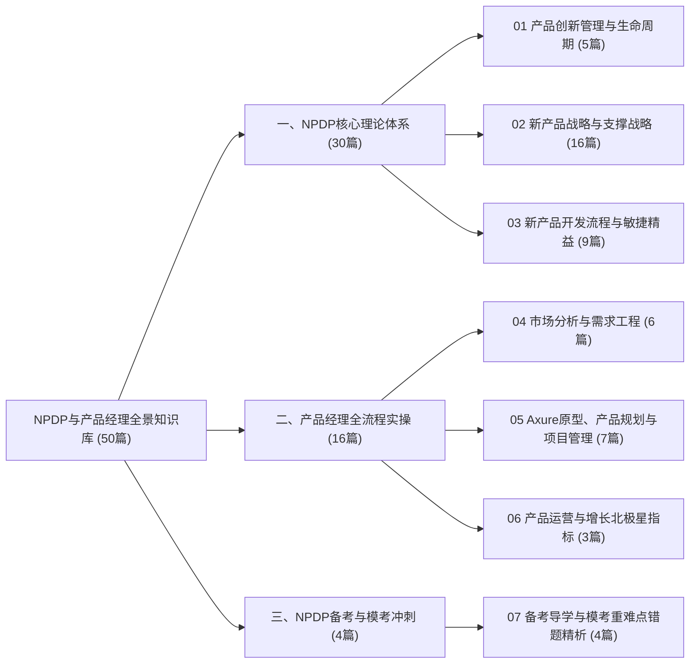

# 00 NPDP 与产品经理知识库总目录（MOC）

> [!IMPORTANT] 知识库结构总览
> 本知识库由 **118 篇**课程原始语音逐字稿（`p03`～`p120`）经同小节合并、去口癖纠错、商业案例保真还原及可视化图表重构而成，共计 **7 大分类模块、50 篇专题精修笔记**：
> * **模块 01～03（NPDP 核心理论精讲）**：共 30 篇，系统覆盖 PDMA 产品创新管理导论、产品生命周期、新产品战略、支撑战略、门径管理（Stage-Gate）、IPD、精益与敏捷开发。
> * **模块 04～06（互联网产品经理全流程实操）**：共 16 篇，覆盖市场与行业分析、需求工程、Axure 9.0 原型设计、产品规划与体验设计五要素、项目研发跟进、产品运营与增长北极星指标。
> * **模块 07（NPDP 备考导学与模考重难点解析）**：共 4 篇，涵盖 NPDP 备考全景导学与期中模考大赛高频错题逐题精析。
> * 🌟 **专题分享与同步答疑讲义（结合 Copy Trading 实战案例）**：[[00_专题分享_从功能PM到商业操盘手的学习心得与答疑手册|00 专题分享：从功能PM到商业操盘手的学习心得与答疑手册（含 Copy Trading 绩效费风控复盘）]]

---

## 📁 01 NPDP导论：产品创新管理与生命周期（5 篇）

1. [[01_NPDP导论_产品创新管理与生命周期/01_1.1-1.2_产品创新管理介绍与核心内涵|01_1.1-1.2 产品创新管理介绍与核心内涵]]（`p03`, `p04`）
2. [[01_NPDP导论_产品创新管理与生命周期/02_1.3-1.4_新产品成功驱动因素与管理产品创新|02_1.3-1.4 新产品成功驱动因素与管理产品创新]]（`p05`, `p06`）
3. [[01_NPDP导论_产品创新管理与生命周期/03_1.5-1.7_产品与项目区别及PDMA产品经理角色|03_1.5-1.7 产品与项目区别及PDMA产品经理角色]]（`p07`, `p08`, `p09`）
4. [[01_NPDP导论_产品创新管理与生命周期/04_1.8-1.10_产品生命周期（PLC）各阶段管理与组合影响|04_1.8-1.10 产品生命周期（PLC）各阶段管理与组合影响]]（`p10`, `p11`, `p12`）
5. [[01_NPDP导论_产品创新管理与生命周期/05_1.11-1.12_跨越鸿沟（产品引入关键阶段）与新产品上市路径|05_1.11-1.12 跨越鸿沟（产品引入关键阶段）与新产品上市路径]]（`p13`, `p14`）

---

## 📁 02 NPDP第一部分：新产品战略（16 篇）

### （一）组织方向与企业/经营战略
1. [[02_NPDP第一部分_新产品战略/1.1-1.2_战略定义、战略与战术区别及战略金字塔层级|1.1-1.2 战略定义、战略与战术区别及战略金字塔层级]]（`p17`～`p20`）
2. [[02_NPDP第一部分_新产品战略/1.3_明确组织方向（愿景、使命、价值观与组织身份认同）|1.3 明确组织方向（愿景、使命、价值观与组织身份认同）]]（`p21`～`p23`）
3. [[02_NPDP第一部分_新产品战略/1.4_公司战略与经营战略（含华为多元战略与诺基亚案例）|1.4 公司战略与经营战略（含华为多元战略与诺基亚案例）]]（`p24`～`p26`）

### （二）创新战略框架与商业模式
4. [[02_NPDP第一部分_新产品战略/1.5_产品创新战略概论与三大战略准备工具（PESTLE、SWOT、德尔菲）|1.5 产品创新战略概论与三大战略准备工具（PESTLE、SWOT、德尔菲）]]（`p27`～`p30`）
5. [[02_NPDP第一部分_新产品战略/1.6_波特竞争战略框架（成本领先、差异化与细分市场）|1.6 波特竞争战略框架（成本领先、差异化与细分市场）]]（`p31`, `p32`）
6. [[02_NPDP第一部分_新产品战略/1.6_商业模式画布（BMC九大模块与亚马逊商业模式案例）|1.6 商业模式画布（BMC九大模块与亚马逊商业模式案例）]]（`p33`, `p34`）
7. [[02_NPDP第一部分_新产品战略/1.7_迈尔斯和斯诺战略框架（探索者、防御者、分析者、反应者）|1.7 迈尔斯和斯诺战略框架（探索者、防御者、分析者、反应者）]]（`p35`）
8. [[02_NPDP第一部分_新产品战略/1.8-1.9_克里斯坦森颠覆式创新与皮萨诺创新景观图|1.8-1.9 克里斯坦森颠覆式创新与皮萨诺创新景观图]]（`p36`～`p39`）

### （三）五大支撑战略与开放式创新
9. [[02_NPDP第一部分_新产品战略/1.12_支撑战略（一）：平台战略及其优势分析|1.12 支撑战略（一）：平台战略及其优势分析]]（`p40`）
10. [[02_NPDP第一部分_新产品战略/1.13-1.14_支撑战略（二）：技术战略、技术预见、S曲线与路线图|1.13-1.14 支撑战略（二）：技术战略、技术预见、S曲线与路线图]]（`p41`～`p45`）
11. [[02_NPDP第一部分_新产品战略/1.15_支撑战略（三）：知识产权战略（类型与战略模式）|1.15 支撑战略（三）：知识产权战略（类型与战略模式）]]（`p46`, `p47`）
12. [[02_NPDP第一部分_新产品战略/1.16_支撑战略（四）：营销战略、价值主张、产品三层次与FAB法则|1.16 支撑战略（四）：营销战略、价值主张、产品三层次与FAB法则]]（`p48`～`p50`）
13. [[02_NPDP第一部分_新产品战略/1.17_产品营销组合（4P理论及4P-4C-4R演变）|1.17 产品营销组合（4P理论及4P-4C-4R演变）]]（`p51`, `p52`）
14. [[02_NPDP第一部分_新产品战略/1.18_波士顿矩阵（BCG产品组合分析）|1.18 波士顿矩阵（BCG产品组合分析）]]（`p53`）
15. [[02_NPDP第一部分_新产品战略/1.19_支撑战略（五）：能力战略（内涵与实施步骤）|1.19 支撑战略（五）：能力战略（内涵与实施步骤）]]（`p54`, `p55`）
16. [[02_NPDP第一部分_新产品战略/1.20_开放式创新与封闭式创新对比|1.20 开放式创新与封闭式创新对比]]（`p56`, `p57`）

---

## 📁 03 NPDP第三部分：新产品开发流程与敏捷精益（9 篇）

1. [[03_NPDP第三部分_新产品开发流程与敏捷精益/3.3_正确决策的基本框架（降低风险）与五WHY寻根法|3.3 正确决策的基本框架（降低风险）与五WHY寻根法]]（`p58`, `p59`）
2. [[03_NPDP第三部分_新产品开发流程与敏捷精益/3.4-3.5_模糊前端（FFE）与产品创新章程（PIC）及演变|3.4-3.5 模糊前端（FFE）与产品创新章程（PIC）及演变]]（`p60`～`p62`）
3. [[03_NPDP第三部分_新产品开发流程与敏捷精益/3.7 & 3.18_博斯六阶段与库珀门径管理流程（Stage-Gate六阶段五关口全解）|3.7 & 3.18 博斯六阶段与库珀门径管理流程（Stage-Gate六阶段五关口全解）]]（`p63`, `p64`, `p84`）
4. [[03_NPDP第三部分_新产品开发流程与敏捷精益/3.9-3.10_罗伊斯瀑布模型与并行工程对比|3.9-3.10 罗伊斯瀑布模型与并行工程对比]]（`p65`, `p66`）
5. [[03_NPDP第三部分_新产品开发流程与敏捷精益/3.11_集成产品开发（IPD模型、基本原则与组织实践层级）|3.11 集成产品开发（IPD模型、基本原则与组织实践层级）]]（`p67`～`p69`）
6. [[03_NPDP第三部分_新产品开发流程与敏捷精益/3.12_精益产品开发全解（丰田TPS、消除浪费、价值流图与看板）|3.12 精益产品开发全解（丰田TPS、消除浪费、价值流图与看板）]]（`p70`～`p74`）
7. [[03_NPDP第三部分_新产品开发流程与敏捷精益/3.13_敏捷开发方法介绍（敏捷模型、用户故事地图、KANO分析与时间盒）|3.13 敏捷开发方法介绍（敏捷模型、用户故事地图、KANO分析与时间盒）]]（`p75`～`p77`）
8. [[03_NPDP第三部分_新产品开发流程与敏捷精益/3.14_敏捷宣言与敏捷十二原则全解|3.14 敏捷宣言与敏捷十二原则全解]]（`p78`～`p80`）
9. [[03_NPDP第三部分_新产品开发流程与敏捷精益/3.15_敏捷Scrum框架（3355体系与PO、Scrum Master、自组织团队三大角色）|3.15 敏捷Scrum框架（3355体系与PO、Scrum Master、自组织团队三大角色）]]（`p81`～`p83`）

---

## 📁 04 产品实操：市场分析与需求工程（6 篇）

1. [[04_产品实操_市场分析与需求工程/1.5_【实操】PEST宏观环境分析实战|1.5 【实操】PEST宏观环境分析实战]]（`p85`）
2. [[04_产品实操_市场分析与需求工程/1.6-1.7_【实操】波特五力竞争分析与产业地图分析|1.6-1.7 【实操】波特五力竞争分析与产业地图分析]]（`p86`, `p87`）
3. [[04_产品实操_市场分析与需求工程/1.8_【实操】市场阶段判断与市场规模测算方法（上+下）|1.8 【实操】市场阶段判断与市场规模测算方法（上+下）]]（`p88`, `p89`）
4. [[04_产品实操_市场分析与需求工程/2.1-2.2_【实操】需求定义与需求四要素（用户、场景、目标、任务）|2.1-2.2 【实操】需求定义与需求四要素（用户、场景、目标、任务）]]（`p90`, `p91`）
5. [[04_产品实操_市场分析与需求工程/2.3_【实操】需求挖掘三大方法（自主分析法、业务驱动法、竞品分析法）|2.3 【实操】需求挖掘三大方法（自主分析法、业务驱动法、竞品分析法）]]（`p92`～`p94`）
6. [[04_产品实操_市场分析与需求工程/2.6_【实操】需求优先级评估三大模型（生命周期、用户金字塔、重要紧急四象限）|2.6 【实操】需求优先级评估三大模型（生命周期、用户金字塔、重要紧急四象限）]]（`p95`～`p97`）

---

## 📁 05 产品实操：Axure原型、产品规划与项目管理（7 篇）

1. [[05_产品实操_Axure原型、产品规划与项目管理/3.1-3.6_【实操】Axure 9.0 原型设计从入门到交互实战（木木老师）|3.1-3.6 【实操】Axure 9.0 原型设计从入门到交互实战（木木老师）]]（`p98`～`p101`）
2. [[05_产品实操_Axure原型、产品规划与项目管理/4.2_【实操】什么是产品规划（上）：产品定位与规划框架|4.2 【实操】什么是产品规划（上）：产品定位与规划框架]]（`p102`）
3. [[05_产品实操_Axure原型、产品规划与项目管理/4.3_【实操】什么是产品规划（下）：健康医疗App虚拟产品规划实战|4.3 【实操】什么是产品规划（下）：健康医疗App虚拟产品规划实战]]（`p103`）
4. [[05_产品实操_Axure原型、产品规划与项目管理/4.8_【实操】如何绘制产品蓝图|4.8 【实操】如何绘制产品蓝图]]（`p104`）
5. [[05_产品实操_Axure原型、产品规划与项目管理/5.3-5.6_【实操】产品设计总流程与用户体验要素（战略层、范围层、架构层）|5.3-5.6 【实操】产品设计总流程与用户体验要素（战略层、范围层、架构层）]]（`p105`～`p108`）
6. [[05_产品实操_Axure原型、产品规划与项目管理/6.1-6.2_【实操】项目管理与风险应对规划及产品管理vs项目管理区别|6.1-6.2 【实操】项目管理与风险应对规划及产品管理vs项目管理区别]]（`p109`, `p110`）
7. [[05_产品实操_Axure原型、产品规划与项目管理/6.7-6.8_【实操】需求宣讲、确认资源排期、测试用例评审与开发进度跟踪|6.7-6.8 【实操】需求宣讲、确认资源排期、测试用例评审与开发进度跟踪]]（`p111`, `p112`）

---

## 📁 06 产品实操：产品运营与增长北极星指标（3 篇）

1. [[06_产品实操_产品运营与增长北极星指标/7.1-7.3_【实操】产品运营的价值、基本概念与T型产品人才发展|7.1-7.3 【实操】产品运营的价值、基本概念与T型产品人才发展]]（`p113`～`p115`）
2. [[06_产品实操_产品运营与增长北极星指标/7.4_【实操】运营人思维与产品人思维的核心区别|7.4 【实操】运营人思维与产品人思维的核心区别]]（`p116`）
3. [[06_产品实操_产品运营与增长北极星指标/7.11-7.12_【实操】找到业务方向：如何制定北极星指标与指标分解优化|7.11-7.12 【实操】找到业务方向：如何制定北极星指标与指标分解优化]]（`p117`, `p118`）

---

## 📁 07 NPDP备考导学与模考重难点解析（4 篇）

1. [[07_NPDP备考导学与模考重难点解析/01_NPDP精髓班备考导学课（上）：产品经理视野格局与NPDP七大领域全景|01 NPDP精髓班备考导学课（上）：产品经理视野格局与NPDP七大领域全景]]（`p15`）
2. [[07_NPDP备考导学与模考重难点解析/02_NPDP精髓班备考导学课（下）：课程学习路径与应试通关方法|02 NPDP精髓班备考导学课（下）：课程学习路径与应试通关方法]]（`p16`）
3. [[07_NPDP备考导学与模考重难点解析/03_NPDP期中模考大赛重难点讲解（上）：考情分析与第一章战略高频错题精析|03 NPDP期中模考大赛重难点讲解（上）：考情分析与第一章战略高频错题精析]]（`p119`）
4. [[07_NPDP备考导学与模考重难点解析/04_NPDP期中模考大赛重难点讲解（下）：组合管理、流程与工具高频考点及错题精析|04 NPDP期中模考大赛重难点讲解（下）：组合管理、流程与工具高频考点及错题精析]]（`p120`）
