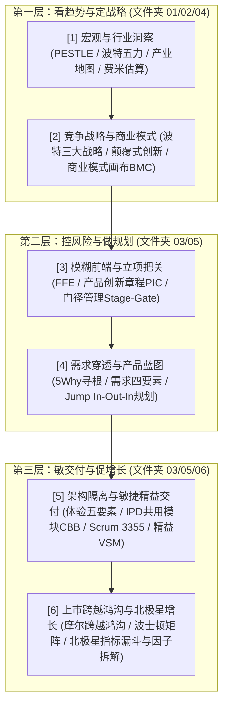
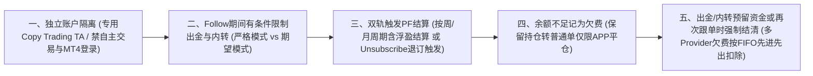

# 专题分享：从“画原型接需求”到“懂战略拿结果”——NPDP 体系与产品实战深度复盘（含 Copy Trading 实战案例）

> [!IMPORTANT] 分享导语（开场 1 分钟破冰话术）
> 大家好！这次我系统学完了 **118 节 NPDP 产品创新管理与互联网产品经理全流程实操课**，并整理成了 **7 大模块、50 篇体系化笔记**（总目录见 [[00_NPDP与产品经理知识库总目录（MOC）|00 NPDP与产品经理知识库总目录（MOC）]]）。
> 以前我们做产品，很容易陷入“业务提个需求 $\rightarrow$ 画原型写 PRD $\rightarrow$ 催开发上线”的工具人循环。但这门课带给我最大的认知重构是：**产品经理在小公司里其实就是老板的替身（没有授权的小 CEO）**。今天我想结合这套方法论，以及咱们自己正在做的 **Copy Trading（跟单交易账户与防恶意套绩效费方案）** 真实案例，跟大家分享三个部分：**① 顶层认知重构、② 一线落地实战复盘、③ 10 个日常高频痛点的同步答疑**。

---

## 第一篇：破局与认知重构——为什么学完这门课，我看产品和业务的眼光变了？

> 📌 **本篇对应支撑笔记**：
> * [[01_NPDP导论_产品创新管理与生命周期/03_1.5-1.7_产品与项目区别及PDMA产品经理角色|03_1.5-1.7 产品与项目区别及PDMA产品经理角色]]
> * [[07_NPDP备考导学与模考重难点解析/01_NPDP精髓班备考导学课（上）：产品经理视野格局与NPDP七大领域全景|01 NPDP备考导学课（上）：产品经理三维能力模型与七大领域]]
> * [[01_NPDP导论_产品创新管理与生命周期/01_1.1-1.2_产品创新管理介绍与核心内涵|01_1.1-1.2 产品创新管理介绍与核心内涵]]

### 1.1 心得一：打破“工具人”困境——产品经理 vs. 项目经理的本质分野
* **产品经理的真实起源**：在初创小公司里没有产品经理，因为**老板本人就是唯一的产品经理**（管资金、选赛道、盯研发、卖向市场赚钱）。当业务大到老板管不过来时，帮老板对“端到端商业结果”负责的人，才是产品经理。
* **核心金句**：
  * **项目管理（PMP）**关注的是**“如何把事做正确（Do things right）”**——在给定的时间、成本、范围铁三角内把版本交付上线；
  * **产品管理（NPDP）**首先关注的是**“做正确的事（Do the right things）”**——方向错了，研发越快、代码越完美，公司亏得越惨。

### 1.2 心得二：一张全景图打通“西方 NPDP 理论”与“互联网产品实操”
很多人觉得 NPDP 理论高大上、离日常画原型很远。其实把这 50 篇笔记拉通来看，**NPDP 的顶层设计与我们日常的需求挖掘、蓝图规划、敏捷迭代是严丝合缝的上下游咬合关系**：

---

## 第二篇：顶层视野篇——用“商业模式与平台思维”审视业务

> 📌 **本篇对应支撑笔记**：
> * [[02_NPDP第一部分_新产品战略/1.6_波特竞争战略框架（成本领先、差异化与细分市场）|1.6 波特竞争战略框架（成本领先、差异化与细分市场）]]
> * [[02_NPDP第一部分_新产品战略/1.6_商业模式画布（BMC九大模块与亚马逊商业模式案例）|1.6 商业模式画布（BMC九大模块与亚马逊商业模式案例）]]
> * [[02_NPDP第一部分_新产品战略/1.12_支撑战略（一）：平台战略及其优势分析|1.12 支撑战略（一）：平台战略及其优势分析]]
> * [[03_NPDP第三部分_新产品开发流程与敏捷精益/3.4-3.5_模糊前端（FFE）与产品创新章程（PIC）及演变|3.4-3.5 模糊前端（FFE）与产品创新章程（PIC）]]

### 2.1 武器一：战略取舍——为什么不能靠单纯低价或纵容套利留客？
* **课程理论与数据铁证**：在 [[02_NPDP第一部分_新产品战略/1.6_波特竞争战略框架（成本领先、差异化与细分市场）|1.6 波特竞争战略]] 中有一组震撼数据：苹果仅占全球手机 **13%** 份额却拿走 **66%** 利润；而成本领先（低价）策略最大的软肋是**“价格敏感型羊毛党毫无忠诚度”**（如李佳琦/薇娅直播间因欧莱雅官网破价瞬间反目）。
* **对我们业务的启示**：如果平台存在机制漏洞被“羊毛党/套利者”钻空子，短期看似乎留住了几个活跃账户，长期看却会摧毁真正贡献核心价值的优质用户生态。

### 2.2 武器二：商业模式画布（BMC）与双边市场飞轮
* 在 [[02_NPDP第一部分_新产品战略/1.6_商业模式画布（BMC九大模块与亚马逊商业模式案例）|1.6 商业模式画布]] 与 [[05_产品实操_Axure原型、产品规划与项目管理/4.3_【实操】什么是产品规划（下）：健康医疗App虚拟产品规划实战|4.3 产品规划生态角色]] 中强调：平台型产品的核心不是单点功能，而是**多角色之间的利益分配与生态飞轮**。一旦供给侧（如淘宝的优质卖家、Copy Trading 的优质信号源 Provider）利益受损，整个双边市场就会坍塌。

---

## 第三篇：个人实战深度复盘——用课程方法论拆解《Copy Trading 防恶意逃避绩效费账户方案》

> 📌 **本篇对应支撑笔记**：
> * [[03_NPDP第三部分_新产品开发流程与敏捷精益/3.3_正确决策的基本框架（降低风险）与五WHY寻根法|3.3 正确决策的基本框架与五WHY寻根法]]
> * [[04_产品实操_市场分析与需求工程/2.1-2.2_【实操】需求定义与需求四要素（用户、场景、目标、任务）|2.1-2.2 需求定义与需求四要素（用户、场景、目标、任务）]]
> * [[05_产品实操_Axure原型、产品规划与项目管理/4.8_【实操】如何绘制产品蓝图|4.8 如何绘制产品蓝图]]
> * [[05_产品实操_Axure原型、产品规划与项目管理/5.3-5.6_【实操】产品设计总流程与用户体验要素（战略层、范围层、架构层）|5.3-5.6 产品设计总流程与用户体验要素（战略层、范围层、架构层）]]

### 3.1 业务痛点背景（真实案例）
在我们的 **Copy Trading（跟单交易）** 业务中，曾面临一个棘手的业务痛点：
* **表象问题**：由于 Follower（跟单者）需缴纳的绩效费（Performance Fee, PF）是由三方平台进行扣款与分润，部分投机 Follower 会**恶意套取/逃避绩效费**——比如在周期结算支付绩效费的前 1 天，Follower 突然把账户里的所有余额全部出金（或内转走），导致结算时账户余额为 0，Provider（交易员/信号源）收不到应收的绩效分润。

### 3.2 第一步：用“5Why 寻根法 + 商业模式飞轮”穿透问题本质
如果只用“功能思维”看，这只是一个“三方扣款失败”的边缘异常；但用我们课程学的 **[[03_NPDP第三部分_新产品开发流程与敏捷精益/3.3_正确决策的基本框架（降低风险）与五WHY寻根法|5Why 寻根法]]** 与 **[[02_NPDP第一部分_新产品战略/1.6_商业模式画布（BMC九大模块与亚马逊商业模式案例）|双边市场商业模式]]** 往深处推演：
1. **Why 1（财务表象）**：为什么 Provider 收不到绩效费？$\rightarrow$ 因为结算日三方平台扣款时，Follower 账户 Balance 被提空了。
2. **Why 2（系统机制）**：为什么 Follower 能在有利润待结算时把钱提空？$\rightarrow$ 因为**三方平台的分润结算周期**与**我方平台的出金/内转风控规则**存在跨系统时间差与状态割裂。
3. **Why 3（账户架构）**：为什么不在原主交易账户（普通 TA）上直接锁死出金？$\rightarrow$ 因为普通 TA 混杂了用户的“自主交易资金”和“跟单交易资金”，一刀切锁死会严重误伤用户的正常自主交易与资金流动性！
4. **Why 4（战略级危害）**：如果不根治这个问题会发生什么？$\rightarrow$ 头部优质 Provider 辛辛苦苦带单盈利却被恶意白嫖，必然大批流失去竞品平台；而没有了优质 Provider，Follower 也就没有了跟单标的——**保护 Provider 的合法分润权，本质上就是保护 Copy Trading 商业飞轮的供给侧生命线！**

### 3.3 第二步：用“用户体验五要素（战略层 $\rightarrow$ 范围层 $\rightarrow$ 架构层）”重构解决方案
对照我们在 [Copy Trading 账户-方案](https://accountplan-poster.lovable.app/) 中设计的完整蓝图，每一个模块都是课程方法论的标准落地：

#### （1）架构层破局：建立“独立 Copy Trading 专用账户边界”
* **设计决策**：客户参与跟单必须使用**独立的 TA（Copy Trading 账户）**，普通 TA 可向其内转入金，但 Copy Trading 账户之间互不可内转；且该账户**严禁客户自主交易、严禁登录 MT4/MT5**（不发给客户 MT4/MT5 交易密码）。
* **方法论映射**：对应 [[05_产品实操_Axure原型、产品规划与项目管理/5.3-5.6_【实操】产品设计总流程与用户体验要素（战略层、范围层、架构层）|5.3-5.6 产品设计总流程与用户体验要素（战略层、范围层、架构层）]]：
  * **初阶 PM（0~3 年）看框架层，高阶 PM（3~5 年）看架构层**：课程中对比了**“微信底部 4 个 Tab 十年不变却能无缝长出朋友圈、小程序、视频号”**（高内聚、高扩展性架构）与**“部分 App 缺乏顶层架构导致每次加新业务就推翻重改、用户认知成本剧增”**的反差；
  * 同理，在 Copy Trading 中通过**底层账户的物理隔离（独立专用 TA）**，既保证了跟单净值核算 100% 纯净不被自主交易污染，又让风控规则只精准作用于跟单资金池，为未来扩展更多跟单策略模式预留了最干净的顶层架构骨架！

#### （2）范围层与 MVP 梯度设计：“严格限制” vs “期望限制”的权衡
* 在限制出金/内转规则上，我们没有只给死板的一套方案，而是运用 [[03_NPDP第三部分_新产品开发流程与敏捷精益/3.13_敏捷开发方法介绍（敏捷模型、用户故事地图、KANO分析与时间盒）|3.13 故事地图纵向切片思维]] 区分了刚性底线与精细化体验：

| 风控维度 | 具体业务规则设计 | 产品设计考量（安全 vs 体验平衡） |
| :--- | :--- | :--- |
| **严格限制（底线方案）** | Follow 期间，**一律不允许内转和出金** | 研发成本最低、风控最绝对，但牺牲了无欠费用户的资金灵活性 |
| **期望限制（精细化方案）** | 1. **有待结算绩效费**（周期内有持仓&已平仓复制单）：**禁止内转&出金** 2. **无待结算但有历史欠费**：允许内转&出金，但**必须预留资金结清欠费** 3. **无待结算也无欠费**：允许自由内转&出金 | 精准锁定“有利润待分润”和“有欠费”两类风险态，对正常无欠费用户 0 打扰 |
| **系统限制（并发幂等防呆）** | 1. **费用结算中**（计算、分润完成前）：锁死内转和出金 2. **结算失败/超时**：系统自动重新发起 | 彻底堵死“利用三方接口结算耗时几秒钟的并发窗口期抢先提现”的技术漏洞 |

#### （3）全链路状态机闭环：把“浮动盈亏（Floating PnL）”与“退订（Unsubscribe）”算进闭环
为什么很多初级产品方案上线后还会漏？因为没考虑**“用户不提现，但故意在结算前退订（Unsubscribe）或扛着浮盈不平仓”**的边缘博弈！我们在方案中做了严密的双轨闭环：
1. **周期结算（周/月）**：计算绩效费时**必须包含浮动盈亏（floating PnL）**，防止用户靠“浮盈不平仓”逃避周期分润。
2. **Unsubscribe（主动退订）双分支处理**：
   * **分支 A（立即平仓）**：系统立即平仓全部复制单，实时核算绩效费并分润给 Provider。
   * **分支 B（保留持仓——最复杂的极端场景兜底）**：
     * 即便用户选择“退订但保留持仓”，系统依然在 Unsubscribe 时间点按 **equity PnL（含 floating PnL）** 强制核算一次绩效费！
     * **若此时现金 Balance 不足扣款**（因为利润还在浮盈持仓里未变现），系统自动记为**“欠费（Debt）”**；
     * 同时将该持仓复制单转为**“普通订单”**，且由于用户没有 MT4/MT5 密码，**只能在 TMGM-APP 内手动平仓**（资金依然逃不出平台闭环！）。
3. **结清规则与 FIFO（先进先出）清偿正义**：
   * 只要该客户后续在 Copy Trading 账户发起内转/出金，或者想**再次跟单同一个 Provider**，系统强制拦截并扣除预留欠费；
   * 如果该 Follower 先后欠了多个 Provider 的绩效费，扣款按 **FIFO（按欠费产生时间先后顺序）** 依次清偿，保障先提供服务的 Provider 优先拿钱。

> [!TIP] 分享总结金句（Copy Trading 案例升华）
> 大家看，如果只做“需求传话筒”，遇到“Follower 提现逃避绩效费”，可能只会想到“提现时弹窗提醒一下”或者“全部禁提现”。但当我们用 **NPDP 商业模式生态思维 + 架构层账户隔离 + 全状态机（含浮盈、退订保留持仓记欠费、FIFO 清偿）** 来做顶层设计时，交付出来的就是一份兼顾**供给侧利益、用户体验与风控滴水不漏**的专业级产品架构方案！

---

## 第四篇：同步答疑专区（10 个分享会高频痛点 & 标准拆解回答）

以下 10 个问答专为分享会互动环节准备，均已关联知识库对应笔记：

### Q1【战略与执行】：我们只是执行层/中层产品经理，公司战略都是老板定的，学“战略、波特模型、波士顿矩阵”对日常画原型写 PRD 有什么实际用处？
* **一句话破题**：不懂战略的产品经理只能做“接需求的画图匠”，懂战略才能拥有**“需求否决权”**和**“资源争取权”**。
* **对应笔记**：[[07_NPDP备考导学与模考重难点解析/01_NPDP精髓班备考导学课（上）：产品经理视野格局与NPDP七大领域全景|01 NPDP备考导学课（上）]]、[[02_NPDP第一部分_新产品战略/1.1-1.2_战略定义、战略与战术区别及战略金字塔层级|1.1-1.2 战略金字塔层级]]、[[02_NPDP第一部分_新产品战略/1.18_波士顿矩阵（BCG产品组合分析）|1.18 波士顿矩阵]]
* **答疑话术**：
  1. **向上听懂老板意图，向下过滤伪需求**：当你知道当前产品在公司波士顿矩阵（BCG）中是**“现金牛”**（低增长高份额，核心是稳住利润、严控大额研发投入）还是**“明星/问题产品”**（高增长，核心是抢份额跨越鸿沟），业务方提一个耗时两个月的重度重构需求给“现金牛”产品时，你就能直接站在公司资源配置（组合管理战略协同）的高度拒绝他，而不是陷入功能细节扯皮。
  2. **指导产品设计取舍（战略层决定范围层）**：就像我们的 Copy Trading 方案，唯有理解“维护 Provider 供给侧生态”是平台战略层的生命线，才能推导出范围层对恶意出金的零容忍锁控。

---

### Q2【伪需求识别】：业务方或老板直接过来要一个具体功能（比如“赶紧抄竞品的红包功能”或“后台加个全量导出按钮”），怎么判断是不是伪需求？怎么优雅地接招？
* **一句话破题**：用户和业务方说的往往是**“他自己想出来的解决方案（Task）”**，而不是**“背后的真实问题与目标（Goal）”**。用**“需求四要素 + 5Why 寻根 + 场景匹配度”**三步拆解。
* **对应笔记**：[[04_产品实操_市场分析与需求工程/2.1-2.2_【实操】需求定义与需求四要素（用户、场景、目标、任务）|2.1-2.2 需求定义与四要素]]、[[04_产品实操_市场分析与需求工程/2.3_【实操】需求挖掘三大方法（自主分析法、业务驱动法、竞品分析法）|2.3 需求挖掘三大方法]]、[[05_产品实操_Axure原型、产品规划与项目管理/5.3-5.6_【实操】产品设计总流程与用户体验要素（战略层、范围层、架构层）|5.3-5.6 产品设计范围层（福特跑车悖论）]]
* **答疑话术**：
  1. **警惕“电钻与打洞”陷阱 & 福特跑车马力悖论（范围层核心教训）**：课程 [[05_产品实操_Axure原型、产品规划与项目管理/5.3-5.6_【实操】产品设计总流程与用户体验要素（战略层、范围层、架构层）|5.5 范围层]] 讲了一个经典惨案——某畅销跑车第一代极速 180 迈，调研时车主都说“喜欢它跑得快”；研发团队第二代盲目把极速拉到 250 迈并做了极致流线降噪，结果**销量暴跌**！因为用户嘴上说的“要速度”，潜意识真正要的是**“推背感与排气管轰鸣的肾上腺素刺激”**。软件产品也一样，盲目按用户字面要求堆砌按钮，只会摧毁核心体验。
  2. **对付业务方提“功能指令”（还原需求四要素：用户、场景、目标、任务）**：业务方说“给我做个订单全量导出 Excel 功能”，连问三个“为什么”（5Why 法）发现他只是想看“每周各渠道取消订单的占比”。直接在后台现有报表加一个统计字段，半天就解决了他的目标（Goal），省去一周导出开发与数据泄露风险。
  3. **对付盲目照搬竞品（警惕场景失配惨案）**：当年共享单车搞“红包车”（用户多走 200 米骑偏远车给红包）大获成功；某共享充电宝团队盲目照抄“红包充电宝”结果被骂惨——因为骑车是宽裕休闲场景，而借充电宝是手机剩 1% 电量的**极度焦虑救急场景**，弹窗发红包反而阻碍借电核心链路！

---

### Q3【排期冲突仲裁】：手头同时塞过来 5 个“都很紧急”的需求（线上故障、老板临时想法、运营大促活动、常规迭代、技术重构），怎么排优先级才让人心服口服？
* **一句话破题**：告别“谁嗓门大听谁的”，用 **“产品生命周期阶段 + 用户使用金字塔 + 重要紧急四象限”** 三层漏斗建立透明的仲裁规则。
* **对应笔记**：[[04_产品实操_市场分析与需求工程/2.6_【实操】需求优先级评估三大模型（生命周期、用户金字塔、重要紧急四象限）|2.6 需求优先级评估三大模型]]、[[03_NPDP第三部分_新产品开发流程与敏捷精益/3.13_敏捷开发方法介绍（敏捷模型、用户故事地图、KANO分析与时间盒）|3.13 KANO模型与故事地图]]
* **答疑话术**：
  1. **第一层滤网（用户使用金字塔底线原则）**：金字塔从底到顶依次是 **可用（能用）$\rightarrow$ 易用 $\rightarrow$ 体验 $\rightarrow$ 商业 $\rightarrow$ 传播**。任何导致核心交易/出入金/分润阻断的底层“可用性或资金安全故障”（对应 KANO 基本型需求），永远是 **P0 最高优**。
  2. **第二层滤网（产品所处生命周期阶段）**：导入期一切围绕“跑通核心 MVP 闭环”排最前；成长期/成熟期直接拉动**北极星指标**和核心营收转化的需求优先。
  3. **第三层滤网（资源置换与方案降级）**：产研资源池是固定的（管道平衡）。如果业务方强行插队一个紧急需求，必须拉齐干系人公开做**“等量资源置换”**（插队 A 就必须顺延同工时的 B），或像 Copy Trading 资金限制那样先上“严格限制（一刀切禁出金）”快速止血，二期再迭代“期望限制（预留欠费精细化出金）”。

---

### Q4【从 0 到 1 规划】：接到一个新业务线或大改版，面对各部门访谈出来的“一地碎片”诉求，第一步该怎么做出清晰的产品规划（Roadmap）？
* **一句话破题**：用 **“Jump In（跳入细节）$\rightarrow$ Jump Out（跳出细节）$\rightarrow$ Jump In（跳回验证）”三段论**，围绕**“目标（Goal）、主线（Backbone）、节奏（Rhythm）”**三要素收拢碎片。
* **对应笔记**：[[05_产品实操_Axure原型、产品规划与项目管理/4.2_【实操】什么是产品规划（上）：产品定位与规划框架|4.2 什么是产品规划（上）]]、[[05_产品实操_Axure原型、产品规划与项目管理/4.3_【实操】什么是产品规划（下）：健康医疗App虚拟产品规划实战|4.3 什么是产品规划（下）]]、[[05_产品实操_Axure原型、产品规划与项目管理/4.8_【实操】如何绘制产品蓝图|4.8 如何绘制产品蓝图]]
* **答疑话术**：
  1. **第一步 Jump In（收集碎片并辨伪）**：深入各部门访谈拿到原始诉求，先剔除违背合规和脱离企业能力边界的伪需求。
  2. **第二步 Jump Out（聚类抽象画蓝图）**：跳出单个功能点，用两大蓝图模型归拢碎片——**按角色与交易链路讲故事**（比如 Copy Trading 中梳理 `账户边界 -> 资金限制 -> 结算退出 -> 欠费 FIFO 结清` 四大模块），或**按需求共通性归聚**。
  3. **第三步 定节奏（Roadmap 权衡）**：划分 V1.0 / V2.0 / V3.0，最后拿概念蓝图（如我们的海报级方案图）跳回细节（Jump In）找业务、风控、研发反向验证闭环。

---

### Q5【研发扯皮应对】：在需求宣讲/评审会上，开发经常质疑需求价值、或者报出虚高工期（比如一个小改动报 2 周），产品经理怎么控场？
* **一句话破题**：会前找技术 Leader 提前对齐探底，会上用**“业务背景与数据目标”**压阵，遇虚高工期用**“颗粒度拆解 + 历史模块复用对标”**破局。
* **对应笔记**：[[05_产品实操_Axure原型、产品规划与项目管理/6.7-6.8_【实操】需求宣讲、确认资源排期、测试用例评审与开发进度跟踪|6.7-6.8 需求宣讲、排期与进度跟踪]]
* **答疑话术**：
  1. **会前“私下通气”**：正式需求宣讲会前，先拉研发组长/架构师花 15 分钟过一遍核心方案（比如 Copy Trading 的 Unsubscribe 保留持仓转普通单逻辑），提前把技术死胡同改掉并摸清合理工期底牌。
  2. **会上遭遇“工期虚高水分”**：请开发**按前后端、接口、状态机把颗粒度拆细到以‘天/半天’为单位**，并追问：“入金和出金基础校验是不是可以直接复用线上已有的 TA 出入金模块（IPD 的 CBB 共用模块思想），只叠加一层‘预留欠费校验’？”一旦拆细到日颗粒度并剥离复用层，水分自然挤干。
  3. **死守两条红线**：会后立即发纪要锁定排期；进入开发测试阶段后**严禁私下口头静默改 PRD**（必须同步测试修改测试用例）。

---

### Q6【流程选型困惑】：门径管理（Stage-Gate）、瀑布模型、敏捷 Scrum、精益开发、集成产品开发（IPD），这几种流程到底怎么选？它们冲突吗？
* **一句话破题**：**绝不冲突，而是“宏观治理”与“微观执行”的嵌套关系**——宏观投资把关用门径/IPD，微观软件迭代用敏捷 Scrum，全流程提效用精益消除浪费。
* **对应笔记**：[[03_NPDP第三部分_新产品开发流程与敏捷精益/3.7 & 3.18_博斯六阶段与库珀门径管理流程（Stage-Gate六阶段五关口全解）|3.7 & 3.18 门径管理流程]]、[[03_NPDP第三部分_新产品开发流程与敏捷精益/3.11_集成产品开发（IPD模型、基本原则与组织实践层级）|3.11 集成产品开发IPD]]、[[03_NPDP第三部分_新产品开发流程与敏捷精益/3.15_敏捷Scrum框架（3355体系与PO、Scrum Master、自组织团队三大角色）|3.15 敏捷Scrum框架]]
* **答疑话术**：
  1. **按“需求确定性 & 变更代价”选型**：涉及底层资金清结算、风控账本（错一分钱都出大事，需求边界极其明确）适合偏严谨的阶段关口评审；而前端社区互动、榜单展示适合 **敏捷 Scrum** 小步快跑。
  2. **“俄罗斯套娃”组合拳**：
     * **宏观投资把关（Stage-Gate 门径管理）**：重点守住 **“关口 3（进入开发 Go to Development）”这一重资产投入分水岭**！把关者（Gatekeepers）在关口会议上依据硬性准则做出 **通过（Go）、终止（Kill）、搁置（Hold）、重做（Recycle）** 四大裁决，把烂项目扼杀在烧钱之前；
     * **微观研发冲刺（Scrum 3355 体系）**：在阶段 3 开发内部，厘清三大角色边界——**PO（产品负责人）做“代言人、掌舵者、验收者”**（独占 Backlog 商业价值排序权与 DoD 验收权），**Scrum Master（敏捷教练）做“催化剂、老母鸡、布道者”**（帮团队挡掉外部打扰与文山会海），**自组织团队（3~9 人/两个披萨原则、T 型专职人才）**采用集中办公（渗透式沟通）或异地虚拟办公（鱼缸窗口 + 远程结队）高效交付增量，并用 **精益价值流图（VSM）** 消除跨部门等待浪费。

---

### Q7【冷启动与跨越鸿沟】：新产品/新功能上线后，第一批种子用户用得很嗨，但推广到主流大众市场时突然增长停滞了，怎么破局？
* **一句话破题**：你掉进了杰弗里·摩尔说的**“死亡鸿沟（The Chasm）”**——因为早期尝鲜者买的是“炫酷概念”，而早期大众买的是**“零风险、开箱即用的完整产品包（Whole Product）”**！
* **对应笔记**：[[01_NPDP导论_产品创新管理与生命周期/05_1.11-1.12_跨越鸿沟（产品引入关键阶段）与新产品上市路径|05_1.11-1.12 跨越鸿沟与新产品上市路径]]、[[02_NPDP第一部分_新产品战略/1.16_支撑战略（四）：营销战略、价值主张、产品三层次与FAB法则|1.16 营销战略、产品三层次与FAB法则]]
* **答疑话术**：
  1. **抢滩战略（Beachhead Strategy / 保龄球道法则）**：不要漫天撒网，先死磕一个痛点最痛的垂直细分客群（打倒第一颗主球瓶），树立真实盈利标杆。
  2. **交付“完整产品包（Whole Product）”**：早期极客愿意自己研究复杂的 MT4/MT5 参数配置，但主流大众（Follower）嫌麻烦、怕被坑。所以我们要提供“一键跟单、独立账户自动隔离、TMGM-APP 内一键平仓、透明分润账单”的傻瓜级完整体验，并用 **FABE 法则**（Feature 特征 $\rightarrow$ Advantage 优势 $\rightarrow$ Benefit 收益 $\rightarrow$ Evidence 历史实盘证据）做转化说服。

---

### Q8【产运协同矛盾】：产品觉得运营整天提临时杂活破坏系统架构，运营觉得产品闭门造车做出来的东西没转化，怎么化解产运互怼？
* **一句话破题**：产品经理必须从“单一功能思维”升维到**“T 型/$\pi$ 型产运一体思维”**——在产品设计阶段就把“运营抓手与增长钩子”内嵌进去。
* **对应笔记**：[[06_产品实操_产品运营与增长北极星指标/7.1-7.3_【实操】产品运营的价值、基本概念与T型产品人才发展|7.1-7.3 产品运营的价值与T型人才]]、[[06_产品实操_产品运营与增长北极星指标/7.4_【实操】运营人思维与产品人思维的核心区别|7.4 运营人思维与产品人思维的核心区别]]
* **答疑话术**：
  1. **理解双方底层思维差异**：产品人追求系统的**抽象性、风控严密性与长期稳定**；运营人追求**连接效率、短期激励催化与转化率**。
  2. **把高频运营动作“配置化/机制化”**：把运营高频调整的分润比例、结算周期（周/月）、榜单推荐规则做成后台灵活配置；同时在立项第一天就拉运营对齐同一个北极星转化目标。

---

### Q9【数据指标虚荣】：团队每天汇报 DAU、注册量都在涨，但业务就是不赚钱或者老用户流失严重，怎么用“北极星指标”扭转局面？
* **一句话破题**：砍掉只看规模的“虚荣指标”，用**“四维评估模型”**重新锚定能代表**“用户真正获得核心价值”**的北极星指标，并用**“漏斗法 + 因子拆解法”**找到出血点。
* **对应笔记**：[[06_产品实操_产品运营与增长北极星指标/7.11-7.12_【实操】找到业务方向：如何制定北极星指标与指标分解优化|7.11-7.12 如何制定北极星指标与指标分解优化]]
* **答疑话术**：
  1. **告别虚荣指标**：就像 YouTube 把北极星指标从 WAU 改为“总观看时长”一样，在 Copy Trading 业务中，单纯看“浏览信号源人数”或“开立跟单账户数”是虚荣指标，真正代表双边生态健康度的核心指标是 **“有效跟单净入金规模 / 成功结算分润的活跃跟单交易量”**。
  2. **漏斗拆解与因子下钻**：
     * **全链路漏斗拆解**：`浏览策略池 -> 点击跟随 -> 开立独立 Copy Trading TA -> 内转入金 -> 首笔跟单成交 -> 周期正向盈利并完成 PF 分润`。
     * **因子公式拆解**：`平台分润总收益 = 活跃 Provider 数 × 人均吸引 Follower 数 × 人均跟单本金 × 策略盈利率 × 绩效费成功扣款率`。我们这次做《Copy Trading 账户方案》，本质上就是把公式最后一项**“绩效费成功扣款率”从漏洞百出拉升到接近 100%**，从而反哺第一项“活跃优质 Provider 留存”！

---

### Q10【NPDP 备考与自学经验】：如果团队同事也想考 NPDP 认证（或高效啃下这 50 篇笔记），有什么最快通关的秘籍和审题避坑法则？
* **一句话破题**：抓大放小死磕**“战略（20%）+ 流程（15%）+ 生命周期（20%）”**三大分值巨头，坚持**“自己画一遍思维导图”**，考场善用**“问大选大、三同排异”**审题技巧。
* **对应笔记**：[[07_NPDP备考导学与模考重难点解析/02_NPDP精髓班备考导学课（下）：课程学习路径与应试通关方法|02 备考导学课（下）]]、[[07_NPDP备考导学与模考重难点解析/03_NPDP期中模考大赛重难点讲解（上）：考情分析与第一章战略高频错题精析|03 模考重难点讲解（上）]]、[[07_NPDP备考导学与模考重难点解析/04_NPDP期中模考大赛重难点讲解（下）：组合管理、流程与工具高频考点及错题精析|04 模考重难点讲解（下）]]
* **答疑话术**：
  1. **心法一：精准抓分值权重**：NPDP 全卷 200 道单选题（答对 150 题 / 75% 通过）。其中**第一章（战略 20%）、第七章（生命周期 20%）、第三章（流程 15%）**三章占了 **55%（110道题）**，先把我们知识库里的文件夹 01、02、03 吃透就稳了一大半。
  2. **心法二：四大项目类型题眼秒杀**：看到“与现有产品大相径庭”秒选**突破型**；看到“共用架构”秒选**平台型**；看到“填补产品线空白带来新收入”秒选**衍生型**；看到“为已售老客户提供配套软件/修补缺陷”秒选**支持型**。
  3. **心法三：四大高频反直觉易错点**：
     * 技术 S 曲线只有引入、成长、成熟三阶段，**没有衰退期**（而产品生命周期 PLC 有衰退期）；
     * 模糊前端之所以叫“模糊”，是因为**最终的产品概念是模糊的**；
     * 产品创新章程（PIC）只回答 5 个 W，**绝不回答 How（怎么做）**；
     * 门径管理中，具体的**产品定价与成本信息**法定是在**阶段 3（开发阶段）**最终确定的！

---

## 附：专题分享控场速查表（Cheat Sheet）

| 分享环节 | 建议时长 | 核心抓手与金句 | 现场演示可点开的 Obsidian 笔记 |
| :--- | :---: | :--- | :--- |
| **开场破冰与认知升维** | 8 分钟 | “小公司老板就是唯一的产品经理”、“PMP 把事做正确 vs NPDP 做正确的事” | [[00_NPDP与产品经理知识库总目录（MOC）\|00 知识库总目录（展示全景图）]] |
| **顶层战略与商业飞轮** | 10 分钟 | 苹果 13% 份额占 66% 利润、李佳琦欧莱雅破价反目、亚马逊黑五冗余算力孵化 AWS | [[02_NPDP第一部分_新产品战略/1.6_波特竞争战略框架（成本领先、差异化与细分市场）\|1.6 波特竞争战略]]、[[02_NPDP第一部分_新产品战略/1.6_商业模式画布（BMC九大模块与亚马逊商业模式案例）\|1.6 商业模式画布]] |
| **Copy Trading 实战复盘** | 15 分钟 | 5Why 穿透双边生态危机 $\rightarrow$ 独立 TA 架构隔离 $\rightarrow$ 严格/期望两档限制 $\rightarrow$ 含浮盈退订记欠费 + FIFO 清偿 | 本篇第三章流程图 + [Copy Trading 账户方案海报](https://accountplan-poster.lovable.app/) |
| **互动同步答疑（Q1~Q10）** | 15~20 分钟 | 需求四要素、用户使用金字塔、Jump In/Out 蓝图法、北极星指标因子公式 | 按听众提问直接定位本篇第四章 Q1～Q10 |
