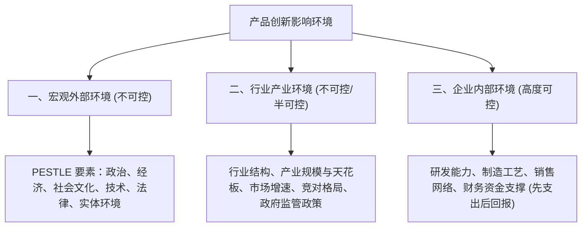
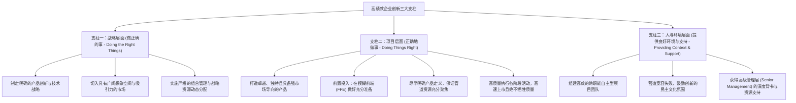
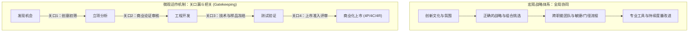

# 1.1-1.2 产品创新管理介绍与核心内涵

> [!IMPORTANT] 核心提要
> 产品创新管理是 NPDP 知识体系的基石与总览章节。在 NPDP 官方认证考试中，本章节**分值占比高达 20%（约 40 道单项选择题）**。它不仅贯穿从**创意萌芽、可行性立项、工程研发、测试修正到商业化上市与生命周期演进**的全流程，更从**宏观战略、中观流程与微观执行**三个层次揭示了新产品能够持续获得商业成功的底层驱动逻辑。

---

## 1. NPDP 课程鸟瞰与产品全生命周期全景

产品创新绝非孤立的研发行为，而是一条贯穿产品“从无到有、从有到优、从生到死”的完整生命链条。

```mermaid
flowchart LR
    subgraph Phase1["一、前端探索与立项阶段"]
        A["[1] 发现阶段 (创意与机会识别)"] --> B["[2] 筛选阶段 (初步可行性分析)"]
        B --> C["[3] 立项分析 (详细商业与财务可行性)"]
    end
    
    subgraph Phase2["二、产品开发与验证阶段"]
        C --> D["[4] 实体开发 (项目管理/敏捷/瀑布)"]
        D --> E["[5] 测试与修正 (原型验证/试产/合规)"]
    end
    
    subgraph Phase3["三、商业化上市与生命周期演进"]
        E --> F["[6] 商业化上市 (产品上市路径图)"]
        F --> G["引入期 (跨越鸿沟关键点)"]
        G --> H["成长期 (快速渗透与规模化)"]
        H --> I["成熟期 (利润收割与微创新)"]
        I --> J["衰退期 (产品退市与上市后审查)"]
    end
```

### 1.1 全生命周期核心阶段拆解
1. **发现阶段（Discovery）**：洞察外部市场痛点与技术机遇，产生大量创新构想。
2. **筛选阶段（Scoping）**：进行快速的市场、技术与合规初步可行性评估，剔除明显不可行的点子。
3. **立项分析阶段（Business Case Analysis）**：进行详细的市场调研、财务回报测算、竞争对标与技术可行性论证，确立商业论证（Business Case）与明确的产品定义。
4. **开发阶段（Development）**：进入实质工程研发与样品制造，涉及跨职能团队协作、项目管理（范围、进度、成本、质量）、风险管理与阶段性绩效评估。
5. **测试与修正阶段（Testing & Validation）**：开展现场测试、实验室验证、用户体验测试（Alpha/Beta测试）以及小批量试产修正。
6. **产品上市与生命周期运营（Launch & PLC）**：通过营销组合（4P/4C/4R）将产品推向市场，历经**引入期（需重点解决“跨越鸿沟”难题）、成长期、成熟期与衰退期**，并在生命周期终点执行**产品上市后审查（Post-Launch Review）**与退市决策。

### 1.2 本章三大核心板块与考试权重分布
本章节在考试中占据 20% 权重（40 题），内容主要聚合为三大知识板块：
* **板块一：产品创新管理内涵与成功因素**（战略、影响因素矩阵、高绩效企业特征）。
* **板块二：产品生命周期（PLC）全过程管理**（跨越鸿沟理论、上市路线图制定、阶段性策略）。
* **板块三：项目可行性分析技术、管理工具与绩效度量**（财务工具、风险工具、度量指标体系）。

---

## 2. 产品创新管理的核心内涵与价值导向

### 2.1 产品创新的本质定义
在 NPDP 框架中，**产品创新（Product Innovation）**包含以下三重表现形态：
* **创造全新产品**：开创前所未有的全新品类或全新技术解决方案。
* **推出改进型产品**：针对现有产品的性能、形态、成本、功能或体验进行优化升级。
* **提供创新的服务形态**：以实体产品为载体或纯数字化形式提供新型增值服务。

> [!IMPORTANT] 核心原则：新产品创新的商业价值导向
> **新产品创新绝不仅仅是“搞技术研发”，而是必须坚持“商业价值导向”！**
> 任何创新的终极衡量标准是：**不仅要研发得出来，更要能够成功推向市场、卖得出去、赢得用户口碑并实现商业回报**。脱离市场需求与商业变现的研发只能被称为“实验室样品”，无法构成真正的“产品创新”。

---

## 3. 产品创新的多维影响因素矩阵

企业进行产品创新并非置身于真空之中，而是受到多层次内外部环境与要素的共同制约。

### 3.1 宏观、行业与微观三层环境分析
1. **宏观外部环境（PESTLE 分析）**：
   * 包括政治（Politics）、经济（Economy）、社会文化（Society）、技术演进（Technology）、法律合规（Legal）与实体自然环境（Environment）。这是企业无法左右的客观约束条件。
2. **行业与产业环境**：
   * **行业天花板与想象空间**：行业本身的潜在容量决定了新产品创新的回报上限。如果行业规模过小或天花板明显，产品创新的商业回报空间将被极大压制。
   * **产业增速与竞争格局**：处于高速增长期的赛道更容易容纳新产品，而存量饱和竞争市场则对差异化和成本控制提出极端严苛的要求。
   * **资源与政策壁垒**：政府产业扶持导向、关键稀缺资源配额等。
3. **企业内部环境**：
   * **技术研发与生产制造能力**：企业是否具备交付该产品的核心工艺与工程实力。
   * **财务资金支撑能力（现金流错配）**：新产品开发遵循“**先集中发生高额支出（研发投入、模具打样、物料采购、营销渠道铺设），上市销售后逐步回笼资金**”的财务规律。企业必须具备稳健的资金链，以承受研发期与市场导入期的负现金流压力。
   * **渠道与商业化推广网络**：产品研发完成后，企业是否有能力铺设触达目标客群的销售渠道并进行高效推广。

### 3.2 影响因素属性矩阵：可控因素 vs. 不可控因素

在实际管理运作中，创新影响要素可以从“要素属性”与“企业可控度”两个维度建立四象限矩阵：

| 影响要素类别 | 内部环境（企业高度可控） | 外部环境（企业通常不可控） |
| :--- | :--- | :--- |
| **组织与客体维度** | • 企业文化与价值观倡导 • 组织战略方向与发展规划 • 企业核心技术能力与专利积累 • 财务资源预算与资产配置 | • 宏观政治法律政策与国际贸易环境 • 宏观经济走势与周期波动 • 行业竞争对手策略与突发动作 • 自然环境与不可抗力因素 |
| **主体与人员维度** | • 董事会与高级管理层（决策层） • 研发团队与工程技术人员 • 产学研合作与生产制造人员 • 财务、采购与营销销售团队 | • 外部行业顾问与智库学者 • 上游供应商与原材料伙伴 • 中游代理商、分销商与贸易贸易伙伴 • 终端目标客户与大众消费者 • 行业监管机构与认证检测部门 |

---

## 4. 高绩效企业产品创新的三大宏观支柱

大量商业实证研究表明，在产品创新领域持续取得高收益、高成功率的优秀企业，普遍在以下三大宏观层次构建了坚实的管理支柱：

### 4.1 战略层面：做正确的事（Doing the Right Things）
* **明确的创新战略愿景**：制定清晰指引产品与技术创新方向的长期战略，确保创新举措与公司使命对齐。
* **选择高吸引力市场**：聚焦于未来天花板高、规模庞大、增长潜力可观的高价值市场，避免在极小规模的存量泥潭中内卷。
* **动态高效的组合管理（Portfolio Management）**：“巧妇难为无米之炊”。组合管理的核心不仅是挑选项目，更是根据战略优先级对有限的资源（资金、关键人才、设备）进行动态调配与取舍。

### 4.2 项目层面：正确地做事（Doing Things Right）
* **追求独特且卓越的产品价值**：坚持以用户真实痛点为导向，提供超越竞品的差异化核心价值。
* **重兵布局模糊前端（Fuzzy Front End, FFE）**：在正式立项立项并进入重度资金投入前，投入充分时间与精力进行市场调研与可行性论证，坚决避免盲目跟风与“赌概率”式的盲目开发。
* **早期确立清晰的产品定义**：尽早界定目标客群、应用场景、核心功能特性与竞品差异化定位，避免后期需求反复蔓延。
* **管道平衡（Pipeline Balance）**：严格控制在研项目数量，集中兵力攻坚核心项目，防止资源被过度摊薄导致项目全部延期。
* **速度与质量兼顾**：力求率先上市抢占先机，但**绝对不能以牺牲产品基本品质与用户体验为代价换取研发速度**。

### 4.3 人与环境层面：提供良好环境与支持（Providing Context & Support）
* **跨职能自主团队**：打破部门“深井”，由研发、市场、制造、财务等各职能专家组建全功能协同作战团队。
* **宽容失败与鼓励建设性冲突的氛围**：建立允许试错、积极探索的民主文化；鼓励围绕业务目标展开激烈的思想碰撞（建设性冲突），坚决遏制对人不对事的内耗式冲突（破坏性冲突）。
* **高层管理者的深度支持**：高级管理层不仅是创新的发起者，更是创新资源的坚实保障者与跨部门阻力的协调者。

---

## 5. 高绩效创新成功的七大核心维度（映射 NPDP 知识体系）

为更加落地可实操，高绩效企业的产品创新实践可进一步解构为以下七大核心维度，这一框架与 NPDP 官方七大知识领域高度契合：

### 5.1 维度一：创新文化（映射文化、团队与领导力）
1. **允许与包容失败**：企业必须从制度上理解并包容创新中的探索性失败，消除员工因恐惧担责而不敢创新的心理顾虑。
2. **高层树立创新标杆**：管理者将创新精神融入企业愿景与日常工作目标中。
3. **创新型人才甄选**：在招聘中重点评估候选人的创造力、学习意愿与解决复杂问题的思维能力。
4. **开放式合作生态**：不固守“闭门造车”，积极与外部高校、科研院所、上下游合作伙伴进行跨界交流与思想碰撞。
5. **鼓励建设性冲突**：世界的进步源于对现状的不满。鼓励团队对不合理的现状提出质疑并拿出更优解决方案，利用有益冲突激发创造力。
6. **透明通畅的内部沟通**：打破信息孤岛，降低跨层级与跨部门的信息不对称，建立互信开放的协作氛围。

### 5.2 维度二：新产品战略（映射战略）
1. **清晰的战略指引**：明确新产品创新的主攻赛道、技术路线与投资边界。
2. **率先进入市场战略（First to Market）**：在关键新兴赛道主动出击，争取早期市场话语权与先发品牌红利。
3. **环境与可持续性开发（Sustainability）**：在产品设计与选材初期全面融入绿色环保理念，兼顾当代人发展与后代人福祉，优先采用可循环、低能耗材料。
4. **知识产权（IP）战略布局**：不仅运用专利构筑自身技术护城河，更探索技术授权、专利许可等创收商业模式。
5. **全球化商业视野**：面向全球市场设计架构，兼顾跨国合规、多区域客户需求与全球供应链协同。

### 5.3 维度三：组合管理（映射组合管理）
1. **多元化维度的项目平衡**：
   * 突破性项目（高风险、颠覆性收益）与 改进型项目（低风险、稳定现金流）的科学配比；
   * 进军全新市场的项目与 深耕现有存量市场的项目相互兼顾。
2. **体系化的组合评价工具**：熟练运用气泡图（Bubble Chart）、战略水桶法（Strategic Buckets）、财务打分模型等工具进行项目优先级排序与取舍。
3. **管道容量约束与资源聚焦**：坚持“管道流量管理”，杜绝项目过载导致的资源瘫痪。

### 5.4 维度四：新产品流程（映射流程）
1. **跨职能团队主导**：产品开发各阶段活动由跨职能团队端到端贯穿执行，杜绝传统的“各扫门前雪”甩包袱式交接。
2. **持续设计与改进流程**：借鉴六西格玛设计（IDOV）搭建流程框架，运用 DMAIC 模型进行持续流程精益优化。
3. **流程的灵活性与定制化**：根据项目属性（硬件开发、软件研发、微小改进、平台创新）灵活选用门径流程（Stage-Gate）、瀑布模型、敏捷开发（Agile）、精益开发（Lean）或系统工程，不生搬硬套。
4. **管理层深度介入评审关口**：决策高层在门径评审点（Gates）严格把关，确保不达标的项目及时止损，优秀项目获得持续注资。

### 5.5 维度五：创新模糊前端（映射工具与度量）
1. **深度洞察用户真实痛点**：在定义产品前，投入重兵运用人种学研究（Ethnography）、“客户生命中的一天”（Day in the life）、焦点小组等深度调研工具，挖掘用户未被言明的隐性需求。
2. **结构化的创意生成与评估**：常态化运行 SCAMPER（奔驰法）、头脑风暴法、德尔菲法、头脑书写法等创新工具，建立规范的创意漏斗筛选机制。
3. **借助社交媒体与数字倾听**：通过分析社交网络舆情、用户社群话题与评论趋势，敏锐捕捉新兴用户需求风向。

### 5.6 维度六：开发工具与技术（映射市场调研与工程工具）
1. **量化市场调研工具**：综合应用联合分析（Conjoint Analysis）、概念测试、KANO 模型等量化工具辅助决策。
2. **工程设计工具**：广泛应用计算机辅助设计（CAD）、制造与装配设计（DFMA）、质量功能展开（QFD）、失效模式分析（FMEA）提升工程可靠性。
3. **严谨的项目管理工具**：全面应用工作分解结构（WBS）、关键路径法（CPM）、甘特图进行项目工期与资源的高精度把控。

### 5.7 维度七：度量指标与持续改进（映射度量与绩效）
1. **正式建立多维指标监控体系**：
   * **结果/产出指标**：例如“过去3~5年内上市新产品占公司当前总营收/总利润的百分比”（新产品活力指数）、投资回报率（ROI）、净现值（NPV）；
   * **过程/流程指标**：例如各阶段里程碑按时达成率、门径评审一次通过率、研发周期（Time-to-Market）。
2. **度量指标作为持续改进引擎**：度量不是为了惩罚，而是为了沉淀组织过程资产，识别流程堵点并指导后续产品开发体系的进化演变。

---

## 6. 产品创新的宏观体系 vs. 微观把关

> [!WARNING] 实战避坑：宏观无战略 vs. 微观无把关
> * **若仅有宏观战略而无微观把关**：项目会在各阶段“带病推进”，劣质项目不断吞噬企业资金，最终导致灾难性的上市失败；
> * **若仅有微观工具而无宏观战略指引**：团队会陷入“高效地做了一堆无用产品”的泥潭，看似忙碌却无法支撑企业长期的战略增长。
> 优秀的产品创新管理必须做到**宏观上有战略指引与文化支撑，微观上有清晰的阶段交付物与严格的关口否决机制**。

---

## 7. 产品创新管理核心知识全景对比速查表（Cheat Sheet）

| 知识模块 / 分析维度 | 核心概念定义与考点要求 | 关键特征 / 核心手段 | 常见实操工具与方法 | 常见管理陷阱与警示 |
| :--- | :--- | :--- | :--- | :--- |
| **产品创新定义** | 创造新产品、推出改进产品或增值服务 | 必须具备**商业价值导向**，兼顾技术研发与商业变现 | 价值主张设计、商业模式画布 | 只顾实验室研发，脱离市场需求，产品无法变现 |
| **创新环境：宏观与行业** | 企业外部不可控约束要素 | PESTLE 六大宏观要素；行业规模、天花板、市场增速 | PESTLE 分析模型、行业集中度与生命周期分析 | 盲目进入规模过小或天花板逼仄的细分赛道，缺乏增长想象空间 |
| **创新环境：内部可控** | 企业内部要素与人员支撑 | 技术储备、生产制造、销售渠道、**先支出后回笼**的资金链支持 | 组织能力审计、现金流错配压力测试 | 低估营销与推广铺设成本，研发完成后资金链断裂 |
| **高绩效宏观三支柱** | 战略层面、项目层面、人与环境层面 | 战略做正确的事、项目正确做事、人与环境提供充沛支撑 | 跨职能团队、高管赞助人（Sponsor）制度 | 高层管理缺失实质支持；团队各自为政缺乏跨职能协同 |
| **创新文化维度** | 激发创造力与容错机制 | 宽容失败、鼓励建设性冲突、透明沟通、招聘创新人才 | 开放式创新平台、创新沙盒、全员创意提案机制 | 惩罚探索性失败，导致全员墨守成规不愿创新；放任内耗式人身冲突 |
| **新产品战略维度** | 创新路径与商业边界确立 | 率先进入市场（抢占先机）、可持续绿色发展、知识产权创收运营 | 战略愿景金字塔、专利池布局、ESG/可持续评估 | 缺乏明确战略指引，项目立项随波逐流；忽视知识产权防御与侵权风险 |
| **组合管理维度** | 动态资源配置与平衡布局 | 突破性与改进型平衡、新市场与现有市场平衡、**管道容量限制** | 战略水桶法、气泡图、管道平衡模型（Pipeline Balance） | 项目过度铺展导致资源严重摊薄，所有项目陷入延期 |
| **流程与工具维度** | 规范化、结构化推进产品落地 | 跨职能协作、流程定制化（门径/敏捷/瀑布）、深度洞察用户真实痛点 | Stage-Gate、DMAIC、IDOV、SCAMPER、人种学调研、QFD、FMEA | 生搬硬套单一固定流程；开发前不做准备盲目开工（忽略模糊前端） |
| **度量与持续改进** | 衡量创新效能与组织进化 | 结果指标（新产品收益占比）与过程指标（里程碑达成率）并重 | 新产品活力指数、ROI、NPV、平衡计分卡（BSC） | 将度量指标变为KPI惩罚工具；只盯短期财务结果忽视长期能力构建 |