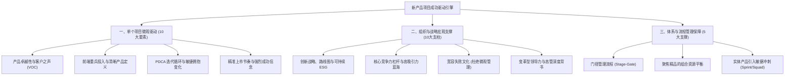
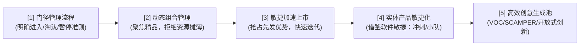
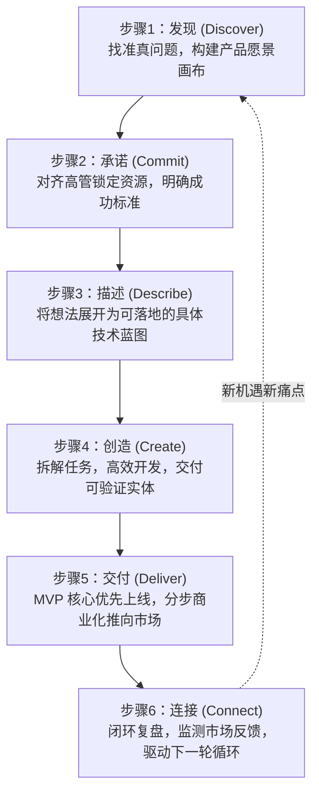
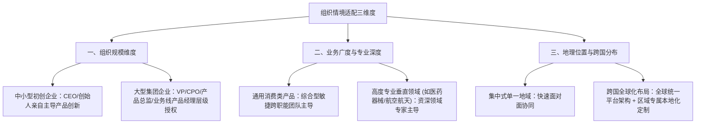

# 1.3-1.4 新产品成功驱动因素与管理产品创新

> [!IMPORTANT] 核心提要
> 为什么绝大多数新产品创新都以失败告终，而少数卓越企业却能屡创爆品？NPDP 知识体系通过大量实证研究证实：**新产品的成功绝非偶然的灵感撞大运，而是由“单个项目微观执行”、“组织战略与文化土壤”以及“结构化体系与敏捷方法论”三大层面的驱动因素共同决定的**。同时，依托**适应性开发框架（发现、承诺、描述、创造、交付、连接）**，企业能够建立起持续学习、快速响应与闭环迭代的产品创新管理机制。

---

## 1. 新产品项目成功的驱动因素全景架构

新产品项目的成功驱动因素可以结构化解构为三大支柱层次：**单个项目层面（10大微观要素）**、**组织与战略层面（10大宏观支柱）**，以及**体系、流程与方法论层面（5大管理支撑）**。

---

## 2. 单个项目层面的 10 大成功驱动要素

在微观项目执行维度，高绩效项目团队普遍展现出以下 10 项鲜明的操作特征：

### 2.1 独特而卓越的产品优势（Product Superiority）
* 契合迈克尔·波特的**差异化战略**。产品必须具备独特的卖点、引人注目的核心价值主张（Value Proposition），能够为用户解决竞品无法解决的痛点，提供不可替代的卓越体验。

### 2.2 深度倾听与践行客户之声（Voice of Customer, VOC）
* 创新不能闭门造车，必须通过深入的市场调研与用户访谈，全面捕捉客户当下最迫切、最核心的痛点与需求。满足真实刚需的产品才具备市场生存基础。

### 2.3 重兵布局前端筹备与调研（Upfront Homework）
* 在正式立项前投入充分时间做深度市场尽调与可行性论证。
* 秉承“**前端高淘汰、低通过**”原则：在成本极低的创意构想与概念阶段从严筛选，把致命缺陷拦截在研发之前；避免在前期盲目放行，导致后期沉没成本巨大。

### 2.4 基于事实的清晰产品定义（Clear Product Definition）
* 基于前期详实调研，形成明确的产品边界说明书（包含目标人群、核心功能清单、性能参数、配套服务及竞品差异）。
* **跨部门统一语言**：清晰的产品定义能消除研发、设计、生产、采购与市场团队之间的理解歧义，减少反复返工，大幅提升交付速度与上市成功率。

### 2.5 螺旋式迭代开发（Iterative Development）
* 贯彻 PDCA 质量循环与精益创业理念：遵循 **Build（构建） $\rightarrow$ Measure（度量） $\rightarrow$ Learn（学习）** 循环。
* 尽早、频繁地将中间阶段原型或粗糙模型交付给核心客户试用，根据用户的直接反馈为后续研发“导航指路”，避免最终交付时与用户预期南辕北辙。

### 2.6 尊重研发规律，把控开发节奏与时机（Pacing & Timing）
* 深入理解新产品开发的客观工程规律，不因盲目抢进度而压缩关键验证环节，做到“步步踏准节奏”，在保证交付品质的前提下优化时间周期。

### 2.7 拥抱变化与敏捷响应（Agile & Embracing Change）
* 市场与客户需求处于动态演变中。团队必须具备敏捷柔性，能够根据外部最新环境与测试反馈，快速调整项目范围或优先级，确保交付物始终紧贴市场需求。

### 2.8 精心策划的高效商业化上市（Well-Planned Launch）
* 上市绝非“研发完成后的甩手交接”，而是需要跨职能部门提前协同策划。制定详尽的上市时间表、铺设匹配的营销渠道、备齐销售工具包，踩准市场引爆节奏。

### 2.9 全球化格局与本地化适配（Global Orientation）
* 具备全球化研发视野，设计之初即考虑跨国标准与跨文化合规；或将全球成熟模式引入本土时，扎实做好针对本地用户使用习惯的本地化（Localization）精细调优。

### 2.10 强烈的成功渴望与心理能量（Desire for Success）
* 心理学中的“**自我实现预言**”：当团队成员由衷认可产品价值、极度渴望做出标杆产品时，能迸发出巨大的自驱力与攻坚能量，逆境中更具韧性。

---

## 3. 组织与战略层面的 10 大宏观支撑支柱

单个项目的成败高度依赖于其所植根的企业土壤。在组织与战略顶层，卓越企业构建了坚不可摧的支撑体系：

### 3.1 明确的新产品创新战略与路线图（Innovation Strategy & Roadmap）
* 明确界定企业在哪些业务板块、切入哪些产品类目、依靠何种战略手段赢得胜利。
* 绘制清晰的**产品路线图（Product Roadmap）**，自上而下规划关键演进节点，实现资源跨周期聚焦配置。

### 3.2 聚焦绿色环保与可持续发展（Sustainability & ESG）
* 树立高度的社会责任感，在产品生命周期各环节深度融合绿色可持续发展理念（绿色设计、节能减排、可降解回收），兼顾当代收益与子孙后代的生存环境。

### 3.3 撬动核心竞争力杠杆（Core Competencies Leverage）
* 深度评估企业自身的独特长板（技术研发底蕴、供应链议价力、特定渠道网络或行业亲和力），坚持“扬长避短”，在自身核心优势的延长线上布局创新。

### 3.4 瞄准高吸引力蓝海市场（Target Attractive Markets）
* 运用市场细分（Segmentation），主动切入**市场规模可观、增长势头强劲、用户需求旺盛且竞对壁垒尚未固化**的蓝海市场。
* 坚决避开需求萎缩、价格血拼内卷、利润微薄的高饱和存量红海。

### 3.5 提供充足且聚焦的资源保障（Resource Commitment）
* “巧妇难为无米之炊”。高层必须为战略重点攻关项目核准充足的研发经费、实验设备与关键技术专家，杜绝“既要马儿跑，又要马儿不吃草”。

### 3.6 组建高效作战的跨职能团队（High-Performing Cross-Functional Teams）
* 打破职能壁垒，涵盖市场、研发、工程、制造、采购、质量、财务全角色，确保信息流顺畅传递与决策高度协同。

### 3.7 全链条深度整合供应链体系（Supply Chain Integration）
* 推进**供应商早期介入（Early Supplier Involvement, ESI）**。在设计研发阶段即引入核心供应商，确保零部件可制造性与物料准时供应，吸收供应商的技术建议。

### 3.8 构筑包容失败的创新文化（杜绝微观管理）
* **心理安全感**：建立宽容合理试错的激励机制，不因单次技术探索失败而惩处或扣减绩效，鼓励团队总结经验复盘。
* **预留自由探索时间**：为研发人员提供一定比例的自主支配时间用于天马行空的创意实验。
* **严禁微观管理（No Micro-Management）**：
  > [!WARNING] 实战避坑：微观管理的致命毒药
  > 高层管理者一旦将权力授权给项目团队，就必须充分信任，只把控宏观方向、关键里程碑（Milestones）与终验标准；**绝对不要插手微观执行细节**。多头干预与微观指挥必然导致项目团队无所适从、内耗激化、自驱力彻底丧失。

### 3.9 采用有机灵活的组织结构（Organic Organizational Design）
* 摒弃僵化官僚的科层制，采用柔性矩阵式或扁平化网络结构；推行**决策权适度下放**，让一线听得见炮火的团队拥有临场应变权。

### 3.10 卓越的变革型领导力与高管背书（Senior Leadership Commitment）
* 高管层身体力行，为创新团队提供坚定背书，亲自担任门径把关人（Gatekeepers），并在项目遭遇跨部门阻力时主动清障。

---

## 4. 体系、流程与方法论层面的 5 大管理支撑

除了项目要素与组织土壤，高绩效企业必然具备科学严谨的流程体系：

1. **结构化门径管理流程（Stage-Gate Process）**：将开发全周期划分为明确的阶段与关口，制定清晰的准入准出标准（Go、Kill、Hold、Recycle），实现受控推进。
2. **聚焦战略组合管理（Portfolio Focus）**：坚守“做少做精”原则。宁可集中资源打赢少数战略精品，也绝不搞“撒胡椒面式”遍地开花导致全线瘫痪。
3. **敏捷加速与先发优势（Speed-to-Market）**：先推出满足核心需求的高优先级版本抢占先发壁垒，后续小步快跑逐步补充衍生功能。
4. **将敏捷思维注入实体制造（Agile for Hardware/Physical Products）**：打破“敏捷只适用于软件”的误区，将 Scrum 冲刺（Sprint）、跨职能小分队（Squad）、看板管理（Kanban）、阶段演示与回顾机制创造性地融入传统工程研发中。
5. **规范化的创意生成机制（Systematic Ideation）**：系统化应用客户之声（VOC）、奔驰法（SCAMPER）、头脑风暴与开放式创新，建立源源不断的优质创意池。

---

## 5. 管理产品创新：六阶段适应性开发框架

产品创新如何实现从灵感闪现到闭环复盘的系统化管理？**适应性开发框架（Adaptive Development Framework）**提供了极佳的操作路径：

### 5.1 适应性开发框架六步拆解

#### 步骤一：发现（Discover）
* **核心目标**：在喧嚣中探寻真实痛点与市场潜在机会，找准“**真问题**”以锚定创新方向。
* **关键动作**：
  * **问题与主体解耦**：先纯粹界定“要解决什么客观问题”，暂时脱离“由谁来解决”的执行归属争议；
  * **绘制产品愿景画布（Product Vision Canvas）**：阐明拟解决的用户痛点、核心价值主张、实现途径以及预期达成的业务效果。

#### 步骤二：承诺（Commit）
* **核心目标**：向上对齐决策层，获取高管认可与正式资源背书。
* **关键动作**：
  * 锁定高管所能调动的资源配额与预算上限；
  * 明晰定义项目的成功衡量标准与具体业务交付物（Business Deliverables）；
  * 获得进入实质性投入阶段的正式立项批准。

#### 步骤三：描述（Describe）
* **核心目标**：将抽象的创意构想（Idea）转化为清晰可落地的**技术蓝图与架构设计**。
* **经典商业类比（从通信愿景到通信系统）**：
  * *最初创意（Idea）*：“我想研发一个通信工具，能让身在长沙的我随时与千里之外的亲友通话”；
  * *技术蓝图展开（Describe）*：定义信号采集麦克风、音频编码信号处理器、特定频段的无线电发射天线、地面基站中继站布设、长途干线光缆传输网络、对端基站接收机与解码器。
* **关键动作**：梳理用户画像（Persona）与用户故事（User Story），界定“目标用户在何种具体业务场景下，调用何种特定功能，达成何种交互效果”。

#### 步骤四：创造（Create）
* **核心目标**：进入实质工程研发与原型试制（Coding & Engineering）。
* **关键动作**：
  * 基于工作分解结构（WBS）进行任务模块拆解，落实责任到人；
  * 制定严格的阶段性交付物验收标准与工程质量控制计划；
  * 保持跨职能日常沟通，确保各模块平稳集成推进。

#### 步骤五：交付（Deliver）
* **核心目标**：完成系统级集成测试、市场准入合规检验，并正式向市场商业化投放。
* **关键动作**：
  * 制定周密的产品发布与上市营销计划；
  * 遵循敏捷思想，**优先保障最小可行产品（MVP）的核心功能率先上线**，让真实用户率先用起来；衍生边缘功能后续迭代跟进。

#### 步骤六：连接（Connect）
* **核心目标**：连接当前交付成果与后续新创意，构建**持续学习与改进闭环**。
* **关键动作**：
  * 开展全流程回顾复盘（对比初始目标与最终交付状态，剖析偏差与根因，固化经验沉淀）；
  * 建立持续的市场舆情与用户行为监控机制，收集真实用户反馈；
  * 用户在使用中暴露的新痛点与新场景，直接反馈成为下一轮适应性循环的“发现”输入源。

---

## 6. 产品创新管理的组织情境适配机制

在实际企业运作中，管理模式不能搞“一刀切”，必须依据企业的**规模层级、业务覆盖范围与地理分布**进行灵活情境适配：

1. **组织规模层级差异**：
   * **初创及中小型企业**：资源高度集中，通常由 CEO 或创始人亲力亲为担任超级产品经理，决策链条极短；
   * **成熟中大型企业**：CEO 需抽身聚焦企业宏观资本与组织建设，产品创新管理职责依法下放至产品副总裁（VP of Product）、首席产品官（CPO）、产品总监及垂直业务线的产品经理团队。
2. **业务广度与专业深度差异**：
   * 产品范围涉及高度垂直专业的领域（如新药研发、高端医疗器械、芯片半导体），必须由具备深厚科研背景的首席科学家或资深行业专家主导研发决策与门径把关。
3. **地理分布与国际化差异**：
   * 业务遍布全球的跨国集团，通常采用“**全球平台化研发 + 区域本地化调优**”的双轨架构：总部研发通用底层平台与核心模块，派驻各国家地区的本地团队负责对接区域法规标准与本土用户习惯定制。

---

## 7. 新产品成功驱动因素与创新管理速查表（Cheat Sheet）

| 核心层级 / 模型 | 核心构成要素 | 核心考点与管理要义 | 关键实践工具 / 标志动作 | 典型管理误区与风险警示 |
| :--- | :--- | :--- | :--- | :--- |
| **单个项目微观驱动** | 10大要素（产品优势、VOC、前端准备、清晰定义、迭代开发、节奏把控、敏捷响应、高效上市、全球化、成功信念） | 强调用户真实需求牵引；**前端重兵布局**、清晰定义、持续迭代 | VOC 调研、产品定义书、Build-Measure-Learn 循环、敏捷看板 | 前期缺乏调研盲目立项；中途需求频繁蔓延；忽视客观研发规律盲目抢期 |
| **组织与战略宏观支撑** | 10大支柱（战略路线图、ESG、核心竞争力、高吸引力蓝海、充足资源、跨职能团队、供应链协同、创新文化、有机架构、高管支持） | 构筑创新的组织土壤；**坚决杜绝微观管理**，给予一线充分授权与试错容忍度 | 产品路线图、战略水桶法、ESI（供应商早期介入）、去中心化授权体系 | 高层对细节过度插手（微观管理）；惩罚探索性失败导致团队墨守成规；资源过度分散 |
| **体系流程管理保障** | 5大支撑（Stage-Gate、组合管理、加速开发、实体敏捷化、系统化创意池） | 结构化管理规避系统风险；将敏捷思维创造性应用于硬件与实体工程中 | 门径评审准则、Pipeline 管道容量管理、Scrum Sprint/Squad、SCAMPER 奔驰法 | 流程僵化教条；搞“撒胡椒面式”项目立项；误以为敏捷只能用于纯软件开发 |
| **适应性开发框架：发现与承诺** | 找准真问题、绘制产品愿景画布；锁定高管资源与成功标准 | 问题与人解耦；向上对齐锁定边界，获得正式立项背书 | 产品愿景画布（Product Vision Canvas）、商业论证报告（Business Case） | 伪需求自嗨立项；未锁定高管资源即开工导致半途资金断供 |
| **适应性开发框架：描述与创造** | 将抽象想法细化为技术蓝图；拆解具体任务高效编码/工程研发 | 从模糊愿景落地到具体系统级架构；明确可交付物与验收标准 | 用户画像（Persona）、用户故事（User Story）、工作分解结构（WBS） | 缺乏系统架构设计直接动手；模块间接口定义不清造成集成灾难 |
| **适应性开发框架：交付与连接** | MVP 核心功能率先上市；闭环复盘与市场舆情监控 | 敏捷小步快跑分期交付；上线后持续学习，为下一轮循环提供输入 | 最小可行产品（MVP）、上线后审查（Post-Launch Review）、舆情倾听 | 试图一步到位导致项目难产；交付后缺乏复盘总结，屡犯同类错误 |
| **组织情境适配机制** | 组织规模、专业领域、地理分布三大情境维度 | 创新组织架构必须与企业发展阶段与业务复杂度动态匹配 | 授权矩阵、全球平台架构与本地化适配方案（Localization） | 小企业照搬大厂复杂官僚层级；跨国公司用单一版本强推全球市场忽视本地化差异 |