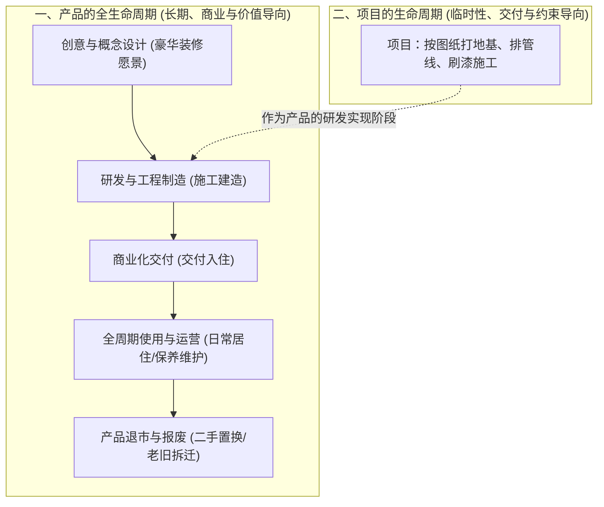
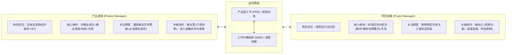
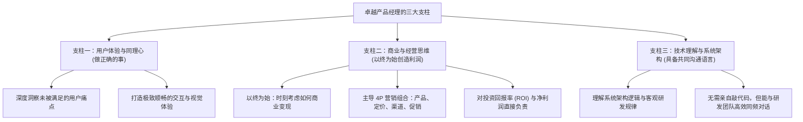
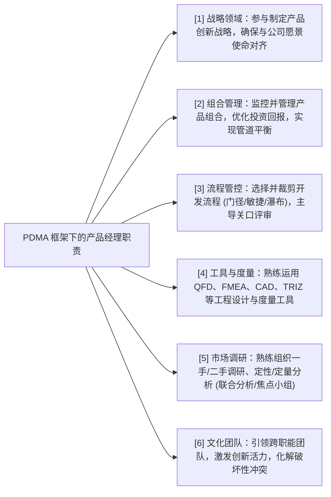
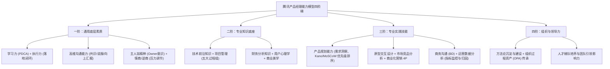

# 1.5-1.7 产品与项目区别及 PDMA 产品经理角色

> [!IMPORTANT] 核心提要
> “做正确的事”与“正确地做事”是企业运作的两大车轮。在 NPDP 知识体系中，**产品（Product）**关注满足市场需求与商业回报，属于长周期的商业实体；而**项目（Project）**则是为了交付特定产品或能力而开展的临时性工作。相应地，**产品经理（Product Manager）扮演着“没有法定职权的迷你 CEO”**，对全生命周期的商业成功负责；而**项目经理（Project Manager）则是“首席交付官”**，对预算、进度和质量范围的受控交付负责。两者各司其职又紧密共生。

---

## 1. 产品与项目的本质区别与生活化隐喻

理解产品与项目的区别，可以通过两个经典的具象化生活案例深入透析：

### 1.1 经典案例一：新房装修与居住体验
* **产品视角（房主的凡尔赛宫殿愿景）**：房主买下一套毛坯房，向设计师提出对未来生活的无限憧憬——希望装修得像“凡尔赛宫殿”一样豪华舒适、具备完美的采光与智能家居、能长期满足一家三代的温馨居住。这种**承载用户需求、解决生活痛点、提供长期居住价值与体验的最终成果，就是“产品”**。
* **项目视角（施工队的图纸与工期）**：施工队为了把房主的愿景变为现实，必须将工程拆解为明确的阶段与任务——勘测打地基、水电管线布设、泥木瓦工、刮腻子刷漆、定制柜安装。施工队按照工期计划、施工预算与质量规范严格推进，**一旦竣工验收交钥匙，施工“项目”便宣告结束**。
* **生命周期错位**：项目结束时，**产品的生命周期（漫长的入住、磨损、维护保养、甚至二手转售）才刚刚拉开序幕**。

### 1.2 经典案例二：残障人士智能助浴机
* **产品全貌**：企业为解决行动不便残障人士的独立洗澡难题，规划了一款“智能助浴机”。它历经市场调研、工业设计、样机研发、临床试验、上市营销、渠道分销、售后保修直至多年后的迭代停产。
* **内部嵌套的项目集群**：
  * **研发项目**：在既定 6 个月内，按照技术参数造出工程样机，耗资 50 万元（研发成功即收尾）；
  * **上市营销项目**：在产品发布当月，策划全国招商会与媒体公关，达成首批 500 台订单（发布会结束即收尾）。
* **核心结论**：**项目是实现产品全生命周期中某一特定阶段交付成果的手段与载体**。

---

## 2. 核心概念严谨辨析：产品 vs. 项目

| 比较维度 | 产品（Product） | 项目（Project） |
| :--- | :--- | :--- |
| **本质定义** | 为满足特定目标客群的特定需求而向市场提供的实体商品、软件应用或增值服务 | 为创造特定产品、服务或成果而开展的**临时性（Temporary）努力** |
| **典型形态** | 智能手机、净水杯、操作系统、创新药、汽车、金融理财产品、专业咨询服务 | 某款手机的硬件开发、软件版本迭代、某企业 ERP 上线、某条生产线改造 |
| **周期跨度** | **长期且持续**：历经创意、开发、上市引入、成长、成熟、衰退乃至最终退市 | **临时且有限**：有明确的启动日期和既定的结束日期，交付达标即宣告解散 |
| **驱动逻辑** | **市场与商业价值驱动**：关注用户痛点是否解决、商品能否卖出、企业能否盈利 | **交付与约束驱动**：关注是否在限定时间、预算和质量标准内完成工作范围 |
| **演进方式** | 循环往复、版本迭代升级、持续优化体验，生命不息演进不止 | 遵循“启动 $\rightarrow$ 规划 $\rightarrow$ 执行 $\rightarrow$ 监控 $\rightarrow$ 收尾”五大过程组，达成目标后即终结 |

---

## 3. 产品经理 vs. 项目经理：角色定位与权责对比

在现代组织架构中，产品经理与项目经理构成了新产品开发的“双子星”。两者的协同与权责界限是 NPDP 的经典核心考点。

### 3.1 角色特质深度对比
1. **“没有法定职权的迷你 CEO”（Mini-CEO without authority）**：
   * 产品经理虽然名字带“经理”，但通常没有直接的行政人事任免权和考核权；
   * 必须凭借**行业远见、严密的逻辑论证、卓越的沟通同理心与个人领导力**，跨部门协调研发、制造、销售、财务等各路人马，为产品的最终商业成败负全责。
2. **“按期保质的交付指挥官”**：
   * 项目经理手握明确的项目授权书（Project Charter），专注于“怎样保质保量在截止日前搞定”；
   * 运用关键路径法、甘特图、燃尽图等严谨工具消除执行阻碍，带领项目团队打赢攻坚战。

---

## 4. 产品经理必备的三大核心底座

一个卓越的产品经理必须站在**用户体验、商业经营与工程技术**的三叉路口：

> [!IMPORTANT] 核心原则：以终为始的商业经营思维
> 产品经理绝对不能做“单纯的需求搬运工”或“画原型图的技术美工”。**必须时刻秉承“以终为始”的经营视角**：
> * 这个功能上线后到底靠什么收费？
> * 怎样的产品包装与功能组合最容易打动目标客群？
> * 定价定在什么区间能兼顾渗透率与毛利率？
> * 渠道商是否有足够的利润动力帮我们推销？

---

## 5. PDMA 知识体系中的产品经理全景职责

在 PDMA（产品开发与管理协会）的 NPDP 知识体系中，产品经理的职责全方位贯穿于七大核心知识领域：

1. **新产品战略（第1章）**：深度参与新产品创新战略的制定，确保每一款新产品举措与公司的宏观愿景、使命、价值观高度对齐。
2. **组合管理（第2章）**：负责产品组合的持续梳理与动态调整，运用战略水桶、气泡图等工具合理分配资源，坚决淘汰低价值项目。
3. **新产品流程（第3章）**：依据项目特性裁量最适宜的流程模型（门径流程、精益开发、敏捷冲刺），在关口决策中担任重要评审角色。
4. **工具与度量（第4章）**：掌握产品规划与工程设计工具（如质量功能展开 QFD、失效模式与影响分析 FMEA），搭建过程指标与结果指标体系。
5. **市场调研（第5章）**：根据不同研发阶段，熟练设计定性调研（人种学、深度访谈）与定量调研（联合分析、问卷统计），驱动数据化决策。
6. **文化、团队与领导力（第6章）**：搭建高协同度的跨职能团队，营造心理安全感，传承沉淀组织过程资产（OPA）。

---

## 6. 业界产品经理能力模型深度拆解（以腾讯能力模型为例）

互联网大厂（以腾讯产品经理能力模型为例）将产品经理的综合能力划分为**通用能力、专业知识、专业技能与组织影响力**四个进阶阶梯：

### 6.1 通用底层素质（Foundation）
* **学习力与执行力**：敏锐吸收跨行业新知，用 PDCA 闭环把规划转化为确定性结果。
* **高维沟通与说服力**：面对技术、运营、销售、高管等不同背景干系人，能够“见人说人话，见智者讲逻辑”，化解分歧达成共识。
* **主人翁精神（Owner 意识）**：真正把产品当成自己的“孩子”，不仅关注自己的一亩三分地，主动填补流程漏洞。
* **情商与抗逆力（EQ & AQ）**：在重重阻力、资源匮乏与突发挫折面前，保持情绪稳定，积极引导团队破局。
> [!TIP] 导师赠言
> **“你不需要很牛逼才开始，但你需要开始了才会很牛逼！”** 优秀产品经理的综合素质都是在实战项目中不断摸爬滚打、踩坑复盘中磨炼出来的。

### 6.2 专业知识底座（Knowledge Base）
* **技术素养**：洞悉技术边界与实现逻辑，避免提出天马行空脱离物理现实的荒谬需求。
* **项目管理方法论**：精通工作分解结构（WBS）、范围控制、进度与成本管理。
* **商业与人文素养**：掌握财务三表基本常识、消费心理学行为动机分析，以及优秀的设计美学鉴赏力。

### 6.3 专业实践技能（Functional Skills）
1. **定义问题与需求（Requirements）**：挖掘用户深层隐性需求，产出高质量的产品需求文档（PRD）。
2. **需求优先级排期（Prioritization）**：熟练运用 **KANO 模型**、**MoSCoW 法则**（必须有 Must、应该有 Should、可以有 Could、不会有 Won't）对庞杂需求进行科学取舍。
3. **原型与交互设计（Prototyping）**：使用原型工具清晰表达业务流程与信息架构。
4. **运营数据驱动（Data Analytics）**：建立指标监控看板，通过留存率、转化率、漏斗模型发现产品潜在漏洞并进行 AB 测试调优。
5. **商业营销与渠道管理（Go-To-Market）**：规划上线定价策略、渠道分润机制、营销物料准备与销售赋能培训。

---

## 7. 产品与项目管理核心知识全景对比速查表（Cheat Sheet）

| 对比维度 / 知识模块 | 项目经理（Project Manager） | 产品经理（Product Manager） | 协同与互补关系 |
| :--- | :--- | :--- | :--- |
| **核心定义与使命** | 项目的组织者与执行者；确保项目在约束条件下成功交付 | 产品的战略规划者与经营者；为产品全生命周期的商业成功负全责 | 产品经理提出“做什么（What）与为什么做（Why）”；项目经理规划“如何做（How）与何时交付（When）” |
| **成功衡量标准** | **执行成功**：按时、在预算内、达成既定范围与质量指标（铁三角） | **商业成功**：投资回报率（ROI）、市场份额、营收与利润贡献、战略对齐 | 项目按时保质交付是产品商业成功的前提；但项目交付成功不代表产品一定能卖得好 |
| **生命周期跨度** | **有限生命周期**：仅覆盖研发与验证等特定项目阶段，验收即终结 | **全生命周期**：贯穿创意、立项、开发、测试、上市、运营、退市全链条 | 一个长期产品的生命周期中，通常包含多个先后交替执行的临时性子项目 |
| **主要日常任务** | 制定项目进度计划、分配团队工作、监控风险、解决日常执行卡点 | 用户调研、需求定义与排序、制定上市营销 4P、分析运营数据、门径评审决策 | 产品经理提供清晰的 PRD 减少项目返工；项目经理提供真实进度与风险预警 |
| **所需核心能力** | 任务拆解（WBS）、关键路径管理、资源调度、跨部门协调执行力 | 商业敏感度、用户同理心、市场竞品洞察、数据分析、产品规划与定价策略 | 两者均需要高超的跨职能沟通能力与领导力 |
| **决策权力特征** | 依据项目章程行使执行指挥权，直接管理项目成员与工期进度 | **无行政职权的协调者（Mini-CEO）**；依靠影响力、逻辑与战略愿景驱动各方 | 产品经理决定功能增减与优先级；项目经理评估技术可行性、工期与资源消耗 |
| **典型风险场景** | 资源短缺、工期延误、技术攻坚受阻、关键人员流动 | 伪需求自嗨、竞品颠覆、定价失误导致销量低迷、用户流失率居高不下 | 项目经理确保产品按质交付，产品经理确保产品切中市场真实脉搏 |