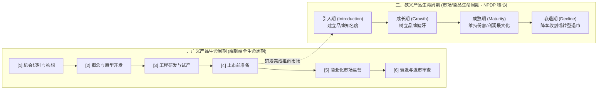
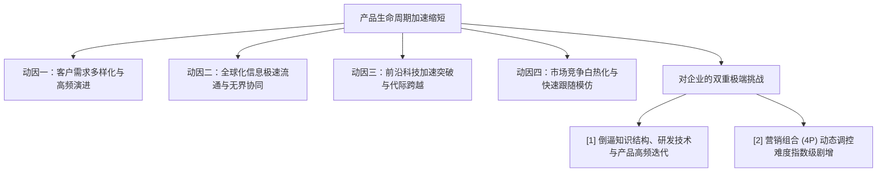
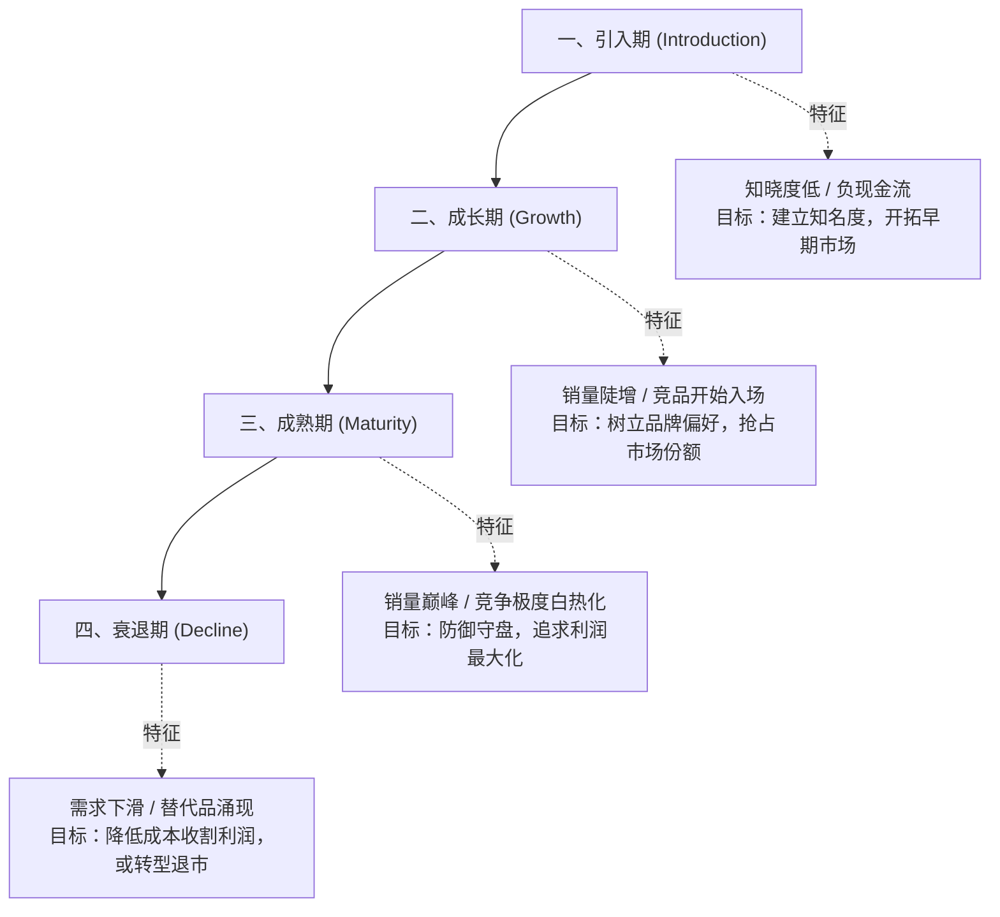
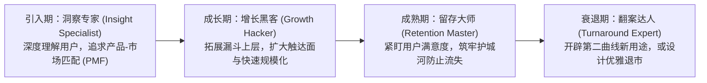
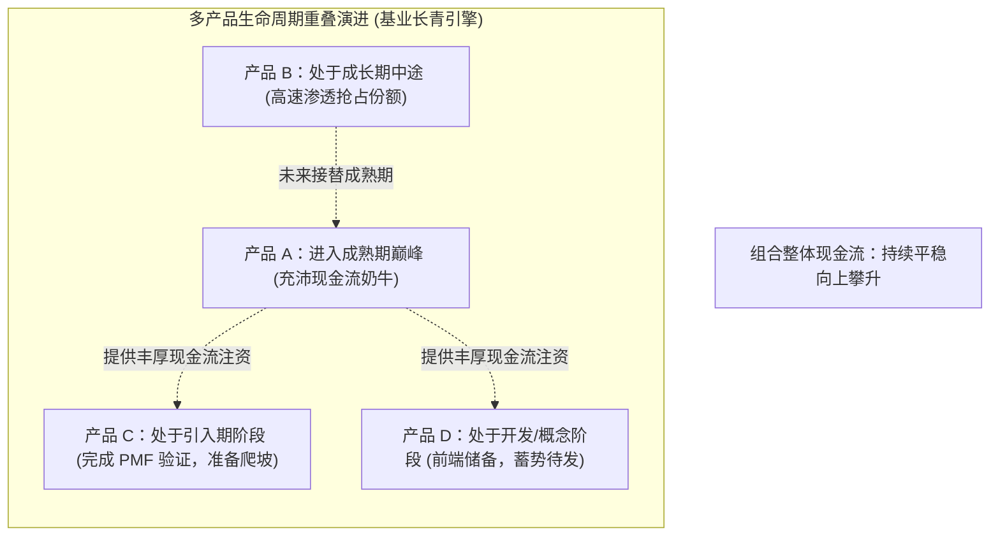

# 1.8-1.10 产品生命周期（PLC）各阶段管理与组合影响

> [!IMPORTANT] 核心提要
> 自然界万物皆有生死轮回，产品亦无法逃脱生命周期的客观宿命。**产品生命周期（Product Life Cycle, PLC）**是 NPDP 知识体系中连接产品规划、上市营销与组合战略的核心纽带。在现代商业环境下，伴随技术代际跃迁与全球化竞争加剧，**产品生命周期呈现出显著的加速缩短趋势**。企业唯有深入掌握**引入期、成长期、成熟期、衰退期**各阶段的动态营销组合（4P）策略，并运用**多产品 S 曲线梯队叠加效应**，方能在单品走向消亡前完成增长接力，实现企业的基业长青。

---

## 1. 产品生命周期（PLC）的核心概念与阶段界定

产品生命周期是指一个产品从最初构想萌芽到最终在市场上退出历史舞台所历经的全过程。在 NPDP 理论框架中，生命周期存在**广义**与**狭义**两种重要划分口径。

### 1.1 广义产品生命周期 vs. 狭义产品生命周期

| 维度对比 | 广义产品生命周期（Full PLC） | 狭义产品生命周期（市场/商品生命周期） |
| :--- | :--- | :--- |
| **涵盖跨度** | **从创意构想诞生直至最终退市**（覆盖研发前、研发中、上市后全阶段） | **从研发完成、商业化投放市场开始，直至最终退市** |
| **涵盖阶段** | 机会识别 $\rightarrow$ 初步筛选 $\rightarrow$ 概念开发 $\rightarrow$ 原型制造 $\rightarrow$ 上市准备 $\rightarrow$ 市场导入 $\rightarrow$ 退市 | **引入期 $\rightarrow$ 成长期 $\rightarrow$ 成熟期 $\rightarrow$ 衰退期** |
| **NPDP 侧重点** | 广泛应用于门径管理流程（Stage-Gate）与综合研发项目管理中 | **NPDP 课程中论及“PLC生命周期管理”时的核心默认指向** |
| **现金流特征** | 研发阶段呈现持续的**负现金流**（资本密集沉没）；上市后历经爬坡跨越**盈亏平衡点（Break-even Point）**转为正现金流 | 引入期仍处于高投入低收益阶段，成长期跨越保本点，成熟期迎来现金流巅峰 |

> [!NOTE] 经典考点辨析
> 考试中常出现混淆题型：
> * *错误表述*：“产品生命周期是从发现创意到开发直至上市的过程”（遗漏了漫长的上市后市场运营与最终退市）；
> * *正确表述*：“绝大多数产品在市场中所经历的从**引入（导入）、成长、成熟到衰退**的完整演变过程”。

---

## 2. 产品生命周期日益缩短的四大动因与企业面临的挑战

“从前车马很慢，书信很远，一件物品可以用一辈子；如今产品迭代如白驹过隙。”在当今商业社会，产品生命周期正以肉眼可见的速度加速缩短。

### 2.1 驱动生命周期缩短的四大核心动因
1. **客户需求多样化与高进阶**：物质财富极大充裕，消费者对现有产品的功能产生快速耐受与倦怠，不断对品质、外观、智能化提出更高追求。
2. **市场竞争白热化与跟随模仿**：资本的嗜血本能决定了一旦某款爆品获得高额利润，市场上会迅速涌入海量跟进者与模仿者，推出功能雷同甚至单点超越的竞品，迅速拉低原产品的生命力。
3. **前沿技术加速迭代跨越**：底层硬科技（芯片半导体、AI大模型、新材料、动力电池）以摩尔定律般的速度演进，新技术一旦进入工业化成熟期，立刻全面颠覆上一代产品形态。
4. **全球化信息极速交互**：信息孤岛被彻底抹平。上海诞生的全新创意，数天内即可在波士顿或硅谷产生全球联动与共振，全球同台竞技使得区域性“信息差红利”荡然无存。

### 2.2 企业面临的两大严峻管理挑战
1. **必须建立常态化高频更新机制**：企业绝不能“一款老产品卖十年”。例如汽车行业，哪怕是奥迪 A6、凯迪拉克 CT5 这样具备深厚品牌积淀的车型，也必须保持“一年一小改（2020款到2022款）、三年一换代”的研发节拍。
2. **全周期营销组合（4P）管理的系统性风险**：新老产品切换极易引发渠道反噬。若新产品发布节奏把控不当，极易导致渠道商手中的上一代老产品瞬间沦为仓库滞销积压死库存，直接激化渠道矛盾。

---

## 3. 产品生命周期各阶段管理与 4P 营销组合策略

在狭义 PLC 的四个不同阶段，企业的**经营重心、竞争环境、定价模式、分销渠道与促销手段（4P）**展现出鲜明的阶段性差异。

### 3.1 引入期（Introduction Stage）
* **阶段特征**：产品刚研发完成投放市场，公众认知度极低，销售额小，生产尚未形成规模效应，研发与市场开荒导致现金流为负。
* **核心目标**：**建立品牌知名度（Brand Awareness）**，培育并开拓早期种子市场。
* **4P 营销组合落地策略**：
  * **产品（Product）**：确立严苛的品质标准，快速修复初期小瑕疵；尽早申请专利，筑牢核心知识产权（IP）护城河。
  * **定价（Price）**：依据产品属性选用两大经典路径：
    1. **渗透定价法（Penetration Pricing）**：以极低的价格或高额补贴迅速切入大众市场，换取海量用户基数（*典型案例：滴滴打车早期巨额打车券补贴、美团外卖立减金、瑞幸咖啡首单免费与通用打折券*）。
    2. **撇脂定价法（Skimming Pricing）**：针对高研发投入、高壁垒的先锋科技产品制定极高售价，优先在愿意尝鲜的高端群体中快速收回前期研发成本（*典型案例：早期全息投影系统、超高精虚拟数字人主播年费高达 120 万元*）。
  * **渠道（Place）**：**审慎且聚焦的选择性渠道（Selective Distribution）**。初期切忌盲目铺摊子，应在少数标杆区域或特定垂直渠道打深打透。
  * **促销（Promotion）**：重兵瞄准**早期采用者（Early Adopters）**。吸引具备尝鲜精神的科技发烧友、极客玩家参与试用，依靠先锋群体建立初期口碑。

### 3.2 成长期（Growth Stage）
* **阶段特征**：产品顺利跨越初期壁垒，被更广泛人群所接受，销售量呈指数级爆发，制造成本大幅下摊，企业开始跨越盈亏平衡点并进入盈利区间。
* **核心目标**：**树立品牌偏好（Brand Preference）**，全力扩张并抢占市场份额。
* **4P 营销组合落地策略**：
  * **产品（Product）**：保持核心优良品质，依据市场反馈快速增添新特性与辅助功能。
    > [!NOTE] 经典实战案例：大疆无人机的成长期功能裂变
    > 大疆（DJI）无人机在早期主要面向航模 DIY 极客小众群体。进入成长期后，大疆迅速将无人机形态拓展至大众消费级航拍市场；更进一步切入**农业植保领域**，开发专用于喷洒农药与肥料的农业无人机系统。至 2020 年，全国无人机农药喷洒作业面积突破 **5 亿亩**，催生出“专业飞手”这一全新就业生态，帮助传统农业大幅降本增效。
  * **定价（Price）**：**保持原有定价水平**。此时市场总蛋糕正快速膨胀，资本的大规模恶性内卷尚未爆发，无需贸然降价，充分享受成长期的丰厚红利。
  * **渠道（Place）**：**全面拓展与深化渠道网络**。从原有的少数专业买手店或官网直营，大步迈向行业代理、省市级分销商、政企行业合作采购。
  * **促销（Promotion）**：告别小圈子极客传播，全面转向面向广泛大众客群的大规模品牌与功效传播。

### 3.3 成熟期（Maturity Stage）
* **阶段特征**：产品已广泛渗透至大众市场，市场容量逼近饱和，销量达到历史峰值。**由于利润极其丰厚，引发各路资本与竞争对手大规模涌入，行业陷入刺刀见红的白热化博弈**。
* **核心目标**：**维护现有市场份额（执行防御者 Defender 策略），实现利润最大化**。
* **4P 营销组合落地策略**：
  * **产品（Product）**：**全力强化差异化竞争优势**。在竞品模仿上一代核心功能时，自身已迭代至更稳定的二代/三代产品（*如更强航向防抖、更长续航能力、全向避障技术*）；同时积极围绕核心优势拓展产品生态（*如大疆跨界深耕青少年机甲大师机器人教育生态*）。
  * **定价（Price）**：在激烈竞争下可能引发局部防御性降价或优惠折扣，但最健康的手段依然是依靠卓越的差异化品质维持合理溢价。
  * **渠道（Place）**：**全渠道饱和式覆盖（Intensive Distribution）**。线上（天猫、京东、抖音、官网）与线下（旗舰店、商超数码城、专卖店）全网铺开；对渠道商提供优厚的分润与返点激励，争夺终端最显眼的黄金展位（类似院线黄金排片）。
  * **促销（Promotion）**：广告重心全面聚焦于“强化独特卖点与品牌美誉度”，不断唤醒成熟用户的品牌认同与二次复购。

### 3.4 衰退期（Decline Stage）
* **阶段特征**：由于全新替代性技术的崛起或大众消费习惯的永久变迁，市场总需求持续萎缩，产品销售额与毛利率出现不可逆的雪崩式下跌（*典型被淘汰品类：磁带录音机、随身听 Walkman、学英语复读机、VCD/DVD 影碟机，均已被智能手机与平板 App 完全替代*）。
* **核心目标**：**压降成本实现收益收割（Harvesting），或寻求转型出路与果断退市**。
* **4P 营销组合落地策略**：
  * **产品（Product）**：维持现有存量产线，**积极探寻全新商业用途**或重新定位（*经典案例：3M 公司研发某款黏性极差的弱胶水，原本面临研发失败，后重新定位并改造成全球风靡的“报事贴/便利贴 Post-it Note”*）。
  * **定价（Price）**：**执行“收割战略（Harvesting）”**：全面撤销昂贵的大众广告投入，关闭亏损的线下门店与渠道代理，把营销成本压降到极致；以近乎零推广成本仅保留低成本线上订购，定向服务少数死忠粉与残留用户，实现“每多卖出一件都是纯利润”。
  * **渠道（Place）**：极度收缩渠道网络，撤出大型卖场与主流货架，仅保留低成本售后与残余渠道。
  * **促销（Promotion）**：彻底停止一切大众营销推广；适时将生产线、技术专利或老旧品牌打包出售给第三方企业，完成体面退市。

---

## 4. 产品生命周期各阶段的产品经理角色跃迁

随着产品在生命周期曲线中的位置转移，产品经理的核心能力与角色定位必须发生动态跃迁：

1. **引入期 —— 洞察专家（Insight Specialist）**：
   * 核心使命：深入一线洞察种子用户痛点，以敏锐的市场嗅觉不断微调产品定义，全力驱动产品达成**产品-市场匹配（Product-Market Fit, PMF）**。
2. **成长期 —— 增长黑客（Growth Hacker）**：
   * 核心使命：运用营销漏斗模型（认知 $\rightarrow$ 兴趣 $\rightarrow$ 试用 $\rightarrow$ 成交），最大化扩大用户触达面，以极快节奏驱动规模化裂变增长。
3. **成熟期 —— 留存大师（Retention Master）**：
   * 核心使命：时刻监控净推荐值（NPS）与用户满意度；持续强化独特价值主张，抵御外部野蛮搅局者，牢牢稳住基本盘。
4. **衰退期 —— 翻案达人（Turnaround / Transition Expert）**：
   * 核心使命：在产品末期挖掘边角余热，寻找非常规应用新场景（老树发新芽）；或冷静研判终局，平稳关闭产线并将资源引导至下一代主力产品。

---

## 5. 产品生命周期对产品组合战略的深远影响

### 5.1 单品宿命 vs. 组合长青（多 S 曲线叠加效应）
任何单一爆品（无论是 iPhone 4 还是大疆精灵 1 代）都有其由盛转衰的物理极限。**若企业将全部赌注押在单一产品上，该产品衰退之日便是企业灭顶之时**。

企业要想实现基业长青，必须通过**前瞻性的产品组合管理（Portfolio Management）**，实现**多产品生命周期 S 曲线的梯队无缝重叠**：

> [!IMPORTANT] 核心组合逻辑：未雨绸缪的梯队布局
> * 当**产品 A 处于成熟期利润顶峰时，企业必须已经成功研发出产品 B 并推向市场**；
> * 当产品 A 步入衰退期时，产品 B 刚好接棒进入成熟期现金牛状态，而产品 C 已经在成长期快速冲刺，产品 D 则在研发管线中紧密孵化；
> * 这种**跨周期的多层 S 曲线叠加效应**，使得企业在任何时间节点都有主力产品处于盈利高位，从而拉平单品波动，确保企业整体现金流保持长盛不衰的上扬态势。

### 5.2 全生命周期组合现金流消耗与隐性成本警示
在评估产品组合的综合回报时，必须清醒认识到各阶段的真实投入与产出：
* **概念与研发阶段**：高额资本净支出（负现金流）；
* **商业化上市初期**：为了渠道铺设、广告轰炸、展会宣讲，**投入资金往往比研发阶段更为庞大**；
* **成熟期回报的隐性稀释（售后服务陷阱）**：
  > [!WARNING] 实战商业案例警示：本田摩托车对标哈雷的售后危机
  > 多年前本田摩托车为切入美国高端重机车市场，对标哈雷戴维森（Harley-Davidson）重金研发了一款大型重型摩托车。尽管上市后获得了一定销售收入，但由于产品在实际高速运转中出现严重的发动机密封漏油缺陷，企业不得不支付极其高昂的跨国召回与售后维修索赔费用。最终核算发现，**售后服务的隐性支出彻底吞噬了全部销售毛利，项目陷入实质亏损**。这警示我们：**销售进账不等于最终利润，生命周期后端的维护与服务成本必须在组合规划中予以严密监控**。

---

## 6. 核心精选题解与考点深度还原

### 题目一：高潜力新产品项目的本质特征
* **考题题干**：以下哪个产品开发项目最具有成为成功新产品的潜力？
  * A. 对公司而言的新产品，但主要聚焦于削减现有成本
  * B. 现有产品线的扩展，并主要致力于削减生产制造成本
  * C. 对公司而言的新产品，并伴随着产品线的战略扩展（**推荐答案**）
  * D. 现有产品的微小改进与局部性能拓展
* **解析精要**：
  * 选项 A 和 B 将核心诉求局限于“削减成本”，成本节约型项目很难开拓增量市场空间，无法承担引领公司战略级突破的使命；
  * 选项 D（微小改进）在本质上仍然归属于老产品序列（如凯迪拉克 CT5 的 2020 款到 2022 款加装行车记录仪），仅属维持性维护，谈不上“真正意义上的新产品”；
  * **选项 C 既开辟了公司过往未曾涉足的新业务边界，又有效延伸了企业的产品线宽度，兼具创新性与规模扩张潜力，是新产品潜力评估的最优选**。

### 题目二：产品生命周期中的产品组合优化考量
* **考题题干**：在产品生命周期的全流程管理中，优化产品组合通常需要考虑以下哪些关键要素？
  1. 新产品规划和导入阶段的项目，往往会带来净负现金流；
  2. 上市发布后的运营成熟期项目，通常能为组织贡献充沛的正向现金流；
  3. 组合管理的核心职责仅仅是回顾和分析过往投资成果；
  4. 建立严密的决策框架以及由特定阈值所触发的战略行动预案；
  5. 组合内的所有项目必须与公司和业务单元的宏观发展战略保持高度一致。
* **解析精要**：
  * **命题 3 存在致命错误**：“仅仅是回顾和分析过往成果”将组合管理严重矮化为事后统计。组合管理更核心的是面向未来的动态资源分配、项目优先级筛选与管道平衡；
  * 命题 1 与命题 2 准确揭示了生命周期前端负现金流与后端正现金流的客观规律；
  * 命题 4 与命题 5 强调了决策机制与战略对齐的底线原则；
  * **结论：包含 1、2、4、5，排除 3**。

---

## 7. 产品生命周期（PLC）各阶段管理全景对比速查表（Cheat Sheet）

| 生命周期阶段 | 核心经营目标 | 产品策略（Product） | 定价策略（Price） | 渠道策略（Place） | 促销策略（Promotion） | 现金流与利润特征 | 产品经理核心角色 |
| :--- | :--- | :--- | :--- | :--- | :--- | :--- | :--- |
| **引入期 (Introduction)** | 建立品牌知名度，培育早期市场 | 确立高品质标准，尽早申请专利保护知识产权 | **渗透定价（低价快速起量）** 或 **撇脂定价（高科技定高价收回研发成本）** | 审慎选择少量优质渠道，小范围打透打稳 | 聚焦**早期采用者（尝鲜客/科技发烧友）**，打造种子口碑 | 现金流为净负；销售额低，严重亏损 | **洞察专家**（验证 PMF 契合度） |
| **成长期 (Growth)** | 树立品牌偏好，全力抢占市场份额 | 保持核心质量，增添衍生新功能与场景特性（如大疆农业植保） | **维持原有定价**，享受市场蛋糕膨胀红利，不打恶性价格战 | 快速拓宽渠道，向大客户、政企采购与多区域代理扩张 | 面向大众更广泛群体，进行大规模品牌与功效传播 | 销售额陡增，跨越盈亏平衡点，利润迅速攀升 | **增长黑客**（漏斗拓客，驱动裂变） |
| **成熟期 (Maturity)** | 维护市场份额，实现利润最大化（防御者策略） | **全力强化差异化壁垒**，拉开代差；构建多维周边生态（如机器人教育） | 视竞争可能适度降价，核心靠差异化维持溢价防内卷 | **全渠道高密度渗透**，提供丰厚返利争夺货架最显眼展位 | 持续强化品牌美誉度与独特卖点，唤醒老客复购与防流失 | 销售额与利润达到历史峰值，充沛的现金牛（Cash Cow） | **留存大师**（稳固基本盘，严防客户流失） |
| **衰退期 (Decline)** | 降低成本实现利润收割，或转型退市 | 维持存量供应，挖掘全新用途（如 3M 便利贴）；或果断转产 | **收割战略（Harvesting）**：砍光非核心成本，以零推广成本赚取纯利 | 极度收缩渠道，仅保留低成本线上直购或特定死忠粉渠道 | 全面停止大众广告促销，适时打包出售产线或技术专利 | 需求断崖式下跌，销售萎缩；降本后维持微薄纯利直至退市 | **翻案达人**（老树发新芽，或体面清盘） |