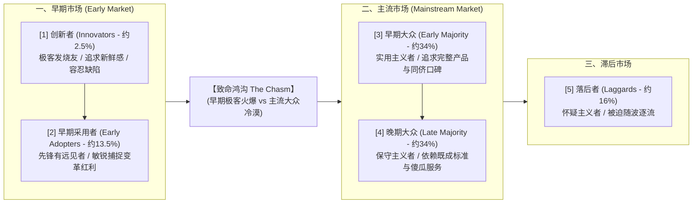
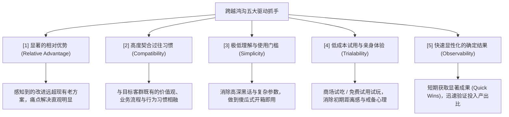
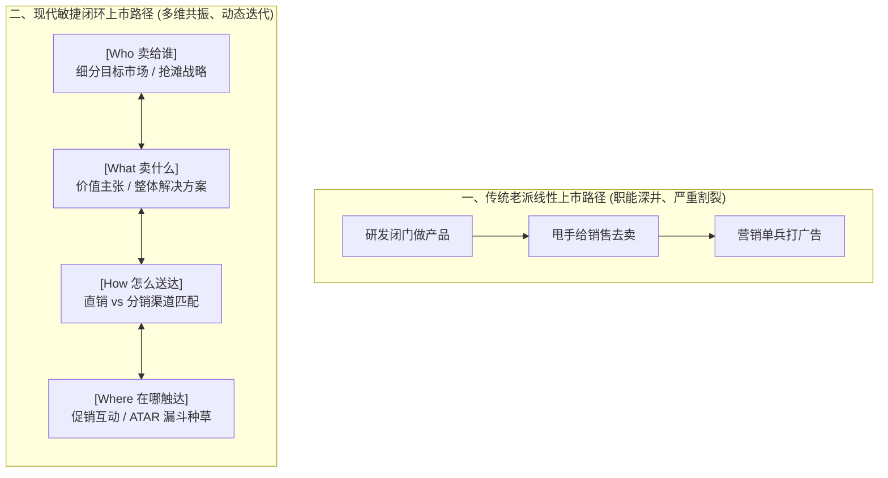
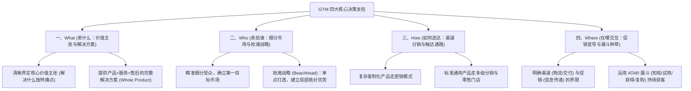

# 1.11-1.12 跨越鸿沟（产品引入关键阶段）与新产品上市路径

> [!IMPORTANT] 核心提要
> 新产品成功完成研发并推向市场，绝不意味着商业成功的必然降临。高科技与创新产品在进入市场时，必然遭遇技术采用生命周期中的“死亡深渊”——**跨越鸿沟（Crossing the Chasm）**。硅谷著名商业思想家杰弗里·摩尔指出：**早期市场（先锋极客）与主流市场（实用大众）之间存在本质的认知断层**。未能跨越鸿沟的产品终将沦为小众极客的玩物并走向早夭。企业必须借助**抢滩战略（Beachhead Strategy）**与现代**新产品上市路径（Go-To-Market, GTM）**，实现从早期试水到主流引爆的战略跨越。

---

## 1. 杰弗里·摩尔“跨越鸿沟”理论与技术采用生命周期

在产品生命周期的引入期与成长早期，市场扩散并非平滑连续的曲线，而是呈现出明显的断裂带。

### 1.1 五类技术采用消费人群深度画像

根据埃弗雷特·罗杰斯（Everett Rogers）与杰弗里·摩尔（Geoffrey Moore）的理论，消费人群按技术接纳心理被划分为五类：

1. **创新者（Innovators，约 2.5%）—— 科技发烧友与探索极客**：
   * **行为动机**：对新技术本身怀有狂热兴趣，购买纯粹出于尝鲜与探索乐趣；
   * **决策特征**：**根本不在乎品牌背景与商业成熟度**，即使产品存在严重 Bug、缺乏说明书，他们也乐在其中，甚至主动帮助开发者寻找系统漏洞。
2. **早期采用者（Early Adopters，约 13.5%）—— 有远见的行业先锋（Visionaries）**：
   * **行为动机**：能够凭借超前的直觉与商业想象力，敏锐洞察新技术能带来的巨大效率提升与战略红利；
   * **决策特征**：不盲从大众舆论，渴望借助新兴产品走在行业曲线最前端、引领时代潮流。
3. **早期大众（Early Majority，约 34%）—— 实用主义者（Pragmatists）**：
   * **行为动机**：**主流市场的真正大门**。极具务实精神，购买新产品的唯一动机是“能否实实在在解决痛点、降本增效”；
   * **决策特征**：**极其厌恶试错风险**。绝不愿做小白鼠，要求产品必须是功能齐备、性能稳定的“完整产品（Whole Product）”，且只参考同行业熟人的真实使用反馈。
4. **晚期大众（Late Majority，约 34%）—— 保守主义者（Conservatives）**：
   * **行为动机**：对高新技术抱有天然的警惕与抗拒心理，缺乏学习复杂新技术的热情；
   * **决策特征**：必须等到行业技术标准完全定型、市场充分普及、配套提供“一键安装、傻瓜式操作”的一站式交钥匙服务时，才为了避免被社会淘汰而跟随购买。
5. **落后者（Laggards，约 16%）—— 怀疑主义者（Skeptics）**：
   * **行为动机**：坚定的旧技术守旧派，对所有新事物持全盘否定态度；
   * **决策特征**：只有在原有老产品被彻底停产销毁、外部基础设施彻底关闭（例如所有燃油车加油站全部拆除关闭）等极端倒逼情形下，才迫不得已转向新方案。

---

## 2. 深度案例透视：人群认知鸿沟的现实映射

> [!NOTE] 经典对比案例：五年前购买特斯拉（Tesla）的两个人
> 假设在特斯拉 Model 3 刚刚推向市场的早期，有两位看似相同的早期买家：
> * **买家 A（汽车工程专家）**：属于典型的**早期采用者**。他看重的是特斯拉革命性的三电底盘架构、纯视觉自动驾驶算法算力，能够忍受早期车辆缝隙不均、内饰毛糙等瑕疵，乐于探索 OTA 升级；
> * **买家 B（中学数学教师）**：属于潜在的**实用大众**。他买车纯粹为了遮风挡雨上下班通勤，需要的是极高的故障稳定性、充沛密集的充电桩网点以及随处可修的售后网点。
> * **营销话术的灾难错位**：如果销售用讲给汽车专家的“电机磁阻扭矩、算力 TOPS、FSD 神经网络”去推销给数学老师，老师只会感到不知所云且缺乏安全感；反之，若用“买菜代步省油钱”的话术去打动科技专家，也无法展现其革命性价值。**两类群体无法作为彼此的引荐参照物，这就是鸿沟的现实投影**。

---

## 3. 鸿沟形成的深层机理与各阶段微裂痕

### 3.1 致命鸿沟形成的深层矛盾根源
鸿沟之所以致命，源于**早期采用者（先锋有远见者）与早期大众（实用主义者）之间无法调和的期望错配**：
* 早期采用者拥抱变革驱动力，为追求行业领先可以忍受半成品；
* 早期大众追求渐进式生产力改善，只为高可靠的成熟方案买单；
* **致命死结（自指循环怪圈）**：
  > [!WARNING] 早期大众的信任锁死机制
  > 早期大众在做出购买决策前，**必须看到其他早期大众的成功标杆案例**；但如果企业尚未跨越鸿沟，市场上根本不存在早期大众的成功案例！同时，早期大众**绝不相信早期极客发烧友的推荐**（认为极客们是一群不计成本的疯子）。这种相互指引的死循环，直接导致无数初创产品在此处失速暴跌。

### 3.2 扩散链条中的微裂痕（Micro-Chasms）
除了最凶险的“大鸿沟”外，各客群跨越之间同样存在认知微裂痕：
* **惠普（HP）打印机案例**：惠普曾研发过一款性能卓越、功能强大的打印机，在早期大众（具备一定操作能力的专业人士）中大获好评。然而在推向晚期大众时遭遇断崖式惨败——原因在于该设备需要手动配置复杂的驱动参数，而晚期大众只接受“傻瓜相机式的一插即用”。
* **摄影器材的圈层割裂**：长焦单反大炮筒虽然成像画质顶尖，但大众用户宁可选择算法自动调教的手机摄像头，核心就在于学习认知成本的代差。

---

## 4. 跨越鸿沟的五大加速要素（罗杰斯创新扩散法则）

企业要想抹平认知鸿沟，必须在产品设计与推广中严格满足以下五大心理认同抓手：

1. **被感知的相对优势（Relative Advantage）**：新产品带来的效能飞跃必须极其明显，让早期大众感知到“放弃老办法转向新方案是压倒性划算的”。
2. **兼容性与一致性（Compatibility）**：新产品的交互逻辑必须与用户过去形成的工作习惯、心理认知与业务流高度兼容，不强迫用户重构行为模式。
3. **极简易懂性（Simplicity / 低复杂性）**：用最朴素的大白话传递价值，杜绝工程师思维的专业术语堆砌；流程傻瓜化，降低学习认知负担。
4. **可试验性与可体验性（Trialability）**：
   * 类似商场食品推广的“**免费试吃**”策略；
   * 为潜在用户提供低门槛甚至零成本的试用版（Free Trial）、样品体验或交互演示，让用户亲手感知产品价值，打消购买疑虑。
5. **结果可见性（Observability / 快速见效 Quick Wins）**：
   * 确保用户在上手初期就能在短时间内轻松看到确定的成效与正向收益；漫长的回报周期会彻底耗尽实用主义者的耐心。

---

## 5. 新产品上市路径（GTM）：从线性割裂到敏捷闭环

### 5.1 传统上市路径 vs. 现代敏捷上市路径

* **传统老派路径的致命弊端**：研发人员只顾闷头开发，销售人员只知照单要提成，营销团队脱离产品打广告。信息极度不对称，研发倾注心血的亮点销售不会讲，市场暴发的需求研发不了解，导致产品上市即碰壁。
* **现代敏捷路径的运作精髓**：以目标细分人群为起点，产品、渠道与促销形成互相校验的飞轮。销售端的反馈实时反哺研发改进，渠道随着客群成熟度动态调整。

---

## 6. 新产品上市（GTM）四大决策支柱：What / Who / How / Where

在规划新产品上市路径时，产品经理必须系统化落地四大核心维度：

### 6.1 What（卖什么）—— 核心价值主张与整体解决方案
* **明确独特价值主张（Value Proposition）**：清晰提炼自身产品与竞品的本质差异，回答“为什么用户必须从我这里购买”。
* **提供整体解决方案（Whole Product Solution）**：现代商业已脱离单纯贩卖裸机硬件的时代。产品必须附带完备的售后保障、培训指导、备件支持与升级服务，为客户提供“交钥匙”式的省心体验。

### 6.2 Who（卖给谁）—— 市场细分与抢滩战略（Beachhead Strategy）
* **锁定精准细分市场**：严禁采用“面向全中国 14 亿人”的泛化空想，必须将市场切割至特定行业、特定地域或特定收入群体。
* **抢滩战略（诺曼底登陆法）**：
  > [!IMPORTANT] 核心战略：抢滩战略（Beachhead Strategy）
  > 在资源有限的引入期，**切忌全面撒网在全国各大城市全线铺开**！
  > 正确策略是：像二战诺曼底登陆一样，**集中全部兵力猛攻某一个极其狭窄的特定细分省市、特定工业园区或垂直小众客群**；在局部市场做到垄断性统治地位（拿下 50% 以上份额），打透打穿形成绝对样板，以此作为稳固的“滩头阵地”，再以此为跳板向周边相邻市场滚雪球式辐射扩张。

### 6.3 How（如何送达）—— 渠道策略与分销路径
* **渠道属性与产品特性的契合度**：
  * **复杂/高客单价产品（如工业母机、企业级定制软件）**：需要深度的售前技术咨询与现场勘测配置，必须采用**自建直销团队（Direct Sales）**；
  * **标准化/消费级产品（如快消品、大众数码）**：操作极简、通用性强，应依托**经销商网络、商超卖场、电商平台等多级分销（Indirect Distribution）**最大化触达面。

### 6.4 Where（在哪里触达）—— 促销与信息传递（区分渠道与促销）
* **渠道 vs. 促销的本质界限**：
  * **渠道（Place / How）**：关注**实体商品如何从工厂仓库搬运并交付到客户手中**（物流、仓储、代理体系）；
  * **促销（Promotion / Where）**：关注**产品价值信息通过什么触点与形式传递给客户的心智**（信息流、种草、互动、广告、展会）。
* **ATAR 营销漏斗驱动**：
  * 依托 **ATAR 模型（Awareness 知晓 $\rightarrow$ Trial 试用 $\rightarrow$ Availability 可获得性 $\rightarrow$ Repeat 重复购买）**，通过精准投放让目标客群首先知道（Awareness），进而通过试吃试用驱动首次转化，构建顺畅的上市推进闭环。

---

## 7. 跨越鸿沟与新产品上市核心知识速查表（Cheat Sheet）

| 核心模块 / 理论模型 | 核心概念定义与考点要义 | 关键人群 / 核心特征 | 实操落地战略与工具 | 典型管理误区与致命警示 |
| :--- | :--- | :--- | :--- | :--- |
| **技术采用生命周期** | 创新扩散的五类人群演变序列 | 创新者（2.5%）、早期采用者（13.5%）、早期大众（34%）、晚期大众（34%）、落后者（16%） | 罗杰斯创新扩散理论、贝尔曲线人群分布 | 误以为人群之间能够自然传导，忽视了早期极客与大众的心理鸿沟 |
| **跨越鸿沟（The Chasm）** | 早期市场跨入主流市场之间的致命阻断带 | 早期采用者（拥抱变革/容忍缺陷）与早期大众（实用主义/厌恶风险）的诉求断裂 | 整体产品概念（Whole Product）、同类同侪口碑标杆建设 | 试图用极客黑话推销给实用大众；在早期大众尚未建立信任时盲目扩大产能 |
| **鸿沟跨越五大抓手** | 降低认知与采用门槛的五维法宝 | 相对优势显著、兼容过往习惯、极简易懂使用、低成本可试用、结果快速可见 | 免费试用装（Free Trial）、现场试吃、概念原型验证、Quick Wins 设计 | 产品操作过于晦涩反人类；需要漫长周期才能见效，耗尽用户耐心 |
| **抢滩战略 (Beachhead)** | 引入期集中兵力攻克局部滩头堡 | 集中优势资源于极窄的细分赛道，打透打穿形成绝对垄断优势 | 目标细分市场优选、标杆样板工程、诺曼底登陆模型 | 初期野心过大盲目全网全省铺开，兵力严重分散导致全线溃败 |
| **现代 GTM 上市路径** | 研发、销售、营销闭环联动的上市体系 | 摆脱传统线性割裂，确立 What（价值主张）、Who（细分市场）、How（渠道交付）、Where（促销触达） | GTM 战略路线图、跨职能上市协同小组 | 研发与销售各自为政；混淆渠道交付（物流）与促销信息触达（心智） |
| **整体产品 (Whole Product)** | 满足主流大众所需的一揽子完整解决方案 | 核心功能裸机 + 周边增值服务 + 售后保障 + 培训指导 + 配套耗材 | 完整产品架构设计、生态伙伴联盟 | 仅交付未成熟的核心样机，缺乏售后保障，引发早期大众群体退货投诉 |
| **ATAR 推广漏斗** | 衡量新产品从上市认知到商业化复购的经典漏斗 | 知晓（Awareness） $\rightarrow$ 试用（Trial） $\rightarrow$ 渠道可得（Availability） $\rightarrow$ 重复购买（Repeat） | 整合营销传播（IMC）、内容种草、渠道渗透率盘点、NPS 复购监测 | 只做宣传不铺渠道（知晓却买不到）；缺乏复购维系导致一锤子买卖 |