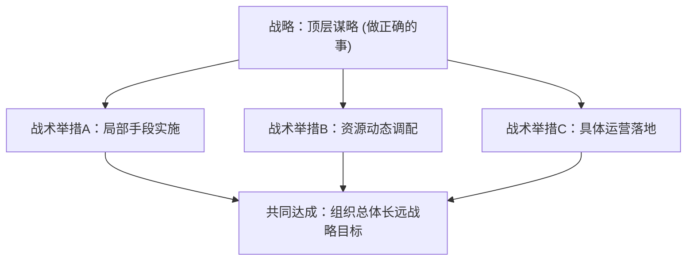
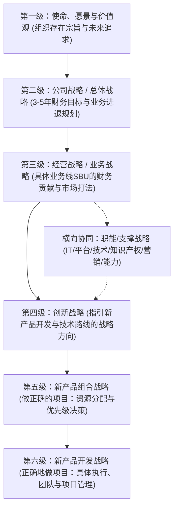

# 1.1-1.2 战略定义、战略与战术区别及战略金字塔层级

> [!IMPORTANT] 核心提要
> “战略”是组织通往理想未来的总纲领。本节涵盖 NPDP 知识体系的基石概念：
> 1. 理解战略源于军事战争的竞争本质，掌握迈克尔·波特与菲利普·科特勒关于战略的权威定义，关注现代战略拓展（数字化转型与可持续性创新）；
> 2. 厘清“战略（做正确的事）”与“战术（正确地做事）”的根本界限，把握战略一致性原则，领会 360 免费杀毒软件降维打击的商业经典；
> 3. 全面剖析战略金字塔自顶向下的六大层级（愿景使命、公司战略、经营战略、创新战略、组合战略、新产品开发战略）及其与职能支撑战略的关系。

---

## 1. 战略的起源、权威定义与现代演进

### 1.1 战略的本质与军事起源
* **军事起源**：战略（Strategy）一词源于古代军事战争，核心在于“知己知彼，百战不殆”。在资源有限且面临敌对对抗的环境中，统帅必须全面权衡自身与对手的兵力、粮饷、地形等资源，运用总体谋略打赢战争。
* **商业本质**：商场如战场。企业在市场竞争中争夺客户与利润份额，必须洞察外部环境与自身能力，通过战略规划获取并维持持久的竞争地位。

### 1.2 管理大师关于“战略”的经典定义
* **迈克尔·波特（Michael Porter, 2008）**：
  * **核心主张**：战略的核心是**获取竞争优势（Competitive Advantage）**。
  * **实现路径**：企业首先必须明确自身的市场定位，全面盘点并认清自身所拥有的资源、技能与专长，通过有效整合内部资源与能力，在特定市场竞争中赢得一席之地并形成护城河。
* **菲利普·科特勒（Philip Kotler）**：
  * **核心主张**：战略是企业基于**行业定位、行业重大机遇及自身能力资源**，为达成企业长远目标而制定的一整套全局规划与行动纲领。
  * **实现路径**：强调远期目标的牵引，将长远愿景转化为阶段性目标和落地举措。
* **广义战略的通识定义**：
  * 战略是**影响并实现“理想未来（愿景）”的方法、路径与综合解决方案**。它明确指引了组织的前进方向（Direction），设定了关键实现路径（Roadmap），并统筹了达成目标所需的资源配置体系。

### 1.3 现代商业环境下的战略延展与演进
在当今商业社会中，单纯的传统竞争战略已无法应对复杂多变的环境，衍生出两大全新战略焦点：
1. **数字化战略 / 数字化转型（Digital Strategy）**：
   * 现代社会各行各业全面走向数字化。从民众出行的网络购票、医疗场景的在线预约挂号与移动缴费，到汽车的车载智能行车系统、智能冰箱与洗衣机等物联网（IoT）家电信息交互，再到企业内部流程管理全面在线化，数字化已成为企业提升效率、重构商业模式的核心战略选择。
2. **可持续性创新战略（Sustainable Innovation Strategy）**：
   * 企业在激烈竞争与扩张过程中，若以破坏自然环境或损害特定群体利益为代价，将不可持续。“人类只有一个蓝色星球”，现代战略高度强调**兼顾当代人发展需求与子孙后代福祉**，确保经济增长、生态环境保护与社会公平和谐的可持续发展。

---

## 2. 战略与战术的辨析及战略一致性法则

### 2.1 战略 vs. 战术的本质区别
* **战略（Strategy）**：大方向、大规划、长远蓝图与核心定位。回答的是**“我们要去向何方”**以及**“做正确的事（Do the right things）”**。
* **战术（Tactics）**：在具体战役、特定业务场景或单场博弈中所采用的手段、技巧与具体操作方法（例如田忌赛马中用下等马对阵上等马以弱胜强的对策、局部阵地作战中选用何种武器等）。回答的是**“我们如何高效执行”**以及**“正确地做事（Do things right）”**。
* **核心从属关系**：**战术必须无条件服从并服务于总体战略**。缺乏战术支撑的战略是空中楼阁，缺乏战略牵引的战术是盲目折腾。

### 2.2 经典商业案例：360杀毒软件的升维战略打击
在 PC 时代早期，杀毒软件市场群雄割据，包括卡巴斯基（Kaspersky）、诺顿（Norton）、金山毒霸、江民杀毒、迈克菲（McAfee）等：
* **传统杀毒软件的战术层争夺**：各厂商将自身牢牢局限在“杀毒工具提供商”的维度，在产品定价（如单套年费 199 元、68 元、39 元）与病毒库特征码更新能力上相互拼杀、内卷竞争。这属于同维度的战术级竞争。
* **360 的升维战略创新**：奇虎 360 横空出世，推出**“永久免费（0元）”**杀毒模式：
  * **跳出杀毒工具思维**：周鸿祎没有把自己定义为一家杀毒软件公司，而是将安全杀毒工具升维为**获取海量互联网流量的超级入口**。
  * **商业模式降维打击**：利用免费杀毒迅速清场并席卷全国上亿 PC 桌面，形成极高粘性的流量底座（“雁过拔毛”）；后续通过 360 安全浏览器、搜索、软件管家、导航主页广告分发与游戏联运实现海量变现。传统软件依赖卖光盘/充值卡赚取蝇头小利，面对来自更高战略维度的免费降维攻击毫无招架之力，行业格局彻底重构。

### 2.3 战略一致性（Strategic Alignment）法则
企业在长期经营中，面对外部环境的变化，其具体的战术手段可以灵活调整，但总体的战略目标与宗旨必须保持高度一致性。若执行与战略脱节，将导致“南辕北辙”。

> [!NOTE] 现实映射：从个人生活到国家战略的一致性
> * **个人与家庭育儿案例**：父母在抚育孩子过程中，可能今天报奥数、明天退奥数、后天报钢琴与美术，战术手段根据孩子精力与反馈频繁加减调整，但根本宗旨始终如一——“将孩子培养为身心健康、有独立生存能力的栋梁之才”。
> * **国家长期战略案例**：新中国外交历经抗美援朝的武装对抗、1970年代尼克松访华与中美建交的破冰合作、1990年代驻南联盟使馆被炸事件中的强烈谴责与克制隐忍，再到当下大国外交的果断坚决。外在应对策略随国际力量对比灵活变动，但国家总体根本目标始终未变——“维护国家稳定发展、建设中国特色社会主义、实现中华民族伟大复兴”。
> * **企业基业长青**：企业拥有多条生产线和跨周期产品矩阵，资源的倾斜与产品增减可以变动，但必须时刻校准与公司战略保持同频共振，才能保障企业在 3 年、5 年乃至更长周期内存活与繁荣。

---

## 3. 战略金字塔的六大层级（Hierarchy of Strategy）

在现代企业组织中，战略由顶层的高度抽象理念逐级细化为底层的具体执行，形成严密的金字塔层级体系：

### 3.1 第一级：使命、愿景与价值观（Vision, Mission & Values）
* **制定主体**：通常由公司董事会、创始人团队、核心大股东共同确立。
* **核心内容**：
  * **使命（Mission）**：阐述“企业因何而存在”，即组织立身于世的本质理由与核心社会价值；
  * **愿景（Vision）**：描绘“企业未来要成为什么”，是组织在 10 年、20 年甚至更长远周期内的理想蓝图与宏大追求；
  * **价值观（Values）**：规范团队在奔赴愿景过程中的文化信仰、行为准则与道德底线，明确“哪些事情绝对不可触碰与违背”。

### 3.2 第二级：公司战略 / 企业总体战略（Corporate Strategy）
* **核心内容**：站在公司集团最高维度制定的总体规划，明确未来 3 到 5 年公司的整体财务目标（如营业收入、利润总额、市值增长等）。
* **决策重点**：决定公司进入哪些新行业/新赛道、退出哪些衰退业务，以及在不同业务板块之间如何进行资本与核心资源的大规模调配与统筹。

### 3.3 第三级：经营战略 / 业务战略（Business Strategy）
* **核心内容**：针对特定业务线或战略业务单元（SBU, Strategic Business Unit）制定的战略。
* **业务贡献划分**：明确该业务单元在未来 2 至 5 年内如何为公司整体战略做贡献（例如公司今年定下一个亿的“小目标”，明确 A 业务贡献 4000 万即 40%，B 业务贡献 3000 万即 30%）。
* **规模适配特点**：在初创或中小型企业中，通常不严格区分公司战略与经营战略；而在大型多元化企业集团中（如同时涵盖通信设备、智能手机、笔记本电脑等多元业务线），各业务板块必须设立独立的经营战略。

### 3.4 第四级：创新战略（Innovation Strategy）
* **核心内容**：为达成业务单元设定的战略目标，规划如何通过研发新产品、应用新技术或开创新商业模式来占领市场。
* **核心产物**：制定清晰的**产品路线图（Product Roadmap）**与**技术路线图（Technology Roadmap）**，明确创新攻关的核心焦点与关键里程碑节点。

### 3.5 第五级：新产品组合战略（Portfolio Strategy）
* **核心内容**：对应 NPDP 知识体系第二章。聚焦于**“做正确的项目（Do the right projects）”**。
* **资源配置抉择**：企业的人力、资金、设备资源永远是有限的。若企业全年度总研发投资预算仅有 6000 万元，组合战略负责在海量待选项目中进行筛选与排序，决断“哪些项目批准立项上马、哪些项目暂缓、哪些项目坚决不上”，以实现企业资源配置价值的最大化与战略协同。

### 3.6 第六级：新产品开发战略（Product Development Strategy）
* **核心内容**：具体项目的落地执行战略，聚焦于**“正确地做项目（Do the projects right）”**（紧密衔接 PMP 项目管理体系）。
* **落地实践**：项目获批后，明确具体开发模式（自主研发自主制造、委外定制开发还是采购集成）、跨职能开发团队组建方式、成员分工与协作流程、汇报机制与全生命周期监控。

### 3.7 横向支撑：职能战略 / 支撑战略（Functional / Enabling Strategies）
* 垂直战略层级的顺畅落地离不开横向职能体系的保驾护航。包括但不限于：
  * **IT 战略**：组织数字化底座与信息化系统保障；
  * **营销战略**：渠道建设、市场推广、品牌公关与用户增长；
  * **能力与人力资源战略**：组织人才招聘、梯队培养与激励机制；
  * **平台战略与技术战略**：跨产品通用平台搭建与底层核心技术攻坚；
  * **知识产权（IP）战略**：专利布局、商标防御与知识产权维权保护。

---

## 4. 战略金字塔六大层级全景速查表（Cheat Sheet）

| 战略层级 | 英文对应 | 核心定位与职责 | 回答的核心问题 | 关键成果物 / 衡量指标 | 典型决策案例 |
| :--- | :--- | :--- | :--- | :--- | :--- |
| **第一级：使命愿景价值观** | Vision, Mission & Values | 组织的最高宗旨、终极理想与行为准则，指引前进总方向 | 为什么存在？要成为什么？底线原则是什么？ | 使命陈述、远景愿景口号、核心价值观准则 | 阿里巴巴“让天下没有难做的生意”；华为愿景 |
| **第二级：公司/企业战略** | Corporate Strategy | 集团总体最高纲领，统揽未来 3~5 年全局财务目标与业务版图 | 公司未来几年做成什么样？做哪些行业？退哪些业务？ | 集团整体营收/利润目标、业务进退并购决策清单 | 集团决定全面进军智能电动汽车，剥离非核心传统地产业务 |
| **第三级：经营/业务战略** | Business Strategy | 针对具体业务线（SBU）的竞争策略与财务目标拆解 | 某条特定业务线如何竞争并贡献业绩？ | 业务线独立利润指标（如贡献集团40%利润）、业务竞争战术 | 智能手机业务线主打中高端破局，PC业务线主打渠道下沉 |
| **第四级：创新战略** | Innovation Strategy | 达成业务目标的创新路径与新产品规划，指引技术突破 | 依靠何种创新与新产品在市场中突围？ | 产品路线图（Roadmap）、核心技术攻关方向清单 | 制定下一代三折叠屏手机产品路线图与铰链研发计划 |
| **第五级：新产品组合战略** | Portfolio Strategy | 在资源与预算约束下筛选和平衡项目（做正确的项目） | 有限资源投给谁？哪些项目上马，哪些放弃？ | 研发项目优先级矩阵、投资组合预算分配方案（如6000万分配） | 在 20 个预备研发项目中精选 6 个投入 6000 万元，砍掉 14 个低收益项目 |
| **第六级：新产品开发战略** | Product Development Strategy | 单个获批项目的具体落地执行（正确地做项目，承接PMP） | 谁来做？怎么做？自研还是外包？如何协同监控？ | 项目章程、团队组织架构表、开发甘特图、跨部门汇报协同机制 | 某智能座舱项目自研算法、硬件外包，采用敏捷跨职能团队双周迭代 |
| **横向支撑：职能战略** | Functional Strategies | IT、营销、技术平台、知识产权、人才组织等横向保障 | 各支持部门如何赋能并保障各业务战略达成？ | 数字化转型方案、专利防御池、平台共享模块库、人才培养战略 | 搭建集团统一中台共享平台，为各终端产品线复用研发资产 |
