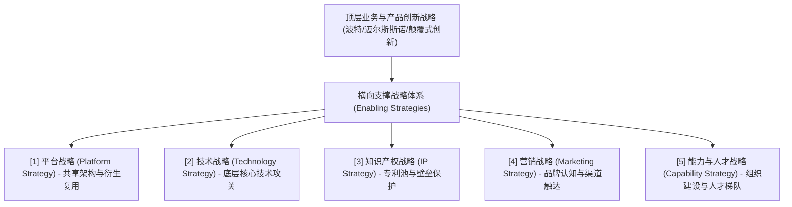
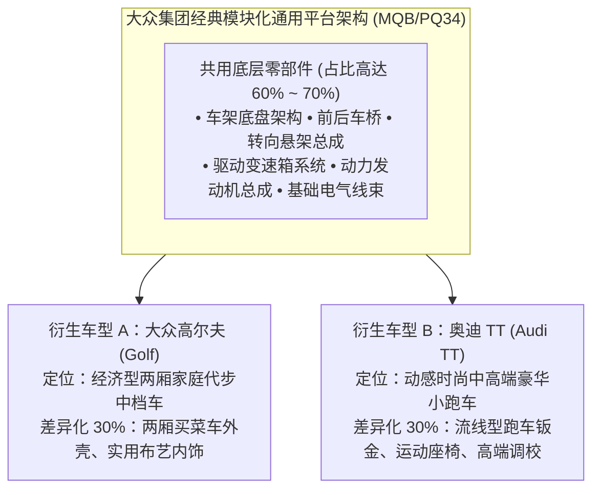
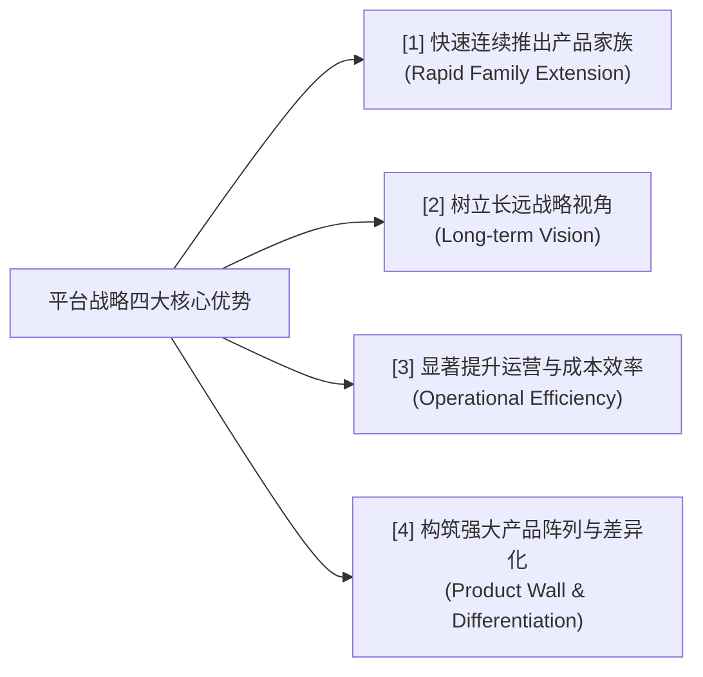

# 1.12 支撑战略（一）：平台战略及其优势分析

> [!IMPORTANT] 核心提要
> 企业仅有宏大的产品创新战略（如波特竞争、迈尔斯斯诺、颠覆式创新等）尚不足以克敌制胜，必须依靠扎实的横向**支撑战略（Enabling / Supporting Strategies）**保驾护航。支撑战略涵盖五大支柱：**平台战略、技术战略、知识产权战略、营销战略与能力战略**。
> 本节聚焦于五大支柱之首——**平台战略（Platform Strategy）**：
> 1. 掌握平台战略的权威定义：**“一系列子系统及其接口构成的通用架构，旨在高效开发一系列衍生产品”**，彻底告别重复造轮子；
> 2. 领会《指环王》三部曲套拍（2.9亿美元总成本 vs. 《阿凡达》单部4亿美元）以及大众汽车集团“奥迪 TT 与大众高尔夫共享 70% 底层零部件”的工业化复用智慧；
> 3. 深入理解平台战略的四大核心优势：**快速连续推新、长远战略视角、极致运营效率与降本、构建产品阵面实现降维打击**。

---

## 1. 支撑战略体系与平台战略的本质定位

在战略金字塔与执行体系中，支撑战略是连接顶层创新规划与底层研发交付的“发动机底座”：

### 1.1 平台与平台战略的权威定义
* **平台（Platform）**：是指**一系列子系统（Subsystems）及其接口（Interfaces）**，它们共同构建起一个**通用的技术与物理架构（Common Architecture）**。
* **平台战略（Platform Strategy）**：企业立足长远，通过预先投入研发这一通用底层架构，以其为底座**高效、低成本、快速地制造与衍生出一整套产品家族（Derivative Products / 衍生产品）**的全局规划。
* **核心哲学**：**坚决杜绝“重新发明轮子（Reinventing the wheel）”**。将高度通用、共性标准化的软硬件能力下沉到底层平台，研发团队只需关注最上层的差异化特性配置。

---

## 2. 平台战略经典跨界商业案例解析

### 2.1 影视工业的“平台化套拍”：《指环王》三部曲 vs. 《阿凡达》
* **数据反差与成本悬殊**：
  * 2001 年彼得·杰克逊执导的史诗巨作《指环王（魔戒）》三部曲陆续公映，**三部电影总制作成本合计仅 2.9 亿美元**；
  * 2009 年詹姆斯·卡梅隆执导的 3D 巨制《阿凡达》，仅**单部电影制作成本即高达 4 亿美元**。
* **背后的平台化复用机制**：
  * 《指环王》在立项初期即确立了“平台化套拍（Batch Shooting）”的模式：一次性完成新西兰全景搭桥布景，同一套演员班底签下长期合约，同一套维塔数码（Weta Digital）CGI 特效渲染引擎流水线运转；
  * 剧组一次性拍摄长达 9 个多小时的海量素材，随后在后期机房分别精细剪辑为第一部《护戒使者》、第二部《双塔奇兵》和第三部《王者归来》；
  * **避坑启示**：许多经典电视剧或电影第一部大火后，筹拍第二部时往往遭遇“演员成名后身价暴涨片酬付不起、原班人马档期凑不齐、原始影棚拆除重建成本高昂”的窘境。《指环王》通过平台化套拍，将演员、布景、道具与特效资产极致复用，成就了影史最具性价比的商业奇迹。
  * **场景复用拓展**：正如陈凯歌导演为拍摄《妖猫传》在湖北襄阳耗巨资兴建了一整座仿唐影视城，后续向其他影视剧组全面开放作为拍摄平台，极大地摊薄并收回了前期基建固定成本。

### 2.2 汽车工业的模块化平台：大众高尔夫（Golf）与奥迪 TT（Audi TT）

* **外观与定位的巨大落差**：从整车视觉看，大众高尔夫是朴素内敛的家庭两厢家用轿车，售价亲民；而奥迪 TT 是线条前卫张扬、售价高昂的中高档豪华小跑车。
* **内在骨架的高密度共享**：
  * 将两台车拆解后会发现，**其内部多达 60% 至 70% 的核心零部件与物理结构是完全共用通用的**；
  * 两者共享相同的模块化底盘平台架构、车架结构件、前后轮轴承、动力总成支撑、转向与驱动结构以及悬架核心系统；
  * 工程师只需针对奥迪 TT 更换专属的流线型跑车外壳、调校运动减震阻尼并升级豪华皮质座舱（仅占整车研发量 20%~30%），即可快速变现出一款高溢价旗舰跑车。

### 2.3 消费电子终端的产品矩阵：华为多系列齐发
在消费电子手机领域，若每一款手机都重新设计主板走线、天线结构与芯片接口，企业将不堪重负。
* 华为依托自研麒麟 SoC 平台、基础射频天线平台与鸿蒙/EMUI 系统底座，能够极其敏捷地衍生出庞大的多系列产品阵列：
  * **P / Pura 系列**：主打极致移动影像与先锋美学；
  * **Mate 系列**：主打商务尊贵、大屏协同与黑科技硬核旗舰；
  * **Nova 系列**：主攻年轻潮流自拍群体；
  * **畅享系列 / 荣耀系列**：下沉大众千元机与极致性价比市场；
* 底层技术平台的成熟，支撑了企业在极短周期内如流水线般向市场倾泻多层级产品。

---

## 3. 平台战略的四大核心优势（NPDP 核心考点）

### 3.1 优势一：快速连续地推出一系列衍生产品（Rapid & Continuous Launch）
* 在通用架构和标准化子系统接口确立后，研发团队开发新单品不再是从 0 到 1 的漫长跋涉，而是从 70 到 100 的模块化拼装与功能增减。
* 企业能够以数倍于竞争对手的频率，闪电般推出覆盖不同价格带的衍生产品家族，牢牢锁定各个消费层级的市场注意力。

### 3.2 优势二：树立长远战略发展视角（Long-term Strategic Vision）
* **前期重投入，后期高享受**：搭建通用平台的初期技术攻关与标准化设计极其艰难，耗资巨大且耗时漫长；
* 但平台战略迫使高管团队跳出单一产品的短视，以 5 至 10 年的长远眼光审视组织的技术底座。一旦平台构筑成功，后续开发版本 10、11、12 乃至跨代际产品的门槛与不确定性大幅骤降。

### 3.3 优势三：大幅提升运营效率与摊薄开发成本（Cost Amortization）
* **研发效率倍增**：减少了成百上千位研发工程师在基础功能上的重复劳动；
* **供应链规模效益（采购议价权）**：由于核心零部件（如车轴、芯片模组、屏幕面板）在多款产品间高度通用，采购部门可以合并订单发起数以千万计的巨额集采，极大压降单件采购成本与模具摊销费用。

### 3.4 优势四：构建强大的“产品阵面（Product Wall）”，打出高维差异化
* **单兵对抗 vs. 矩阵围剿**：若行业竞争对手耗费全力打造了一款极其优秀的单点爆品，缺乏平台能力的企业只能孤注一掷与其硬碰硬；
* **产品阵面压制**：具备平台战略的企业，能够在现有技术底座上瞬间生成由“顶级旗舰版（PK高端形象）、标准版（正面硬刚对标）、青春版（极致性价比下沉收割）”组成的**立体化产品墙（Product Wall）**。既展现出深厚雄厚的工业实力，又在价格敏感型客群与品质溢价型客群中全方位拦截竞品。

---

## 4. 平台战略全景速查表（Cheat Sheet）

| 维度 / 考点 | 核心内涵与定义 | 关键衡量特征 | 典型商业/工业案例 | 核心战略价值 | 实战误区与警示 |
| :--- | :--- | :--- | :--- | :--- | :--- |
| **平台战略本质** | 研发通用的子系统与接口架构，以此高效生产衍生产品家族 | 架构通用性、接口标准化、严禁重复发明轮子 | 汽车模块化底盘平台（大众MQB）、手机通用芯片基带平台 | 变“单点研发”为“体系化资产沉淀”，从长远周期规划产线 | **误区**：前期平台研发过重导致短期难以见效，须防范过度设计 |
| **优势1：快速推新** | 大幅缩短新产品概念到上市的研发周期（Time-to-Market） | 模块化拼装、低代码/配置化开发、快速版本裂变 | 华为快速推出 P10/P20/P30 及 Mate 系列、Nova 系列产品线 | 敏捷响应市场变化，抢占细分赛道先机 | 衍生产品过多易导致“同质化套娃”，需保证外观与体验差异 |
| **优势2：长远视角** | 跳出单款项目得失，从长远产品线生命周期进行架构投资 | 5~10年演进规划、通用架构拓展性设计 | 影视基地长期运营出租；软件核心微服务中台搭建 | 为组织构筑持久技术底座，平滑单品生命周期波动风险 | 若底层平台架构选型失误，将导致后续所有衍生产品集体沉没 |
| **优势3：成本与效率** | 核心零部件与研发代码高度复用，极大摊薄前期开发投资 | 60%~70%通用件比例、集采规模降本、模具复用 | 《指环王》三部曲套拍仅耗资 2.9 亿；大众奥迪零件共用 | 供应链采购议价权极大提升，单品边际研发制造成本趋近最低 | 若供应链单一通用件出现设计缺陷，将引发全系产品大规模召回 |
| **优势4：产品阵面** | 快速拉出覆盖高中低端的多产品矩阵，实施多维差异化打击 | 形成 Product Wall（产品墙）、对竞品实施上下两路包抄 | 奥迪TT（豪华跑车）与大众高尔夫（家用车）共享底盘 | 以体系化矩阵对抗单一爆品，兼顾品牌溢价与大众下沉走量 | 必须清晰定义各衍生产品的品牌心智，防止高端品牌被拉低 |
