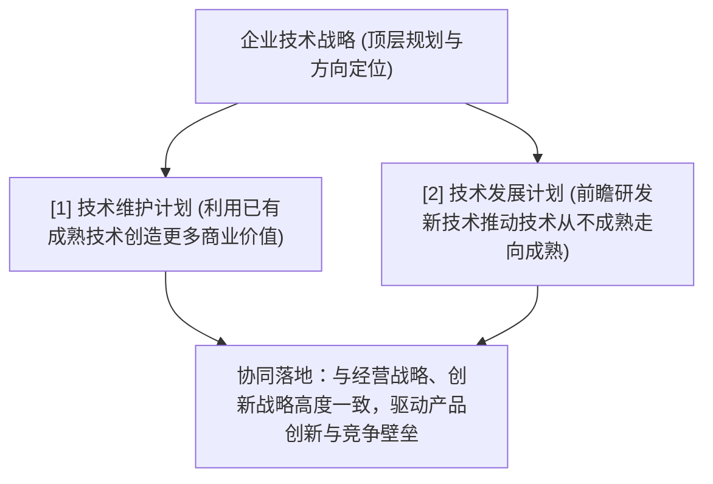
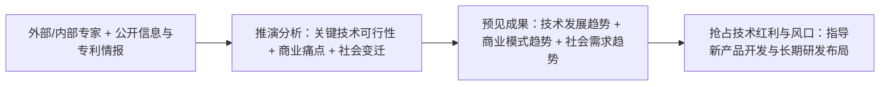
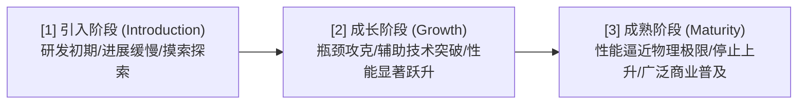
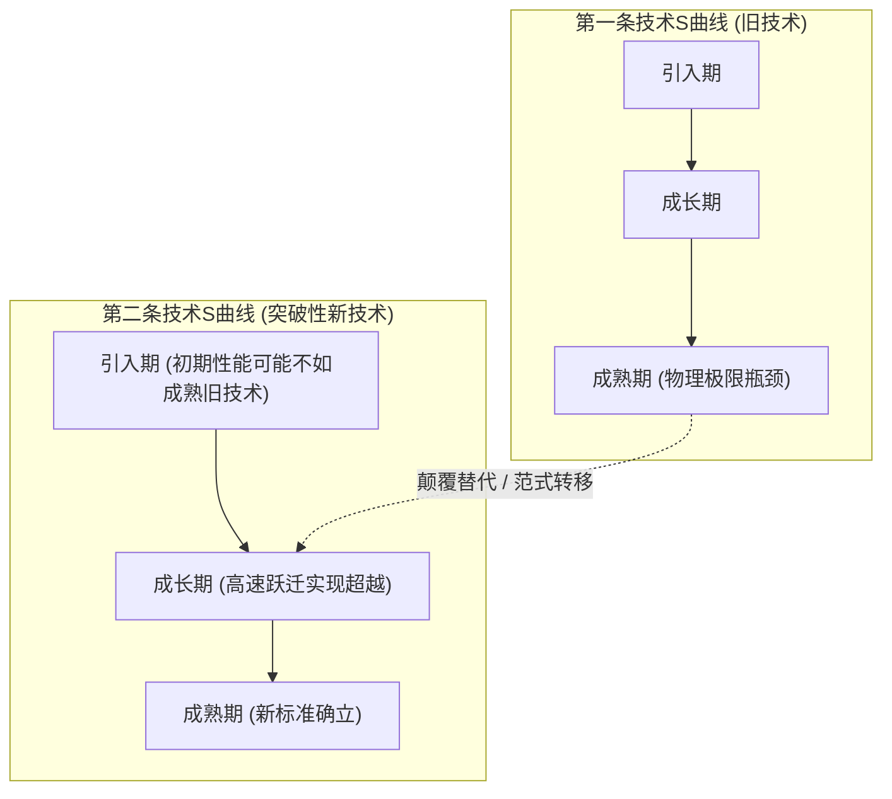
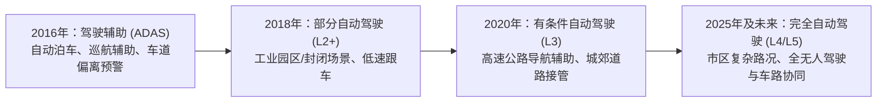
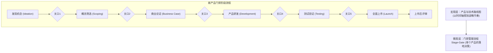

# 1.13-1.14 支撑战略（二）：技术战略、技术预见、S曲线与路线图

> [!IMPORTANT] 核心提要
> 技术战略（Technology Strategy）是支撑企业经营战略与新产品创新战略落地的关键技术底座。在高科技及重度依赖研发的行业中，拥有核心技术与专利壁垒往往决定了企业能否领跑行业并获取超额商业利润。
> 本篇系统涵盖技术战略的双核心（技术维护与技术发展）、技术预见的方法工具与实证案例、技术S曲线的三阶段跃迁与核心考点辨析，以及从宏观技术路线图到微观门禁产品开发流程的协同落地架构。

---

## 1. 技术战略的本质与内涵

### 1.1 什么是技术战略
战略本质上是指明组织的定位、方向与行动计划。**技术战略**是一份指导组织在**技术维护**与**技术发展**方面的顶层规划，确保技术投资与企业整体经营战略、创新战略保持高度一致。

* **技术维护（Technology Maintenance）**：利用现存已有的成熟技术，通过流程优化、降本增效或微创新，赋能现有产品线，最大化提取已有技术资产的商业价值。
* **技术发展（Technology Development）**：面向未来进行新技术研发与探索。任何技术都必须经历从早期不成熟、充满不确定性到逐步稳定成熟的过程，技术发展计划旨在为组织布局中长期技术储备。

### 1.2 商业案例：移动通信技术的代际更替与战略布局
移动通信技术的迭代是技术战略驱动产业竞争格局重塑的经典代表：
* **3G 时代受制于人**：高通（Qualcomm）凭借在 CDMA 等底层核心技术上的先发专利垄断，构筑了严密的技术专利壁垒。国内绝大多数通信设备及终端制造厂商因缺乏核心技术，只能被迫支付高昂的专利许可费，从事微薄利润的代工与组装工作。
* **4G 追赶与 5G 领跑**：在已知后发追赶极度被动的前提下，国内企业（以华为等为代表）与国家战略提前在 4G/5G 阶段加大技术研发投入。5G 时代实现技术反超并领跑全球，掌握了国际标准必要专利（SEP）的话语权。
* **6G 超前布局**：技术竞争永不停歇。在 5G 领跑格局确立后，欧美等部分国家开始跳过局部成熟技术、直接将战略重心前瞻性转向 6G 卫星互联网及太赫兹通信研发；中国亦同步启动 6G 超前预研，形成新一轮技术战略角力。

---

## 2. 技术预见（Technology Forecasting）

### 2.1 技术预见的定义与输入机制
* **核心定义**：**技术预见**是一种系统性洞察未来、预测新兴技术发展趋势及其对组织未来产生深远影响的方法与流程。
* **价值逻辑**：商业竞争中“顺势而为”至关重要（雷军所谓“站在风口上，猪也能飞起来”）。能够提前捕捉规律、洞察趋势的组织，能够抢先开辟新赛道、享受早期爆发红利。聪明的本质往往来自“见多识广”与“触类旁通”（跨界融合与跨界打击）。
* **信息输入来源**：
  * **企业内部专家与工程师**：提供技术可行性与工程实现维度的洞见；
  * **外部学术界与行业专家**：提供基础科学突破与宏观视野；
  * **公开情报与专利数据库**：追踪全球前沿学术论文、行业报告与专利布局动态。
* **研判输出**：推演社会变迁趋势、商业模式演变趋势与核心关键技术演进路径三者的交汇点。

### 2.2 技术预见的常用分析工具
1. **头脑风暴（Brainstorming）**：用于早期的**发散思维**，打破思维定势，尽可能多地挖掘潜在的技术演进方向与交叉应用可能。
2. **专家小组 / 德尔菲法（Delphi Method）**：用于多轮匿名的专家意见反馈与**收敛聚焦思维**，消除权威干扰，逐步在不确定性中达成专家共识。
3. **SWOT 分析**：结合内部优势（Strengths）、劣势（Weaknesses）与外部技术机会（Opportunities）、技术替代威胁（Threats）进行匹配。
4. **专利分析（Patent Analysis）**：分析竞争对手的专利申请量、专利聚类与空白地带，识别技术演变轨迹与壁垒盲区。
5. **逆向工程（Reverse Engineering）**：拆解市面上先锋竞品，解析其技术实现路径，辅助自我研发与技术规避。
6. **趋势外推与情景分析（Trend Analysis & Scenario Planning）**：基于历史数据推演技术发展斜率并建立不同维度的未来情景假设。

### 2.3 经典案例：麻省理工科技评论（MIT Technology Review）二十年验证
自 2001 年起，《麻省理工科技评论》每年评选“全球十大突破性技术（Top 10 Breakthrough Technologies）”，其历史预测为技术预见的长期规律提供了极为直观的参照：

#### （1）2001 年预测技术的 20 年历史回溯与检验
2001 年评选出的十大前沿技术包括：脑机接口（Brain-machine Interface）、数据挖掘（Data Mining）、生物识别（Biometrics）、微光子（Microphotonics）、机器人设计、微流控（Microfluidics）、代码解耦技术、自然语言处理（NLP）、数据资产管理、柔性晶体管（Flexible Transistors）。
经过 20 年的历史沉淀与检验，呈现出经典的**三等分格局**：
* **约 1/3 取得巨大商业成功并成为主流支柱**：如**数据挖掘（演变为今日的大数据与云计算分析）**、**生物识别（人脸/指纹/声纹识别全面普及）**、**自然语言处理（NLP，成为大语言模型与语音交互基石）**；
* **约 1/3 有所发展并取得阶段性突破**：如**脑机接口**（马斯克 Neuralink 植入试验等）、**机器人设计**、**柔性晶体管/柔性屏**；
* **约 1/3 发展远慢于预期或陷入停滞**：受制于材料物理极限或商业化落地成本过高。
> [!NOTE] 启示
> 技术预见并非保证 100% 押中，技术从萌芽到产业化面临大量工程瓶颈与商业不确定性。技术预见的真正价值在于**从成千上万种纷繁复杂的技术信号中，精准筛选并收敛聚焦到极少数高潜力的关键赛道**。

#### （2）2020 年十大突破性技术概览
包括：信使 RNA（mRNA 疫苗与药物）、数据托管与数字化接触追踪、多技能人工智能（Multi-task AI）、基于算法的内容精准推荐（如抖音千人千面算法引擎）、新型锂金属电池（新能源汽车与储能行业爆发，如宁德时代市值跃迁）等。

---

## 3. 技术的 S 曲线（Technology S-Curve）

### 3.1 技术 S 曲线的三个生命阶段
技术的演进通常以累积研发投入（时间/资金）为横坐标，以技术性能指标为纵坐标，呈现出一条拉长的“S”形曲线，经历三个阶段：

1. **引入阶段（Introduction）**：技术处于实验室或原型萌芽期。研发团队探索未知，进展较为缓慢，需要大量的研发试错与资金沉淀，性能提升微弱。
2. **成长期（Growth）**：随着技术机理的认知深入，或者关键辅助技术/上游材料获得突破，技术难关被逐一攻克。此时单位研发投入换来的技术性能呈**指数级显著提升**。
3. **成熟期（Maturity）**：技术方案已高度完善，并被广泛应用于消费市场与工业场景中。但受限于物理学、化学或工程学极限，进一步投入研发已难以换取明显的性能跃升，**技术性能遭遇瓶颈并停止上升**。

### 3.2 【核心考点辨析】技术 S 曲线 vs. 产品生命周期（PLC）

> [!WARNING] NPDP 极高频必考误区：技术没有“衰退期”！
> * **产品生命周期（PLC）**包含四个阶段：引入期 $\to$ 成长期 $\to$ 成熟期 $\to$ **衰退期（Decline）**。产品会因为市场过时、需求转移而销量暴跌并经历衰退。
> * **技术 S 曲线（Technology S-Curve）没有衰退期**！
>   * 技术本身发展到成熟期巅峰后，性能停止上升并长期存在。
>   * 技术不会随着时间自然“衰老”变差，它最终退出历史舞台是因为**遭遇了另一条全新技术 S 曲线的跃迁与替代**。
>   * 新旧技术的替代是**不连续的（Discontinuous）技术跳跃**。

### 3.3 技术跃迁案例
* **计算工具的演进**：机械计算器（物理齿轮传动极限） $\to$ 集成电路芯片与半导体驱动的电子计算器 $\to$ 个人计算机与智能移动终端。
* **通信与终端演进**：固网有线通信 $\to$ 蜂窝无线移动网络与 Wi-Fi 终端。每一次飞跃都源于底层物理芯片与算法的根本换代。

---

## 4. 路线图工具：技术路线图与产品路线图

### 4.1 技术路线图（Technology Roadmap）
* **定义**：技术路线图是以**时间为节点**，清晰描绘技术演进历程与未来前瞻研发计划的结构化示意图。
* **核心作用**：
  * 指导组织内部前沿新技术的研发排期；
  * 为未来新产品的**技术选型**提供确定性依据；
  * **作为产品路线图的重要支撑与补充**：明确回答“未来炫酷的产品功能，底层的哪项技术在何时能够准备就绪”。

### 4.2 案例：自动驾驶技术路线图演进
自动驾驶技术展现了严谨的技术成熟度进阶排期：

* **技术落地约束**：技术路线图不仅关乎算法与传感器（激光雷达/视觉算力）的成熟，还与车联网物联网（V2X）基础设施、国家立法与责任认定等外部条件深度交织。

### 4.3 产品路线图（Product Roadmap）
* **定义**：产品路线图是在时间轴线上对**产品需求、核心功能以及发布交付节点**的总体结构化展现。它回答“在什么时候交付什么产品/功能来满足什么客户需求”。
* **分类形式**：
  * **单产品路线图**：展示单一产品或核心单品在各季度/年度的版本迭代路径（V1.0 发布核心功能 $\to$ V2.0 迭代增值体验 $\to$ V3.0 生态扩展）。
  * **多产品路线图（产品组合路线图）**：展示公司多个业务单元或产品线（如产品线 A、产品线 B）的并行推进节奏。
* **商业战略价值**：
  * **对内拉齐共识**：作为产品经理在研发、测试、营销、供应链之间的核心对齐工具；
  * **对外商业融资**：向投资人清晰阐述产品商业版图与未来盈利潜能，是争取早期资本支持的关键利器。

### 4.4 宏观路线图与微观门禁流程的嵌套关系（俄罗斯套娃模型）
路线图与具体的开发流程构成了从宏观到微观的体系化管理：

* **战略与战术的承接**：宏观产品路线图统领全局产品线；而在具体执行单个产品开发时，必须依托严密的**门禁管理流程（Stage-Gate）**，在每一个关口进行财务可行性、技术达标度与市场风险的漏斗式筛选，确保商业成功率。

---

## 5. 技术战略与路线图全景对比速查表（Cheat Sheet）

| 核心维度 | 定义与核心定位 | 关键特征 / 构成要素 | 核心考点与辨析 | 典型商业案例 |
| :--- | :--- | :--- | :--- | :--- |
| **技术战略** | 规划技术维护与技术发展的顶层战略规划 | 技术维护（榨取成熟技术价值）+ 技术发展（前瞻研发储备） | 必须与企业经营战略、产品创新战略保持高度一致 | 3G 时代高通专利壁垒 vs. 5G 华为弯道领跑与 6G 布局 |
| **技术预见** | 洞察未来技术趋势及其组织影响的方法流程 | 头脑风暴（发散）、德尔菲法（收敛）、SWOT、专利分析、逆向工程 | 不是 100% 押中，而是从海量信号中聚焦收敛至关键赛道 | MIT 科技评论 20 年回溯：大数据/生物识别/NLP 大成，脑机接口渐进 |
| **技术 S 曲线** | 技术性能随研发投入增长的演进轨迹模型 | 引入期（缓慢） $\to$ 成长期（显著跃迁） $\to$ 成熟期（物理极限） | **技术没有衰退期**！成熟后被新一轮技术跳跃（新 S 曲线）颠覆替代 | 机械计算器 $\to$ 电子计算器 $\to$ 智能移动终端 |
| **技术路线图** | 以时间为节点的技术演化和发展规划示意图 | 关键时间节点、底层技术突破里程碑、技术选型指引 | 作为产品路线图的底层技术支撑，解决“功能何时能实现” | 自动驾驶从 2016 辅助驾驶到 2025 全场景自动驾驶 |
| **产品路线图** | 展现产品需求、功能特性与上市时间的规划图 | 单产品路线图、多产品路线图、功能交付时间表 | 对内统合研发营销节奏，对外向投资人与市场证明长期商业价值 | 手机厂商年度旗舰迭代图、阶段门禁流程（Stage-Gate）嵌套 |