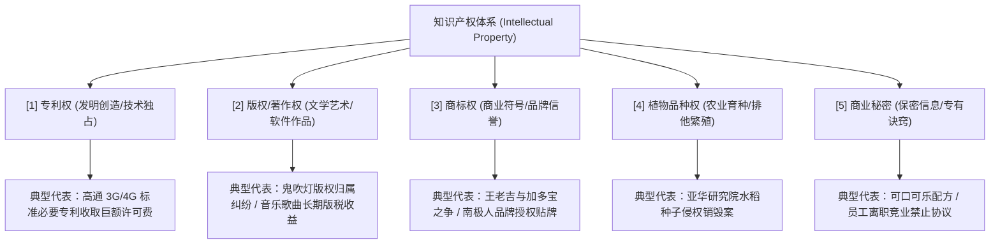
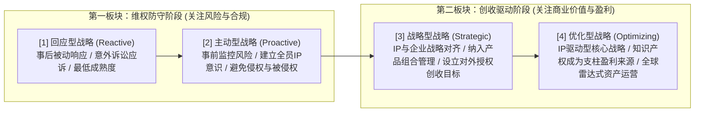
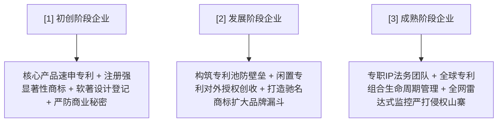

# 1.15 支撑战略（三）：知识产权战略（类型与战略模式）

> [!IMPORTANT] 核心提要
> 知识产权（Intellectual Property, IP）是人类智力劳动成果依法享有的专有权利，是现代新产品战略中构建竞争壁垒（护城河）、保护研发成果与实现技术资产货币化（Monetization）的核心工具。
> 知识产权不仅是法务防御层面的“盾”，更是能够作为独立创收引擎、驱动产业生态繁荣的“矛”。本篇涵盖五大知识产权核心类型、四阶知识产权战略成熟度演变路径，以及企业全生命周期的知识产权防御与经营策略。

---

## 1. 知识产权的本质与商业价值

### 1.1 智力成果的专有财产权
知识产权的本质是法律赋予创造者在一定期限内对其智力成果享有的专有排他权利。随着全球创新经济的发展，知识产权资产在企业整体估值中的比重持续上升。缺乏知识产权意识的企业，不仅难以保护自身的研发投资，还极易落入侵权诉讼的商业陷阱。

### 1.2 商业警示案例：天下霸唱与《鬼吹灯》版权案
* **案情背景**：知名作家天下霸唱（张牧野）创作了现象级盗墓探险小说《鬼吹灯》系列（涵盖《精绝古城》、《龙岭迷窟》、《云南虫谷》等）。在早期网络文学发展初期，作者以极为低廉的价格将《鬼吹灯》的著作权完整转让给了起点中文网（后并入阅文集团）。
* **纠纷爆发**：版权转让后，起点中文网/阅文集团成为了《鬼吹灯》著作权的合法唯一所有人。此后天下霸唱重新创作了其他探险小说并改编为影视剧时，片方使用了“鬼吹灯之XX”作为宣传及片名标识，阅文集团随即发起侵权诉讼。
* **判决启示**：法院最终判定原作者天下霸唱败诉并承担高额赔偿，且不得在后续商业作品中继续使用“鬼吹灯”系列字样。
> [!WARNING] 核心教训
> 智力成果一旦合法出让全部著作财产权，即便是原作者本人也无权随意擅自进行商业衍生。知识产权具有严密的法律权属与排他性，忽视合同与权属约定将付出沉痛代价。

---

## 2. 五大核心知识产权类型深度剖析与商业案例

### 2.1 专利权（Patent）
* **核心定义**：政府专利行政部门依法授予发明人对其发明创造（包含发明专利、实用新型专利、外观设计专利）在法定年限内享有的独占排他权。他人未经许可不得为生产经营目的制造、使用、许诺销售、销售、进口该专利产品。
* **商业案例：高通公司（Qualcomm）的专利许可模式**
  * 高通在 3G、4G 移动通信底层技术（如 CDMA）上拥有极其雄厚的标准必要专利（SEP）。
  * 全球手机制造厂商每生产销售一台智能手机，哪怕不采购高通的物理芯片，仅使用通信模块就必须按整机价格的一定比例向高通缴纳专利许可费。高通凭借严密的专利壁垒实现躺赢盈利，被业内称为典型的“专利军火商”。

### 2.2 版权 / 著作权（Copyright）
* **核心定义**：文学、艺术、科学作品的作者依法对其创作的文字作品、音乐、戏剧、美术、影视作品、计算机软件等享有的专有权利（涵盖人身权与财产权，如复制权、发行权、出租权、展览权、信息网络传播权、改编权等）。
* **商业案例**：
  * **音乐版权的持续长期收益**：如知名歌手（如王心凌《爱你》等经典曲目）凭借其代表作的音乐著作权与邻接权，每年在流媒体平台播放、商业演出及翻唱翻录中即可稳定获取高达八九位数的被动版税收入。优质文学与音乐作品是一座永续盈利的版权金矿。
  * **新媒体公众号与自媒体图文侵权风险**：早期新媒体运营普遍缺乏版权意识，大量转载网络图片并标注“图片来自网络，如有侵权请联系删除”。这种事后免责声明**不具备任何法律效力**，视觉中国等图片版权机构发起的批量维权诉讼证明：商业用途使用未经授权的版权图片即构成侵权。

### 2.3 商标权（Trademark）
* **核心定义**：用于区别商品或服务来源的显著商业标志，由文字、图形、字母、数字、三维标志、颜色组合或声音等构成，经商标局核准注册后享有排他专用权。商标承载着企业的商誉与品质背书。
* **商业案例**：
  * **加多宝与王老吉商标世纪之争**：广药集团将“王老吉”商标租借给鸿道集团（加多宝母公司）使用，加多宝投入数十亿将王老吉凉茶打造成全国爆款；租约到期后广药集团收回商标，双方围绕红罐包装与商标归属爆发了长达数年的诉讼拉锯战，导致品牌资源严重内耗。
  * **品牌授权与“卖吊牌”代工模式**：部分知名老牌内衣与服装企业（如南极人、恒源祥）逐步剥离自身重资产工厂，转型为纯粹的“商标授权管理商”，将商标授权给成百上千家第三方代工厂贴牌生产销售。该模式虽然变现迅速，但若缺乏严密品控，代工厂质量参差不齐极易迅速透支品牌商誉。
  * **山寨擦边球现象**：知名品牌极易遭遇恶意仿冒傍名牌（如“茶颜悦色”遭遇“茶颜观色/茶颜起色”、“肯德基”遭遇“肯德西”）。企业必须进行全类注册与防御性商标注册（如阿里巴巴注册阿里妈妈、阿里爷爷）。

### 2.4 植物品种权（Plant Breeder's Rights）
* **核心定义**：特指授予完成育种的单位或个人对其人工培育或发现并经过改良的植物新品种享有的排他专有权。未经权利人许可，任何单位和个人不得为商业目的生产、繁殖、销售该授权品种的繁殖材料。
* **商业案例**：
  * **亚华研究院水稻种子维权案**：亚华水稻育种研究院依法享有杂交水稻新品种的品种权。某李姓人员私自获取该水稻种子的亲本母本并进行扩繁种植和对外商业销售。法院最终判决李某构成严重侵权，下令彻底销毁其所种植培育的全部母本及衍生种子，并判决巨额赔偿。
  * **特种植物国家特许经营**：对于药用罂粟等特殊农作物品种，国家严禁个人私自栽种，仅允许特定具备国家专营资质的研究机构与药企在严格监管下定点培植。

### 2.5 商业秘密（Trade Secret）
* **核心定义**：不为公众所知悉、具有商业价值并经权利人采取了相应保密措施的技术信息（如源代码、配方、工艺流程）和经营信息（如客户名单、采购底价、战略规划）。
* **保护机制与现实挑战**：
  * 商业秘密无需向政府公开申请，保护期限理论上是永久的（如可口可乐绝密配方）；
  * 但保护难度极高，一旦泄露即永久丧失独占性。在人才流动频繁的现代企业中，企业主要依赖入职保密协议与离职**竞业禁止协议（Non-compete Agreement）**；
  * 现实中部分竞争对手为获取关键商业秘密，甚至不惜以承担数百万竞业违约金为代价跨公司高薪挖角关键研发人员。

---

## 3. 四大知识产权战略模式（按成熟度与价值演进）

企业知识产权战略依据其对业务的介入深度与商业目标，呈现从低阶到高阶的四个发展阶段，清晰划分为**维权防守**与**创收驱动**两大板块：

### 3.1 第一级：回应型知识产权战略（Reactive）
* **定位**：最低层级，纯被动应付。
* **行为特征**：平时缺乏系统的知识产权管理机制，事后才被迫考虑知识产权问题；遭遇意外诉讼时仓促应诉；对技术并购与知识产权资产化毫无规划。

### 3.2 第二级：主动型知识产权战略（Proactive）
* **定位**：具备主动维权与风险防范意识。
* **行为特征**：将知识产权与具体研发和业务相挂钩；建立内部 IP 检索与风险评估流程；主动监控外部竞品侵权风险，既主动防范自身侵权，又积极防范他人盗用成果，保护自身不受商业侵害。

### 3.3 第三级：战略型知识产权战略（Strategic）
* **定位**：知识产权融入商业战略，开启主动创收。
* **行为特征**：知识产权战略与公司整体经营战略保持高度一致；将知识产权资产全面纳入**产品组合管理（Portfolio Management）**体系；设立明确的**知识产权收入目标（IP Revenue Targets）**，通过专利交叉许可、对外技术授权（Licensing）获取丰厚的分润收益。

### 3.4 第四级：优化型知识产权战略（Optimizing）
* **定位**：最高形态——知识产权驱动型商业模式（IP-driven Business Model）。
* **行为特征**：企业核心商业逻辑由知识产权所定义和驱动；知识产权本身成为企业压倒性的核心竞争优势与主要利润源泉（如高通标准专利运营）；部署“雷达式”全球监测网络，实现专利全球布局、标准制定、侵权诉讼与特许经营的闭环商业化运作。

---

## 4. 企业不同发展生命周期的知识产权应对策略

### 4.1 初创阶段（Startup Stage）：防守筑墙
* **核心产品快速确权**：核心技术成果必须第一时间提交专利申请，确保先发所有权；
* **申请显著性强的商标**：避免使用通用词汇，注册具备独创性和显著识别特征的商标，防止为他人做嫁衣；
* **版权与软著全面登记**：软著、外观设计图纸、品牌视觉 VI 全面版权登记；
* **严密保护商业秘密**：核心技术人员全员签署严格的保密协议与竞业限制条款。

### 4.2 发展阶段（Growth Stage）：扩容与盘活
* **扩大专利申请规模**：在核心专利周围布局大量防御性外围专利，形成密不透风的**专利池（Patent Pool）**；
* **盘活闲置专利资产**：将非核心、企业自身未充分利用的闲置专利对外授权给非竞争性伙伴，获取授权许可分润；
* **打造驰名商标**：通过市场营销与品牌运营打造行业驰名商标，拓宽营销漏斗顶层流量，提升品牌信任溢价。

### 4.3 成熟阶段（Maturity Stage）：全球资产化与雷达维权
* **设立专职 IP 运营法务团队**：统筹全球专利生命周期与专利维持费用管理；
* **主动技术授权与标准输出**：将专利转化为行业标准，通过卖 License 成为产业链底层标准制定者；
* **雷达式主动监控与严厉打假**：主动扫描全行业侵权迹象，严厉打击傍名牌山寨擦边球，坚决捍卫品牌溢价与市场份额。

---

## 5. 知识产权战略全景对比速查表（Cheat Sheet）

| 知识产权类别 / 战略模式 | 保护客体 / 核心定位 | 法定 / 保护机制 | 商业实操考点与核心价值 | 经典案例与典型现象 |
| :--- | :--- | :--- | :--- | :--- |
| **专利权** | 发明、实用新型、外观设计 | 国家行政部门审查授权，法定垄断保护期 | 构建技术壁垒，可用于防御、交叉许可或直接对外收费 | 高通通信 SEP 专利许可费模式 |
| **版权（著作权）** | 文学、艺术、影视、软件等智力作品 | 作品创作完成即自动产生，登记强化证据效力 | 具备长期永续版税价值；版权出让后原作者亦不可侵权 | 天下霸唱《鬼吹灯》出让败诉案；王心凌音乐版税；自媒体图片侵权 |
| **商标权** | 文字、图形、字母、声音等商业标识 | 商标局审查注册，十年一续展可无限期延展 | 承载企业商誉；防范山寨擦边球；可进行品牌代工授权 | 王老吉加多宝之争；南极人贴牌授权；茶颜悦色被山寨仿冒 |
| **植物品种权** | 人工选育或改良的植物新品种 | 农业农村部等主管部门授权，保护排他繁殖销售权 | 保护农业育种研发投资；私自繁殖销售亲本面临销毁赔偿 | 亚华研究院杂交水稻种子侵权销毁案；国家特许作物专营 |
| **商业秘密** | 技术信息（配方工艺）与经营信息 | 无需审批，依赖保密措施；一旦公开永久失效 | 保护期可理论无限；重度依赖保密协议与竞业禁止协议 | 可口可乐配方；高科技大厂高额竞业违约金挖角 |
| **回应型 IP 战略** | 事后被动应诉型战略 | 维权防守板块最低级 | 缺乏全员版权意识，仅在遭遇诉讼或索赔时被动应付 | 传统小微企业被动收到法院侵权传票 |
| **主动型 IP 战略** | 事前主动防范与监控型战略 | 维权防守板块中级 | 主动排查风险，业务与 IP 挂钩，保护自身不被侵权 | 软件公司上线前代码合规审查与专利自由实施（FTO）检索 |
| **战略型 IP 战略** | 战略对齐与组合创收型战略 | 创收驱动板块高级 | 纳入产品组合管理，设立明确的 IP 收益考核目标 | 跨国企业专利池交叉许可与技术对外有偿授权 |
| **优化型 IP 战略** | 知识产权驱动型商业模式 | 创收驱动板块最高级 | 知识产权成为企业支柱盈利引擎与核心竞争优势源泉 | 高通全方位专利商业化；国际巨头雷达式全网侵权监控变现 |