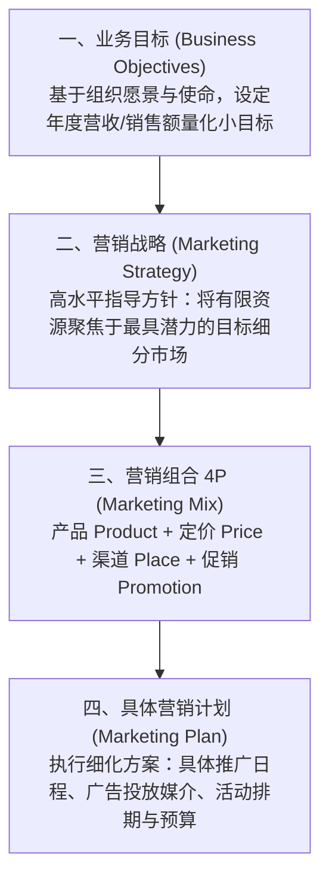
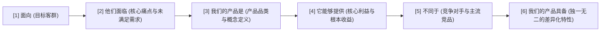
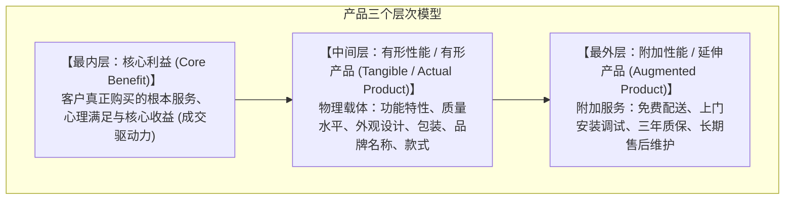
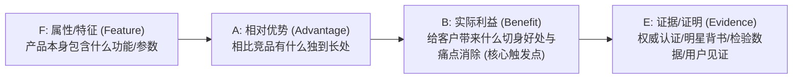

# 1.16 支撑战略（四）：营销战略、价值主张、产品三层次与FAB法则

> [!IMPORTANT] 核心提要
> 新产品的成功不仅仅取决于研发阶段的技术实现，更取决于能否将研发成果高效推向市场并实现商业变现。**营销战略（Marketing Strategy）**将有限的组织资源聚焦于最具潜力的市场机会中。
> 本篇系统涵盖从业务目标到营销执行的层级递进体系、定义客户心智的价值主张电梯演讲框架、洞察客户本质购买动机的产品三个层次模型（以豪华汽车为例），以及驱动高转化成交的销售利器——FAB/FABE 法则（以功能牙刷为例）。

---

## 1. 营销战略的内涵与层级递进

### 1.1 从“产品研发”到“产品包（Product Package）”交付
很多研发团队容易陷入“重研发、轻营销”的技术自嗨误区。在新产品开发全流程中，完成样机或代码开发仅仅是走完了第一步。要让新产品成功推向市场，必须向内部营销团队及外部客户交付一套完整的**产品包（Product Package）**：
* **内部赋能培训**：对一线销售与支持人员进行产品核心卖点、竞争优势与使用场景的深度培训；
* **定价方案与策略**：制定科学合理的定价模型、渠道毛利空间与促销折扣阶梯；
* **销售话术体系（Sales Script）**：梳理直击客户痛点的场景化说服脚本与异议应对方案；
* **试点与验证（Pilot & Beta Test）**：在受控的小范围内进行试点销售，打磨运营与交付闭环；
* **售后支撑体系**：建立物流配送、安装调试、质保维修与客户成功保障体系。

> [!TIP] 场景化说服案例：高性能双层中空玻璃的销售逻辑
> 若仅向游艇客户宣称“双层玻璃耐高温防潮”，客户感受十分抽象。销售话术应当场景化：
> * **极致实验印证**：“哪怕将这款玻璃放入微波炉高温加热，结构依然稳固完好”；
> * **高端体验升维**：“采用这款特制双层防潮防紫外线玻璃制造游艇舷窗，客人在海上远眺清晨日出时的通透视觉体验，与市面上普通玻璃截然不同”；
> * **耐用与安全价值**：“防热防潮抗撞击，在恶劣风浪环境中绝不易碎破裂，保障长途出海生命安全”。

### 1.2 营销管理的层级递进链条
营销绝非零散的广告轰炸，而是一个自上而下高度严密的逻辑演进体系：

1. **业务目标（Business Objectives）**：源自企业愿景与使命，明确具体的经营指标（例如“本年度新产品线实现 1 亿元销售额”）。
2. **营销战略（Marketing Strategy）**：作为高水平行动指导，明确选择哪些细分市场、如何定位价值、如何战胜对手，确保资源聚焦于胜算最大的方向。
3. **营销组合（Marketing Mix - 4P）**：制定产品（Product）、定价（Price）、渠道（Place）、促销（Promotion）四大维度的协同策略。
4. **营销计划（Marketing Plan）**：将战略与 4P 拆解为可落地的日常执行甘特图、具体营销活动日程、社交媒体投放点位与考核指标。

### 1.3 营销战略必须回答的五大核心问题（5W 框架）
营销战略的本质在于达成“**你恰好需要，而我恰好拥有**”的价值共鸣：
* **Who（目标客群是谁）**：谁是我们的目标细分市场？核心画像是什么？
* **What（提供什么产品）**：我们能为他们提供什么规格、形态的产品包？
* **Why（核心价值主张）**：产品能为客户带来什么独特的利益、好处与痛点解决方案？
* **How（如何让客户获知）**：通过何种促销与传播媒介（线上社交网络、知乎、B站、电视植入等）触达客群心智？
* **Where（如何交付送达）**：通过何种分销渠道与物流体系将货物高效送达客户手中？

---

## 2. 价值主张（Value Proposition）与电梯演讲框架

### 2.1 价值主张的核心内涵
* **核心定义**：**价值主张**是企业对客户所做出的核心承诺。它清晰阐述了新产品概念在哪些具体维度上向目标客户传递独特的价值，能够帮助客户解决什么迫切痛点，带来何种实际收益。
* **心智法则**：客户购买的从来不是产品的功能本身，而是产品所能带来的**利益与改变**。

### 2.2 价值主张电梯测试（Elevator Pitch）表达框架
在电梯上下运行的短短 30～60 秒内，必须能够极其精炼、有力地讲清楚产品价值主张：

* **标准句式模板**：
  > “面向【**追求高品质出海体验的豪华游艇买家**】，他们面临【**普通舷窗起雾、暴晒闷热及视线折射失真**】的困扰；  
  > 我们的【**航海级双层镀膜中空钢化玻璃**】是一种【**专业特种游艇舷窗解决方案**】；  
  > 它能够提供【**99.8% 高透光率、隔绝 95% 热量与终身不起雾防潮**】的卓越体验；  
  > 不同于【**市面上传统普通夹胶玻璃**】；  
  > 我们的产品具备【**微波级耐温变分子焊接技术与超韧防爆结构**】，让您享受纯粹的日出美景与极致安全。”

---

## 3. 产品的三个层次模型（Three Levels of Product）

菲利普·科特勒（Philip Kotler）提出了著名的**产品三层次模型**，深刻揭示了客户从物理产品到心理满足的认知递进过程：

### 3.1 核心利益（Core Benefit）：最底层的购买驱动力
* **内涵**：客户真正购买的核心服务、深层价值与利益体验。这是真正触发客户做出购买决策的灵魂所在。
* **经典商业案例：豪华汽车（Luxury Cars）的购买动机深度剖析**
  * **普通代步需求**：日常上下班通勤，一辆 10 万元出头的普通家用车完全足够遮风挡雨、代步出行。
  * **豪车消费心理**：消费者为何愿意豪掷 50 万、80 万甚至更高预算购买奔驰、宝马或保时捷？
  * **表面有形属性**：如百公里加速 3.8 秒、真皮加热座椅、大排量引擎声浪、精致的光滑车漆等，这些确实是高端配置，但**绝非根本购买驱动力**（大部分车主日常通勤根本用不到极限马力）。
  * **底层核心利益**：**彰显个人的社会阶层、财富实力、卓越品位与成功身份，赢得他人的羡慕与社交尊重**。这就是豪华汽车卖给客户的最核心利益。

### 3.2 有形性能 / 有形产品（Tangible / Actual Product）
* **内涵**：实现核心利益的物理载体与具体实体形式。
* **构成要素**：产品的物理规格、功能性能指标、工业外观设计、选材做工质量、包装形态、品牌 Logo 标识等。

### 3.3 附加性能 / 延伸产品（Augmented Product）
* **内涵**：在有形产品之外提供的附加增值服务与保障。
* **构成要素**：免费配送到家、专业上门安装、退换货保障、三年/五年超长质保、定期保养服务、快速响应的客诉通道等。

---

## 4. 销售转化利器：FAB 与 FABE 法则

在向客户推介产品、促进从意向到成交转化的过程中，**FAB / FABE 法则**是极具实战威力的沟通说服框架：

### 4.1 FAB / FABE 构成要素详解
1. **F（Feature - 特征/属性）**：回答“它是什么？有什么物理功能与参数？”。客观描述产品的材质、结构、技术指标等。
2. **A（Advantage - 优势）**：回答“它比别人好在哪里？”。对比市面竞品，展示人无我有、人有我优的独特性。
3. **B（Benefit - 利益/益处）**：回答“这跟我有什么关系？能给我带来什么好处？”。**成交最核心的关键点**！将技术优势转化为直接消除客户痛苦、满足客户欲望的切身利益。
4. **E（Evidence - 证据/证明）**：回答“我凭什么相信你说的？”。提供权威资质背书、明星同款代言、临床测试报告、专利证书或海量好评数据，消除决策疑虑。

### 4.2 经典商业案例：功能牙刷的 FABE 销售转化拆解

| FABE 维度 | 牙刷具体设计 / 话术表现 | 话术沟通心理转化逻辑 |
| :--- | :--- | :--- |
| **F（Feature 特征）** | 刷头采用 0.01mm 极细高密纤柔刷毛；刷头呈 45 度微倾角；手柄内置高弹橡胶减震臂；刷头背部集成梯级软胶刮片。 | 客观陈述产品的工艺构造与物理参数，建立专业技术认知。 |
| **A（Advantage 优势）** | 能够三面包裹式贴合牙齿曲面；自然契合国际公认的巴氏刷牙法（Bass Method）；刷牙时根据齿缝自动张合；背部刮片可同步清洁舌苔。市面普通平头牙刷无法做到多维包裹。 | 与竞品形成鲜明对比，展现“人无我有”的差异化技术优势。 |
| **B（Benefit 利益）** | **【痛点消除与健康收益】**：深入牙龈沟与智齿死角，彻底清除顽固牙垢与食物残留；微弹减震避免刷牙用力过猛导致牙龈出血与牙釉质磨损；深度清除舌苔细菌，从源头消灭口腔异味，**避免与伴侣亲吻（Kiss）或商务会谈时的口臭尴尬**。 | **直击用户核心痛点与心理利益**！客户购买牙刷不是为了 0.01mm 刷毛，而是为了健康牙齿与社交自信。 |
| **E（Evidence 证据）** | 国际口腔医学联合会临床测试认证（牙菌斑清除率提升 98%）；吴彦祖、刘亦菲、刘德华等巨星同款日常推荐；各大三甲口腔医院专家联合背书推荐。 | 借助名人背书与权威检验报告，彻底打消信任顾虑，促成冲动下单。 |

---

## 5. 营销战略与产品层次全景对比速查表（Cheat Sheet）

| 理论模型 / 模块 | 核心构成维度 | 核心定义与功能 | 关键实战考点 / 落地误区 | 典型商业案例 |
| :--- | :--- | :--- | :--- | :--- |
| **营销管理层级** | 业务目标 $\to$ 营销战略 $\to$ 营销组合(4P) $\to$ 营销计划 | 自上而下的战略落实链条，将有限资源聚焦于最优机会 | 研发完成必须提供包含培训、话术、定价、试点的完整“产品包” | 高性能游艇双层中空防潮耐高温玻璃案例 |
| **营销核心问题** | Who / What / Why / How / Where | 厘清目标客群、产品形态、价值主张、推广媒介与分销渠道 | 营销的本质：“你恰好需要，而我恰好拥有” | 目标市场精准切分与全渠道触达网络 |
| **价值主张** | 目标人群 + 痛点场景 + 产品定义 + 独特收益 + 竞品差异 | 对客户做出的核心价值承诺，阐述客户获得的根本好处 | 善用电梯测试（Elevator Pitch）在 30 秒内阐明核心卖点 | 游艇舷窗玻璃电梯演讲范式 |
| **产品三个层次** | 核心利益 + 有形性能 + 附加性能 | 揭示从客户底层心理满足到物理产品再到增值服务的全景结构 | **客户购买的根本是核心利益**（非物理属性）；豪华品消费重在身份认同 | 豪华汽车：百公里加速/真皮（有形）vs. 财富地位认同（核心利益） |
| **FAB / FABE 法则** | Feature（特征）+ Advantage（优势）+ Benefit（利益）+ Evidence（证据） | 场景化销售话术转化利器，跨越技术参数与用户利益的认知鸿沟 | **特征与优势不是最关键的，直击痛点的利益（Benefit）才是成交核心** | 功能牙刷：45度角与细毛（F/A）$\to$ 清除口臭避免接吻尴尬（B）$\to$ 明星代言与临床报告（E） |