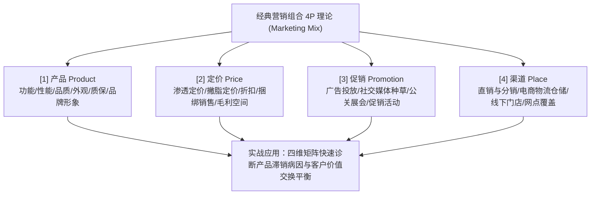
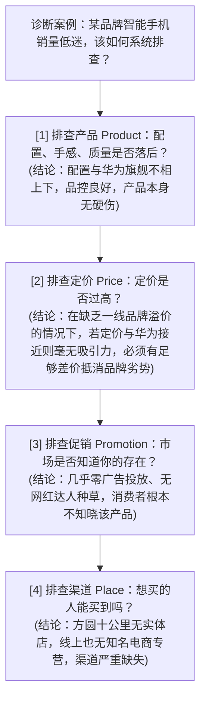
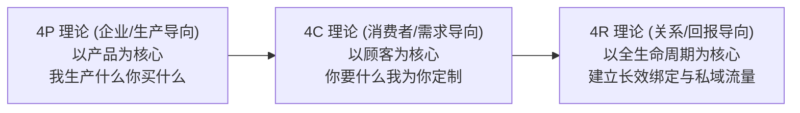

# 1.17 产品营销组合（4P理论及4P-4C-4R演变）

> [!IMPORTANT] 核心提要
> 营销组合（Marketing Mix）是将企业战略落地为具体市场操作的核心工具箱。由杰罗姆·麦卡锡（E. Jerome McCarthy）提出、菲利普·科特勒（Philip Kotler）发扬光大的 **4P 理论（Product, Price, Promotion, Place）**历经半个多世纪，依然是企业诊断产品病因、统筹上市资源的基础框架。
> 随着供需关系变革与数字时代演进，营销思想经历了从**以企业为中心的 4P**，到**以顾客为中心的 4C**，再到**以长期关系与生命周期价值为核心的 4R** 的系统性演进。

---

## 1. 经典营销组合 4P 理论深度解析

### 1.1 四大核心支柱拆解

#### （1）产品（Product）：打造价值载体
* **核心要素**：产品本身的功能、性能、工业设计、做工质量、特色配置、质保政策及品牌附加值。
* **选购心理**：消费者在选择笔记本电脑（如联想 ThinkPad 还是戴尔 XPS）时，不仅考量 CPU/显卡等客观硬件参数，更看重工业设计、散热做工、超长质保与品牌形象契合度。产品是一切营销的原点。

#### （2）定价（Price）：利润与竞争力的博弈
定价直接决定企业的利润空间与客户的决策门槛：
* **常规定价策略**：折扣定价、高标价打折、套餐捆绑销售（Bundle Pricing，如买硬件送软件或套餐优惠以提高客单价）。
* **商业实操案例：钱大妈“不卖隔夜肉”的定价与清货机制**
  * 钱大妈生鲜肉菜店采取了极具辨识度的动态折扣机制：白天维持正常标价（通过会员折扣与新鲜感吸引日常客流）；
  * **阶梯清货机制**：从每天晚上 19:00 或 20:00 开始打折（如打 9 折、8 折、6 折），越晚折扣越大，直至深夜免费派送全部清空；
  * **商业价值**：通过机制保障“零隔夜库存”，极高周转率换取极佳现金流与品质信任，成为社区生鲜坪效冠军。

> [!IMPORTANT] NPDP 极高频必考辨析：渗透定价 vs. 撇脂定价
> * **渗透定价（Penetration Pricing）**：
>   * **机制**：以**极低的价格**切入市场，针对广大对价格高度敏感的普通消费群体。
>   * **适用条件**：标准化程度高、替代品多、大众日用品；通过**薄利多销**快速占领市场份额，利用规模经济构建竞争壁垒。
> * **撇脂定价（Skimming Pricing）**：
>   * **名称溯源**：如同煮热牛奶后，用勺子撇取浮在表面最营养美味的奶油层（Skim the Cream）。
>   * **机制**：在产品导入期设定**极高的溢价价格**，面向具有尝鲜意愿、对价格不敏感的高端富裕客群。
>   * **适用条件**：具有极高技术壁垒、研发投入巨大的前沿高科技产品；在竞品跟进前快速收回高昂的研发与设备成本，随后再逐步降价覆盖大众市场。

#### （3）促销（Promotion）：传递信息与建立认知
* **核心要素**：广告宣传、公关活动、展会推介、节日促销与社交媒体互动。
* **数字营销新场景**：现代促销已从传统的报纸单页全面转向数字化新媒体。
  * **热播剧赞助与明星效应**：如在刘亦菲主演的热播电视剧片头片尾投放硬广赞助；
  * **数字内容营销**：在 Bilibili 进行深度测评、在知乎回答专业问题、在小红书进行海量达人种草（KOL/KOC 推荐）。
* **隐性价值**：高规格的促销活动不仅能促进销量，更是企业向市场彰显研发实力与雄厚资本背书的重要手段。

#### （4）渠道（Place）：产品的可得性与交付链路
* **核心要素**：直销 vs. 分销代理网络、仓储物流配送、实体门店覆盖率与线上电商矩阵。
* **渠道选择逻辑**：
  * **高复杂度工业品 / 高端定制品**：通常依赖厂家直销团队或认证服务商，需提供上门安装、调试与培训；
  * **快消品 / 日常标准品**：追求极致的分销铺市率，越密集越好；
  * **电商仓储体验**：如京东自营依托区域中心仓实现“次日达/半日达”，显著提升客户转化率与复购率。

---

### 1.2 4P 实战诊断模型：手机滞销的老板咨询案例
当企业的新产品（如某小品牌智能手机）遭遇市场滞销时，4P 理论是最清晰的排查工具：

* **商业交换的价值本质**：
  $$\text{客户让渡价值} = \text{客户感知总利益 (Perceived Benefits)} - \text{客户支付总成本 (Customer Costs)}$$
  当客户从产品中获得的整体利益大于其付出的金钱与时间成本时，交易才会达成并产生自发推荐；反之产品必将无人问津。

---

## 2. 营销组合哲学的演变：从 4P 到 4C 再到 4R

随着买方市场确立与互联网深度普及，营销理论历经了三次根本性飞跃：

### 2.1 4C 理论：以顾客为中心（Robert Lauterborn 提出）
20 世纪 90 年代，罗伯特·劳特朋针对 4P 的局限性提出了以消费者需求为导向的 4C 理论：
1. **Customer（顾客的需求与欲望）**：取代单纯的 Product（产品）。从研发“我能生产什么”转变为“客户需要解决什么问题”。
2. **Cost（顾客获取的成本）**：取代传统的 Price（价格）。不仅指标价，还涵盖客户的时间成本、精力成本与心理风险成本。
3. **Convenience（购买与使用的便利性）**：取代传统的 Place（渠道）。强调让客户在最便捷的场景下（如手机一键下单、送货上门）完成获取。
4. **Communication（双向沟通）**：取代单向灌输的 Promotion（促销）。强调倾听客户反馈、建立即时互动与共鸣机制。

### 2.2 4R 理论：建立长期关系与客户终身价值（Don Schultz 提出）
进入数字时代与存量竞争时代，单次交易的边际收益递减，唐·舒尔茨提出了以**客户全生命周期（LTV）**与双赢为核心的 4R 理论：
1. **Relevance（关联）**：产品与服务必须与客户的长期生活工作场景产生深度绑定，成为客户难以割舍的基础设施。
2. **Reaction（反应）**：企业对市场风向与客户需求的细微变动保持极高的敏捷响应速度。
3. **Relationship（关系）**：超越单次售卖，建立长期动态的信任互动，打造高粘性的**私域流量池（Private Domain Traffic）**。
4. **Reward（回报）**：在为客户提供持续价值的同时，企业获得长期稳定的高客单价、复购与转介绍分润。

### 2.3 4R 商业模式实践案例：网络文化与数字产品的私域闭环
* **网络小说连载模式**：前 30～50 章完全免费阅读（降低决策成本，培养阅读习惯与情感代入）；在剧情最关键悬念处（卡点）开始收费阅读；通过每日打赏、书友圈讨论沉淀死忠读者。
* **影视流媒体运营**：基础会员免广告免费看，高潮大结局推出“超前点播”增值付费；打造粉丝专属社区。
* **免费增值游戏（Freemium）**：游戏本体下载游玩完全免费，但在玩家投入大量时间、面临通关瓶颈时，通过出售限量炫酷皮肤与强力装备变现；玩家既被锁定在社交公会中，又为情感认同持续付费。

---

## 3. 营销组合全景对比速查表（Cheat Sheet）

| 理论框架 | 核心维度构成 | 核心导向与理念 | 优势与时代局限 | 经典实操案例 |
| :--- | :--- | :--- | :--- | :--- |
| **经典 4P 理论** | Product（产品） Price（价格） Place（渠道） Promotion（促销） | **企业 / 生产导向** “我有什么好东西卖给你” | 结构化强，是企业排查滞销问题的最强诊断清单；但在买方市场容易陷入技术自嗨 | 手机滞销四步排查；钱大妈晚间梯度打折清货；高通撇脂 vs. 小米渗透 |
| **现代 4C 理论** | Customer（顾客需求） Cost（顾客成本） Convenience（便利性） Communication（双向沟通） | **消费者 / 需求导向** “你需要什么我提供什么” | 彻底站在客户视角思考让渡价值；但过度迎合客户有时会忽略企业自身成本控制 | 线上买菜半小时送达；根据用户社群痛点定制反向供应链（C2M） |
| **进阶 4R 理论** | Relevance（深度关联） Reaction（敏捷反应） Relationship（长期关系） Reward（双赢回报） | **关系 / 终身价值导向** “从单次成交到私域长效绑定” | 聚焦客户终身价值（LTV）与私域流量池沉淀；对企业持续服务与社群运营能力要求极高 | 网文免费试读后收费；网络游戏道具与皮肤内购；会员订阅制服务 |