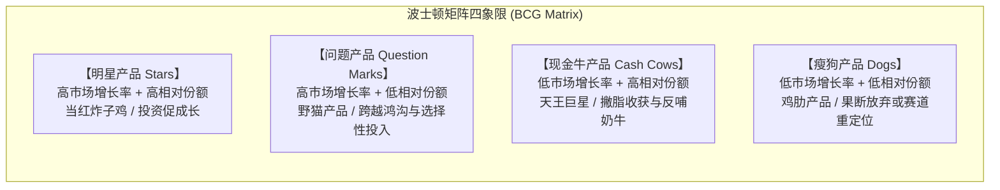
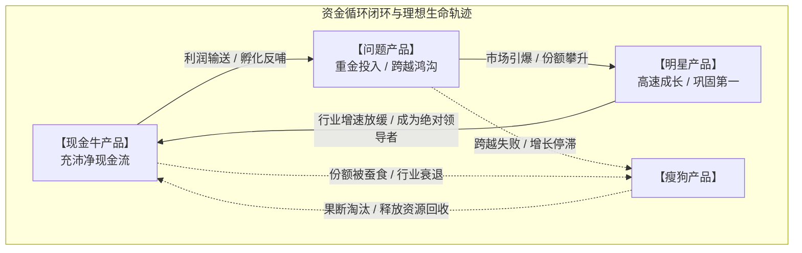

# 1.18 波士顿矩阵（BCG产品组合分析）

> [!IMPORTANT] 核心提要
> 任何企业都不可能仅凭单一产品长盛不衰。由波士顿咨询公司（Boston Consulting Group, BCG）首创的**波士顿矩阵（BCG Growth-Share Matrix）**，是产品组合管理与战略资金调配中最经典、应用最广泛的工具模型。
> 它通过**市场增长率**（代表行业吸引力）与**相对市场份额**（代表自身竞争实力）两大核心维度，将企业所有的产品线划分为四大象限，清晰指明不同产品所处的战略地位、现金流特征与资金闭环反哺机制。

---

## 1. 波士顿矩阵的双维度坐标体系

### 1.1 坐标轴评估逻辑
* **纵轴：市场销售增长率（Market Growth Rate）**
  * 反映产品所在行业或细分赛道的整体扩张速度与市场空间吸引力；
  * 高增长率意味着市场正在蓬勃发展，需要企业投入大量研发、营销与产能资本；低增长率意味着行业进入成熟饱和期或萎缩期。
* **横轴：相对市场份额（Relative Market Share）**
  * 反映企业产品相对于行业最大竞争对手的市场占有率水平，代表企业的市场竞争地位与规模经济效应；
  * 高份额通常意味着单位成本低、定价权高与强大的渠道掌控力。

---

## 2. 四象限产品深度解析与战略应对

### 2.1 问题产品 / 野猫产品（Question Marks / Wild Cats）
* **象限特征**：**高市场增长率、低相对市场份额**。
* **现状剖析**：
  * 通常是企业新近推向市场的新产品，或者是在高增长行业中尚未站稳脚跟的产品。
  * **财务现金流**：消耗大量现金进行市场推广和技术迭代，但因自身市场份额小、销量基数低，产生的收入极少，**净现金流为显著的负数**。
* **未来两大走向机制**：
  * **成功走向明星**：若产品能成功**跨越鸿沟（Crossing the Chasm）**，触发**巴斯扩散模型（Bass Diffusion Model）**实现大众口碑引爆，份额快速攀升，则蜕变晋升为“明星产品”；
  * **跌落沦为瘦狗**：若未能在窗口期内引爆市场，增长后继乏力，则随着行业增速放缓，直接掉入“瘦狗产品”深渊。
* **对应战略**：**选择性发展战略（Build/Invest selectively）**。
  * 对具有高爆发潜力的产品集中重金追投，助其跨越鸿沟；
  * 对验证后前景暗淡、技术受阻的产品，及时止损果断叫停。
* **日化案例**：宝洁旗下的草本概念洗发水“**伊卡璐（Herbal Essences）**”（曾由李宇春代言“下个路口见”风靡一时，初期增长极快，但在主流洗发水竞争中未能持续扩大份额，后期退居边缘）。

### 2.2 明星产品（Stars）
* **象限特征**：**高市场增长率、高相对市场份额**。
* **现状剖析**：
  * 处于企业产品线的“**当红炸子鸡**”地位。不仅赛道处于爆发期，且企业在赛道中占据领导地位。
  * **财务现金流**：自身能产生大量销售收入，但为了应对激烈竞争、扩大产能并捍卫市场第一地位，仍需持续投入巨额资本进行再投资，**净现金流通常处于紧平衡或微正状态**。
* **对应战略**：**投资促成长战略（Hold/Grow）**。
  * 坚决倾斜优质资源继续砸钱投入，进一步巩固规模优势与心智壁垒，确保在市场增速放缓后顺理成章转化为企业的“现金牛”。
* **日化案例**：联合利华旗下的“**清扬（Clear）**”男士去屑洗发水（签约巨星 C 罗、小 S 强势代言，精准切入男士专业去屑高增长赛道，迅速攻城略地成长为明星大单品）。

### 2.3 现金牛产品 / 金牛产品（Cash Cows）
* **象限特征**：**低市场增长率、高相对市场份额**。
* **现状剖析**：
  * 企业无可撼动的“**天王巨星**”与财务压舱石。所在行业整体已进入成熟期甚至触达天花板，但企业凭借压倒性市场份额牢牢垄断市场。
  * **财务现金流**：无需再进行大规模的产能扩张与高额研发投入，产品如同源源不断挤出牛奶的母牛，**产生极其庞大充沛的净正向现金流**。
* **对应战略**：**撇脂收获战略（Harvest/Milk）+ 维系防御性投资**。
  * 绝不能“杀鸡取卵”彻底放弃维护，必须进行适度的防御性维护投资（如包装微调、渠道日常维护）以延缓成熟期寿命；
  * 将挤出的大量净现金利润作为“战略资金池”，反哺抽调给问题产品与明星产品。
* **日化案例**：宝洁旗下的**飘柔（Rejoice）、海飞丝（Head & Shoulders）、潘婷（Pantene）**。已成为家喻户晓的国民级品牌，市场渗透率极高，几乎无需做高风险颠覆性研发，每年持续为宝洁集团贡献数以百亿计的现金流。

### 2.4 瘦狗产品（Dogs）
* **象限特征**：**低市场增长率、低相对市场份额**。
* **现状剖析**：
  * 处于“食之无味、弃之可惜”的“**鸡肋**”地位。行业增长停滞甚至萎缩，企业在其中份额微弱，既无成本优势也无品牌溢价，甚至可能产生负利润并占用宝贵的管理精力。
* **对应战略**：
  * **撤资清算 / 放弃战略（Divest/Liquidate）**：果断停产淘汰，清理变现资产；
  * **重新定位与赛道迁移战略（Repositioning）**：发掘产品技术的特殊用途，迁移至局部垂直细分领域。
* **经典案例**：
  * **柯达传统胶卷的医疗赛道重定位**：柯达传统民用拍照胶卷在数码相机与智能手机普及后彻底沦为瘦狗，但胶片感光技术被重新定位至医院医用 X 光片、CT 胶片及工业探伤等特种高利润赛道，重获生机；
  * **传统洗发膏的怀旧退守**：部分老式蜂花、海鸥洗发膏从年轻大众市场淡出后，退守特定老年群体或作为怀旧国货小众单品维持微利运营。

---

## 3. 动态流转机制与健康产品组合的资金平衡闭环

波士顿矩阵绝非静止的分类表，而是一个动态流转的**战略生命力引擎**：

### 3.1 理想生命轨迹（Success Sequence）
新产品研发成功推向市场后，健康的理想演进路线为：
$$\text{问题产品 (孵化)} \xrightarrow{\text{跨越鸿沟}} \text{明星产品 (爆发)} \xrightarrow{\text{行业成熟}} \text{现金牛产品 (收割)} \xrightarrow{\text{自然衰退}} \text{瘦狗产品 (退出)}$$

### 3.2 资金闭环与企业造血机制
* **造血枢纽**：**现金牛是整个企业运转的核心血液库**。企业必须严厉遏制管理层将现金牛利润盲目盲目挥霍在低效项目上的冲动；
* **投资闭环**：抽取现金牛的利润，精准注入到有潜力的问题产品进行早期孵化，同时为明星产品提供扩张弹药；
* **优胜劣汰**：对于跨越鸿沟失败的问题产品及陷入衰退的瘦狗产品，坚决予以关停并转，释放现金与管理带宽回流至现金牛与新一轮研发。

---

## 4. 波士顿矩阵四象限全景对比速查表（Cheat Sheet）

| 象限类别 | 市场增长率 / 相对份额 | 现金流特征 | 核心战略目标 | 关键管理动作与决策要点 | 典型商业案例 |
| :--- | :--- | :--- | :--- | :--- | :--- |
| **问题产品 (Question Marks)** | 高增长率 低相对份额 | **净现金流严重为负** (高投入，极低产出) | **选择性发展** (Build / Invest Selectively) | 深度评估能否跨越鸿沟；有潜力者集中追投抢占份额，不佳者及早止损 | 伊卡璐草本洗发水；各类处于试错期的新品探索 |
| **明星产品 (Stars)** | 高增长率 高相对份额 | **净现金流紧平衡 / 微正** (高收入，高再投资) | **维持与扩大领先地位** (Hold / Grow) | 坚决追投扩大产能与品牌认知，筑牢护城河，等待市场成熟蜕变为现金牛 | 清扬去屑洗发水；造车新势力中的爆款热销主力车型 |
| **现金牛产品 (Cash Cows)** | 低增长率 高相对份额 | **极其庞大的净正向现金流** (极高收入，极低再投资) | **收获与适度防御** (Harvest / Milk) | 避免杀鸡取卵，维持防御性投入延缓衰老；将利润全面反哺问题与明星产品 | 海飞丝、飘柔、潘婷；微软 Windows / Office 核心套件 |
| **瘦狗产品 (Dogs)** | 低增长率 低相对份额 | **微利、持平或负现金流** (低产出，占用管理带宽) | **撤资放弃或重新定位** (Divest / Reposition) | 坚决关停清算淘汰，止损止血；或探索技术在医用、工业特种赛道的重定位 | 柯达传统民用胶卷迁移至医用CT片；老式洗发膏退守怀旧市场 |