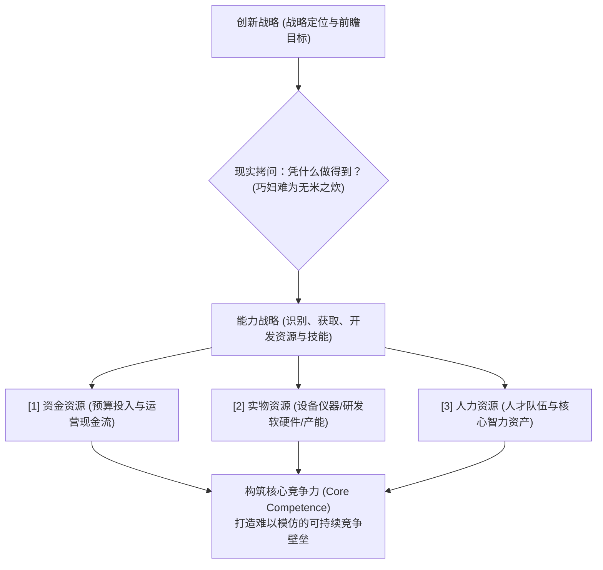
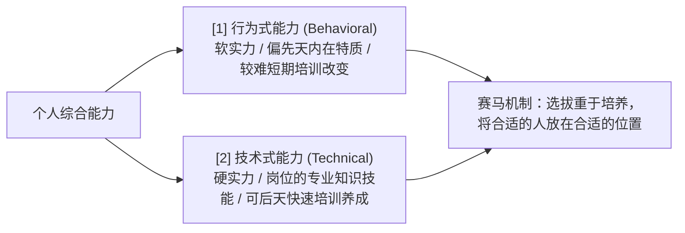
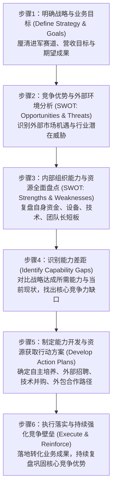

# 1.19 支撑战略（五）：能力战略（内涵与实施步骤）

> [!IMPORTANT] 核心提要
> 战略是明确方向与规划，但“**巧妇难为无米之炊**”。如果企业没有充足的资金、先进的设备和胜任的人才队伍，再宏伟的创新战略也只是空中楼阁。
> **能力战略（Capability Strategy）**作为关键支撑战略，聚焦于系统性识别、获取、开发并整合组织的资源与技能，将创新构想转化为实际的生产力与竞争壁垒。本篇系统涵盖能力战略的内涵、支撑资源的三大支柱、人的两大能力维度对比（行为式 vs. 技术式），以及制定能力战略的六大闭环步骤。

---

## 1. 能力战略的本质与内涵

### 1.1 什么是“能力”与“组织能力”
* **个人能力**：指个体所掌握的技能与动作模式（如行走、骑车、驾驶、双语阅读翻译、解决特定数学问题等）。
* **组织能力（Organizational Capabilities）**：指组织通过协调、配置和综合利用其拥有的全部资源，开展特定业务活动或稳定提供某种关键职能的综合本领（例如研发创新职能、安全保障职能、供应链交付职能、市场营销职能等）。

### 1.2 什么是能力战略（Capability Strategy）
* **核心定义**：能力战略是组织系统**识别自身拥有的技能与资源状况，并有效开发、整合这些资源与技能，以获取、维持和巩固可持续竞争优势**的顶层行动路线。
* **承接定位**：创新战略回答“我们要向哪里创新、做什么创新”，而能力战略回答“**我们凭什么做得到、需要建立什么关键能力来保证战略落地**”。

### 1.3 核心竞争力（Core Competence）
组织内部经过整合的知识、技术与技能资产，能够为目标客户创造显著价值，具备极高的独特性与难以模仿性，赋予组织超越对手的压倒性竞争优势。

---

## 2. 支撑能力战略落地的三大支柱资源

企业在执行能力战略时，必须围绕以下三大支柱资源进行系统性排查与补齐：
1. **资金支持（Financial Resources）**：充足的研发预算、试错资金与供应链流动资金。研发项目资金紧张将直接导致关键实验搁浅或进度延误。
2. **实物资源（Physical Resources）**：先进的研发实验设备、测试仪器、工业模具、高性能算力服务器与量产厂房设施。硬件资源匮乏会直接成为技术转化的物理瓶颈。
3. **人力资源（Human Resources）**：胜任的工程技术人员、产品经理、市场策划与一线销售人才。人是所有资源中最具能动性和决定性的要素。

---

## 3. 人的两大能力维度对比（NPDP 核心考点）

在人力资源与团队能力构建中，NPDP 将个人能力划分为**行为式能力**与**技术式能力**两大维度：

### 3.1 行为式能力（Behavioral Capabilities / 软实力）
* **核心内涵**：与生俱来的个性特质、心理倾向和内在软素质，较难在短时间内通过集中培训完全习得。
* **典型要素**：
  * **人际沟通与交往能力**：能否主动破冰、善于倾听、具备同理心；
  * **自驱力与主动性（Proactivity）**：面对不确定性是否积极探索而非被动等待指令；
  * **逻辑分析与归纳思维**：面对纷繁复杂的数据与现象，能否快速洞察事物本质与底层规律；
  * **抗挫力与韧性**：面对失败能否快速调整心态重新出发。

### 3.2 技术式能力（Technical Capabilities / 硬实力）
* **核心内涵**：胜任特定岗位日常工作所必须掌握的具体专业知识、专业工具与操作技能。具有标准化的学习路径，**高度依赖后天培养、受训与刻意练习**。
* **典型要素**：
  * **研发工程师**：编写 Java/Python 代码、读懂架构图、设计数据库函数；
  * **教师从业人员**：考取国家教师资格证、掌握教学教法与教案编写；
  * **财务分析师**：编制资产负债表与现金流量表模型、操作 ERP 系统；
  * **质量工程师**：掌握 SPC 统计过程控制工具与失效模式分析（FMEA）。

### 3.3 赛马机制与人才选拔实战感悟
* **赛马不相马机制（Racing Mechanism）**：通过实战环境与开放竞争机制，让真正具备潜质的人才脱颖而出。
* **选拔与培养的辩证关系（以讲师培养为例）**：
  * 在讲师与助教团队选拔中，先天具备极强**表达欲望、舞台气场与共情沟通能力**的人选，只需通过短期培训补足专业技术式能力（课程大纲与教法），即可迅速成长为主讲名师；
  * 反之，若候选人天生极度抗拒公众表达、缺乏沟通意愿，即便组织投入数月甚至数年的密集培训，也很难将其培养为优秀讲师，最终往往不得不放弃；
  * **职场启示**：企业要善于“因材适用”，员工个人也应清晰洞察自身的先天特长与行为偏好，顺应优势培养专业技术能力，职业成长才能事半功倍。

---

## 4. 能力战略制定的六大闭环步骤

企业制定与实施能力战略，必须遵循自上而下、内外部结合的六大系统性步骤：

### 步骤1：明确组织战略与业务目标（Define Strategy & Goals）
从公司最高战略愿景出发，明确组织计划进军的目标市场领域、产品线定位，以及需要达成的量化经营小目标（如营收额、市场份额指标）。

### 步骤2：竞争优势与外部环境分析（SWOT 之 OT 分析）
运用 SWOT 分析工具中的外部维度，深入分析外部宏观环境与行业竞争格局：
* 捕捉外部前沿技术风口与市场新机遇（Opportunities）；
* 识别竞品技术替代、政策法规收紧等外部潜在威胁（Threats）；
* 明确在外部竞争中建立差异化优势所需的核心能力方向。

### 步骤3：内部组织能力与资源盘点（SWOT 之 SW 分析）
全面复盘审视企业内部当前的真实家底：
* 盘点内部已具备的优势（Strengths）与关键资源（成熟研发团队、核心专利、稳定渠道）；
* 剖析内部显露的劣势（Weaknesses）与资源短板（如缺乏某项算法能力、缺乏国际化销售经验）。

### 步骤4：识别能力差距（Identify Capability Gaps）
将**步骤1（战略落地所必需的理想能力矩阵）**与**步骤3（当前实际拥有的能力底盘）**进行深度对标映射：
* 清晰界定“我们缺什么”；
* 确定哪些能力差距是致命的卡脖子瓶颈，将其列为核心能力建设攻坚清单。

### 步骤5：制定能力开发与资源获取行动方案（Develop Action Plans）
针对已识别的能力短板，系统设计补齐路径与资源调配方案：
* **内部自主开发**：组织内部技术攻坚、员工专项培养、设备升级采购；
* **外部敏捷获取**：通过外部高薪招聘关键领军人才、收购兼并专业公司、与高校建立产学研战略联盟、引入专业咨询机构或进行业务外包。

### 步骤6：执行落实与持续强化竞争壁垒（Execute & Reinforce）
将获取与整合的新能力全面投入到新产品研发与市场开拓中，将能力转化为真实的商业成果与客户价值，并在实践中持续迭代优化，形成深厚的竞争护城河。

---

## 5. 能力战略全景对比速查表（Cheat Sheet）

| 核心模块 | 关键维度 / 步骤 | 核心定义与内涵 | 管理考点与实操要点 | 典型商业与实操案例 |
| :--- | :--- | :--- | :--- | :--- |
| **能力内涵** | 组织能力与能力战略 | 组织综合协调配置全部资源以提供特定职能、支撑战略落地的规划 | “巧妇难为无米之炊”，能力战略是创新战略与经营战略的落地底座 | 研发职能、安全职能、供应链交付职能的组织建设 |
| **三大支柱资源** | 资金 + 实物 + 人力 | 支撑战略落地不可或缺的财务支持、硬件设备设施与人才团队 | 资金短缺导致研发断流，设备不足限制试验，人才匮乏影响成败 | 研发预算保障、算力实验室配置、核心专家引进 |
| **行为式能力** | 人的软实力 (Behavioral) | 偏向先天特质与个性驱动的能力（沟通、主动性、逻辑分析、韧性） | 较难在短时间内通过培训彻底改变；选拔重于培养，善用赛马机制 | 优秀讲师的先天表达欲与台风；自驱型项目经理 |
| **技术式能力** | 人的硬实力 (Technical) | 岗位的具体专业知识与操作工具技能（编程、考证、财务、制图） | 高度依赖后天学习、外部培训与刻意练习；可标准化快速赋能 | 软件开发工程师编码与算法；教师资格证考试认证 |
| **能力战略六步骤** | 目标明确 $\to$ 外部OT分析 $\to$ 内部SW盘点 $\to$ 差距识别 $\to$ 行动方案 $\to$ 执行强化 | 制定与落地能力战略的系统性闭环流程（自顶向下与内外融合） | 核心在于精准识别“战略所需能力”与“当前能力”之间的差距（Gap） | 传统制造企业转型数字化：盘点软件人才缺口 $\to$ 并购或招聘补齐 |