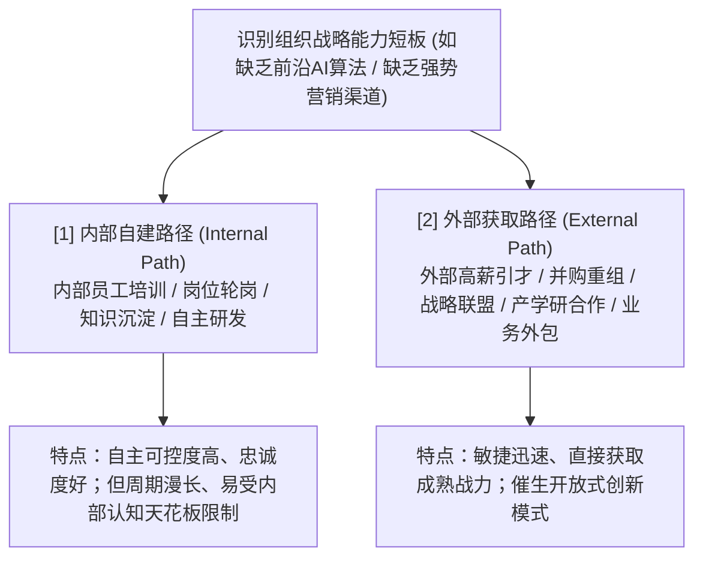
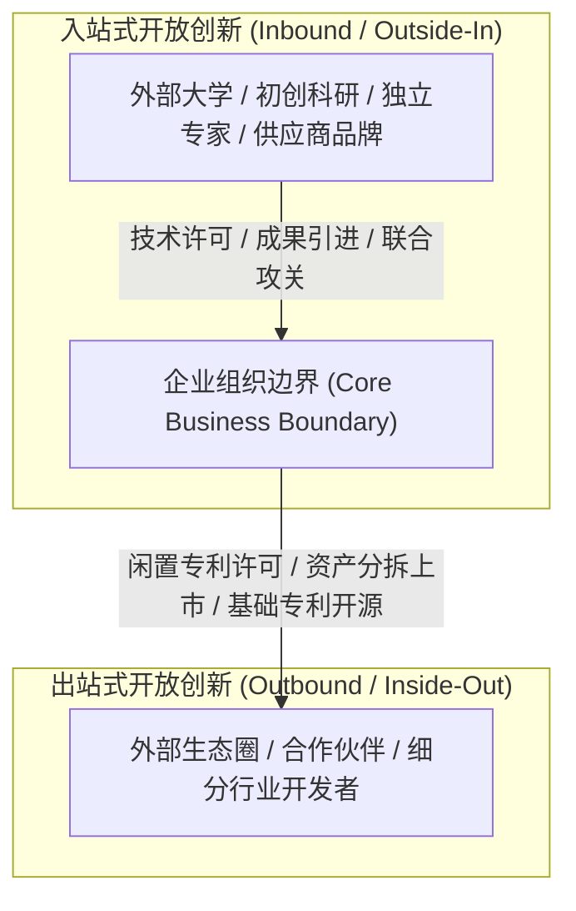

# 1.20 开放式创新与封闭式创新对比

> [!IMPORTANT] 核心提要
> 在企业构建核心竞争力的过程中，并非所有能力与技术都必须凡事亲力亲为。由加州大学伯克利分校教授亨利·切斯布鲁（Henry Chesbrough）提出的**开放式创新（Open Innovation）**理念，彻底打破了传统“关起门来搞研发”的封闭思维，重新定义了组织的边界。
> 开放式创新强调系统性地利用外部知识与资源补齐自身短板，同时让内部沉淀的闲置技术资产向外流动。本篇系统涵盖能力获取的内外部路径、封闭式创新与开放式创新的五大核心原则对比、入站与出站双向创新机制，以及开放创新的多维收益与潜在管理挑战。

---

## 1. 组织获取能力的两大基本途径

企业在识别出战略能力差距后，可以通过两条基本路径获取所需能力：

### 1.1 内部自建路径（Internal）
* **方式**：设立内部研发课题、骨干员工培训进修、内部技能认证考核、经验复盘与组织知识库沉淀。
* **优劣势**：核心资产与技术秘密完全掌控在自己手中，团队稳定性强；但**耗时漫长、研发周期长**，一旦遭遇技术快速换代容易错失商业窗口期。

### 1.2 外部获取路径（External）
* **方式**：
  * **外部引才与团队挖角**：直接招募外部现成的成熟研发或营销团队；
  * **企业兼并与收购（M&A）**：直接出资收购在目标技术或营销渠道上表现优异的创新企业；
  * **设立合资企业（Joint Venture）**：双方各出资 50% 共同成立合资实体，共享技术与市场资源；
  * **引入专业咨询与技术外包**：委托专业咨询机构完成局部攻坚，将非核心环节外包给第三方专业公司。
* **演进产物**：外部获取路径的体系化与战略化，催生了现代新产品战略中的核心范式——**开放式创新**。

---

## 2. 封闭式创新 vs. 开放式创新核心原则深度对比

封闭式创新与开放式创新代表了两种截然不同的研发哲学与商业价值观，NPDP 将其精辟总结为**五大核心原则维度的根本性转变**：

### 2.1 原则 1：人才观（Talent & Experts）
* **封闭式创新**：“全行业里最聪明、最顶尖的人才都必须直接被我们雇佣，全职为我们工作。”
* **开放式创新**：“我们不需要拥有全世界所有的聪明人，但我们可以**与全世界最聪明的人一起合作**。”
  * 企业通过项目签约、技术顾问、专家网络与开源生态，跨越雇佣边界调用全球智慧。

### 2.2 原则 2：研发与价值创造（R&D & Value Creation）
* **封闭式创新**：“为了发现、研发并推出有价值的新产品，我们必须亲自完成从基础科学到工程试验的所有研究。”
* **开放式创新**：“**外部研发同样能创造巨大的商业价值**，内部研发的重心在于具备敏锐的识别、认领、嫁接与商业化变现能力。”

### 2.3 原则 3：先发优势与商业模式（First-Mover Advantage vs. Business Model）
* **封闭式创新**：“如果我们是市场上第一个研发出该技术并推向市场的先驱，我们就必然能够赢得商业竞争。”
* **开放式创新**：“**构建卓越、可持续的商业模式，远比单纯争夺‘第一个进入市场’更关键**。”
  * 商业史上大量技术首创者因商业模式缺陷沦为“先烈”，而优秀的整合者凭借商业模式创新后来居上。

### 2.4 原则 4：创意的挖掘与利用（Idea Generation & Utilization）
* **封闭式创新**：“谁能把最多、最好的自研内部创意推向市场，谁就会在竞争中胜出。”
* **开放式创新**：“**谁能够最好地组合利用内部自研与外部引进的最佳创意，谁就会赢得最终胜利**。”

### 2.5 原则 5：知识产权策略（Intellectual Property Strategy）
* **封闭式创新**：“我们必须筑起高墙严密保护自有知识产权，严禁外部任何人使用或接触我们的技术成果。”
* **开放式创新**：“我们应当积极从他人的知识产权中获益（**入站式引进**），同时应当将企业自身闲置、非核心的知识产权对外授权或免费开放（**出站式赋能**），以此换取直接利润或培育繁荣的行业生态。”

---

## 3. 开放式创新的双向流动机制：入站式 vs. 出站式

切斯布鲁教授指出，开放式创新绝不仅是单纯的技术采购，而是包含了**知识与资产的双向流动网络**：

### 3.1 入站式开放创新（Inbound Open Innovation / Outside-In）
* **机制**：通过外部扫描，将外部涌现的创意、技术构想、专利或样品引入企业内部，经由企业强大的供应链与渠道能力进行放大并实现商业化。
* **经典案例：宝洁公司的“联系与开发”（Connect + Develop, C&D）模式**
  * 过去宝洁严重依赖辛辛那提研发总部的自建研发体系，随着产品线扩张，研发回报率一度出现停滞；
  * 宝洁全面推行 C&D 开放式战略，提出“**公司 50% 以上的新产品创新必须来自外部合作**”；
  * 宝洁通过全球创新网络，与全球中小科技公司、大学实验室展开深度合作，由外部提供创新配方或技术原型，宝洁负责产业化验证、品牌包装与全球铺货，研发效率与爆款产出率显著回升。

### 3.2 出站式开放创新（Outbound Open Innovation / Inside-Out）
* **机制**：企业在长期内部研发中会沉淀大量与当前主营战略不匹配、未被充分商业化的专利、技术原型或创意草案。出站式创新通过将这些闲置资产对外授权（Licensing-out）、分拆独立创业团队（Spin-off）或开源开放，最大化释放沉睡资产的价值。
* **商业价值**：
  * **盘活资产直接创收**：闲置专利收取授权分润；
  * **培育行业标准与繁荣生态**：适度开放底层技术协议与基础专利，吸引海量开发者与合作伙伴加入自身生态圈，将蛋糕做大。

---

## 4. 开放式创新的核心收益与潜在挑战分析

| 分析维度 | 核心收益与战略优势（Benefits） | 潜在挑战与管理弊端（Challenges & Risks） |
| :--- | :--- | :--- |
| **外部人才与智力连接** | 极大扩充企业知识库；大幅减轻对内部研发专家的单一依赖与产能天花板。 | 外部合适专家的搜寻与甄别成本极高；传统企业根深蒂固的**“非我所创症（Not Invented Here, NIH 综合征）”**文化排斥外部方案。 |
| **联合研发与联盟合作** | 显著摊薄研发初期的沉没成本；分担技术开发的不确定性风险；拓宽技术深度与广度。 | 合作成果为多方共享，企业难以获得 100% 的专有独占性；**难以构筑极致差异化壁垒**；若利益分配不均，合作伙伴可能演变为潜在竞争对手。 |
| **创意与商业模式创新** | 突破内部研发视角的局限，创意池呈指数级扩充；通过商业模式创新快速变现。 | 容易导致企业浅尝辄止，倾向于挑选短期易变现项目，忽视长期颠覆性技术的持续投入；依赖市场成熟度与组织商业化运作本领。 |
| **知识产权双向流动** | 盘活沉睡闲置资产创造额外版税收入；通过入站引进绕过漫长自研周期。 | 知识产权跨边界转移的估值与谈判机制极其复杂；存在核心机密泄漏风险及与主营战略潜在冲突的隐患。 |

---

## 5. 开放式与封闭式创新全景对比速查表（Cheat Sheet）

| 比较维度 | 封闭式创新（Closed Innovation） | 开放式创新（Open Innovation） | 考点提炼与实务启示 |
| :--- | :--- | :--- | :--- |
| **核心范式定义** | 关起门来自力更生，技术研发与商业化全部局限在组织围墙内 | 打破组织边界，系统整合内外部知识、技术与商业模式资源 | 并非开放式绝对替代封闭式，而是根据核心主航道与非核心模块协同运用 |
| **人才观** | 行业最顶尖的人才必须全职为我们工作 | 无需拥有全世界最聪明的人，但与世界上最聪明的人一起合作 | 打破雇佣关系束缚，善用专家顾问、产学研协同网络与众包模式 |
| **研发观** | 为了开发新产品，必须亲自完成所有研究开发 | 外部研发同样具有巨大价值，内部重点在于敏锐识别、认领与商业化 | 宝洁 Connect + Develop（C&D）创新模式：50% 创新来自外部 |
| **先发优势观** | 谁最先研发出新技术并推向市场，谁就能赢得竞争 | 构建卓越的商业模式远比争夺“第一个入场”更关键 | 技术领先不等于商业成功，商业模式创新是变现的关键催化剂 |
| **创意转化观** | 谁把最多最好的自研创意推向市场谁获胜 | 谁能最好地组合利用内部与外部的最佳创意谁获胜 | 克服“非我所创（NIH）”傲慢心理，建立海纳百川的创意筛选漏斗 |
| **知识产权观** | 严密封锁知识产权，严防死守不许竞争对手使用 | 双向流动：入站引进他人 IP 获益，出站授权自身闲置 IP 创收或繁荣生态 | 高通专利授权商业化；底层技术开源换取生态领导力 |