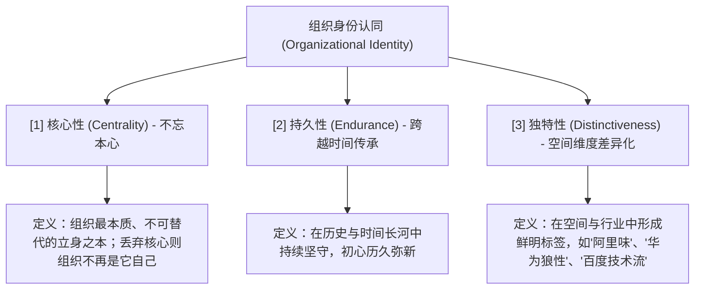
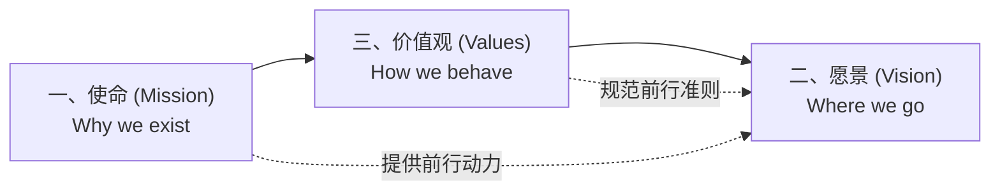
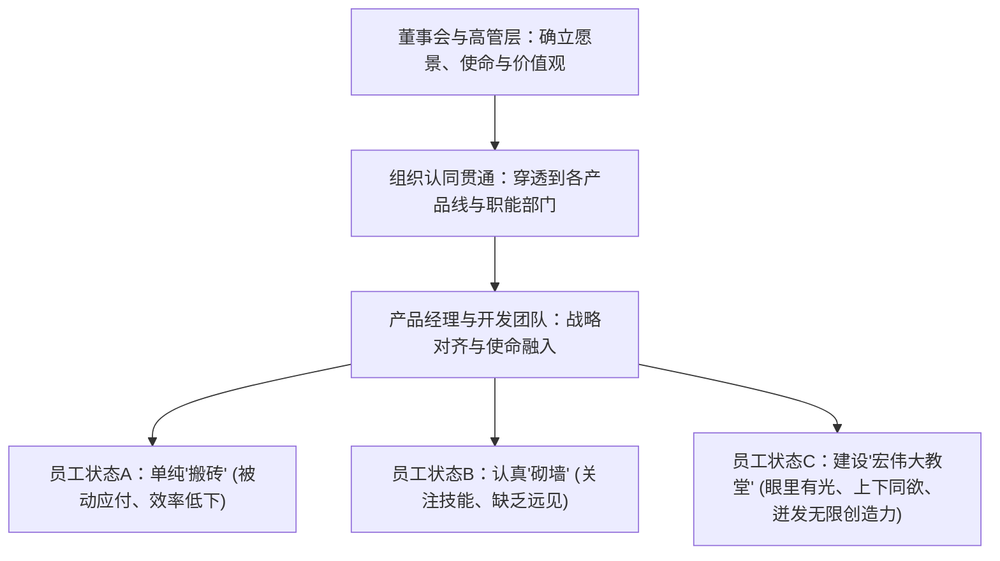

# 1.3 明确组织方向（愿景、使命、价值观与组织身份认同）

> [!IMPORTANT] 核心提要
> 一个企业在制定具体的产品开发战略与研发投入之前，首先必须回答哲学层面的三大根本问题：**我们因何而存在？我们将去向何方？我们坚守何种做事底线？**
> 本节重点掌握：
> 1. **组织身份认同（Organizational Identity）**的三大属性：核心性、持久性与独特性，领会吉利并购沃尔沃实现品牌身份升维的逻辑；
> 2. **愿景（Vision）、使命（Mission）与价值观（Values）**的严格区别、标准提炼范式及动态演进机制；
> 3. 标杆企业实战演练（华为与阿里巴巴）及组织身份自上而下全员穿透法则（三个砌墙工寓言、华为“千疮百孔战机”海报与利益共享机制）。

---

## 1. 组织身份认同（Organizational Identity）及其三大核心属性

在探讨具体战略之前，企业首先面临自身的“身份定位”。组织的身份定位决定了其核心资源流向与文化气质。

### 1.1 经典商业案例：吉利汽车“农村小伙迎娶瑞典白富美”的身份跨越
* **背景与公众认知**：2010 年吉利汽车收购瑞典豪华汽车品牌沃尔沃（Volvo）时，媒体曾用极具反差的标题戏称这一并购为**“中国农村小伙迎娶瑞典白富美”**。在十几年前，吉利汽车在公众心目中多是经济低端代步车甚至出租车的刻板印象。
* **身份重塑与技术反哺**：通过并购沃尔沃，吉利不仅保留并吸纳了沃尔沃世界顶级的车辆安全基因与造车技术，还推动自身品牌架构全面向上跃迁。如今从领克、极氪到收购路特斯、入股奔驰，形成了“无论买奔驰还是买沃尔沃，都图个‘吉利’”的产业格局，彻底重塑了自身的企业身份认同。

### 1.2 组织身份认同的三大支柱（Albert & Whetten 理论）
一个健康的组织，其身份认同由三大基本属性构建而成：

1. **核心性（Centrality）**：
   * **内涵**：组织不可妥协、最本质的核心特质。如同武侠小说中初入江湖的少年，若在历经险恶后黑化，便丢掉了自我。
   * **商业警示**：若一家以科技创新立身的高科技企业，核心利润来源却变成了靠放小额贷款、金融套利，那么它的组织核心属性便已发生异变，丧失了科技企业的立身之本。
2. **持久性（Endurance / Continuity）**：
   * **内涵**：在时间与历史的长周期维度上展现出的持续性与稳定性。无论外部宏观经济周期与行业技术如何更迭，企业贯穿始终的初心、基因与底色历久弥新、代代相传。
3. **独特性（Distinctiveness）**：
   * **内涵**：在空间与同行竞争维度上，能将该组织与其他所有企业清晰区分开来的鲜明个性与文化烙印。
   * **典型表现**：正如业内常言“这个人一举一动一看就是阿里系出来的”、“那位骨子里带着百度工程师的技术范儿”、“这位浑身透着华为人的奋斗拼劲”，这就是组织独特性深植于个体所形成的组织烙印。

---

## 2. 愿景、使命与价值观的内涵与提炼范式

在 NPDP 知识体系中，明确组织方向的核心是通过三个关键概念构建组织航标：

### 2.1 愿景（Vision）：我们将去向何方？
* **核心定义**：基于企业对行业趋势的前瞻预见与深刻洞察，对组织**未来理想状态（Ideal Future State）**的宏大设想与描摹。愿景等同于**组织的“终极梦想”**。
* **回答的核心问题**：**“我们未来要成为什么（What we want to become）？去往何方（Where are we going）？”**
* **提炼句式范式**：通常表述为“在某个特定领域/区域/时间窗口内，达成何种卓越成就，成为一家什么样的企业”。
* **动态演进法则**：**愿景并非永恒固定，可随发展阶段动态跃迁**。当企业攀登至山顶、原定愿景达成之时，必须及时设立更具挑战性的全新愿景指引前行。

### 2.2 使命（Mission）：我们因何而存在？
* **核心定义**：阐释组织立足于世的根本宗旨、存在理由、业务边界以及为社会客户创造的根本价值。
* **回答的核心问题**：**“我们为什么而存在（Why we exist）？我们为谁创造何种价值？”**
* **人生与企业的境界隐喻**：
  * 有人仅有**“性命”**（只为生理存活与本能所驱使）；
  * 有人活出**“生命”**（具有丰富的体验与自我实现）；
  * 卓越的领袖与企业拥有**“使命”**（具有超越个体与狭隘私利的社会责任感，以此凝聚万千资源，成就不可思议的伟业）。
* **经典提炼范例**：
  * **迪士尼（Disney）**：“让全世界快乐起来”；
  * **通用电气（GE）**：“让世界亮起来”；
  * **阿里巴巴（Alibaba）**：“让天下没有难做的生意”。
* **提炼句式范式**：通常聚焦于“为哪类人群、解决何种核心难题/痛点、提供何种产品/服务、实现何种社会价值”。

### 2.3 核心价值观（Core Values）：我们坚守的准则是什么？
* **核心定义**：组织在奔赴愿景、践行使命的征途上，全体成员在思想、情感与行动上必须恪守的**道德底线、行为规范与决策准则**。
* **回答的核心问题**：**“我们如何行事（How we behave）？我们坚持什么、反对什么？”**
* **表达特征**：通常提炼为琅琅上口、易于全员践行的 4 字或 6 字短语。

> [!WARNING] 实战案例：亚马逊“客户第一”与高管开会事件
> 价值观不是挂在墙上的空洞口号，而是指导具体行为的裁判准绳。
> 亚马逊的核心价值观之一是“客户至上（Customer Obsession）”。曾有亚马逊高管正在召开极为重要的高层战略会议，此时前台传来紧急严重的客户投诉与故障。该高管选择继续闭门开会而延后处理投诉，事后遭到创始人贝索斯的严厉问责与批评。在亚马逊的价值序列中，**解决客户痛点永远置于内部行政与内部会议之上**。

> [!NOTE] 考点辨析：现实混淆与考试标准的界限
> 在真实的商业实践中，诸多顶级科技企业（如华为、阿里）往往将愿景与使命相互交叉甚至互换使用（业界常戏言“规则由强者制定，牛逼公司说了算”）。
> 但在 **NPDP 专业考试与知识框架**中，必须严格区分：
> * **愿景（Vision）** = 目标导向、未来状态、梦想蓝图（Where / What）；
> * **使命（Mission）** = 宗旨导向、存在意义、为谁服务（Why）；
> * **价值观（Values）** = 过程导向、行为底线、准则规范（How）。

---

## 3. 标杆企业实战拆解：华为 vs. 阿里巴巴

| 企业名称 | 维度 | 官方表述与演进 | 深度内涵与商业启示 |
| :--- | :--- | :--- | :--- |
| **华为技术 (Huawei)** | **愿景 (Vision)** | • **原愿景**：丰富人们的沟通和生活 • **2018新愿景**：把数字世界带入每个人、每个家庭、每个组织，构建万物互联的智能世界 | 随着 5G、云与 IoT 技术成熟，华为从单纯的“人际通信”跃迁至全场景“智能万物互联”，展现了愿景随时代技术与战略高度动态迭代的典型范式。 |
| | **使命 (Mission)** | 聚焦客户关注的挑战和压力，提供有竞争力的通信与智能解决方案和服务，持续为客户创造最大价值 | 清晰定义“为何而战”：以客户痛点为圆心，以端到端解决方案为半径，以为客户创造持续价值为归宿。 |
| | **价值观 (Values)** | 成就客户、艰苦奋斗、自我批判、开放进取、至诚守信、团队合作 | “以客户为中心，以奋斗者为本，长期艰苦奋斗，坚持自我批判”构建了华为坚不可摧的狼性奋斗铁军底座。 |
| **阿里巴巴 (Alibaba)** | **愿景 (Vision)** | 1. 成为分享数据的第一平台 2. 成为幸福指数最高的企业 3. **活 102 年**（横跨三个世纪，成为百年老店） | 极其罕见地将企业的“生命周期长度（102年）”作为量化愿景，兼具业务数据追求与组织人文温度。 |
| | **使命 (Mission)** | **让天下没有难做的生意** | 宏大且深入人心的商业使命：赋能中小微商家、降低全社会商业交易履约门槛。 |
| | **价值观 (Values)** | **独孤九剑 / 六脉神剑**： 客户第一、团队合作、拥抱变化、诚信、激情、敬业 | 强文化驱动的代表，将价值观直接纳入员工 360 度绩效考核体系，占绩效比重高达 50%。 |

---

## 4. 组织身份认同的穿透传递与全员共鸣

组织方向与身份认同绝不是高层管理者的自娱自乐，必须自上而下穿透到产品开发的每一个层级与执行末梢。

### 4.1 经典寓言：三个砌墙工人的境界之别
路人向工地上正在劳作的三名工人询问“你们在干什么？”：
1. **第一名工人**满脸抱怨与疲惫：“我在搬砖呢，累得要死。”（仅停留在性命层面，视工作为苦役）；
2. **第二名工人**神情平淡：“我在砌一堵砖墙，挣一份工资。”（停留在生命层面，掌握技术但缺乏宏大追求）；
3. **第三名工人**擦了擦额头的汗水，眼中闪烁着自豪与幸福的光芒：“**我正在建造一座世界上最庄严宏伟的避风大教堂！**”
* **启示**：当一线研发与产品人员充分理解企业使命，将日常枯燥的产品迭代、代码编写视作“改变世界、守护人类”伟业的一部分时，组织将迸发出无与伦比的自主自驱力。

### 4.2 经典商业案例：2020年华为“千疮百孔的伊尔-2飞机”海报
* **背景与意象**：2020 年，面对外部极端严酷的技术封锁与供应链断供，华为官方发布了一幅震撼人心的海报：画面中是一架在二战炮火中被防空炮打得千疮百孔、弹痕累累却依然振翅翱翔在蓝天之上的**苏联伊尔-2（IL-2）轰炸机**。
* **配文与精神共振**：**“没有伤痕累累，哪来皮糙肉厚，英雄自古多磨难。”**
* **身份认同爆发**：这一海报迅速引爆了全体华为人及全社会广大同胞的强烈精神共鸣。它向全员清晰传递了组织的硬核身份认同——**无论历经多少艰难挫折，华为永远是一只打不垮、炸不沉的雄鹰，必将死战到底平安归航**。这种极致的身份认同转化为危机时刻全员昼夜攻坚“备胎芯片”、推进纯血鸿蒙研发的磅礴力量。

### 4.3 警示思考：精神激励与利益共享机制的平衡
> [!IMPORTANT] 核心警示：上下同欲的前提是利益相融！
> 许多企业管理者盲目效仿华为的“狼性奋斗、奉献精神与 996 高强度攻坚”，却忽视了华为组织文化赖以生存的最核心物质基石——**全员大比例持股与丰厚的全员分红机制**。
> 创始人任正非仅持有华为约 1% 的微小股份，将超过 98% 的股权和收益全部分享给一线奋斗员工。企业若只要求员工讲情怀、讲奉献，却对物质回报极度苛刻（“既要马儿快快跑，又要马儿不吃草”），组织身份认同必将沦为空中楼阁与虚伪伪善。

---

## 5. 组织方向与身份认同全景速查表（Cheat Sheet）

| 维度 / 概念 | 英文名词 | 核心定义与内涵 | 典型特征 / 句式标志 | 经典商业案例 | 考点与误区提示 |
| :--- | :--- | :--- | :--- | :--- | :--- |
| **组织身份认同** | Organizational Identity | 组织的自我认知与定位，含核心性、持久性与独特性 | 我是谁？为何独特？何以传承？ | 吉利收购沃尔沃实现身份高端化跃迁；华为伊尔-2海报 | 必须全员穿透，兼顾崇高情怀与匹配的物质利益共享机制 |
| **企业愿景** | Vision | 组织对理想未来状态的终极梦想与宏大追求 | “我们将去向何方”；某领域成为第一；某年限跨越 | 阿里“活102年、做数据第一平台”；华为“构建万物互联智能世界” | **动态演进**：阶段性登顶后可主动升级新愿景；避免与使命混淆 |
| **企业使命** | Mission | 组织因何而存在的立身宗旨与社会客户价值 | “我们为什么而存在”；为谁服务，解决什么根本难题 | 阿里“让天下没有难做的生意”；迪士尼“让全世界快乐起来” | 凝聚全员精力的根本源泉；体现组织的社会存在价值 |
| **核心价值观** | Core Values | 践行使命愿景过程中恪守的道德底线与行为准则 | “我们如何做事”；坚持什么、反对什么；4~6字准则 | 华为“成就客户、艰苦奋斗、自我批判”；阿里“六脉神剑”；亚马逊客户至上 | **行为裁判准绳**：非口号，必须融入日常决策、晋升与绩效考核中 |
