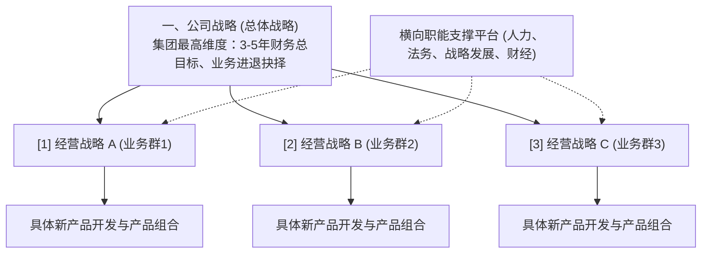
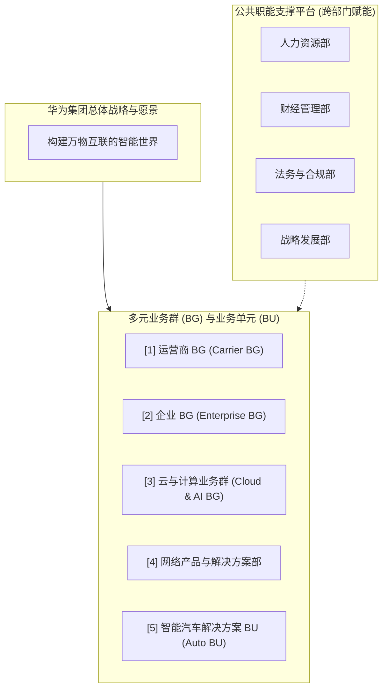
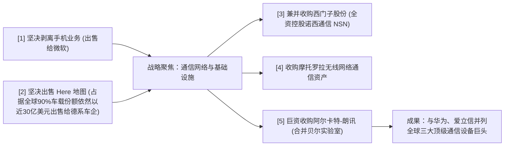
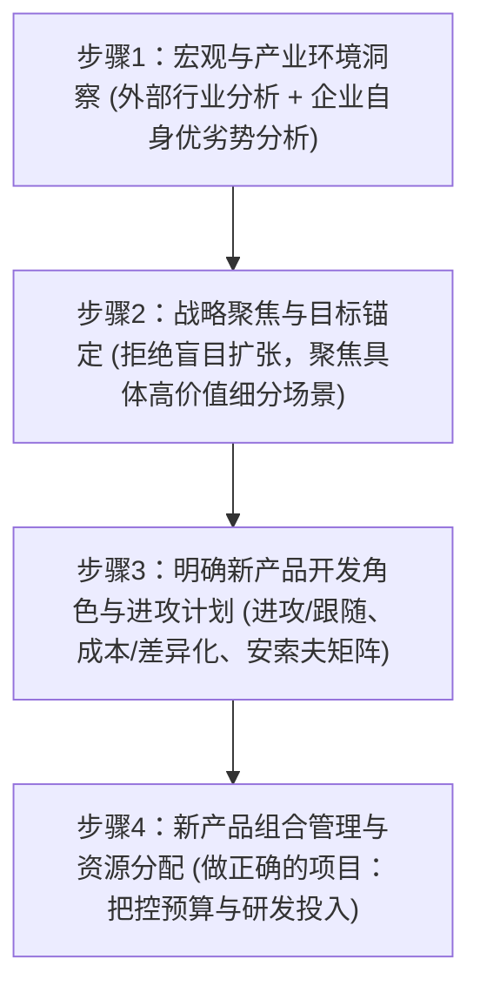

# 1.4 公司战略与经营战略（含华为多元战略与诺基亚案例）

> [!IMPORTANT] 核心提要
> 在战略金字塔中，**公司战略（Corporate Strategy）**与**经营战略（Business Strategy / 业务战略）**直接承接顶层的愿景与使命：
> 1. 公司战略回答“做哪些业务、退出哪些业务以及集团总体财务目标”；经营战略回答“特定业务线如何竞争并贡献业绩”；
> 2. 大型多元化企业（如华为）通过业务群（BG）与职能平台协同运作，保证总体战略一致性；
> 3. 诺基亚（Nokia）在手机溃败后通过“战略管道平衡（Pipeline Balancing）”，断臂出售市场份额高达 90% 的车载导航业务，集中全副资源并购阿尔卡特-朗讯重回全球通信设备巅峰，是战略聚焦的商业典范；
> 4. 掌握经营战略指引新产品开发（NPD）落地的四步闭环模型。

---

## 1. 公司战略与经营战略的内涵与协同关系

### 1.1 公司战略（Corporate Strategy）
* **定位**：站在组织最高维度制定的纲领性战略。
* **核心内容**：
  * 确立公司未来 3 至 5 年的全局财务收益规划与总体增长目标；
  * 评估并决断企业未来的**业务布局边界**——哪些是有潜力的新兴产业必须果断进军（如向新能源、智能汽车拓展），哪些是衰退或边际效益递减的业务必须果断剥离或退出；
  * 在集团各业务板块之间，主导资本、核心人才和战略性资源的宏观配置与倾斜。

### 1.2 经营战略 / 业务战略（Business Strategy）
* **定位**：针对企业内部特定的业务板块或战略业务单元（SBU, Strategic Business Unit）制定的竞争指导框架。
* **核心内容**：
  * 明确该业务板块在未来特定周期内对公司整体财务目标的**贡献度与量化指标**（例如集团制定年度净利润目标，明确 A 业务贡献 40%、B 业务贡献 30%）；
  * 明确该业务线在目标行业中的具体竞争打法（如抢占多少市场份额、主打什么差异化定位）。

### 1.3 组织规模与战略形态的适配
* **初创与中小型企业**：通常只有单一业务线，此时**公司战略往往等同于经营战略**，两者合二为一。
* **大型多元化企业集团**：涵盖跨行业、跨场景的数十条产品线，必须在公司统一战略统领下，为各独立业务群制定定制化的经营战略，同时依托横向职能体系提供协同支撑。

---

## 2. 华为 2019 多元化业务架构与协同战略

在 2019 年华为公布的业务与组织架构蓝图中，展现了大型多元化科技巨头如何实现公司总体战略与多元业务战略的严密协同：

### 2.1 业务群（BG/BU）与多元化协同
* **业务单元纵向纵深**：
  * **运营商 BG**：主攻全球电信运营商基础设施（5G基站、光传输网等）；
  * **企业 BG**：主攻政企数字化转型（数据中心、园区网络、政务云等）；
  * **云与 AI 业务群**：布局底层算力基础设施与公共云服务；
  * **智能汽车解决方案 BU**：切入智能网联汽车核心增量零部件与智能座舱。
* **公共平台横向贯通**：
  * 多元业务线绝非各自为政、分裂割据的“诸侯割据”，必须共享底层的**法务部、人力资源部、财经部及中央研究院战略平台**。
  * **核心启示**：多元化组织的最高法则是**“战略协同与一致性”**。所有独立业务群的竞争策略必须严格服从于集团的总体愿景与公司战略，形成“力出一孔、利出一孔”的合力。

---

## 3. 诺基亚（Nokia）断臂求生与战略管道平衡案例

许多人误以为诺基亚在智能手机浪潮失败后已经彻底倒闭破产。事实上，诺基亚通过极其果断的**经营战略聚焦与战略管道平衡（Pipeline Balancing）**，成功实现了史诗级的蜕变重生。

### 3.1 手机帝国的崩塌与清算
* 在功能机时代，诺基亚是名副其实的“手机霸主”与行业统治者，全球手机市场份额曾一度逼近 **50%**。
* 随着苹果 iPhone 及安卓阵营的崛起，固守塞班系统的诺基亚遭遇毁灭性打击，市场份额断崖式跌至 **4%** 以下。诺基亚痛定思痛，果断将手机终端业务整体剥离出售给微软（后被授权至 HMD）。

### 3.2 战略管道平衡（Pipeline Balancing）的精髓
> [!IMPORTANT] 核心概念：管道平衡（Pipeline Balancing）
> 企业的研发资源、组织带宽与资金资本永远是有限的“管道”。如果管道中同时塞入过多互不相干的项目与业务，将导致所有项目因资源匮乏而全面窒息延误。
> **战略聚焦的核心不仅在于“决定做什么”，更在于“极其坚决地决定不做什么、退出什么”**。将有限精力高度聚焦在核心关键命脉上，方能形成压倒性突破。

### 3.3 诺基亚的绝地反击行动
诺基亚将经营战略彻底收缩并重新定位为**“全球通信网络基础设施与技术服务的领导者”**，围绕这一核心战略实施了一系列教科书级的业务整合：

1. **收购整合核心通信资产**：
   * 联合德国西门子成立合资公司**“诺西公司（NSN）”**，随后出资全资收购西门子所持的 50% 股权，彻底将移动网络基础设施资产收归己有；
   * 收购**摩托罗拉（Motorola）**的无线通信网络业务资产，夯实北美与全球网络根基；
   * 耗资 156 亿欧元巨资收购**阿尔卡特-朗讯（Alcatel-Lucent）**，将著名的贝尔实验室与全球固定/光网络技术收编旗下。
2. **断臂出售垄断级非核心业务（Here 地图案例）**：
   * 诺基亚旗下的 **Here 地图系统**在当时已占据**全球汽车车载导航市场高达 90%** 的垄断性份额，盈利能力极强。
   * 但诺基亚高层清醒地认识到：车载导航与底层通信设备基站之间存在严重的精力分散与协同损耗，会严重挤占通信研发预算。
   * 诺基亚毅然以近 **30 亿美元**的高价将 Here 地图出售给德国三大豪华车企联盟（宝马、奥迪、奔驰戴姆勒），果断回笼巨额现金，将所有弹药全部压向 5G 与下一代网络通信设备研发。
* **最终结果**：诺基亚重返全球科技之巅，与华为、爱立信鼎足而立，成为全球仅有的三家能提供全套端到端 5G/6G 移动通信网络解决方案的巨头之一，每年专利授权与设备采购收入极其惊人。

---

## 4. 经营战略驱动新产品开发的四步落地路径

经营战略绝非空洞口号，它必须能够穿透并指引产品团队在市场中如何选择项目、规划开发。其经典落地闭环包含四大关键步骤：

### 步骤1：宏观与产业环境洞察（Market & Internal Analysis）
* 深入分析产业环境、宏观趋势（PESTLE）、行业竞争结构（波特五力）及公司自身的资源禀赋与核心技能（SWOT 分析）；
* 从行业痛点与技术变革中敏锐捕捉真实的商业机遇。

### 步骤2：战略聚焦与目标锚定（Strategic Focus & Goal Setting）
* **拒绝泛化**：坚决避免“看到某个赛道热门就盲目入场”（例如仅看到“新能源大有可为”，却不知道自己在电池、电控、整车还是充换电中具体做哪一环）；
* 聚焦特定垂直场景，制定清晰量化的经营目标（如未来 3 年在某细分市场占领 25% 份额或实现 5 亿元营收）。

### 步骤3：明确新产品开发的贡献与进攻计划（NPD Role & Attack Plan）
* **确定开发路径**：明确达成目标是通过**自主内部研发**、**战略并购（M&A）**还是**合资合作**来完成；
* **确定竞争定位与进攻策略**：
  * 市场角色：是争当行业开创者/先行者（Leader/Innovator），还是做快速跟随者（Fast Follower）？
  * 竞争战略：采用低成本领先还是高附加值差异化？
  * 市场拓展维度：应用安索夫矩阵（市场渗透、产品开发、市场开发或多元化）；
  * 特性与成本权衡：是追求极致性能配置，还是追求极简极致性价比？

### 步骤4：新产品组合管理与资源倾斜（Portfolio Management）
* 依据经营战略与进攻计划，在待选项目中开展**产品组合管理（Portfolio Management）**；
* 牢牢把握“做正确的项目（Do the right projects）”，把有限的人力、研发预算与设备倾斜配置给最符合战略目标的高价值项目，形成强有力的产品开发进攻梯队。

---

## 5. 公司战略与经营战略全景对比速查表（Cheat Sheet）

| 维度 | 公司战略（Corporate Strategy） | 经营战略（Business Strategy） | 协同机制 / 关联考点 |
| :--- | :--- | :--- | :--- |
| **战略层级** | 组织顶层总体战略（集团级） | 特定业务单元/业务群战略（SBU级） | 经营战略承接公司战略，共同支撑组织愿景 |
| **管理跨度** | 跨部门、跨业务、跨行业 | 针对某一条特定业务线或垂直市场 | 单一业务小企业两者合一；大型集团严格分设 |
| **核心职责** | 制定集团 3~5 年财务目标；决定业务进退与赛道取舍；统筹资本与宏观资源调配 | 明确该业务线对集团财务目标的贡献占比；制定该业务在目标市场中的竞争打法与攻防策略 | 业务线之间及职能平台必须保持一致性（华为多元协同） |
| **关键决策** | “我们该做哪些产业？该放弃哪些产业？资源如何向高增长业务倾斜？” | “在这个特定行业中，我们如何打赢对手？依靠低成本还是差异化？自研还是收购？” | 遵循战略管道平衡（Pipeline Balancing），严禁盲目铺摊子 |
| **经典商业案例** | 诺基亚剥离手机业务，全资控股诺西通信、并购阿尔卡特-朗讯，重构集团版图 | 诺基亚果断以 30 亿美元出售市占率 90% 的 Here 车载导航，全力押注 5G 通信网络 | 舍弃高份额非核心业务，聚焦有限资源于战略核心命脉 |
| **对 NPD 的指导** | 划定产品开发的大赛道边界与整体研发投入预算上限 | 明确新产品在业务中的贡献占比；制定进攻计划；驱动产品组合筛选（做正确的事） | 战略直接决定研发项目的生杀予夺，避免研发自嗨脱节 |
