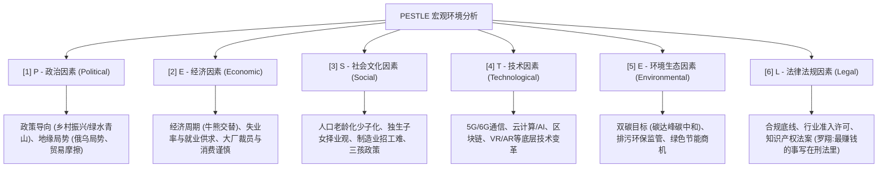
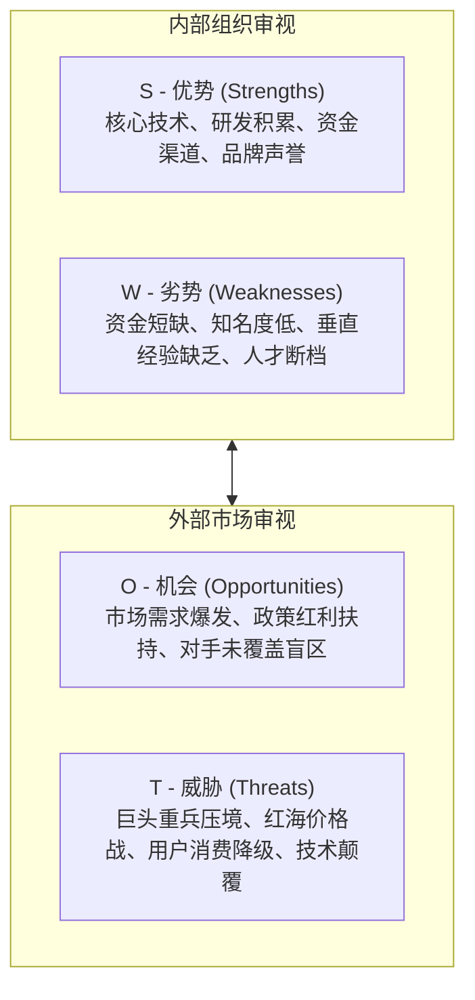
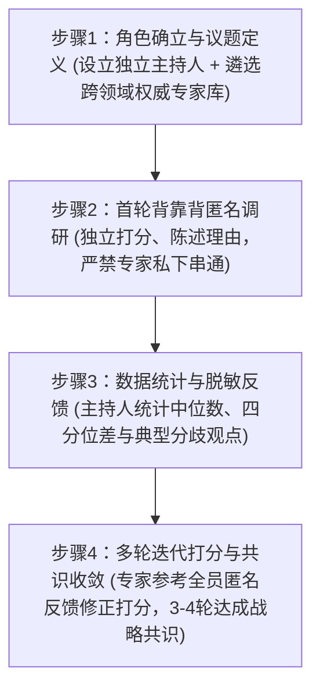

# 1.5 产品创新战略概论与三大战略准备工具（PESTLE、SWOT、德尔菲）

> [!IMPORTANT] 核心提要
> 战略制定绝非凭空拍脑袋，必须建立在严谨的宏观环境洞察、内部资源审视与科学决策基础之上：
> 1. **产品创新战略**是连接业务战略与具体研发的纽带，核心在于**与总体战略对齐**、**项目优先级排序**及**果断权衡取舍**；
> 2. **PESTLE 分析**从政治、经济、社会文化、技术、环境、法律六大宏观维度把脉外部大势；
> 3. **SWOT 分析**打通组织内部优势/劣势与外部机会/威胁，掌握其在真实商业（如在线教育进军 MBA 培训）中的矩阵推演；
> 4. **德尔菲法（Delphi Method）**通过“背靠背、匿名打分、多轮反馈、迭代收敛”，有效规避“领导一言堂”与从众心理，形成高质量专家共识。

---

## 1. 产品创新战略核心概论与主流框架

### 1.1 产品创新战略的定义与三大核心特征
产品创新战略（Product Innovation Strategy）是企业为实现经营目标，针对新产品开发与技术创新活动所制定的纲领性指导方案。其三大核心支柱包括：
1. **战略匹配与协同（Strategic Alignment）**：必须与公司的总体战略、经营目标高度一致，为集团全局价值创造提供支撑；
2. **创新项目优先级排序（Prioritization）**：组织的研发预算、人员与时间永远是稀缺的，创新战略必须为众多备选项目排出清晰的先后顺位（紧密衔接第二章组合管理）；
3. **有效的权衡与取舍（Trade-offs）**：战略的本质是选择与放弃。根据优先级排序，集中优质资源强攻排名前列的战略级项目，坚决割舍边际效应差的次要项目。

### 1.2 优秀创新战略的组织特征
* **价值最大化导向**：利用有限资源博取最大的商业回报与社会价值；
* **开放拥抱变革**：面对技术跃迁与市场突变，具备敏捷调整的韧性；
* **容错与好奇心文化**：为团队探索未知、提出突破性创意提供容错土壤。

### 1.3 NPDP 主流创新战略框架全景预览
NPDP 课程后续章节将围绕五大核心创新战略框架深度展开：
* **波特一般竞争战略**：从市场范围与竞争优势划分成本领先、差异化、细分市场；
* **迈尔斯和斯诺战略框架**：按面对创新的进取姿态划分为探索者、防御者、分析者与反应者；
* **克里斯坦森颠覆式创新**：区分维持性创新与颠覆性创新（低端颠覆与新市场颠覆）；
* **皮萨诺创新景观图**：基于技术与商业模式两个维度划分为常规、突破、颠覆与架构型创新；
* **安索夫矩阵**：从产品与市场的新旧组合划分市场渗透、产品开发、市场开发与多元化。

---

## 2. 战略准备工具之一：PESTLE 宏观态势分析

在切入任何新产业或规划全新产品线之前，企业首先要抬头看天，通过 **PESTLE 模型**系统扫描外部宏观环境的机遇与掣肘：

### 2.1 六大宏观维度深度拆解
1. **P（政治因素 / Political）**：
   * **国家政策导向**：例如“绿水青山就是金山银山”驱动新能源与环保产业，乡村振兴扶持返乡做特色农副产品电商。
   * **地缘政治与外贸环境**：在俄乌局势动荡期进入东欧投资风险极高；中美贸易争端对外贸出口型企业造成重大准入与关税壁垒。
2. **E（经济因素 / Economic）**：
   * **宏观经济周期与就业市场**：在经济下行放缓阶段，求职市场降温（如大厂出现 10%~20% 规模优化，40 岁资深人才再就业周期拉长），大众消费偏向保守理性。
   * **战略启示**：企业做新产品决策时，必须认清顺风期与逆风期，在扩张期享受增长红利，在紧缩期强化造血与防守避险。
3. **S（社会文化与人口因素 / Social & Cultural）**：
   * **人口结构与代际变迁**：传统人口红利逐步减退，少子化与老龄化加剧；现代年轻一代成长于物质充裕家庭，制造业工厂招工难度日益加大。
   * **消费与文化变迁**：国家放开三孩政策对高品质母婴用品、素质教育带来潜在契机；银发经济与适老化产品需求急剧爆发。
4. **T（技术因素 / Technological）**：
   * **底层技术浪潮**：5G 通信、生成式 AI、大模型、云计算、物联网（IoT）及元宇宙（VR/AR）的成熟，正在全面颠覆传统软件与工业产品形态，必须紧跟前沿进行技术融合。
5. **E（环境与生态因素 / Environmental）**：
   * **绿色与双碳标准**：严格的碳排放配额（碳中和/碳达峰）对高耗能、高污染传统制造业构成直接生死考验；相反，工业污水治理、废弃物循环利用、清洁能源等“变废为宝”领域孕育出巨大商机。
6. **L（法律法规因素 / Legal）**：
   * **法治红线与合规敬畏**：法学名师罗翔曾戏言“最赚钱的事都写在刑法里”，商业竞争绝不可踩踏法律红线与打擦边球；跨国业务更要深入调研海外反垄断法案、GDPR 数据隐私法案及劳动雇佣法规。

---

## 3. 战略准备工具之二：SWOT 战略态势分析

**SWOT 模型**是连接组织“外部客观环境”与“内部资源禀赋”的经典决策罗盘，用于明确自身的攻防态势：

### 3.1 四大维度要素盘点
* **S（内部优势 / Strengths）**：企业独有的核心专长、差异化技术壁垒、充沛的资本储备、高效的销售网络与品牌美誉度。
* **W（内部劣势 / Weaknesses）**：企业缺乏的关键资源、薄弱的供应链掌控力、落后的管理机制或模糊的市场定位。
* **O（外部机会 / Opportunities）**：未被满足的庞大市场痛点、宽松的行业准入许可、国家新兴战略政策扶持。
* **T（外部威胁 / Threats）**：既有头部巨头的严密防御、竞争对手激进的价格围剿、宏观下行引发的客群购买力缩水。

### 3.2 商业实战案例：希赛网布局 MBA 联考培训的 SWOT 推演
以知名在线教育机构希赛网进军“MBA 专业硕士联考考前培训”业务为例，其立项前的 SWOT 分析如下：
* **优势（Strengths）**：
  * **20 余年在线教育底蕴**：公司自 2001 年成立以来，积累了成熟的在线直播、录播、题库与社群答疑产品研发体系；
  * **师资与教研复用**：已沉淀顶尖的考博英语教研团队与管理类综合素质导师队伍，教学底座扎实。
* **劣势（Weaknesses）**：
  * **垂直品牌沉淀不足**：在传统 MBA 考生圈层中心智渗透尚浅，缺乏家喻户晓的全国级 MBA 头部明星名师；
  * **地域劣势**：总部地处湖南长沙，相比北上广深一线顶级商学院密集的中心城市，线下生源互动与高端圈层资源存在地域鸿沟。
* **机会（Opportunities）**：
  * **职场学历内卷驱动**：职场竞争与企业晋升门槛提高，大批白领对在职提升研究生学历（MBA/MEM/MPA）的刚性需求持续高涨；
  * **教培行业合规出清**：政策引导下教育行业走向规范，大批优秀教育人才向合规在线平台流动，便于吸纳整合。
* **威胁（Threats）**：
  * **存量巨头林立**：太奇、社科赛斯、华章等深耕十数年的老牌传统 MBA 机构具备较强的渠道先发优势；
  * **宏观消费谨慎**：受经济环境冲击，部分学员对动辄数千至上万元的培训支出决策更加审慎，付费转化周期延长。

---

## 4. 战略准备工具之三：德尔菲法（Delphi Method）

### 4.1 核心痛点：规避“领导一言堂”与“群体盲思”
在企业战略研讨会上，若采用公开举手投票或自由发言，常陷入严重弊端：高层领导或权势最大的部门长一旦率先定调，下属专家出于人情世故或避免冲突，往往盲目附和（“领导英明，我也赞同”）。
**德尔菲法（Delphi Method）**由此诞生，其核心主旨是通过**匿名、多轮、背靠背迭代**，汇聚真正客观的专家智慧。

### 4.2 德尔菲法标准实施四步流程

1. **第一步：确立主持人与遴选专家**：
   * 设立中立客观的调研主持人（Facilitator）；
   * 遴选相关业务领域内具备深厚认知、互不隶属的专业专家小组；
   * 清晰精准地界定待决断的战略问题（例如：“未来 3 年我司新产品管线中，哪些前沿方向应列入第一梯队开发？”）。
2. **第二步：首轮背对背匿名问卷打分**：
   * 专家各自独立填写详细问卷与打分表，并充分陈述立论理由；
   * 全程严格匿名，专家之间不发生直接横向沟通，消除权威施压与人际面子顾虑。
3. **第三步：主持人汇总统计与匿名反馈**：
   * 主持人收集首轮打分，进行客观的统计学分析（计算均值、中位数、极差分布）；
   * 将打分结果与具有代表性的正反方匿名观点汇总整理，编制成不包含专家姓名的反馈报告，分发回全体专家。
4. **第四步：多轮迭代打分直至达成共识**：
   * 专家在审阅其他专家的匿名观点与整体离散情况后，自主决定是否修正自己的原始判断，开展第二轮、第三轮打分；
   * 通常经过 **3 至 4 轮**迭代后，意见离散度显著缩小，最终收敛并输出高度可靠的战略决策共识。

---

## 5. 三大战略准备分析工具全景速查表（Cheat Sheet）

| 工具名称 | 核心应用场景 | 分析维度 / 构成模块 | 核心工作原理 | 核心产出与价值 | 常见误区与实战警示 |
| :--- | :--- | :--- | :--- | :--- | :--- |
| **PESTLE 模型** | 宏观大势研判、新行业准入前瞻、跨国出海战略评估 | **P** (政治)、**E** (经济)、**S** (社会文化)、**T** (技术)、**L** (法律)、**E** (环境) | 外部大环境宏观扫描，识别不可控的大势与宏观红利/风险 | 宏观机会与阻碍清单，明确行业顺逆周期与合规准入边界 | 仅罗列大而化之的假大空信息，未能与自身业务痛点具体勾连 |
| **SWOT 矩阵** | 业务线立项审视、攻防竞争策略制定、新业务可行性论证 | **S** (内部优势)、**W** (内部劣势)、 **O** (外部机会)、**T** (外部威胁) | 内部资源禀赋与外部市场机遇威胁交叉匹配 | SO增长战略、ST多元化防守、WO扭转型战略、WT防御收缩决策 | 主观臆断严重（误将平庸能力当优势）；优劣势缺乏竞争对手参照物 |
| **德尔菲法** (Delphi Method) | 前沿战略方向预测、新产品管线优先级排序、颠覆性技术落地预估 | 主持人 + 跨领域专家组 + 匿名问卷 + 多轮迭代统计报告 | **背对背匿名**、多轮统计反馈、自主修正、逐步收敛共识 | 消除权威压制与从众盲思，达成科学量化的高质量战略共识 | 专家背景单一造成视野狭隘；主持人带有倾向性引导导致统计失真 |
