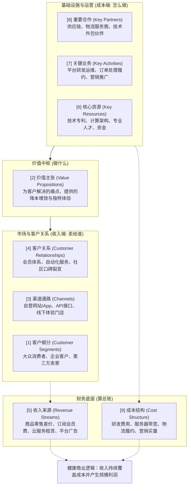
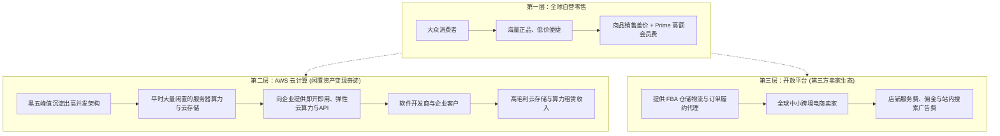
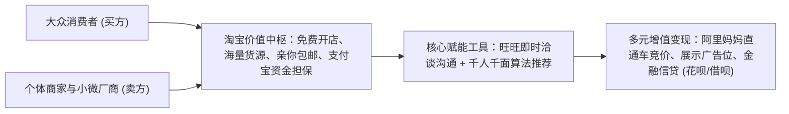

# 1.6 商业模式画布（BMC九大模块与亚马逊商业模式案例）

> [!IMPORTANT] 核心提要
> 商业模式画布（Business Model Canvas, BMC）是由瑞士学者亚历山大·奥斯特瓦德（Alexander Osterwalder）提出的战略管理与创业工具。其核心价值在于**将动辄几十页的繁琐商业企划案（BP）精炼为一页可视化的九宫格全局地图**：
> 1. 系统掌握 BMC 的**九大核心模块（Building Blocks）**及其内在的“价值创造、价值传递与价值捕获”闭环；
> 2. 深度复盘**亚马逊（Amazon）**如何从在线书店零售商，演变为利用“黑五”冗余算力孵化出全球云计算霸主 AWS，实现低边际成本扩张的飞轮商业模式；
> 3. 对比分析中国本土电商代表**淘宝网（Taobao）**以免费入驻、旺旺沟通、支付宝担保交易与广告增值服务构建的双边平台商业模式。

---

## 1. 商业模式画布的诞生背景与核心结构

在创业初期或新产品孵化阶段，产品团队往往充满创意，但若直接投入研发，极易因“缺乏造血能力与盈利逻辑”而夭折。
* **痛点根源**：过去的商业企划案篇幅冗长，投资人与高管查阅耗时；且许多互联网项目外表炫酷，底层却未厘清“究竟赚谁的钱、如何覆盖成本”。
* **BMC 的核心价值**：通过结构化的九大模块，帮助团队在立项前“心中有地图”，透视商业运作全貌。

---

## 2. 商业模式画布九大模块深度拆解

### 2.1 右半部分：面向客户与市场（价值传递与收入捕获）
1. **客户细分（Customer Segments, CS）**：
   * 企业到底为谁创造价值？谁是将为产品掏出真金白银的核心目标客群（如价格敏感大众、企业级开发者、第三方中小商家）。
2. **价值主张（Value Propositions, VP）**：
   * 凭什么让客户购买我们的产品而非竞品？产品为客户解决了何种痛点，提供了怎样的功能、便捷性、性价比或情感认同。
3. **渠道通路（Channels, CH）**：
   * 客户通过何种触点认知、评估、购买并接收我们的产品与服务（如线上电商平台、线下自营旗舰店、第三方代理商、开放 API 接口）。
4. **客户关系（Customer Relationships, CR）**：
   * 企业如何获取新客户、维护现有客户黏性并促成复购裂变（如自动化自助服务、专属客户经理服务、高价值付费会员体系、社群运营）。
5. **收入来源（Revenue Streams, RS）**：
   * 客户愿意为哪些价值付费？具体的变现形态为何（如商品买卖差价、周期性会员订阅费、资产租赁使用费、软件许可授权费、平台撮合佣金、广告流量变现等）。

### 2.2 左半部分：面向组织与后台（基础设施与能力构建）
6. **核心资源（Key Resources, KR）**：
   * 要交付上述价值主张所必需的核心生产要素与战略资产，涵盖物理资产（机房设备、仓储物流网）、知识资产（专有技术、知识产权、大数据）、人力资产及财务资本。
7. **关键业务（Key Activities, KA）**：
   * 企业日常运转与实现商业模式必须开展的核心行动。如软件架构开发维护、海量高并发订单处理与分发、供应链品控管理、市场品牌营销推广等。
8. **重要合作（Key Partners, KP）**：
   * 企业无法完全依靠自身包揽全部环节，必须借力的外部商业生态伙伴（如上游原材料供应商、三方物流快递企业、金融支付清算机构）。
9. **成本结构（Cost Structure, CS）**：
   * 运转整个商业模式所衍生出的所有成本费用清单。包括固定成本（机房租金、研发团队薪资）与可变成本（服务器带宽扩容费、包装履约运费、广告投放买量成本等）。

---

## 3. 标杆案例 1：亚马逊（Amazon）多边飞轮商业模式演进

亚马逊从一家最初在线卖书的网站，成长为万亿美元市值的超级帝国，其核心驱动力正在于其基于 BMC 展现出的**高复用、低边际成本扩张**的商业模式飞轮。

### 3.1 第一层：全球在线零售与 Prime 会员飞轮
* **目标客群（CS）**：全球大众网购消费者。
* **价值主张（VP）**：提供品类极其丰富、价格亲民、品质可靠的一站式正品电商零售体验。
* **核心客户关系与杀手级收入（CR & RS）**：
  * **Prime 会员服务**：千万级规模的会员每年缴纳数十至上百美元会员费。
  * **商业精髓**：类似线下仓储超市巨头 Costco（好市多），当付费会员基数极其庞大时，会员费本身就构成了数十亿美元的巨额纯利润池；这反过来倒逼平台将前端商品毛利压缩到极致（甚至平价保本销售），以不可抗拒的低价吸引更多用户加入会员，形成自我强化的正向飞轮。

### 3.2 第二层：AWS 云计算平台——闲置计算资源的复用奇迹
* **历史契机与痛点**：
  * 每年海外网购狂欢节**“黑色星期五（Black Friday）”**及圣诞购物季期间，涌入亚马逊网站的瞬时订单量暴增数十倍。
  * 为确保网站不宕机，亚马逊投入巨资研发了超高并发的分布式订单处理底层架构与海量服务器集群。
  * **副产品与资源冗余**：黑五狂欢退潮后，庞大的计算与存储能力在全年的其余 300 多天里大面积闲置，折旧成本巨大。
* **商业模式升维突破**：
  * 贝索斯敏锐察觉到：市场上大批初创软件开发团队与中小型企业，极需稳定强大的高并发云存储与算力，但自身无力承担自建服务器机房的天价成本。
  * 亚马逊于是不动声色地向外部开发者开放云服务——**AWS（Amazon Web Services）**横空出世。
* **BMC 模块演进**：
  * **新增客户（CS）**：软件开发商、科技初创公司与大中型企业；
  * **新增价值主张（VP）**：弹性按需付费的云存储、云算力与标准 API 程序接口；
  * **几乎零增量边际成本（CS & KA）**：底层机房、网络维护与架构工程师团队是自营业务原有的，新增云客户几乎无需额外追加固定资产；
  * **新增暴利收入来源（RS）**：企业按使用量按月缴纳的高毛利云存储与云计算服务费，一举成为亚马逊全集团最强劲的现金奶牛。

### 3.3 第三层：开放第三方卖家生态（Marketplace）
* **新增客群（CS）**：全球寻求海外销路的跨境贸易商家与第三方品牌方。
* **价值主张与复用（VP & KR）**：为商家开放流量店铺，提供专业的 FBA（Fulfillment by Amazon）仓储、打包、配送及跨境代收款服务。
* **新增收入（RS）**：商户入驻年费、平台交易抽成佣金、FBA 仓储物流服务费，以及站内关键词广告竞价收入。

---

## 4. 标杆案例 2：淘宝网（Taobao）中国本土化商业模式实践

阿里巴巴旗下的淘宝网，在借鉴海外电商理念的同时，结合中国本土国情开创了极具东方特色的商业模式画布：

* **客户细分（CS）**：双边市场——庞大的中国大众网购买家 + 千千万万小微制造厂、个体掌柜与创业者。
* **价值主张（VP）**：
  * **买家侧**：“淘尽天下好物”、“亲，包邮哦”、人性化的无门槛导购；
  * **卖家侧**：**“免费开店，零门槛做老板”**（早期正面击溃收取交易服务费的易趣 eBay）；
  * **互信基石**：**支付宝（Alipay）担保交易**机制——买家付款后资金存管在第三方托管账户，确认收货满意后再放款给卖家，彻底扫除陌生人线上支付交易的安全顾虑。
* **核心渠道与工具（CH & KR）**：淘宝网 PC 站与手机淘宝 App；阿里旺旺即时通信工具（实现买卖双方无障碍实时砍价与售前咨询）。
* **客户关系（CR）**：千人千面智能推荐引擎、达人直播导购、买家秀社群评价。
* **收入来源（RS）**：
  * 平台虽然对商家“基础开店免抽佣”，但通过**阿里妈妈（直通车、钻展、淘宝客）**收取高昂的**搜索结果竞价排名与广告展示费**；
  * 依托庞大的资金沉淀与交易流水，衍生出花呗、借呗、网商银行等供应链金融借贷与利息收入。

---

## 5. 商业模式画布九大模块全景速查表（Cheat Sheet）

| 模块名称 | 英文缩写 | 核心定位与内涵 | 核心诊断问题 | 亚马逊经典实践 | 淘宝网经典实践 |
| :--- | :--- | :--- | :--- | :--- | :--- |
| **客户细分** | CS | 企业为之提供服务与创造价值的核心人群或机构 | 我们在为谁解决痛点？谁是核心付费金主？ | 全球网购普通消费者、企业开发者(AWS)、第三方跨境卖家 | 海量大众网购用户、个体中小掌柜与微型品牌厂商 |
| **价值主张** | VP | 产品或服务解决的核心问题、带来的独特效用 | 我们给客户带来了什么独特不可替代的价值？ | 正品低价零售体验、弹性高可用云存储计算、一站式FBA履约 | 免费入驻开店、“亲，包邮”、支付宝第三方资金安全担保 |
| **渠道通路** | CH | 接触、转化、交付产品给客户的触点网络 | 客户如何知晓、评估、购买并收到我们的产品？ | 亚马逊官网/移动端、AWS标准REST API接口、Kindle电子书库 | 淘宝 PC 网站、手机淘宝 App、千人千面个性化信息流 |
| **客户关系** | CR | 企业与特定客户群体建立和维系的关系模式 | 我们如何引流获客？如何拉升粘性与长期留存？ | Prime 付费会员尊享服务、自动化智能客服体系 | 阿里旺旺即时双向沟通、店铺粉丝社群与买家评价机制 |
| **收入来源** | RS | 商业模式中所有现金流入的渠道与变现方式 | 客户因何付费？怎么付？是买断、租赁还是会员？ | 商品销售毛利、Prime会员费、AWS弹性云计算租金、入驻佣金 | 阿里妈妈广告竞价直通车、展示位广告费、花呗借呗金融利息 |
| **核心资源** | KR | 支撑价值主张交付与运营必备的关键战略资产 | 我们需要哪些核心技术、基础设施、人才与资本？ | 超大规模服务器集群、分布式履约仓储中心、云计算专利 | 高并发双十一交易中台、阿里旺旺架构、风控信贷算法模型 |
| **关键业务** | KA | 确保商业模式顺畅运转企业必须开展的关键行动 | 团队每天必须重点抓的核心运营与考核工作？ | 平台软件维护迭代、黑五订单处理履约、云计算API研发 | 电商大促活动策划、反刷单黑产治理、搜索算法与推荐调优 |
| **重要合作** | KP | 弥补内部能力不足、实现共赢的外部生态伙伴 | 哪些环节需要借助外部力量？谁能降低我的风险？ | 联邦快递/UPS/邮政物流、出版发行商、第三方数据中心 | 全国各大快递物流公司（菜鸟联盟）、第三方服务代运营ISV |
| **成本结构** | CS | 维持整套商业系统运转所需支出的所有费用构成 | 哪些业务耗费资金最多？固定与可变成本比例？ | 巨额数据中心电费带宽、物流仓储履约人员成本、技术研发 | 阿里巴巴研发工程师薪酬、机房带宽折旧、品牌宣传大促营销 |
