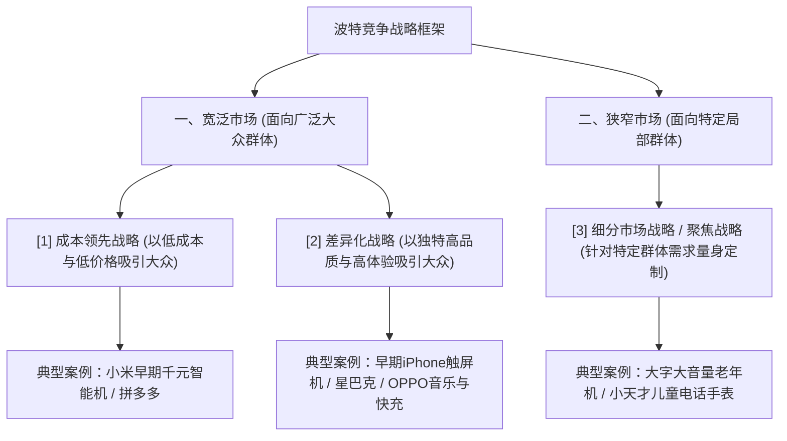

# 1.6 波特竞争战略框架（成本领先、差异化与细分市场）

> [!IMPORTANT] 核心提要
> 哈佛商学院终身教授迈克尔·波特（32岁即获终身教授称号）最广为人知的两大理论贡献：一是**波特五力模型**（五种竞争力模型），二便是本节核心——**波特三大一般竞争战略框架**。波特从**市场范围（宽泛市场 vs. 狭窄市场）**与**竞争优势来源（低成本 vs. 独特性）**两个维度，将企业竞争战略划分为：**成本领先战略**、**差异化战略**与**细分市场（聚焦）战略**。

---

## 1. 波特三大竞争战略的划分逻辑

波特首先将目标市场划分为**宽泛市场（广阔大众市场）**和**狭窄市场（特定局部市场）**，由此衍生出三种核心竞争战略路径：

---

## 2. 三大竞争战略深度解析与商业案例

### 2.1 成本领先战略（Cost Leadership Strategy）

#### （1）核心内涵与运作机制
* **目标客群**：面向**宽泛市场**中对**价格高度敏感**的广大普通消费群体。
* **实现路径**：并非单纯降价亏本赚吆喝，而是必须在全链条实现低成本——通过**规模化生产**、**优化供应链**、**严控渠道与运输费用**、**减少非必要高昂研发投入**等方式压低总成本，向市场提供“品质尚可（过得去）、但价格显著低于竞争对手”的产品，依靠**薄利多销**获取规模利润。

#### （2）经典商业案例
* **小米早期千元智能手机**：在智能手机普及初期，主流智能机售价普遍在 2500～4000 元以上（当时大众薪资水平较低，手机仅能发短信、看图，多点触控缩放图片都很罕见）。小米横空出世推出 **799 元、999 元** 的千元智能手机，迅速引爆大众市场，让普通消费者都能用上智能机。
* **社会财富分布与“二八/一九法则”支撑**：社会财富往往呈现“20% 的人掌握 80% 财富，80% 的人掌握 20% 财富”（甚至 10% 的人掌握 90% 财富）。这意味着市场中**绝大部分人是需要“物美价廉（尤其是价廉）”的普通老百姓**（如拼多多的崛起），因此成本领先战略拥有极广的受众基础，能快速推向市场并被大众接受。

#### （3）核心优势与致命弊端
* **核心优势**：具备显著的价格杀伤力，市场接受度高、渗透速度快；当规模达到极致时可依靠总量获利。
* **致命弊端**：
  1. **利润率低、利润空间狭窄**。
  2. **品质保障隐患**：由于全链条极致压降成本，产品质量难以做到顶尖；一旦品控失守导致质量下滑，极易引发客户流失。
  3. **客户毫无忠诚度（最大风险）**：价格敏感型客群遵循“哪里便宜去哪里”。一旦出现价格更低的竞争对手，客户会立刻转移。

> [!WARNING] 实战案例警示：价格破发与渠道反噬（薇娅/李佳琦与欧莱雅事件）
> 头部主播（如李佳琦、薇娅）带货之所以销量惊人，除了口才与个人形象外，核心在于其庞大流量带来的**供应链议价能力**（对应波特五力模型中的买方议价能力），能谈下全网最低价。
> 但曾发生过**欧莱雅面霜事件**：品牌方在自家官网放出的价格比薇娅、李佳琦直播间还要低，直接击穿了“最低价”承诺，导致双方合作决裂、消费者集体维权。这充分印证了：**在成本/价格导向的策略下，客户对渠道或品牌本身没有忠诚度，只对“最低价”忠诚。**

---

### 2.2 差异化战略（Differentiation Strategy）

#### （1）核心内涵与运作机制
* **目标客群**：面向**宽泛市场**中追求**更高品质、独特性能、高品位（高逼格）或情感价值**，且**愿意为之支付溢价**的客户群体（这部分客群不愿花时间在低价品中“淘金”，认为那是浪费时间）。
* **实现路径**：打造与市面上主流竞品截然不同的产品特性、设计体验或品牌调性，吸引高粘性粉丝群体。

#### （2）经典商业案例
* **初代及早期苹果 iPhone（颠覆级差异化）**：当全行业都在做多按键直板功能机时，苹果推出了仅有一个 Home 键、全屏幕触控滑动的 iPhone（从 iPhone 3/4/5 一路延续）。当时堪称“一骑绝尘”，彻底与普通手机拉开代差。
* **国产智能手机的局部特性差异化**：当智能手机进入同质化时代（所有手机都是大屏触控）后，各大品牌通过强化单一突出卖点来构建差异化：
  * **OPPO 音乐手机**、**步步高/vivo 照相手机**
  * **“充电五分钟，通话两小时”**（闪充差异化）
  * **“逆光也清晰，照亮你的美”**（自拍场景差异化）
  * 核心逻辑：**“别人有的基础功能我全有，同时在某一个痛点维度上做到极致突出。”**
* **星巴克咖啡（体验与社交属性差异化）**：同样是喝咖啡，部分消费者愿意支付溢价购买星巴克，拍照打卡以彰显生活情调与身份认同。

#### （3）核心优势与致命弊端
* **核心优势**：**客户忠诚度高**（不会因为竞品便宜几块钱就轻易流失）、**产品溢价能力强、利润率全行业最高**。
  * **数据佐证（2021年全球智能手机行业数据）**：苹果 iPhone 仅凭约 **13%** 的全球市场份额，赚走了全球智能手机市场高达 **66%** 的利润；而众多其他手机品牌合计占据了 **67%** 的市场份额，却仅分得 **17%** 的行业利润。
* **致命弊端**：**必须持续不断创新，研发压力巨大**。高要求客群的忠诚建立在“产品持续领先”之上；一旦停止创新、性能落后或丧失独特感（如近年部分用户觉得 iPhone 创新放缓），客户也会迅速转向更优质的新产品。

---

### 2.3 细分市场战略 / 聚焦战略（Focus / Niche Strategy）

#### （1）核心内涵与运作机制
* **目标客群**：面向**狭窄市场**中的某一特定垂直人群或特殊场景需求。
* **实现路径**：深入亲近特定客群，洞察其未被大众产品满足的**独特痛点**，为其量身定制专用产品。

#### （2）经典商业案例
* **老年人专用手机（老年机）**：老年人同样有通话需求，但存在两大生理特性——**听觉退化**与**手指粗糙/视力下降**。老年机专门针对这两点做成**超大音量 + 超大物理按键**（年轻人绝不会买，但精准命中老年群体刚需）。
* **儿童电话手表（如小天才、华为、小米儿童手表）**：针对幼儿园及小学低年级儿童，将**电话功能与手表形态集成**，佩戴在手腕上防丢失，且去除复杂按键，仅保留极简的一键接打功能。

#### （3）核心优势与致命弊端
* **核心优势**：
  1. **资源高度聚焦**：企业无需做大做全，只需集中精力做好核心单品的研发与营销。
  2. **竞争壁垒（护城河）极高、利润率可观**：由于垂直市场容量有限，一旦先发品牌（如小天才电话手表）建立起社交与品牌壁垒并持续深挖，外部品牌很难切入；许多“隐形冠军”小公司靠几个垂直单品就能获得极佳的盈利。
* **致命弊端**：
  1. **市场总容量受限**：受众基数有限，绝对营收规模天花板较低。
  2. **“鸡蛋放在一个篮子里”的系统性风险**：高度依赖单一细分市场，一旦该细分市场因**新技术冲击**或**行业大巨头降维覆盖**而消失，企业将面临灭顶之灾。
  * **新技术冲击案例**：二维码移动支付普及后，高速公路及停车场的大量人工收费岗亭被撤除，原本稳定的收费员岗位瞬间被技术替代。

---

## 3. 战略组合与互斥性辨析

> [!IMPORTANT] 核心考点：三大竞争战略并非绝对互斥！
> 在真实商业世界中，消费者在不同场景下会有不同取舍（例如买高价值数码选京东图品质可靠，买日用百货选拼多多图极致低价），企业同样可以**组合运用多种战略**：
> * 既可以在做**细分市场（如儿童电话手表）**的同时，在细分领域内部进一步做**差异化（高端旗舰版）**或**成本领先（高性价比版）**；
> * 大型企业也可以通过多品牌矩阵（如华为与荣耀、小米与 Redmi）分别覆盖差异化高端市场与成本领先大众市场。

---

## 4. 波特三大竞争战略全景对比速查表（Cheat Sheet）

| 战略名称 | 目标市场范围 | 核心竞争手段 | 目标客群特征 | 核心优势 | 致命弊端与风险 | 典型商业案例 |
| :--- | :--- | :--- | :--- | :--- | :--- | :--- |
| **成本领先战略** | 宽泛市场 | 规模化生产、供应链优化、全链条降本，以低价薄利多销 | 占人口大多数的价格敏感型大众（二八/一九法则底座） | 价格优势明显、市场渗透快、大众接受度高 | 利润空间窄；过度压成本易伤品质；**客户零忠诚度（谁更便宜跟谁走）** | 小米早期千元机（799/999元）、拼多多、直播间最低价争夺 |
| **差异化战略** | 宽泛市场 | 打造独特功能、卓越品质、品牌调性或极致单点体验 | 注重品质/性能/品位、愿付溢价、不愿花时间淘低价品的客群 | **客户忠诚度高**、品牌溢价强、**行业利润占比最高** | **必须持续高强度创新**；一旦创新停滞或品质下滑，高端客户即刻流失 | 苹果 iPhone（13%份额占66%利润）、星巴克、OPPO闪充/vivo拍照 |
| **细分市场战略（聚焦战略）** | 狭窄市场 | 深度洞察特定人群独特痛点，量身定制专用产品 | 具有特殊生理、年龄或场景需求的垂直小众群体 | 研发营销聚焦、**竞争壁垒（护城河）高**、垂直单品利润率高 | 市场总容量有限；**单点依赖风险极高**（易被新技术颠覆或大厂覆盖） | 老年机（大字大音量）、小天才儿童电话手表、人工收费岗亭（反面被颠覆案例） |
