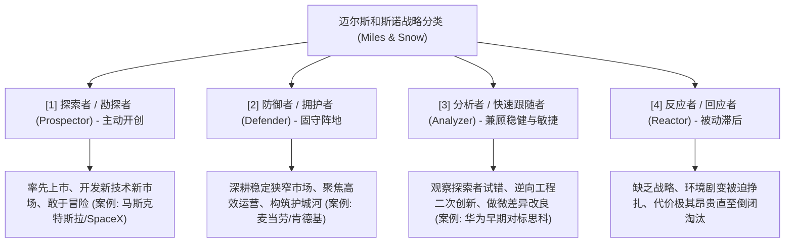

# 1.7 迈尔斯和斯诺战略框架（探索者、防御者、分析者、反应者）

> [!IMPORTANT] 核心提要
> 迈尔斯和斯诺战略框架（Miles & Snow Strategic Typology, 1978）是 NPDP 知识体系中衡量企业**对待技术创新与市场变革姿态**的核心工具：
> 1. 明确四大战略类型的本质差异与不同翻译（探索者/勘探者、分析者/快速跟随者、防御者/拥护者、反应者/回应者）；
> 2. 深入理解**探索者**的高风险领航机制（埃隆·马斯克特斯拉与 SpaceX 案例），掌握**分析者**“逆向工程+快速跟随”的演进路径（华为对标思科并反超案例）；
> 3. 领会**防御者**守卫既得蛋糕的高效运营壁垒（麦当劳/肯德基案例），并高度警惕**反应者**无战略、被动挨打导致的“昂贵代价”。

---

## 1. 迈尔斯和斯诺战略框架的划分维度

迈尔斯（Raymond Miles）与斯诺（Charles Snow）提出，任何企业在面对外部市场机遇与技术创新时，都会依据其**战略进取心、风险承受力与组织适应模式**，在以下四大类型中寻找定位：

> [!NOTE] 术语翻译多义性提醒
> 在 NPDP、PMP 与 PMI-ACP 认证考试中，同一英文术语因翻译风格不同常有多种中文对应，备考与理解时必须融会贯通：
> * **Prospector**：探索者、勘探者；
> * **Defender**：防御者（防御外敌抢夺）、拥护者（拥护既得蛋糕与阵地）；
> * **Analyzer**：分析者、快速跟随者（Fast Follower）；
> * **Reactor**：反应者、回应者。

---

## 2. 四大战略类型深度剖析与商业案例

### 2.1 探索者 / 勘探者（Prospector）
* **核心内涵**：始终站在技术与商业的最前沿。致力于**开发与应用全新前沿技术**，持续探索未知领域，开创全新的产品品类与市场空间。
* **竞争战略与风险偏好**：
  * 追求**“率先上市（First to Market）”**与行业第一名；
  * 具有极强的冒险精神（High Risk, High Return），依靠先发优势与颠覆性创新实现爆发式增长。
* **经典商业案例**：
  * **埃隆·马斯克（Elon Musk）的商业帝国**：
    * **特斯拉（Tesla）**：在传统燃油车一统天下的时代，率先大规模商业化电动智能汽车，彻底颠覆并重构了全球百年汽车工业格局，引爆了全球新能源车（包括比亚迪、蔚来、小鹏等）的发展浪潮；
    * **SpaceX**：打破数十年来运载火箭发射后坠落沦为太空垃圾的传统，敢于冒着多次爆炸失败的极高风险，前所未有地研发成功可回收复用的轨道级火箭，大幅削减人类进入太空的成本；
    * **星链（Starlink）与超级高铁（Hyperloop）**：持续挑战人类想象力边界，展现了极致的“探索者”特质。
  * **华为进入“技术无人区”**：在通信网络设备与 5G 核心领域，华为历经追赶后领跑全球，任正非曾直言“华为前锋部队已经攻入无人区，拿着望远镜也找不到竞争对手”，必须作为行业探索者自主开辟未来的通信理论与底层架构。

### 2.2 分析者 / 快速跟随者（Analyzer）
* **核心内涵**：分析者巧妙地融合了防御者的稳健与探索者的敏锐。
* **竞争战略与运作机制**：
  * 一方面在成熟稳定的核心市场维持扎实的基本盘；
  * 另一方面密切紧盯行业探索者的动作，观察探索者推出的新产品与新商业模式；
  * 一旦探索者在市场上验证了新需求，分析者迅速跟进，通过**技术再造、逆向工程（Reverse Engineering）与模仿型开发**，推出性能更稳定、体验更优或性价比更高的改良型产品（“做得比第一名更好一点”）。
* **优势与劣势**：
  * **核心优势**：坐享其成，规避了探索者前期庞大的市场教育成本、技术研发试错成本与沉没风险；
  * **核心挑战**：产品推向市场的时间点显著滞后于探索者；如果探索者自身迭代极快（已推出二代或三代），分析者将面临持续追赶的压力。
* **经典商业案例：华为对标思科（Cisco）的逆袭史**：
  * 华为在进军数通路由器和交换机领域的初期，是极其典型的“分析者”；
  * 全面深度分析全球网络巨头思科的设备架构、协议标准与功能特性，通过对标分析与技术攻关，研发出功能毫不逊色、甚至针对中国复杂电信环境做了更好适配与服务保障的设备；
  * 依托强大的快速交付能力与性价比，从分析者起步，逐步缩小差距，最终完成对思科等老牌霸主的全面反超，进而迈向探索者阵营。

### 2.3 防御者 / 拥护者（Defender）
* **核心内涵**：**高度风险厌恶型（Risk Averse）**。不热衷于频繁开发激进的新技术或涉足未知市场。
* **竞争战略与运作机制**：
  * 聚焦于自身已经确立主导地位的**狭窄、成熟、稳定的细分利基市场（Niche Market）**；
  * 核心诉求是**“拥护既有阵地，防御竞品侵蚀”**；
  * 依靠卓越的品质保障、极致的生产与运营效率、严密的供应链成本控制和深厚的品牌护城河，筑起坚不可摧的壁垒，让潜在入侵者无缝可钻。
* **经典商业案例：麦当劳（McDonald's）与肯德基（KFC）**：
  * 全球快餐霸主的核心单品（汉堡包、炸薯条、炸鸡翅、可乐等）历经数十年几乎未发生颠覆性结构改变；
  * 它们并不追求激进地研发太空食品或前卫菜系，而是专注于将经典快餐的供应链标准化、食材安全品控、出餐速度控制在以“秒”计算的极致水平，通过全球数以万计的连锁网络，长期守卫其庞大稳固的快餐利润蛋糕。

### 2.4 反应者 / 回应者（Reactor）
* **核心内涵**：在四种形态中，**唯一一种非主动、非健康的被动适应型组织**。
* **致命缺陷**：
  * 缺乏清晰长远的战略目标与统一的发展蓝图；
  * 缺乏明确的技术研发路线图，对外部市场趋势与技术变革麻木不仁；
  * 既不主动进取开创新市场（非探索者），也不主动构建防御护城河（非防御者），更不敏锐监控行业标杆并快速跟进（非分析者）。
* **昂贵的代价**：
  * 只有在行业格局巨变、竞争对手重兵压境、自身市场份额面临断崖式暴跌的绝境下，才仓促被动地做出应急反应；
  * 此时行业大势已去，技术代差与用户心智已不可逆，最终导致产品线被清洗或企业面临淘汰破产的昂贵下场。

---

## 3. 迈尔斯和斯诺四大战略类型全景对比速查表（Cheat Sheet）

| 战略类型 | 英文术语 | 风险态度 | 市场与技术定位 | 核心竞争策略与手段 | 经典商业案例 | 优劣势与陷阱提示 |
| :--- | :--- | :--- | :--- | :--- | :--- | :--- |
| **探索者** (勘探者) | Prospector | 极高风险偏好 (敢于冒险) | 新兴前沿市场、底层颠覆性新技术 | **率先上市 (First to Market)**；创造全新赛道；以持续颠覆驱动增长 | 特斯拉电动车、SpaceX可回收火箭、华为5G无人区探索 | **优势**：享受先发暴利与崇高声誉 **劣势**：研发试错成本极高、失败率高 |
| **分析者** (快速跟随者) | Analyzer | 中等风险偏好 (兼顾稳健) | 紧跟探索者开创的新兴市场；维持既有市场 | **快速跟随 (Fast Follower)**；逆向工程；做功能强化与微差异化升级 | 华为早期深度对标思科路由器并实现技术反超 | **优势**：避开前期沉没成本与试错陷阱 **劣势**：上市滞后；面临探索者二代压制 |
| **防御者** (拥护者) | Defender | 极度厌恶风险 (保守稳健) | 狭窄、成熟、高占有率的稳定利基市场 | **深耕现有阵地**；追求极致运营效率、标准化品质、低成本与强渠道 | 麦当劳/肯德基数十年深耕汉堡薯条标准化供应链 | **优势**：运营效率极高、现金流稳固 **劣势**：一旦行业遭遇外部颠覆，调整迟缓 |
| **反应者** (回应者) | Reactor | 缺乏策略 (麻木被动) | 迷失于市场；缺乏前瞻性技术路线 | **被动挨打后仓促应急**；缺乏长远规划，危机临头才做出迟滞应对 | 柯达错失数码浪潮、被动应对技术颠覆的衰败企业 | **代价极其昂贵**；属于非自愿、非持续的失败形态，应坚决避免 |
