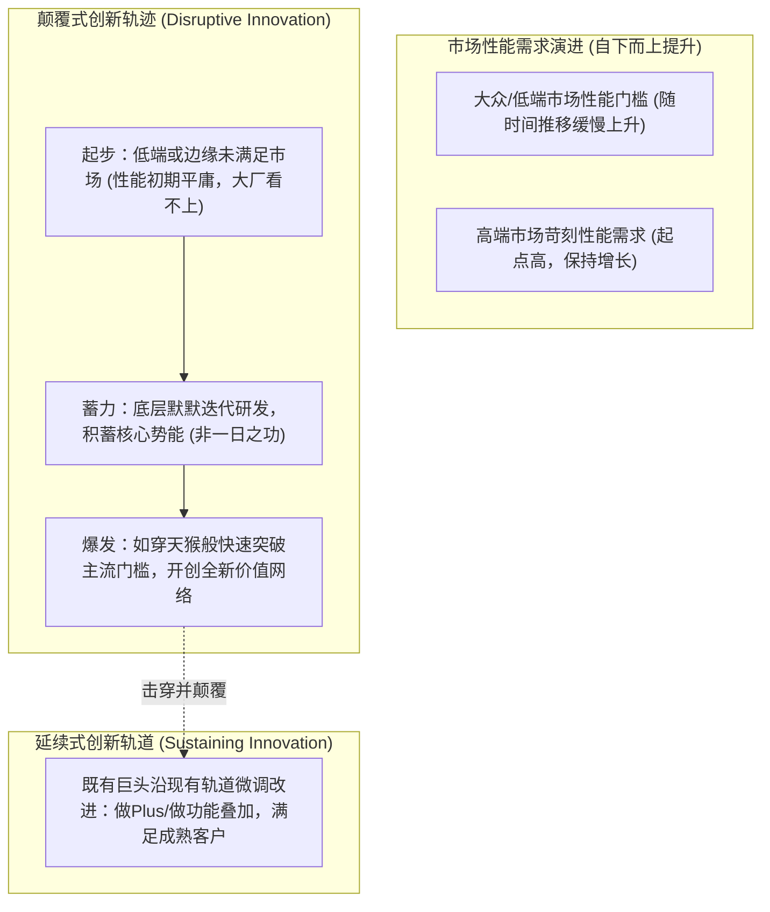
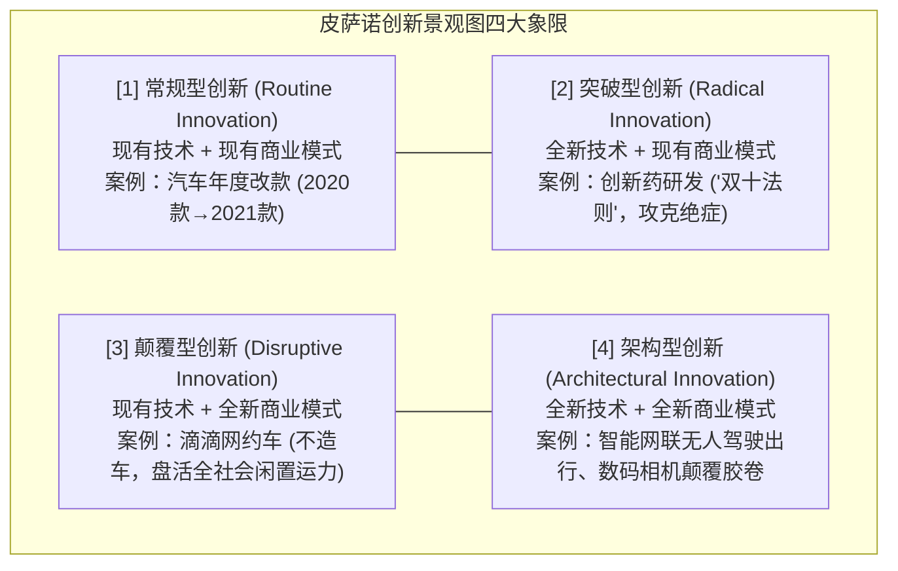

# 1.8-1.9 克里斯坦森颠覆式创新与皮萨诺创新景观图

> [!IMPORTANT] 核心提要
> 当企业审视产品创新路径时，必须清晰界定自身面对的是“改良优化”还是“范式颠覆”：
> 1. **克里斯坦森（Clayton Christensen）**在《创新者的窘境》中揭示：成熟巨头死守既有高端客户与延续式创新，极易被起步于低端或边缘市场的**颠覆式创新**以更陡峭的斜率实现致命降维打击；
> 2. **加里·皮萨诺（Gary Pisano）**从“技术能力（现有 vs. 新技术）”与“商业模式（现有 vs. 新模式）”两大维度绘制**创新景观图（Innovation Landscape Map）**，将创新划分为常规型、突破型、颠覆型与架构型四大象限；
> 3. 掌握移动支付、滴滴打车（不造车却颠覆出行）、医药研发“双十法则”等实战商业案例在两大模型中的精准映射。

---

## 1. 克里斯坦森：延续式创新 vs. 颠覆式创新

哈佛商学院已故著名管理大师克里斯坦森在其经典著作《创新者的窘境》中，通过“时间-产品性能”演进曲线揭示了行业巨头衰亡与新星崛起的规律：

### 1.1 延续式创新（Sustaining Innovation）
* **核心机制**：企业沿着现有主流市场的既定技术轨道与性能指标，日复一日地对产品进行渐进式改良（“做加法、做 Plus”）。
* **驱动力**：
  * **客户挑剔反馈**：主流客户对产品性能提出更高要求，倒逼企业不断缩小技术供给与客户期望的差距；
  * **后方追赶压力**：竞争对手与跟随者在身后步步紧逼，促使龙头企业持续升级产品。
* **特征**：在现有的价值网络中演进，维护既有商业秩序与用户使用习惯；不会对社会的底层生活形态产生断裂性震荡。

### 1.2 颠覆式创新（Disruptive Innovation）
* **演进机制（从微末边缘到爆发颠覆）**：
  * **起步阶段**：往往从不起眼的小角落、低端市场或未被主流巨头重视的微小细分痛点切入。初期性能指标可能低于主流市场的标准，导致传统大厂认为其利润微薄、“不值一提”而主动放弃防守；
  * **蓄力积累**：俗话说“罗马非一日建成，颠覆非一日之功”。创新团队在幕后付出了大量的隐形研发与试错积累；
  * **临界爆发**：随着技术与模式的成熟，颠覆式产品以**远快于主流市场需求增长的斜率快速爬升**。在短短时间内，性能迅速跨越大众消费者的基本门槛，随后像“窜天猴”一样横空出世，以压倒性的便利性与性价比席卷主流市场，彻底摧毁既有巨头的根基。
* **终极影响**：创造一个**全新的市场与全新价值网络（New Value Network）**，彻底重构用户的使用习惯与生活形态。

> [!NOTE] 经典生活案例：移动支付对传统生活方式的彻底颠覆
> 曾经全人类出门消费的标配是厚厚的钱包、银行卡与大把纸币零钱。微信与支付宝移动支付的普及，从初期线上网购小额转账发端，迅速渗透到街头地摊、出租车、商超与公共出行。
> 如今人们只带一部智能手机即可畅行全国出差，甚至忘记了上一次携带钱包是何年何月。移动支付不仅彻底淘汰了传统钱包制造业，还深刻改变了金融网点结算与公共收费岗亭的生态格局。

---

## 2. 皮萨诺创新景观图（Gary Pisano Innovation Landscape Map）

哈佛商学院教授加里·皮萨诺提出：创新不能只盯技术，也不能只盯商业。他通过**“技术变革程度”**与**“商业模式变革程度”**两大维度，将企业创新绘制为四大象限：

### 2.1 第一象限：常规型创新（Routine Innovation）
* **坐标定位**：**现有技术能力 + 现有商业模式**。
* **核心特征**：在企业熟悉的技术平台和成熟商业网络内部，开展渐进式改良与功能微调。
* **典型案例**：
  * **汽车行业的年度小改款**：汽车厂商每年推出的 2020 款、2021 款、2022 款车型，仅微调大灯造型、内饰车机小幅升级，底盘架构与 4S 店经销销售模式毫无质变。
  * **智能手机年度小版本迭代**：在现有处理器平台基础上微幅升级像素、增加机身新配色。

### 2.2 第二象限：突破型创新（Radical Innovation）
* **坐标定位**：**全新技术突破 + 现有商业模式**。
* **核心特征**：依赖底层纯科学与工程技术的重磅突破，开创了前所未有的核心能力，但最终产品的变现与商业交付渠道依然沿用传统通道。
* **典型商业案例：医药行业的创新药研发（“双十法则”）**：
  * **高门槛与漫长周期**：创新药研发遵循著名的**“双十法则（10 年时间 + 10 亿美元研发资金）”**，需要经历靶点筛选、临床前试验及严苛的 I/II/III 期人体临床试验，面临极高的失败率；
  * **技术突破造福人类**：一旦研发成功，将对人类医学带来革命性跨越——例如让过去的绝症（如肺结核、特定恶性肿瘤与癌症）变成通过靶向药物、基因治疗即可有效控制或治愈的普通慢性病；
  * **商业模式未变**：尽管底层生物分子技术发生了翻天覆地的跃迁，但创新药的销售依旧通过药监局审批、医院开方及药房零售等传统医药渠道交付变现。

### 2.3 第三象限：颠覆型创新（Disruptive Innovation，皮萨诺定义）
* **坐标定位**：**现有成熟技术 + 全新颠覆性商业模式**。
* **核心特征**：企业在底层纯技术层面并没有研发出惊世骇俗的全新发明，而是巧妙地将市场上现成的成熟技术进行全新组合，创造出颠覆性的商业运转模式，重塑产业链价值分配。
* **典型商业案例：滴滴打车（网约车出行平台）**：
  * **技术层面毫无造车动作**：滴滴没有自主研发制造哪怕一辆汽车，甚至连一个轮胎、一台车载发动机都没有研发过；其依靠的移动互联网、GPS 卫星定位导航与线上移动支付全都是行业成熟公用技术；
  * **商业模式彻底颠覆**：传统出行模式必须在马路边招手苦等空车，受制于恶劣天气与路线信息不透明。滴滴通过撮合双边市场，将全社会海量闲置私家车运力与乘客出行需求进行算法即时匹配，让用户足不出户即可一键叫车、线上结算，彻底颠覆了全球传统出租车行业的运营生态。

### 2.4 第四象限：架构型创新（Architectural Innovation）
* **坐标定位**：**全新技术突破 + 全新商业模式重构**。
* **核心特征**：创新体系中复杂度最高、破坏力最强、壁垒最深的系统性变革。既需要攻克底层全新的核心技术难题，又必须同步搭建一套前所未有的商业价值生态体系。
* **典型商业案例**：
  * **数码成像生态对柯达胶卷帝国的毁灭**：从化学感光胶卷跃迁至电子 CCD/CMOS 传感器技术，同时商业模式从“售卖胶卷与线下暗房冲印”跃迁至“数字化存储、即时分享与互联网屏幕显示”，将庞大的传统胶卷产业连根拔起；
  * **智能网联无人驾驶出行（Robotaxi）**：底层依赖高精感知激光雷达、自动驾驶大模型 AI 芯片技术突破，商业模式跃迁为“免驾驶员、按行驶里程订阅付费的智慧交通运营网络”。

---

## 3. 克里斯坦森与皮萨诺两大创新模型全景对比速查表（Cheat Sheet）

| 创新框架 | 核心细分形态 | 技术能力要求 | 商业模式要求 | 创新演进与破坏力特征 | 典型商业/产品案例 | 考点与误区提示 |
| :--- | :--- | :--- | :--- | :--- | :--- | :--- |
| **克里斯坦森战略框架** | **延续式创新** (Sustaining) | 依托现有轨道持续渐进提升 | 维持既有主流价值网络 | 满足现有高端客户挑剔需求；潜移默化、维护现有行业秩序 | 手机增加 Plus/Pro 旗舰版、传统硬件常规性能升级 | 成熟巨头极易因此产生路径依赖，陷入《创新者的窘境》 |
| | **颠覆式创新** (Disruptive) | 初期平庸但进化斜率更陡峭 | 开创全新价值网络与市场 | 起步于低端或边缘小市场；积蓄势能后突然爆发，改变全人类习惯 | 移动支付颠覆传统钱包与现金、个人 PC 颠覆大型小型机 | **误区**：绝非一蹴而就的横空出世，背后经历漫长隐秘的技术积累 |
| **皮萨诺创新景观图** | **常规型创新** (Routine) | 利用现有成熟技术 | 利用现有商业模式 | 在舒适区内优化改良；风险最低、回报可预测但无法构筑代差 | 汽车年度改款（2020款→2021款）、家电产品小更新 | 适用于成熟稳定期，过度依赖将丧失核心竞争力 |
| | **突破型创新** (Radical) | **需要全新重大技术突破** | 利用现有商业模式 | 技术门槛极高；研发周期长、资金消耗大；技术成功即带来垄断 | 创新药研发（“双十法则”、癌症靶向药）、芯片制程突破 | 纯技术飞跃，商业渠道与变现模式仍沿用既有框架 |
| | **颠覆型创新** (Disruptive) | 利用现有成熟技术 | **开创全新颠覆商业模式** | 底层无新硬发明，依靠对现有技术要素的重构实现跨界降维打击 | **滴滴打车网约车平台**（不造车却盘活闲置运力改变出行） | **皮萨诺与克氏差异**：皮萨诺在此特指“现有技术+新模式” |
| | **架构型创新** (Architectural) | **需要全新重大技术突破** | **开创全新颠覆商业模式** | 系统级最高难度变革；彻底摧毁旧产业体系，重建跨界全新生态 | 智能网联无人驾驶出行网络、数码成像对柯达胶卷的替代 | 涉及组织能力重构与产业链再造，综合挑战与回报最高 |
