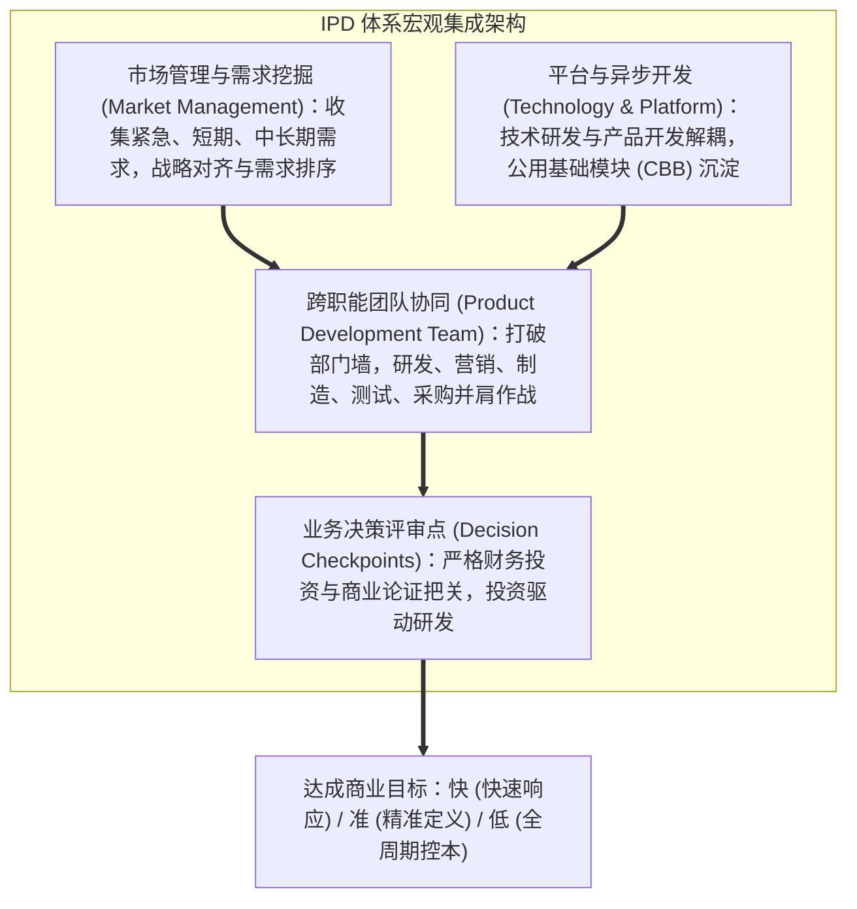
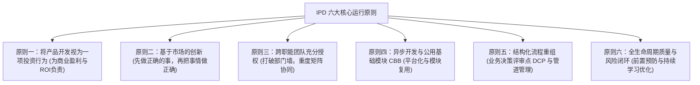
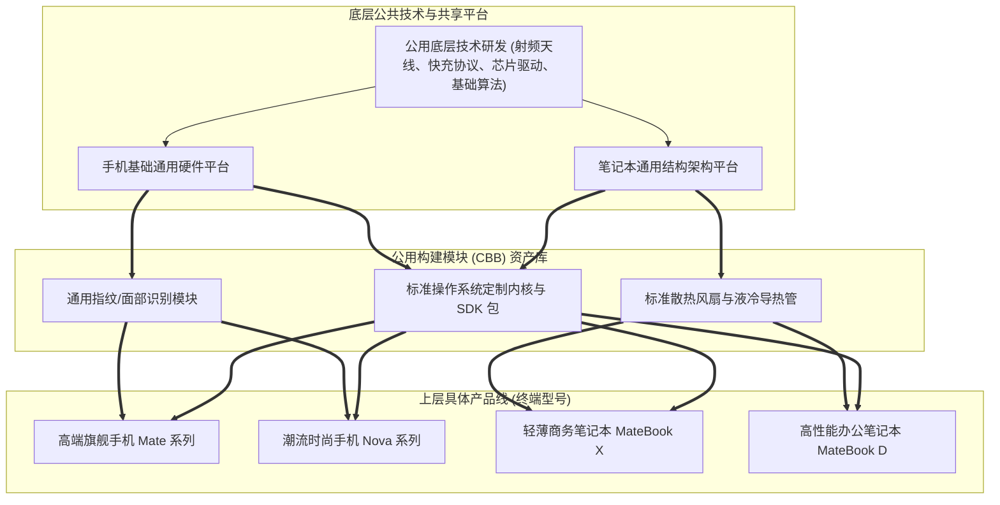
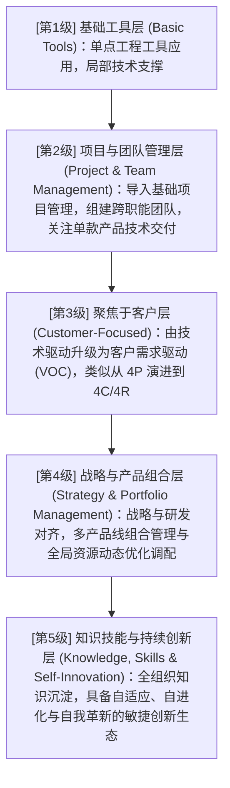

# 3.11 集成产品开发（IPD模型、基本原则与组织实践层级）

> [!IMPORTANT] 核心提要
> **集成产品开发（Integrated Product Development, IPD）**于 20 世纪 90 年代由 IBM 率先创立并成功实现企业脱困复兴；随后华为在任正非“削足适履、穿美国鞋”的魄力下斥巨资引进 IBM 咨询顾问，将 IPD 深度扎根并升华，使其成为中国高科技制造企业的管理标杆。
> IPD 的本质是将**多重开发流程、跨职能团队、支撑平台与技术工具进行深度系统化集成**。其战略宗旨是实现**“快（快速上市）、准（精准满足需求）、低（低生命周期成本）”**；通过确立**“将产品开发视为商业投资”**、**“基于市场的创新”**、**“跨职能重度矩阵团队”**以及**“异步开发与公用基础模块（CBB）”**等核心原则，彻底破除部门墙，推动企业从偶然成功走向必然成功。

---

## 1. 集成产品开发（IPD）的模型全景与核心目标

### 1.1 什么是“集成（Integrated）”？

IPD 绝非孤立的软件工程方法或某一种单一流程，而是将产品研发推向商业成功的一整套**企业级端到端经营管理框架**：
* **开发模式的集成**：包容并蓄，在宏观阶段关口（Stage-Gate）与商业决策评审点（DCP）的大框架下，无缝嵌入敏捷迭代、精益看板等微观开发手法；
* **跨职能组织的集成**：打破传统部门各自为战的割裂状态，将市场营销、研发、供应链制造、测试、销售、采购、售后服务深度绑定；
* **使能技术的集成**：通过模块化解耦与公共软件开发工具包（SDK）、硬件公用架构，实现技术与产品的多维协同。

### 1.2 IPD 的三大终极交付目标：“快、准、低”

1. **快（Speed to Market）**：通过并行协同与公用模块复用，大幅缩短产品从概念到全面上市的研制周期；
2. **准（Accuracy in Customer Needs）**：在产品定义阶段即跨职能导入客户真实心声（VOC），准确把控细分市场痛点，杜绝自嗨式研发；
3. **低（Lowest Total Lifecycle Cost）**：不仅压降单次研发支出，更从源头设计上降低制造成本、维护成本与供应链采购成本。

---

## 2. IPD 的六大核心运行原则

### 原则一：将产品开发视为一项投资行为（Investment-Driven）
* **打破“工程师自嗨”**：产品开发绝非单纯的技术秀场，而是一场严肃的商业投资；
* **建立业务决策评审点（DCP）**：在概念（CDCP）、计划（PDCP）、早期上市（ADCP）等关键节点，管理层以投资人身份严格审视项目的净现值（NPV）、投资回报率（ROI）及市场可行性。**不赚钱的项目必须坚决下马止损**。

### 原则二：基于市场的创新（Market-Driven）
* 设立专职的市场管理（MM）团队，系统梳理用户的**紧迫需求、短期需求、中长期战略需求**；
* 结合历史商业数据与竞争态势对需求实施加权排序，保证团队**“先做正确的事（Do the right thing），再把事情做正确（Do the thing right）”**。

### 原则三：跨职能团队充分授权（Cross-Functional Team & Heavy Matrix）
* 组建跨越研发、营销、制造、财务、采购的**产品开发团队（PDT）**；
* 高层管理委员会向 PDT 经理进行充分业务授权，PDT 成员全流程为该产品的商业成功连带负责，从机制上消灭部门间的“推诿扯皮”。

### 原则四：异步开发与公用基础模块（CBB, Common Building Blocks）
* **异步开发（Asynchronous Development）的核心逻辑**：将**底层关键技术/平台预研**与**上层具体产品型号开发**从时间上彻底解耦！
* **华为手机与笔记本双业务经典实战范例**：

* **管理价值**：
  * **不重复造轮子**：如同制造汽车无需重新设计轮胎，新产品研发直接调用现成的成熟 CBB 模块和封装 SDK；
  * **快速衍生**：产品团队只需聚焦于该型号特有的差异化卖点设计，研发周期由数年缩短为数月，且大幅降低了未知技术缺陷导致的召回风险。

### 原则五：结构化流程重组（Structured Process）
* 建立既有严格阶段纪律（管道管理、质量门）、又具备灵活剪裁特性的标准化流程，避免因流程缺失导致的个人英雄主义与管理混乱。

### 原则六：全生命周期的质量前置与持续学习（Life-Cycle Quality & Learning）
* 质量管理贯穿于从立项论证到退市的全生命周期；建立项目复盘机制，将每一款产品的踩坑教训反哺为组织的流程资产与平台规范。

---

## 3. 组织形态演进：职能型、项目型与 IPD 矩阵型对比

很多企业试图模仿华为的 IPD 却折戟沉沙，核心根源在于未能突破组织架构的“部门壁垒”：

| 组织结构模型 | 运作机制与特征 | 核心优势 | 致命弊端与瓶颈 | 在 IPD 中的地位与定位 |
| :--- | :--- | :--- | :--- | :--- |
| **纯职能型组织（Functional）** | 按专业划界（研发部、生产部、销售部、售后部各管一摊） | 纵向专业深度高，技术传承好，员工职业晋升通道清晰 | **部门墙森严**，各职能屁股决定脑袋；跨部门沟通阻力极大，项目周期漫长 | IPD 极力革除的旧模式；职能部门在 IPD 中演化为“资源中心”与“专业能力培养池” |
| **纯项目型组织（Projectized）** | 一切围绕独立项目组运转，员工专职服务于项目经理 | 目标极度聚焦，决策链路极短，执行力和推进效率高 | **跨项目资源重复配置造成严重浪费**；项目结束后团队解散，员工缺乏长期职业安全感与技术沉淀 | 成本过高，无法支撑多产品线企业的集约化规模运营 |
| **IPD 矩阵型组织（Matrix / PDT）** | **平衡型或重度矩阵（Heavyweight Matrix）**：人员行政编制在职能部，业务授权给 PDT 经理 | 兼顾纵向专业能力沉淀与横向项目高效推进，资源动态共享 | 需要高超的沟通与双头汇报机制协调，对中高层领导力要求极高 | **IPD 赖以运转的组织基石**：组建跨职能 PDT 团队，由 PDT 经理统揽研产供销全局推进 |

---

## 4. IPD 系统的五层组织实践成熟度层级

企业推行 IPD 并非一蹴而就，NPDP 将组织的 IPD 实践提炼为由浅入深的五个成熟度层级：

### 第 1 级：基础工具层（Basic Tools）
* 组织仅在局部研发工作中应用 CAD、仿真软件、代码管理等基础单点工具，缺乏跨部门流程约束。

### 第 2 级：项目与团队管理层（Project & Team Management）
* 开始引入基本的项目管理规范与里程碑把控；
* 初步组建跨职能研发团队，但视角依然属于**“技术驱动型（Tech-Driven）”**，核心精力集中在“如何把单款产品的技术方案做出来”。

### 第 3 级：聚焦于客户层（Customer-Focused）
* **思想维度的重大跃升**：彻底摆脱纯技术自嗨，实现从“以技术为中心”向“以客户为中心”的转型（正如市场营销从以产品为核心的 4P 体系向以客户为核心的 4C/4R 体系演变）；
* 系统倾听客户心声（Voice of Customer, VOC），完全基于市场真实痛点与客户购买行为来反向定义产品。

### 第 4 级：战略与产品组合层（Strategy & Portfolio Management）
* 不再局限于孤立操盘单个产品或项目，而是上升到企业中长期战略规划的高维视角；
* 建立科学的**产品组合管理（Portfolio Management）**与管道筛选机制，实现资金、核心研发资源在多条产品线、多个战略机会点之间的最优化配置。

### 第 5 级：知识技能与持续创新层（Knowledge, Skills & Self-Innovation）
* IPD 实践的最高境界：组织不仅拥有完善的流程，更具备**强大的组织记忆、知识沉淀体系与敏捷自我革新能力**；
* 能够根据市场大环境的骤变主动重塑自身流程与技术架构，形成无边界协同与持续自我进化的创新飞轮。

---

## 5. 核心概念与考点速查表

| 核心模块 | 核心概念与内涵 | 典型特征与机制 | 实战范例 / 隐喻 | 核心考点与风险警示 |
| :--- | :--- | :--- | :--- | :--- |
| **IPD 核心定义** | 集成产品开发，以商业成功为目标的端到端跨职能开发管理体系 | 融合 Stage-Gate、敏捷、精益与 CBB，兼具纪律性与扩展性 | IBM 转型成功、华为高科技制造实践 | 考点：IPD 是管理框架而非单一流程，追求“快、准、低” |
| **商业投资驱动原则** | 将产品开发视为严肃的商业投资，而非单纯技术研发 | 设立业务决策评审点（DCP），管理层以投资人身份严格考核 ROI | 阶段关口中对无盈利前景的项目坚决终止（Kill） | 误区：认为技术越先进越好；考点：无法实现商业盈利的技术创新是巨大的浪费 |
| **异步开发与 CBB** | 底层平台/技术预研与上层产品开发时间解耦；共用模块高度复用 | 打造通用软硬件平台与 SDK，新产品快速基于 CBB 搭建 | 华为手机与 PC 共用天线/指纹/快充技术；造车无需重造轮胎 | 考点：CBB 大幅缩短研发周期并降低试错风险，是 IPD 高效产出的技术基石 |
| **跨职能重度矩阵** | 打破职能部门壁垒，组建跨职能产品开发团队（PDT） | 职能部门管人员能力培养，PDT 经理全权统领项目业务推进 | 从研产供销抽调骨干全流程捆绑考核 | 考点：推行 IPD 最大的组织阻力在于职能部门的“部门墙”与权力割裂 |
| **组织实践层级 3 vs. 4**| 第3级聚焦客户（需求驱动单品）；第4级战略与组合（统筹全局产品线） | 4C/4R 导向满足用户需求 $\rightarrow$ 战略指引下的资源组合优化配置 | 单款爆品研发（L3） $\rightarrow$ 覆盖多细分市场的完整产品矩阵（L4） | 考点：辨析成熟度演进顺序（工具 $\rightarrow$ 项目 $\rightarrow$ 客户 $\rightarrow$ 组合战略 $\rightarrow$ 自我革新） |
