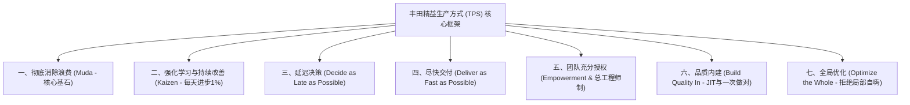
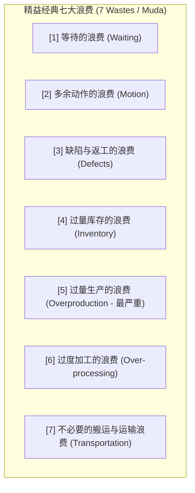
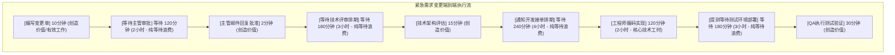
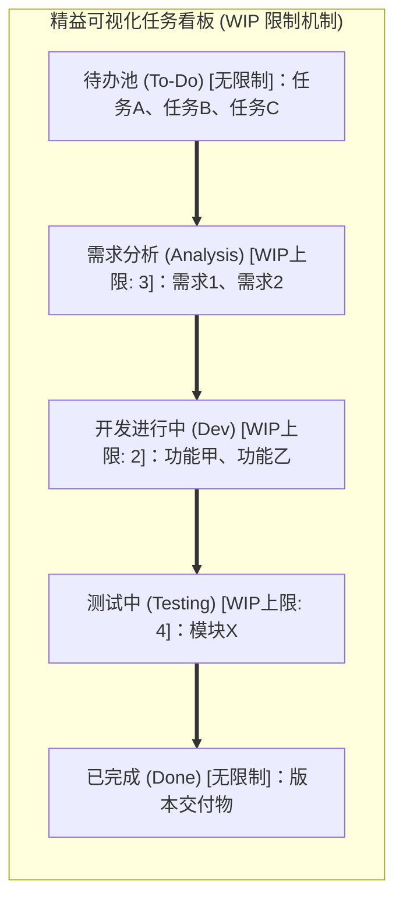

# 3.12 精益产品开发全解（丰田TPS、消除浪费、价值流图与看板）

> [!IMPORTANT] 核心提要
> **精益（Lean）**思想起源于二战后日本丰田汽车公司创立的**丰田生产方式（Toyota Production System, TPS）**。面对战后日本国土狭窄、资源匮乏与国内市场需求有限的约束，丰田摒弃了美国福特式的大规模批量压货模式，开创了以**“彻底消除浪费（Muda）”**与**“准时制拉动（Just-In-Time, JIT）”**为灵魂的卓越管理体系。
> 在产品开发领域，精益哲学倡导**“由客户定义价值”**，借助**价值流图（Value Stream Mapping, VSM）**识别并压缩吞噬工期的非增值等待时间，通过**看板（Kanban）**限制在制品（WIP）上限以打通端到端流动，配合**持续改善（Kaizen）**与**延迟决策**，实现研发资源的高效配置与高质量快速交付。

---

## 1. 丰田精益生产方式（TPS）的起源与核心原则

### 1.1 丰田汽车的传奇跃升：从织布机到全球汽车利润之王

* **创业背景**：丰田最初以纺织机械起家，第一代创始人丰田佐吉发明的自动织布机曾远销工业革命发源地英国；其子丰田喜一郎在老丰田去世后力排众议跨界投身汽车工业。
* **逆境创新**：二战后日本经济萧条，无法仿效美国车企的“大规模流水线生产”。丰田大野耐一等人通过小批量试制、订单驱动与持续消除车间浪费，使丰田汽车在销量与净利润上长期稳居全球顶级行列。
* **精益哲学的数学魅力（持续改善 Kaizen）**：
  $$ (1 + 0.01)^{365} \approx 37.78 $$
  每天进步 1%，一年下来将产生近 38 倍的飞跃。丰田全员每年向公司提交数万条一线微创新与改进提案，采纳率极高，构筑了不可复制的效率护城河。

---

### 1.2 精益产品创新的七大核心支柱

1. **彻底消除浪费（Eliminate Waste）**：精益的最高信仰，一切不产生客户价值的环节皆是浪费；
2. **强化学习与持续改善（Amplify Learning / Kaizen）**：鼓励一线发现漏洞与优化空间，建立组织学习闭环；
3. **延迟决策（Decide as Late as Possible）**：在不确定性极高时，过早敲定技术方案往往导致后期全盘报废；等到信息充分明朗的最后一刻再做决断，保留战略灵活性；
4. **尽快交付（Deliver as Fast as Possible）**：压缩交期，按需制造，快速回笼现金流，降低资金沉没风险；
5. **团队赋权（Empower the Team）**：实施总工程师（Chief Engineer）负责制，赋予一线员工发现异常即时拉停产线的权威（安灯系统 Andon）；
6. **品质内建（Build Quality In）**：借助防错机制（Poka-Yoke）与严格质量管控，强调**“一次性把事情做对做好”**，杜绝次品流入下一道工序；
7. **全局系统优化（Optimize the Whole）**：追求端到端业务流的通畅，防止“局部部门效率极高、整体交付严重延误”的子系统优化陷阱。

---

## 2. 彻底消除浪费（Muda）：价值定义与经典七大浪费

### 2.1 谁来定义“价值”与“浪费”？

> [!IMPORTANT] 黄金法则：客户定义价值
> 在精益体系中，**价值（Value）必须且只能由最终客户来定义**！
> * **增值活动（Value-Adding）**：客户愿意为其掏钱购买的产品功能、物理变换与核心体验；
> * **浪费（Muda）**：消耗了时间、资金、人力或空间资源，但**最终客户根本不在乎、也不愿意为之买单的任何活动**。

---

### 2.2 制造与运营中的经典“七大浪费”

| 浪费类别 | 本质内涵与表现 | 经典生活 / 商业实战案例 | 应对治理之道 |
| :--- | :--- | :--- | :--- |
| **1. 等待的浪费（Waiting）** | 人员、物料或设备处于空转闲置状态 | 带孩子去游乐场**排队 1 小时、游玩 5 分钟**；医院排队 2 小时看病 2 分钟；半成品在工位排队 | 打通上下游工序衔接，采用拉动式生产 |
| **2. 多余动作的浪费（Motion）** | 工人身体无效晃动、弯腰或寻找工具 | 高尔夫球手一杆进洞无任何多余肢体动作；德企汽车厂**老员工 12 秒完成操作，新员工多余动作耗时 24 秒** | 实施 5S 现场管理、人机工程优化 |
| **3. 缺陷与返工（Defects）** | 制造出不合格产品或代码缺陷 Bug | 报废的次品零部件；软件重度 Bug 导致版本推迟，前期开发工时全数报销 | 建立防错装置（Poka-Yoke），品质内建 |
| **4. 过量库存（Inventory）** | 原材料、在制品或成品堆积库房吃灰 | 资本家因生产过剩“往河里倒牛奶”；仓库积压大量未售汽车占用现金流与仓储租金 | 实行准时制（JIT）按需供料，零库存追求 |
| **5. 过量生产（Overproduction）** | **最严重的浪费之源**：生产速度快于下游需求 | 盲目追求设备开工率打满，提前制造大量暂无订单的汽车零件，直接诱发库存与搬运浪费 | 订单拉动，只生产下游当前所需数量 |
| **6. 过度加工（Over-processing）** | 投入远超客户预期或毫无感知的高精尖修饰 | **《红楼梦》刘姥姥吃茄鲞**：凤姐用十二只肥母鸡配料极度繁琐腌制一个茄子，茄子原味荡然无存 | 识别客户核心痛点，杜绝自嗨式过度设计 |
| **7. 运输与搬运（Transportation）** | 物料在车间或仓库之间的长距离往返搬运 | 散装运输占用大量车厢空气空间；**宜家家居（IKEA）全线推行“扁平化包装（Flat Pack）”**，长方体紧凑装车大幅降低物流成本 | 优化厂区布局，采用紧凑标准化几何包装 |

### 2.3 产品研发与设计过程中的衍生浪费

不仅车间存在浪费，新产品开发流程中的无形浪费更为致命：
* **混乱的工作环境与工具寻觅困难**；
* **糟糕模糊的产品定义**：前期需求未明确，导致后续整个研发团队朝着错误方向狂奔；
* **缺乏可制造性（DFM）与装配性早期考量**：设计的造型极其酷炫却根本无法量产下线；
* **无休止的低效会议与泛滥的审批电子邮件**。

---

## 3. 核心诊断利器：价值流图（Value Stream Mapping, VSM）

### 3.1 价值流图的基本逻辑：揭开工期延误的真相

价值流图（VSM）是用于分析和设计业务流（材料流与信息流）的结构化图表工具。它将全流程的时间划分为两大部分：
* **增值时间（Value-Add Time, VA）**：工程师真正进行编码、设计、计算或机器实际切削加工的时间；
* **非增值时间（Non-Value-Add Time, NVA）**：等待上级审批、排队等待测试、跨部门邮件传递等待、仓库闲置等待的时间。

### 3.2 实战推演：紧急需求变更流程的 VSM 剖析

#### 颠覆传统的效率提升认知：
1. **传统盲区（死磕技术人员工时）**：
   * 很多管理者试图将研发周期缩短一半时，第一反应是逼迫程序员把 120 分钟的编码时间压缩到 60 分钟甚至 30 分钟。**然而培养一个顶尖程序员的技术水平使其编码提速一倍，需要数年的漫长积累，难度极高且容易引发团队离职与代码质量崩盘**；
2. **精益解法（向非增值等待时间要效率）**：
   * 在上述完整变更生命周期中，**真正的纯增值工时仅约 177 分钟，而中间无所事事的等待排队时间长达 720 分钟（占总耗时的 80% 以上）**！
   * 改善极其容易：发邮件后立即电话对齐、取消多层冗余行政签批、建立即时流转机制，**将等待时间压缩一半只需优化流程规则，几乎零成本，却能让整体交付效率瞬间提升数倍**！

---

## 4. 驱动任务顺畅流动的核心引擎：看板（Kanban System）

### 4.1 看板的起源与核心机制

* **起源**：源于日本传统杂货铺与超级市场。货架上的商品被取走后，店员依据空出的卡片（Kanban 即日文“信号卡/招牌”）向仓库下达补货指令。
* **软件与研发看板的三大支柱**：

1. **工作流可视化（Visualize the Workflow）**：通过泳道（待办 $\rightarrow$ 分析 $\rightarrow$ 开发 $\rightarrow$ 测试 $\rightarrow$ 完成）将无形的智力工作具象化为卡片流动，所有瓶颈与堆积一目了然；
2. **限制在制品（Limit Work-In-Process, WIP）——看板的精髓**：
   * **明确限定每个环节同时在办任务的数量上限**（如上图：开发泳道 WIP = 2，最多只允许 2 个任务并行）；
   * **防止多任务并行导致的认知切换损耗与严重阻塞**；未完成当前任务前，坚决禁止开工新任务；
3. **拉动式生产（Pull System）与信号机制（Signal）**：
   * 当下游测试环节完成并移出任务后，才向开发环节发出拉取信号（Signal），开发人员才可将下一张任务卡拉入测试。由下游空闲容量驱动流动，杜绝盲目向下游“推任务”。

---

## 5. 精益产品开发的优劣势全景与适用条件

### 5.1 核心优势与商业价值
* **资源成本极致节约**：消除库存、过度加工与无谓搬运，大幅释放企业现金流；
* **交付流速大幅跃升**：信息与任务顺畅流动，端到端交付周期缩短 30%~60%；
* **供应商生态协同共赢**：将 JIT 理念输入给上游供应商，实现“你好、我好、大家好”的敏捷供应链网络。

### 5.2 实施条件与局限性（NPDP 高频警示）
* **对团队个体素质要求极高**：依赖高度自律、经验丰富且具备主人翁精神的一线专家；
* **极度考验组织的包容文化**：组织必须拥有真诚接纳一线批评与改善意见的开明机制；
* **脆弱的准时制依赖**：JIT 追求零库存，一旦遭遇黑天鹅事件（如地震、运河堵塞、关键供应商断供两周），整条生产线将瞬间陷入瘫痪停摆；
* **强者的加速器**：精益是优秀企业的“如虎添翼”利器，若企业自身管理极度混乱，贸然推行精益往往会导致更严重的失控。

---

## 6. 核心概念与精益工具速查表

| 核心知识点 | 核心定义与内涵 | 典型特征 / 机制 | 经典案例 / 隐喻 | 核心考点与风险警示 |
| :--- | :--- | :--- | :--- | :--- |
| **丰田 TPS** | 精益制造始祖，以小批量、订单拉动、准时制与持续改善为核心 | JIT 准时制、自働化、总工程师制、安灯系统 | 丰田战后崛起成为全球汽车利润之王 | 考点：精益追求全局优化，而非局部的单点效率 |
| **客户定义价值** | 只有最终客户愿意为之买单的功能与活动才具备真实价值 | 排除自嗨与形式主义，一切无用消耗皆为浪费（Muda） | 识别终端客户的真实刚需与核心痛点 | 误区：工程师认为高难度技术就是价值；考点：客户认可才是唯一标准 |
| **七大浪费（Muda）**| 等待、多余动作、缺陷返工、库存、过量生产、过度加工、不必要搬运 | 过量生产是最严重的浪费之源；过度加工违背商业本质 | 游乐场排队、德企老员工动作、红楼梦茄鲞、宜家扁平包装 | 考点：牢记七大浪费分类，过量生产会导致连锁式的二次浪费 |
| **价值流图（VSM）** | 区分并可视化分析全流程中“增值工时”与“非增值等待工时” | 寻找时间浪费瓶颈，压缩交接与审批等待时间 | 紧急变更流程优化（压缩 2 小时审批等待而非死磕编码） | 考点：提升端到端交付流速最立竿见影的手段是**挤压等待时间** |
| **看板与限制在制品** | 基于信号的可视化工作流工具，严格限定 WIP 上限 | 可视化流动、限制在制品数量、下游容量拉动式推进 | 超市货架缺货卡片、开发泳道上限 2 个任务 | 考点：WIP 过大必导致任务堆积与交付停滞；看板通过限制 WIP 暴露瓶颈 |
| **精益适用条件** | 依赖高素质自律人才、开放包容的组织文化与强有力的供应链 | 零库存追求对供应链准时交付要求极严苛 | 供应商两周内精准供料支撑车间 JIT 装配 | 考点：精益供应链容错冗余极低，抗外部灾难冲击的脆弱性需重点防范 |
