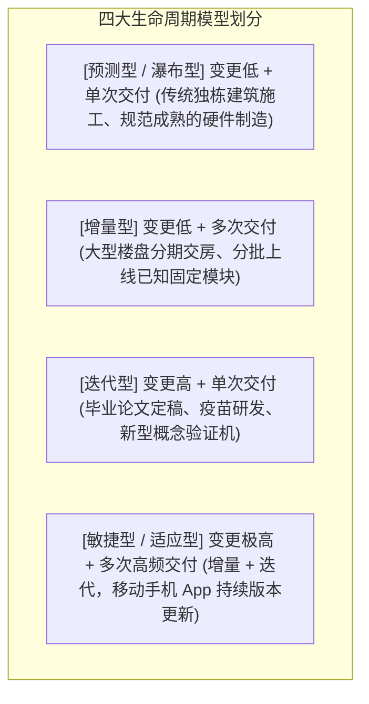
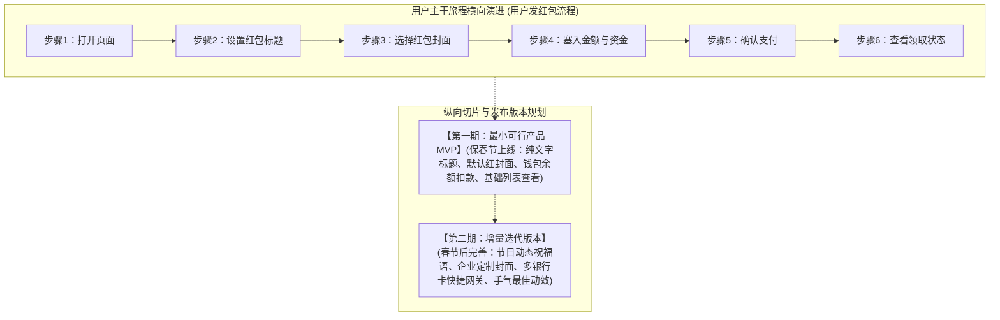
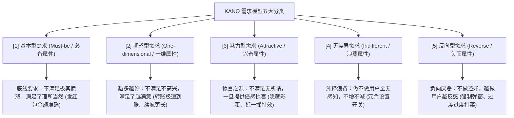
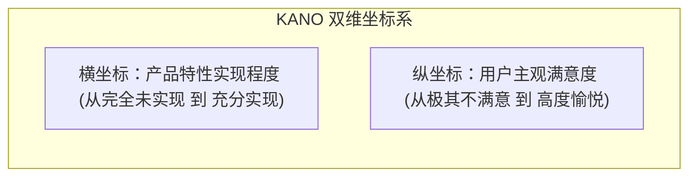
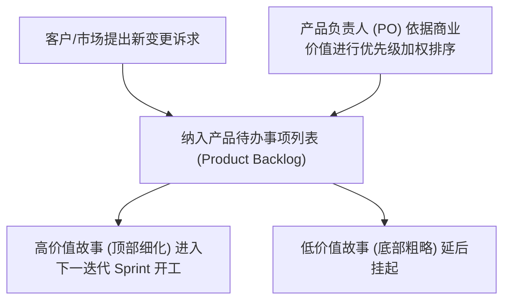

# 3.13 敏捷开发方法介绍（敏捷模型、用户故事地图、KANO分析与时间盒）

> [!IMPORTANT] 核心提要
> 步入 21 世纪，随着移动互联网与软件产业的爆发式发展，外部市场技术与客户需求呈现高频震荡。传统的预测型瀑布模型因周期漫长、排斥变更而遭遇严峻挑战，**敏捷开发（Agile Development）**应运而生。
> 敏捷的本质是**“增量（Incremental）+ 迭代（Iterative）”**的有机融合。通过**用户故事地图（User Story Mapping）**梳理用户主干旅程并切分出**最小可行产品（MVP）**，借助**KANO 卡诺模型**穿透五类需求本质以建立价值排序，配合严格的**时间盒（Timebox）**、**用户故事（User Story）**与**故事点相对估算**，使产品团队具备在高度不确定性迷雾中“小步快跑、拥抱变化”的敏捷适应力。

---

## 1. 敏捷开发模型与四大项目生命周期象限

### 1.1 增量与迭代的核心内涵辨析

许多团队容易混淆“增量”与“迭代”，二者在交付哲学上有着根本区别：
* **增量型（Incremental）——“分批构建，积少成多”**：
  * **生动隐喻**：去餐馆一桌人点了 15 道菜，后厨不是等全部菜做齐了一起端上来，而是做完 2 道先上一盘，过 5 分钟再上 2 道热菜；
  * **工程案例**：大型房产楼盘开发（如长沙大型社区湘江世纪城），不可能等待全区数十栋楼全部封顶才交房，而是先盖好 3 栋分期交付业主入住并回笼资金，后续批次滚动交付。
* **迭代型（Iterative）——“反复打磨，逐轮细化”**：
  * **生动隐喻**：撰写大学或硕士毕业论文、工程方案设计，先写出粗糙大纲初稿，再经导师审阅修改出 0.1 版、0.2 版，经历无数次推倒推敲，最终定稿出完整版本；
  * **科研案例**：新冠疫苗研发，早期研发出多种技术路线的样品，在严苛的动物实验与临床试验中不断推倒修正、排查抗体有效性与毒副作用，直至验证安全稳定后才最终交付给大众接种。

---

### 1.2 四大项目生命周期象限对比矩阵

以**“需求变更程度（不确定性）”**与**“交付频度”**为横纵坐标轴，可将开发模型严格划分为四大象限：

| 生命周期类型 | 需求变更程度 | 交付频度 | 核心运作特征与价值交付模式 | 经典代表案例 |
| :--- | :---: | :---: | :--- | :--- |
| **预测型（瀑布型）** | **极低** | **单次最终交付** | 一开始锁定需求基线，按部就班顺序流转，直至最后完整交付 | 单栋桥梁/大厦建造、传统政企软件 |
| **增量型（Incremental）**| **较低** | **分多次高频交付** | 需求相对清晰，但按模块分批次构建并交付，提早产生业务收益 | 大型楼盘分期售房、餐馆分批上菜 |
| **迭代型（Iterative）** | **较高** | **单次最终交付** | 需求高度复杂模糊，通过粗胚到精品的逐轮反馈修改达成最终目标 | 毕业论文撰写修改、新冠疫苗研发试制 |
| **敏捷型（适应型/Agile）**| **极高** | **分多次高频交付** | **“增量 + 迭代”双轮驱动**：既有分批发布，又在过程中持续打磨优化 | 智能手机移动 App（如微信、抖音持续迭代更新） |

---

## 2. 用户故事地图与最小可行产品（MVP）

### 2.1 用户故事地图（User Story Mapping）的构建逻辑

用户故事地图由敏捷大师 Jeff Patton 提出。它打破了传统需求列表（Flat Backlog）的孤立视角，从**用户的全局体验旅程（User Journey）**出发横向铺开主干流程，纵向按业务紧急度与价值进行切片划分。

### 2.2 微信春节发红包经典实战案例

* **极限时间挑战**：当年腾讯团队决定上线“微信发红包”功能以突击春节移动支付市场。若按照传统思路开发完整功能（支持各类银行卡联动、私聊与复杂群红包、企业定制个性化封面、新年签语、语音彩蛋动画），**完整工期至少需要 6 个月，而距离除夕之夜仅剩 2.5 个月**！
* **敏捷 MVP 裁剪破局**：
  * **设置标题**：舍弃复杂的富文本与动画，第一期仅支持纯文本简短祝福语（如“新年快乐”、“恭喜发财”）；
  * **红包封面**：不做个性化与定制封面上传，全网统一定制经典标准红底金字封面；
  * **资金来源**：规避复杂的银行卡清结算接口排期，优先仅支持“微信零钱余额”划扣与极少数打通的快捷渠道；
  * **商业战果**：团队以极简的 **MVP（Minimum Viable Product，最小可行产品）** 赶在除夕夜准时上线，借助央视春晚摇一摇一夜之间绑定数亿张银行卡，完成了对竞品的战略奇袭。节后再通过后续迭代逐步增补定制红包皮、群专属红包等次级功能。

---

## 3. KANO 卡诺需求分析模型

### 3.1 什么是 KANO 模型？

由东京理工大学教授**狩野纪昭（Noriaki Kano）**于 1979 年提出。KANO 模型揭示了**产品功能的具备程度与客户满意度之间绝非简单的线性关系**。

---

### 3.2 KANO 五大需求类型深度辨析

1. **基本型需求（Must-be / 必备需求 - 必备底线）**：
   * **特征**：这是产品的准入门槛。如果不提供，用户会极度愤怒并立刻卸载产品；如果提供得再完美，用户也认为这是“理所应当（Taken for granted）”的，不会因此产生额外满意。
   * **案例**：手机能拨打电话、发红包扣款金额与到账金额分毫不差。
2. **期望型需求（One-dimensional / 期望需求 - 竞争优势）**：
   * **特征**：满足程度与满意度成正比。满足得越充分，用户越满意；不满足，用户就会不满意。
   * **案例**：智能手机续航从 8 小时延长至 24 小时、移动支付到账从 3 秒优化至毫秒级。
3. **魅力型需求（Attractive / 魅力需求 - 创新杀手锏）**：
   * **特征**：超乎客户预期。客户原本根本没有期望有这个功能，如果不提供，用户没有任何不适；一旦提供，用户会产生极大的惊喜与口碑裂变传播。
   * **案例**：微信红包群里“手气最佳 / 运气王”皇冠图标与排行榜、抢到特定金额掉落全屏烟花雨。
4. **无差异需求（Indifferent - 杜绝浪费）**：
   * **特征**：无论实现与否，用户均毫无感觉。在产品设计中，**无差异需求是典型的资源浪费**，应果断剔除。
5. **反向型需求（Reverse - 坚决禁止）**：
   * **特征**：越是投入精力实现，客户反而越愤怒厌恶。
   * **实战案例**：食堂阿姨打菜原本分量正好，第二勺非要挖一根烂菜叶放上去，适得其反；移动 App 每次切换页面都强制弹出全屏广告。

---

## 4. 敏捷迭代机制：用户故事、Backlog 与时间盒

### 4.1 用户故事（User Story）的标准语法

在敏捷管理中，彻底摒弃了传统动辄数百页的冗长功能说明书，改用轻量级的“用户故事卡片”：

> [!IMPORTANT] 用户故事黄金三要素（3C 原则）
> **标准句式模板**：
> **“作为【某种类型的用户角色】，我想要【某种特定系统功能】，以便于【达成某种商业或业务价值】。”**
> *(As a [role], I want [feature], so that [business value].)*

* **业务价值**：只告诉研发团队**“谁想要、要什么、为什么（What & Why）”**，将具体的工程技术实现方式（How）充分授权给自组织的开发工程师。

---

### 4.2 产品待办事项列表（Product Backlog）与拥抱变化

* **Backlog 的动态维护**：由**产品负责人（PO）**统一管理的单一需求池；
* **价值驱动排序（Value-Driven）**：Backlog 严格按照**“商业价值大小”**由高到低纵向排列。最高价值的需求排在最顶层，优先被排入下一个迭代开工；
* **如何拥抱变化？**
  * 市场出现新变化或客户提出新诉求时，**严禁随意插队当前正在开发中的迭代周期**！
  * 新需求被纳入 Product Backlog 中，PO 重新评估其商业价值并调整排序，在下一个迭代规划会上再从顶部拉取。

### 4.3 故事点数（Story Points）与相对估算

* **故事点定义**：用于度量用户故事整体工作量、技术复杂性与未知风险的相对无量纲单位；
* **相对估算机制**：不直接估算“需要多少人天/小时”，而是以一个公认的简单基准任务设为“1 点”；
  * 若任务 A 复杂度为基准任务的 4 倍，则估为 **4 故事点**；
  * 若任务 B 复杂度为基准任务的 9 倍，则估为 **9 故事点**；
  * 敏捷团队通常采用**斐波那契数列（1, 2, 3, 5, 8, 13, 21...）**进行估算，随着数值变大，跨度增加，反映远期复杂任务的不确定性放大。

### 4.4 敏捷迭代时间盒（Timebox）

* **固定时间与固定质量，浮动范围**：传统的瀑布模型是“范围固定、成本与时间浮动”，往往导致项目严重拖期；敏捷时间盒坚持**“时间固定（如固定为两周一个 Sprint）、质量标准固定，通过弹性裁剪非关键故事范围确保按时发布交付”**。

---

## 5. 核心概念与敏捷工具速查表

| 核心知识点 | 核心定义与内涵 | 典型特征与机制 | 实战案例 / 隐喻 | 核心考点与风险警示 |
| :--- | :--- | :--- | :--- | :--- |
| **四大生命周期** | 瀑布（低变单交）、增量（低变多交）、迭代（高变单交）、敏捷（高变多交） | 敏捷 = 增量 + 迭代 | 盖楼房分批交房（增量）；写毕业论文/疫苗（迭代）；手机 App（敏捷） | 考点：牢记二维象限划分标准（变更程度 vs 交付频度） |
| **用户故事地图** | 横向展开端到端用户旅程，纵向按发布版本切分 | 提炼关键旅程骨架，划分发布骨干与次要分支 | 微信发红包流程横向展开，纵向裁剪 MVP | 考点：防止团队陷入单一平铺需求清单，保障产品体验骨架完整性 |
| **最小可行产品（MVP）**| 包含最核心端到端功能，以最低成本验证商业假设的产品版本 | 小步快跑、快速验证、杜绝早期过度设计 | 微信红包第一期仅保留纯文本、默认封面与零钱扣款 | 误区：MVP 不是半成品或残次品，必须具备完整闭环的用户价值体验 |
| **KANO 基本型需求** | 产品底线属性，不实现极度不满，实现后理所应当 | 必须 100% 优先满足的硬指标 | 手机能够拨号接听、发红包扣款分毫不差 | 考点：基本型需求做得再多也不会提升用户好感度，但缺少则直接致死 |
| **KANO 期望与魅力型**| 期望型越多越满意（续航长）；魅力型超预期带来极大惊喜 | 期望型打差异化竞争；魅力型做爆品裂变 | 红包“手气最佳”皇冠彩蛋、全屏烟花雨 | 考点：魅力型需求随时间推移会逐渐蜕化为期望型甚至基本型需求 |
| **用户故事模板** | “作为 [角色]，我想要 [功能]，以便于 [价值]” | 聚焦价值（Why），而非技术细节（How） | “作为微信用户，我想要发群红包，以分享节日快乐” | 考点：用户故事必须阐明用户带来的实际商业或业务价值 |
| **敏捷时间盒原则** | 锁定迭代周期（1~4周），固定时间与质量，弹性浮动范围 | 到期强制评审交付增量，拥抱变化不延期 | 双周 Sprint 迭代，按 Backlog 商业价值由上至下开工 | 考点：敏捷绝不延长期限，若时间不够只能将低优先级需求退回 Backlog |
