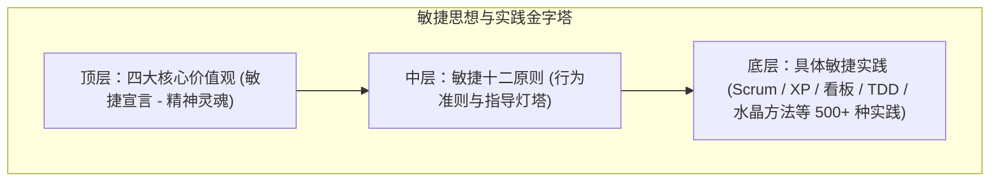
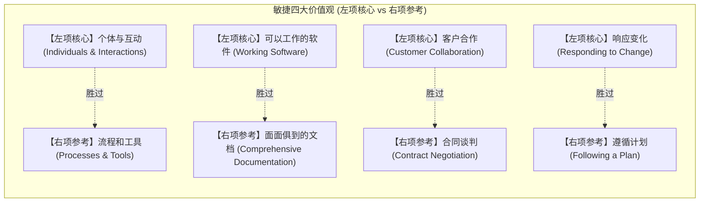
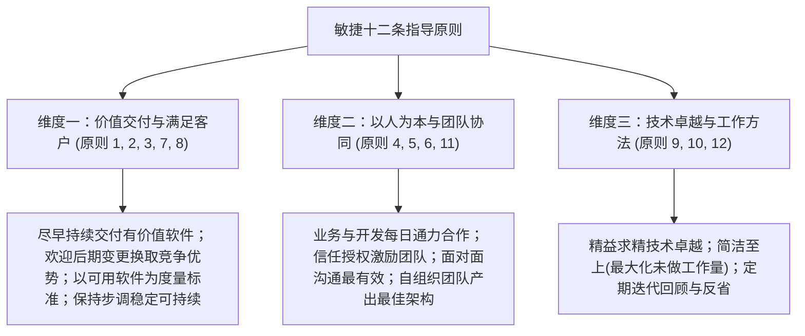

# 3.14 敏捷宣言与敏捷十二原则全解

> [!IMPORTANT] 核心提要
> **敏捷（Agile）**本质上不是一套机械僵化的开发工具，而是一种**以人为本、价值驱动、快速响应变化的思维模式（Mindset）**。2001 年，17 位软件轻量级开发先驱在美国犹他州雪鸟滑雪场共同签署了划时代的**《敏捷软件开发宣言》（Manifesto for Agile Software Development）**。
> 敏捷体系的顶层架构由**“四大核心价值观”**与**“十二条指导原则”**共同筑成。它打破了传统项目管理对于厚重文档、严格流程与刚性合同的过度崇拜，确立了**“可工作软件胜过详尽文档、个体互动胜过流程工具、客户合作胜过合同谈判、响应变化胜过遵循计划”**的新范式，指导着全球数百种敏捷实践（如 Scrum、XP、Kanban）的稳健落地。

---

## 1. 敏捷体系框架与生命周期五阶段

### 1.1 敏捷金字塔全景结构

敏捷的知识架构自上而下呈现三层金字塔形态：
1. **顶层思维与灵魂：四大价值观（敏捷宣言）**；
2. **中层指导准则：敏捷十二原则**；
3. **底层实践形态：数百种敏捷方法（Agile Practices）**：包括最为风靡的 **Scrum** 框架、**极限编程（XP）**、**看板方法（Kanban）**、**测试驱动开发（TDD）**、**水晶方法（Crystal）**等。尽管各实践在仪式与工具上各具特色，但其精神内核均严格受敏捷宣言与十二原则的滋养。

### 1.2 敏捷项目生命周期的五大阶段

传统预测型项目管理涵盖“启动、规划、执行、监控、收尾”五大过程组；而在敏捷生命周期中，呈现的是更加动态、高频演进的五大阶段：
* **构想阶段（Envision）**：对齐产品愿景与业务价值，类比于“项目启动”；
* **推测阶段（Speculate）**：基于当前已知信息进行轻量级探索规划，类比于“项目规划”；
* **探索阶段（Explore）**：自组织团队开展增量构建与试验，类比于“项目执行”；
* **适应阶段（Adapt）**：评审运行软件，结合客户反馈动态校准偏差，类比于“监控与调整”；
* **结束阶段（Close）**：总结经验教训并归档资产，类比于“项目收尾”。

> [!NOTE] 核心动态环路
> 在整个敏捷开发过程中，团队绝大部分时间都在**“推测 $\rightarrow$ 探索 $\rightarrow$ 适应”**的三角闭环中持续循环迭代。每一次“适应”完成，都会交付一个可独立运行的业务增量版本供用户试用。

---

## 2. 敏捷宣言：四大核心价值观深度解读

2001 年 2 月，17 位敏捷开创者在犹他州雪鸟滑雪场发布宣言：
> “我们正在通过亲身实践以及帮助他人实践，探索开发软件的更优之道。透过这些工作，我们确立了以下核心价值：
> 1. **个体与互动** 胜过 **流程和工具**
> 2. **可以工作的软件** 胜过 **面面俱到的文档**
> 3. **客户合作** 胜过 **合同谈判**
> 4. **响应变化** 胜过 **遵循计划**
> 也就是说，**尽管右项有其价值，我们更重视左项的价值**。”

### 2.1 个体与互动 胜过 流程和工具
* **以人为本**：再严谨完善的流程、再先进现代的研发工具，最终必须由鲜活的人来推进。若缺乏人的智慧与主动性，流程只会演化为僵化教条；
* **破除沟通壁垒**：人和人之间的直接沟通与通融互动，是化解复杂模糊问题的最短路径。

### 2.2 可以工作的软件 胜过 面面俱到的文档
* **价值交付导向**：软件的核心价值在于“能否被用户实际操作运行”。写出上千页无人问津的技术说明书，不如提交一段经过严格测试的可用代码；
* **文档的“够用原则”**：敏捷并非完全抛弃文档，而是倡导**“适度、简洁、够用就好（Bare Minimum）”**，杜绝形式主义的长篇套话。

### 2.3 客户合作 胜过 合同谈判
* **双赢伙伴思维**：传统模式下甲乙双方往往通过冰冷的合同条款互相防备、扯皮甩锅；
* **共创价值**：敏捷将客户视为并肩作战的合伙人，在整个开发过程中频繁互动，客户随时提出合理诉求，团队积极协助实现，共同达成商业利益最大化。

### 2.4 响应变化 胜过 遵循计划
* **打破“凡事预则立”的盲信**：做计划固然重要，但外部市场竞争与用户痛点瞬息万变，“计划永远赶不上变化”；
* **变更即机遇**：面对变化不应抱怨或排斥，而应敏锐捕捉并快速调整方向，使产品在最新市场环境中保持极高竞争力。

---

## 3. 敏捷十二条指导原则系统拆解

为了让四大宣言能够真正指导日常开发行为，敏捷联盟进一步推导出了 12 条行事原则，可系统归纳为三大维度：

---

### 维度一：价值交付与满足客户原则

* **原则 1（最高宗旨）**：**我们最重要的目标，是通过尽早和持续交付有价值的软件来满足客户**。
  * 将大颗粒的交付切碎为微小批次，让客户以最短的周期尽早看到商业成果；
* **原则 2（拥抱变更）**：**欢迎对需求提出变更，即便在项目开发后期也不例外。敏捷过程善于利用需求变更，帮助客户获得竞争优势**。
  * *讲师深度释义*：客户在项目开发 4 个月后推翻原先设想提出新需求，说明外部市场环境发生了剧变。若团队固执执行 4 个月前的陈旧计划，做出的产品必死无疑；积极响应新需求，正是赋予客户战胜对手的战略先机；
* **原则 3（高频交付）**：**经常交付可工作的软件，周期从数周到数月不等，且偏好较短的周期（通常为 2 到 6 周，最推荐 2~4 周）**；
* **原则 7（首要度量）**：**可以工作的软件，是衡量项目进度的首要度量标准**。
  * 拒绝汇报“代码已写完 80% 但无法跑通”的虚假进度，只有点按功能可正常运行才算真实成果；
* **原则 8（可持续节奏）**：**敏捷过程倡导可持续的开发。赞助人、开发者和用户应该能够长期保持恒定、稳定的步调（Sustainable Pacing）**。
  * 反对牺牲健康、把明天的精力提前透支在今天的恶性疯狂加班，唯有稳健的节奏才能支撑长跑。

---

### 维度二：以人为本与团队协同原则

* **原则 4（消除隔阂）**：**在整个项目开发期间，业务人员和开发人员必须每天通力合作**。
  * 打破“业务负责天马行空画饼挖坑、技术在后方疲于奔命填坑”的对立局面，让技术理解商业意图，让业务明白实现边界；
* **原则 5（激励与授权）**：**围绕有积极性的个体构建项目。为他们提供所需的环境和支持，并信任他们能够完成工作**。
  * 践行管理学 **Y 理论**：放弃微观盯梢管理（Micromanagement），管理者与敏捷教练的核心使命是**为团队搬开拦路虎、扫除一切外部干扰与体制障碍**；
* **原则 6（面对面沟通）**：**在团队内部以及向团队外部传递信息，最有效、最高效的方法是面对面的交谈（Face-to-Face Communication）**。
  * “见面三分情”，面对面交谈不仅传递语言，还承载语气、肢体动作与情绪共鸣。敏捷极度推崇**集中办公（Co-location）**与**每日站立会议（Daily Standup）**；
* **原则 11（自组织团队）**：**最佳的架构、需求和设计，皆出自于自组织的团队（Self-Organizing Teams）**。
  * 不由项目经理行政指派“张三做模块A、李四做模块B”，而是将任务池交由团队自行认领、自行协商最优架构方案。

---

### 维度三：技术卓越与工作方法原则

* **原则 9（技术卓越）**：**持续关注技术的卓越与优良的设计，能够显著增强敏捷能力**。
  * “你不需要很牛逼才开始，但你开始了才会很牛逼”。在迭代推进中持续重构底层代码与技术架构，避免技术债务（Technical Debt）堆积崩盘；
* **原则 10（简洁至上）**：**简洁至上——即最大化未完成工作量的艺术，是不可或缺的（Simplicity: the art of maximizing the amount of work not done）**。
  * 精益思想在敏捷中的体现：坚决剔除任何不产生价值的冗余设计、无谓动作与过度加工，“够用就好”；
* **原则 12（定期反省回顾）**：**团队定期反省如何提升有效性，并相应调整其行为模式**。
  * “未经审视的人生不值得过”。在敏捷每个迭代周期结束时，必须严肃召开**迭代回顾会议（Sprint Retrospective）**，真诚剖析“哪些做得好、哪些做得烂、下一轮如何改”，实现团队认知飞轮的持续进化。

---

## 4. 敏捷宣言与原则核心对比速查表

| 核心维度 | 核心条款 / 原则要点 | 传统瀑布范式对比 | 落地机制 / 实操工具 | 核心考点与理念精髓 |
| :--- | :--- | :--- | :--- | :--- |
| **价值观 1** | 个体与互动 胜过 流程与工具 | 迷信流程制度与复杂工具 | 集中办公、每日站会、直接沟通 | 流程工具不可缺少，但人与互动处于核心主导地位 |
| **价值观 2** | 可用软件 胜过 完整文档 | 文档驱动，数千页说明书 | 最小可行产品（MVP）、两周增量交付 | 进度度量的唯一客观凭据是“功能可独立运行” |
| **价值观 3** | 客户合作 胜过 合同谈判 | 严控合同范围，防备扯皮 | PO 深度参与、高频评审展示会 | 破除甲乙方对立，视客户为并肩创造商业价值的同盟 |
| **价值观 4** | 响应变化 胜过 遵循计划 | 需求冻结，排斥中途变更 | 动态产品代办池（Backlog 重新排序） | 变更源于外部竞争变化，积极响应可为客户赢得竞争优势 |
| **可持续步调** | 原则8：保持恒定稳定开发步调 | 阶段末期疯狂通宵突击加班 | 固定的 Sprint 时间盒（2~4周） | 提倡长期可持续节奏，反对透支性疲劳战术 |
| **团队协同与激励** | 原则5/11：信任授权、自组织团队 | 自上而下指令派发与微观盯梢 | 麦格雷戈 Y 理论、管理者专职排障 | 最佳架构与设计均出自高度自律、自我认领任务的自组织团队 |
| **沟通效能** | 原则6：面对面交谈效率最高 | 漫长邮件往返与冗长公文呈批 | 物理白板、面对面对齐、站立会 | 面对面沟通信息带宽最大、误解衰减最少 |
| **持续改善** | 原则12：团队定期反省与自省 | 项目结束才做流于形式的归档总结 | 迭代回顾会议（Sprint Retrospective） | 敏捷的核心学习机制：每一轮迭代必须进行闭环自省与行为纠偏 |
