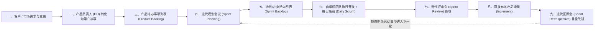
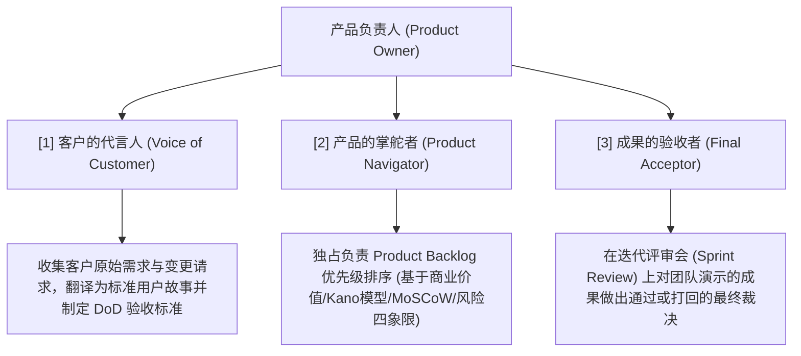
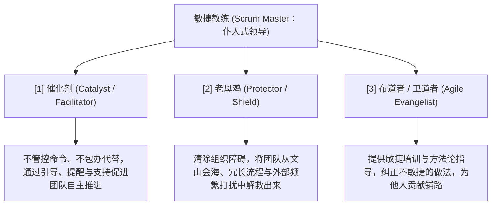
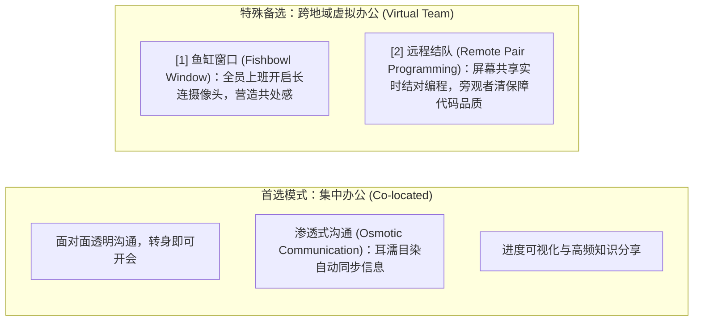

# 3.15 敏捷 Scrum 框架（3355 体系与 PO、Scrum Master、自组织团队三大角色）

> [!IMPORTANT] 核心提要
> 在敏捷（Agile）众多实践方法论（如极限编程 XP、测试驱动开发 TDD、看板 Kanban、水晶方法 Crystal 等）中，**Scrum 框架**是全球应用最广泛的项目管理与产品开发流程框架。
> Scrum 的核心灵魂浓缩为 **“3355 体系”**：**3 个核心角色**（产品负责人 PO、敏捷教练 Scrum Master、自组织开发团队）、**3 个关键工件**（产品待办事项列表、迭代待办事项列表、可交付产品增量）、**5 个标准事件**与 **5 大核心价值观**。精准把握三大角色的权责边界，是 NPDP 考试与企业敏捷转型的重中之重。

---

## 1. Scrum 敏捷实践框架全链路运作机制

Scrum 采用**“小步快跑、固定时间盒（Time-box）迭代交付”**的方式应对频繁变化的客户需求。一个标准迭代（Sprint，通常为 1~4 周，以 4 周为例）的完整流转闭环如下：

### 1.1 核心工件与术语解析
1. **用户故事（User Story）**：
   * 客户提出的需求或变更，由产品负责人（PO）使用标准句式转化为具体的用户故事：
     > **标准句式**：**“作为 [某种用户角色]，我需要 [某种功能/特性]，以便实现 [某种商业目的或用户价值]。”**
   * **完成定义（DoD, Definition of Done）**：每一个用户故事在立项时必须同步明确**验收标准（即完成定义 DoD）**，作为后续迭代评审会判定“通过与否”的唯一客观准绳。
2. **三大工件（3 Artifacts）**：
   * **产品待办事项列表（Product Backlog）**：全量需求池，汇总了当前产品所需的所有用户故事，按商业价值动态排序。
   * **迭代/冲刺待办事项列表（Sprint Backlog）**：在迭代规划会议上，从产品待办列表中挑出**本轮迭代承诺完成的子集**（注：考试中“迭代”与“冲刺”均对应英文 `Sprint`，含义完全相同）。
   * **可交付的产品增量（Product Increment）**：每轮迭代结束并通过验收后，产出的可随时推向市场的、可用的产品功能增量。
3. **四大核心会议 + 冲刺（5 Events）**：
   * **迭代规划会议（Sprint Planning）**：确定本轮迭代做什么、怎么做；
   * **每日站会（Daily Scrum）**：团队每天固定时间同步三件事——**① 我昨天干了什么？② 我今天要干什么？③ 我遇到了什么困难和挑战？**
   * **迭代评审会议（Sprint Review）**：相当于**产品验收会**，团队演示已完成的用户故事，由 PO 根据 DoD 逐项判定验收通过与否，并收集客户最新反馈；
   * **迭代回顾会议（Sprint Retrospective）**：相当于**团队内部复盘会**，践行敏捷十二原则中的“定期反省”，总结本轮迭代哪些做得好、哪些待改进，并在下一轮迭代中持续优化。

---

## 2. 角色一：产品负责人（Product Owner, PO）

产品负责人（PO）是 Scrum 团队中对**产品商业价值最大化**负全责的核心枢纽，其核心职能可概括为三个关键词：**代言人、掌舵者、验收者**。

### 2.1 三大核心职责详解
1. **客户的代言人（Spokesperson）**：
   * 对接外部客户与市场干系人，将其零散需求与随时发生的变更请求，准确翻译为研发团队可理解的“用户故事”并塞入产品待办事项列表。
2. **产品的掌舵者（Helm / Navigator）**：
   * **唯一拥有产品待办列表（Product Backlog）排序权的人**；
   * **排序准则**：核心以**商业价值（Value）**高低进行排序（价值大的排上面、优先做；价值小的排下面），辅以 **Kano 模型（卡诺分析）**、**MoSCoW 法则（莫斯科法则）**或**价值-风险四象限法则**；
   * 在迭代规划会议与评审会议中，向团队指明近期客户最关心的核心痛点与下一阶段产品演进方向——**“整个产品定义做什么、接下来往哪走，由 PO 说了算”**。
3. **成果的验收者（Acceptor）**：
   * 在进入迭代评审会前，敏捷开发团队需先完成自我检查与内部测试；
   * 在迭代评审会上，团队现场演示功能，由 **PO 依据预设的完成定义（DoD）做出最终验收裁决**（判定哪些功能通过、哪些未达标需打回重做）。

---

## 3. 角色二：敏捷教练（Scrum Master）——仆人式领导

在敏捷体系中，传统的“项目经理”蜕变为**敏捷教练（Scrum Master）**（在不同企业中也常被称为 Scrum 主管、团队促进者、团队教练或团队领导者）。其核心定位是**“仆人式领导（Servant Leader）”**，用三个形象词汇概括即：**催化剂、老母鸡、布道者（卫道者）**。

### 3.1 三大核心职责详解
1. **催化剂（促进者）**：
   * 绝不采用传统命令控制式（Command & Control）去“管人管事”，也绝不越俎代庖替团队成员完成具体任务；
   * 通过引导、启发、提醒与支持，促进（Push）团队高效协作、推动项目向前发展。
2. **老母鸡（清除障碍者）**：
   * 像老母鸡张开翅膀保护小鸡一样，**替团队清除一切内部与外部组织障碍（Remove Impediments）**；
   * 把团队成员从繁琐冗余的详尽文档、无休止的“文山会海”、低效审批流程以及外部干系人的频繁打扰中解救出来，保障团队心无旁骛地专注于核心研发工作。
3. **布道者 / 卫道者（为他人贡献铺路）**：
   * 在组织敏捷转型过程中，承担培训师与教练职责，教导团队如何正确践行 Scrum 规则；
   * 当团队出现违背敏捷原则的做法时，及时站出来引导、纠正并提供方法论支持。

---

## 4. 角色三：自组织团队（Self-Organizing Team）

自组织团队是真正将迭代待办列表（Sprint Backlog）转化为可交付产品增量（Increment）的执行主体。敏捷宣言十二原则明确指出：**“最好的架构、需求和设计出自自组织团队。”**

### 4.1 自组织团队的五大核心特征
1. **自我组织、自我管理与充分授权**：
   * 团队聚焦于**绩效与价值交付**，内部自行分工、自主决策、自我管理并共同承担结果责任；
   * **冲突处理原则**：鼓励团队内部的**“建设性对抗”**（有助于激发创意、推进事情发展的良性争论）；若演变为**“破坏性对抗”**，则由敏捷教练（Scrum Master）介入调解。
2. **跨职能通才型专家（T 型人才 / 复合型人才）**：
   * 成员绝非只会单一技能的螺丝钉，而是**“某一方面极度专业（一专），同时其他相关领域均略懂一二（多能）”的 T 型复合人才**，从而减少跨工种等待壁垒。
3. **团队规模：3~9 人（“7±2 原则”与“两个披萨原则”）**：
   * 标准规模为 **3~9 人**（经典管理学常称 $7 \pm 2$，即 5~9 人，极精简时 3 人亦可）；
   * **亚马逊“两个披萨原则（Two-Pizza Rule）”**：团队下午茶聚餐时，两张披萨刚好够全员吃饱；若两张披萨不够分，说明团队人数过多、沟通复杂度超标，必须拆分。
4. **100% 专职投入与团队稳定性**：
   * **专职成员**：要求成员 **100% 专职服务于当前项目**，严禁“半天干 A 项目、半天干 B 项目”的多任务兼职切换；
   * **保持稳定**：敏捷团队一旦组建成型，在项目周期内应尽量保持人员稳定，不轻易拆散或频繁调换。

---

### 4.2 敏捷团队的办公环境：集中办公 vs. 虚拟办公

1. **首选模式：集中办公（Co-location）**
   * **核心优势**：沟通成本最低、信息透明度最高、团队专注度与协作凝聚力最强，无需预定会议室，转身即可随时讨论；
   * **渗透式沟通（Osmotic Communication）**：由于全员坐在一起办公，旁边同事讨论技术细节或业务变更时，无需刻意通知，周围成员在耳濡目染中便能无意间吸收关键信息，极大减少信息差。
2. **特殊场景：虚拟办公（分布式团队）的两大补偿工具**
   当团队成员分散在北京、长沙、南京等不同城市无法集中办公时，需借助线上实践弥补面对面沟通的缺失：
   * **鱼缸窗口（Fishbowl Window）**：类似商场监控室大屏，团队成员每天上班即打开摄像头并挂载在公共虚拟窗口中，下班关闭。全员随时能看到彼此的工作状态，消除异地孤立感，营造“并肩作战”的团队氛围。
   * **远程结队（Remote Pairing）**：源自极限编程（XP）中的**“结对编程（Pair Programming）”**（两人共用一台电脑工作，张三写代码时李四在旁审视，李四写时张三看，“当局者迷，旁观者清”，既提升专注度又大幅降低缺陷率）。在异地场景下，通过**实时屏幕共享**实现远程结对编程，同伴可实时看到代码行并即时纠错提醒。

---

## 5. 全景对比与速查表（Cheat Sheet）

| 角色 / 概念维度 | 核心定位与代称 | 关键职责与权限边界 | 高频考点与数字法则 |
| :--- | :--- | :--- | :--- |
| **Scrum 3355 体系** | 敏捷项目管理主流框架 | **3 角色**：PO、Scrum Master、自组织团队 **3 工件**：产品待办列表、迭代待办列表、产品增量 **5 事件**：冲刺、迭代规划会、每日站会、迭代评审会、迭代回顾会 **5 价值观**：承诺、专注、开放、尊重、勇气 | 区分**迭代评审会（对事/验收产品增量）**与**迭代回顾会（对人/复盘流程改进）** |
| **产品负责人** （Product Owner, PO） | **代言人、掌舵者、验收者** | 1. 将客户需求与变更转化为**用户故事**并制定 **DoD（完成定义）** 2. **唯一负责对 Product Backlog 进行商业价值优先级排序** 3. 在迭代评审会上对交付成果进行**最终验收** | 排序方法：**商业价值优先**，辅以 Kano 模型、MoSCoW 法则、风险价值四象限 |
| **敏捷教练** （Scrum Master） | **仆人式领导** （催化剂、老母鸡、布道者） | 1. **促进者**：引导启发团队，不替成员干活、不发号施令 2. **清除障碍**：帮团队屏蔽文山会海、冗长流程与外部打扰 3. **敏捷培训**：教导并护航敏捷规则落地 | 遇到外部领导强塞任务或组织流程卡点时，找 **Scrum Master** 出面挡刀排障 |
| **自组织团队** （Development Team） | 价值与增量交付主体 | 1. 自我组织、自我管理、自主分工与决策 2. 负责估算工作量并在迭代周期内交付可用产品增量 3. 欢迎**建设性对抗**，拒绝破坏性冲突 | **规模**：**3~9 人**（$7 \pm 2$ / **两个披萨原则**） **人才结构**：**T 型通才型专家**、**100% 专职** |
| **团队办公与沟通机制** | 集中办公 vs. 虚拟办公 | 1. **集中办公（首选）**：实现面对面透明沟通与**渗透式沟通** 2. **虚拟办公（异地）**：采用**鱼缸窗口**（长开摄像头联结）与**远程结队**（屏幕共享结对编程） | “无意间听到旁边同事讨论而获取项目信息”在考题中对应**渗透式沟通** |
