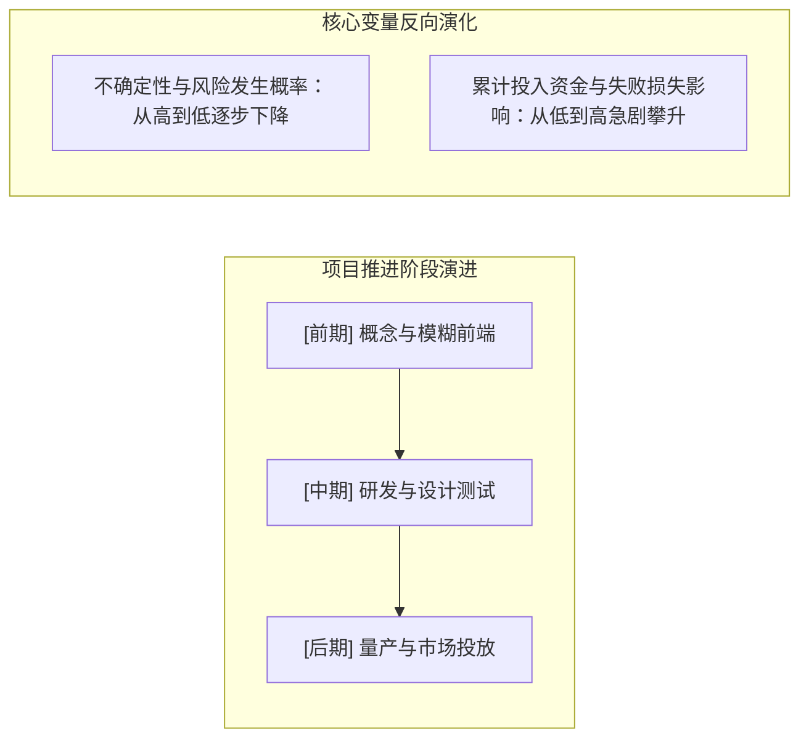
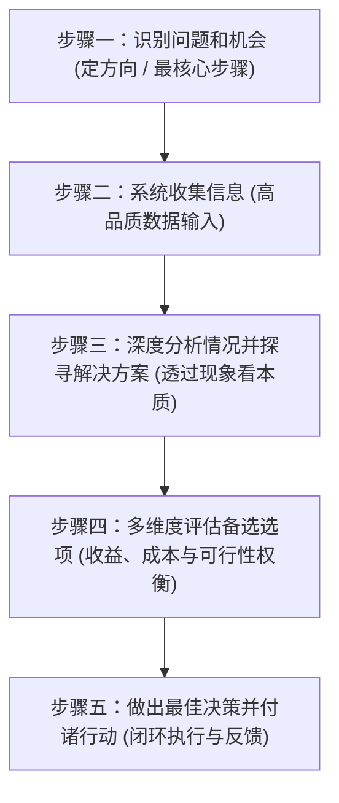
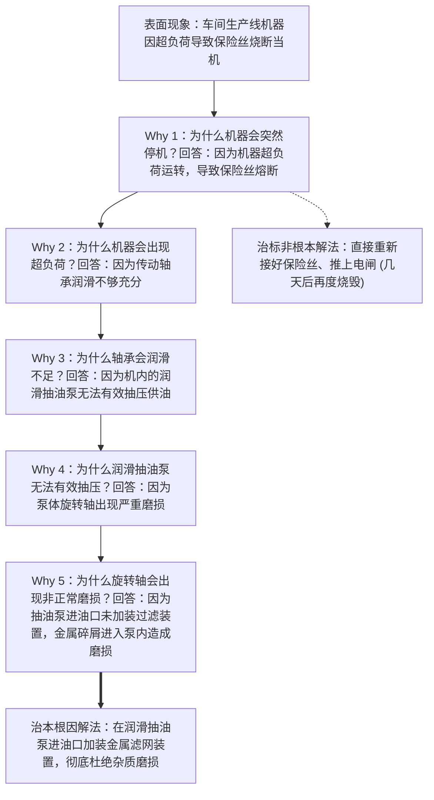
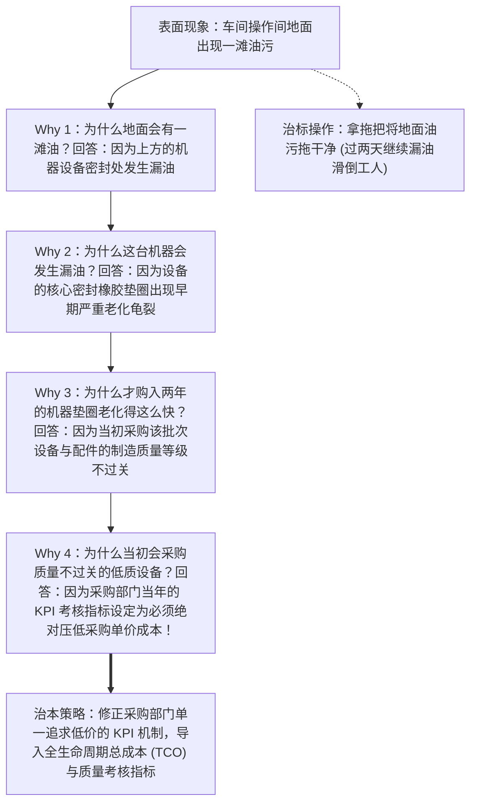

# 3.3 正确决策的基本框架（降低风险）与五WHY寻根法

> [!IMPORTANT] 核心提要
> 新产品开发本质上是在高度不确定性环境中不断配置资源、承担风险并做出判断的过程。随着项目推进，**风险的发生概率与损失影响呈现反向交织状态**（前期不确定性高但沉没成本低，后期不确定性降低但资金投入巨大、试错成本极高）。
> 建立科学严谨的决策框架，其核心目的在于**降低项目失败风险、提升成功概率，并实现“进取有据、止损及时”**。而决策质量高度依赖于**对问题本质的精准识别**，丰田精益体系首创的**五WHY寻根法（5 Whys）**与**因果鱼骨图**正是破解表象迷雾、深挖系统性根因的经典利器。

---

## 1. 项目生命周期中的风险特征与决策价值

### 1.1 不确定性、成本投入与风险的双重演变

在产品研发与项目生命周期中，两个核心变量随时间推移发生着动态变化：
1. **不确定性（Uncertainty）与风险概率**：随着调研的深入、原型的验证以及技术方案的逐步落实，**不确定性持续下降**，因认知盲区导致风险爆发的概率在逐步降低。
2. **累计投入成本与风险影响程度（Impact）**：项目前期通常仅投入少量调研与构思预算，越往后走，模具开模、产线搭建、备料采购、市场铺货等资金投入呈指数级增长。**一旦在后期发生方向性偏差或质量事故，给企业造成的破坏性影响和财务损失将呈几何级数放大**。

### 1.2 科学决策的战略意义：及时止损亦是收益

* **一招不慎，满盘皆输**：在资金与资源重度倾斜的后期，任何错误的决策都会直接吞噬企业的核心现金流。
* **决策的核心目标**：通过高质量的信息输入与严密的评估机制，实现：
  * **该进取时果断进取**：在确定性机会出现时全力压上优质资源；
  * **该暂停时立即暂停**：在关键验证未通过前坚决不启动下一阶段资金释放；
  * **该放弃时坚决放弃**：**及时止损（Kill Project）本身就是一种高价值的收益**，能避免企业在注定失败的项目上继续失血。

---

## 2. 科学决策的标准五步法框架

做出明智决策的前提是**拥有大量高品质的信息与结构化的分析逻辑**。NPDP 将科学决策归纳为以下五个递进步骤：

### 步骤一：识别问题和机会（Identify Problems & Opportunities）——最核心的定方向环节

* **为什么第一步权重最高？**
  * 识别问题与机会属于**战略定调**。如果方向判断错误，即所谓“南辕北辙”，后续收集再多的数据、做再精细的方案推演，也是在错误的方向上狂奔，所有的努力都会演化为巨大浪费。
* **爱因斯坦经典名言**：
  > “如果给我一个小时的时间来拯救地球，我会用 59 分钟去发现和定义问题，最后只用 1 分钟去解决它。”
* **警惕表象陷阱**：管理者与产品经理通常只能看到浮在表面的日常业务异常（如销量下滑、交付延期、客户投诉），但这些往往只是“症状（Symptoms）”，必须穿透表象找到背后的真实问题与本质机会。

### 步骤二：系统收集高质量信息（Gather High-Quality Information）

没有高质量的信息输入，决策就会沦为凭空拍脑袋。收集信息需要兼顾维度与真实度：
* **信息来源的多样化**：
  * **内部运营数据**：工作日志、缺陷记录、员工访谈记录、生产质检数据；
  * **外部市场情报**：竞争对手动向、行业基准报告、法规趋势；
  * **客户真实反馈**：客户满意度调查、售后退换货工单、终端用户使用记录。
* **信息收集的常用工具与方法**：
  * **一对一/一对多深度访谈**：获取深层因果认知与个体真实诉求；
  * **头脑风暴（Brainstorming）**：发散式收集跨职能团队的多重视角；
  * **焦点小组（Focus Group）**：针对特定客户画像挖掘真实体验与痛点；
  * **问卷调查（Surveys）**：获取定量化的样本统计支持。
* **信息筛选与降噪机制**：
  * 并非所有收集到的信息都有同等价值。低品质、主观臆断或来源不可靠的信息必须做剔除或降权处理；只有经过核实、高可信度的数据才应作为决策基石。

### 步骤三：深度分析情况，找出解决方案（Analyze Situation & Generate Solutions）

* **不同认知产生不同解法**：如同中国古代公案剧（《大宋提刑官》、《神探狄仁杰》、《包拯探案》）中所展现的，面对完全相同的现场痕迹与客观证据，常人往往茫然无措或得出荒谬推论，而具备高维侦探思维的人能抽丝剥茧还原真相。
* **结构化分析模型的导入**：面对复杂局势，必须引入严谨的因果推演与结构化分析工具（如五WHY法、鱼骨图、SWOT分析、根本原因分析 RCA），从而推导出多条潜在的解决方案路径。

### 步骤四：多维度评估备选选项（Evaluate Options）

* **破除“公说公有理，婆说婆有道”的主观争执**：团队面对多个备选方案时，不同部门往往站在自身立场各执一词（研发主张技术领先、财务主张严格控本、市场主张多加功能）。
* **建立客观评估矩阵**：基于量化指标对各方案进行多维度打分加权评估，包括：
  * 战略契合度与商业回报潜力；
  * 研发与制造成本预算；
  * 技术实现可行性与交期风险；
  * 竞争壁垒与市场接受度。

### 步骤五：做出最佳决策并付诸行动（Make the Best Decision & Take Action）

* 经过综合权衡挑选出最优解（或风险可控的次优折中方案），明确负责人、里程碑、关键资源配置并立即推进执行，随后根据实战反馈进行动态闭环调整。

---

## 3. 探寻问题本质的核心工具与实战案例

### 3.1 冰山模型：表象与深层根因的巨大鸿沟

在产品与运营管理中，问题往往呈现典型的**冰山法则（Iceberg Model）**：
* **水面以上部分（冰山一角）**：只占整体问题表现的极小比例（如 10%），是所有人肉眼可见的“现象/症状”（如机器当机、地面油污、交付延误、功能退件）；
* **水面以下部分（深海根基）**：占据 90% 的隐蔽体量，涵盖了流程漏洞、考核机制缺陷、供应链劣质、组织协同失能等**深层次本质根因**。若只针对水面表象施策，问题必将反复发作。

---

### 3.2 丰田精益“五WHY寻根法”（5 Whys）

> [!IMPORTANT] 五WHY法核心逻辑
> 由日本丰田汽车公司（Toyota）在大野耐一领导的精益生产体系（TPS）中发明推广。其核心思想是：**面对任何表面缺陷或故障，绝不停留在表浅应对，而是连续追问至少五次“为什么”，层层穿透因果链条，直至揪出系统性制度或物理层面的根本原因**。

#### 案例一：车间机器当机停转案例

* **反思**：若不采用五WHY法，工人的标准操作就是“去库房领新保险丝换上，拉上闸门继续开工”。这种“治标”操作不仅无法解决问题，还会让机器在短时间内再次爆险，甚至酿成主轴抱死报废的更大事故。

#### 案例二：车间地面漏油与采购 KPI 考核案例

* **管理启示**：地上一滩油污看似是一个保洁问题或简单的机器维修问题，通过五WHY追问，最终发现其深层根源竟然潜伏在**公司的绩效管理机制（采购 KPI 导向）**中。只有从组织考核层面纠正，才能从源头杜绝全厂低质设备的蔓延。

---

### 3.3 鱼骨图分析法（因果图 / 石川图 / Why-Why横向展开）

* **工具定位**：五WHY法侧重于**单条因果链条的纵向深挖**；而由日本质量管理大师石川馨发明的**鱼骨图（Ishikawa Diagram / 因果图）**，则侧重于**围绕一个核心问题，从多维度进行发散性连续追问**。
* **应用模式**：
  * 针对同一个核心痛点（如“新产品交付严重延期”），从**人（人员）、机（设备）、料（物料）、法（流程方法）、环（环境）**等关键支干上，反复提问“为什么延期”：
    * 第一次回答：研发团队关键技术水平不足；
    * 第二次回答：项目专项研发资金未能及时拨付到位；
    * 第三次回答：生产与测试设备过于陈旧老化，调试耗时过长；
    * 第四次回答：跨部门接口缺乏标准协同机制，需求频繁变更且管理失控。
  * 将所有原因梳理为鱼骨主刺与细刺后，团队再结合当前项目的客观实际，筛选出最具影响力的关键诱因并针对性制定改善措施。

---

## 4. 核心概念与决策工具速查表

| 维度 / 模块 | 核心概念与特征 | 典型工具 / 关键步骤 | 经典实战案例 / 场景 | 核心价值与警示 |
| :--- | :--- | :--- | :--- | :--- |
| **项目风险特征** | 前期高不确定性、低沉没成本；后期低不确定性、高毁灭成本 | 动态风险监控矩阵、阶段关口审查 | 硬件开模与量产备料阶段的资金爆发式投入 | 及时止损（Kill Project）本身是巨大收益；越到后期犯错代价越大 |
| **决策五步法** | 识别问题/机会 $\rightarrow$ 收集信息 $\rightarrow$ 分析找解 $\rightarrow$ 评估选项 $\rightarrow$ 决策行动 | 头脑风暴、深度访谈、焦点小组、加权决策矩阵 | 爱因斯坦“59分钟找问题，1分钟解决问题” | 步骤一（定方向）最关键，避免“南辕北辙”导致全部努力付诸东流 |
| **信息收集与筛选** | 基于高质量客观事实做判断，剔除劣质噪音 | 问卷调研、竞品情报、工作记录日志 | 《大宋提刑官》、《神探狄仁杰》证据与推演对照 | 收集信息不能仅凭主观猜测，劣质数据会导致误导性决策 |
| **五WHY寻根法** | 丰田 TPS 精益工具，沿单一因果链条连续追问 5 次“为什么” | 纵向递进因果链条推导法 | 1. 机器当机 $\rightarrow$ 轴承润滑 $\rightarrow$ 抽油泵磨损 $\rightarrow$ 加装滤网 2. 地面漏油 $\rightarrow$ 垫圈老化 $\rightarrow$ 采购低质 $\rightarrow$ 采购 KPI 漏洞 | 彻底告别“头痛医头、脚痛医脚”的表面应付，直击系统与机制根因 |
| **鱼骨图分析法** | 石川馨因果分析法，从多维度（人机料法环）横向发散追问原因 | 因果分析图（Fishbone Diagram / Why-Why Matrix） | 新产品交付延期分析（技术人员能力、资金到位、设备陈旧、流程管理） | 适用于多元复合因素交织的复杂系统故障排查 |
