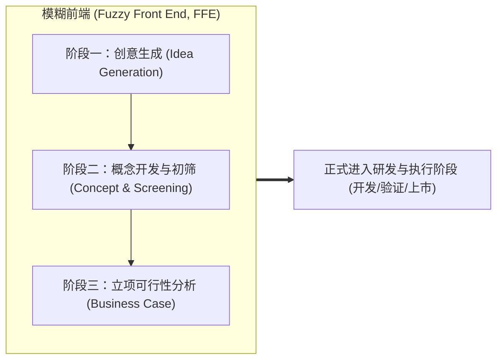
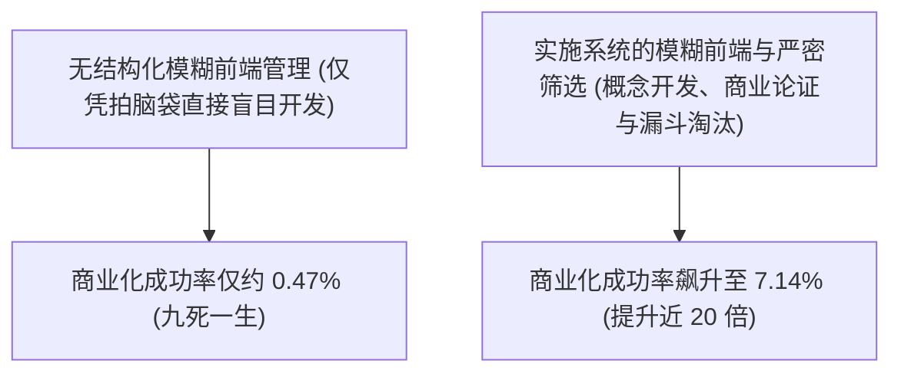
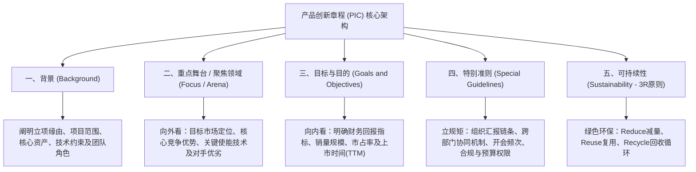
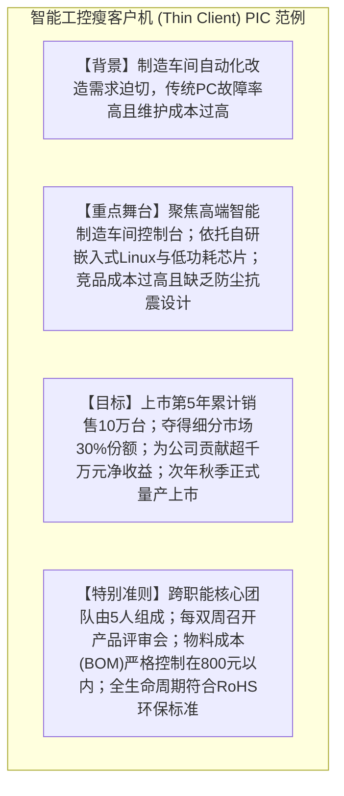

# 3.4-3.5 模糊前端（FFE）与产品创新章程（PIC）及演变

> [!IMPORTANT] 核心提要
> 在产品生命周期早期，项目面临着极高的环境不确定性与资源不透明性，这一阶段被称为**模糊前端（Fuzzy Front End, FFE）**。数据显示，缺乏科学管理的原始创意商业化成功率不足 **0.5%**，而经过模糊前端系统论证与漏斗筛选的项目，成功率可暴增至 **7.14%**（近 **20 倍**的差距）。
> 为了避免团队在迷雾中盲目试错，管理层必须出台一份战略性纲领文件——**产品创新章程（Product Innovation Charter, PIC）**。PIC 通过厘清**背景（Background）**、**重点舞台/聚焦领域（Focus/Arena）**、**目标与目的（Goals & Objectives）**、**特别准则（Special Guidelines）**以及**可持续性（Sustainability 3R 原则）**，为跨职能创新团队划定自由探索的战略边界。

---

## 1. 影响项目方向的关键枢纽：模糊前端（FFE）

### 1.1 什么是模糊前端（Fuzzy Front End, FFE）？

在完整的新产品开发流程（NPD）中，时间轴最靠前、处于正式立项研发之前的早期探索阶段，统称为**模糊前端（FFE）**。
* **涵盖的三个关键子阶段**：
  1. **创意生成（Idea Generation）**：收集并激发各种潜在的技术突破或用户痛点设想；
  2. **概念开发与初步筛选（Initial Concept & Screening）**：将粗糙的想法具象化为产品概念，淘汰明显不具可行性的构想；
  3. **立项商业分析（Business Case Analysis）**：进行严密的商业可行性、财务估算与市场潜力评估。

### 1.2 “模糊”的双重维度：环境与资源

模糊前端之所以被称为“模糊（Fuzzy）”，是因为此时团队面临着内外部信息的双重混沌：
* **外部环境维度（External Environment）**：
  * **客户需求不清晰**：用户诉求通常是零散、矛盾或尚未被言明的潜在渴望；
  * **市场与竞争不确定**：竞争对手动向变幻莫测，政策法规及外部市场风向尚未明朗。
* **内部资源维度（Internal Resources）**：
  * **关键技术路径未定**：团队不确定需要攻坚哪些底层技术，现有技术储备是否足以支撑；
  * **组织与管理手段未定**：资金预算额度、人员配置模式及项目管控方式尚处于摸索状态。

### 1.3 模糊前端的核心价值：成功率跃升 20 倍的实证

在模糊前端投入充足的时间与精力进行严密筛选，是企业优化研发 ROI（投资回报率）最具杠杆效应的举措：

* **本质价值**：以最低的纸面论证与前期调研成本，提前**扼杀无商业价值的伪需求（Fail Fast, Fail Cheap）**，将宝贵的人力与资金聚焦在真正具备高成功概率的优质项目上。
* **新概念开发模型（NCD, New Concept Development）**：包含机会识别（Opportunity Identification）、机会分析（Opportunity Analysis）、创意产生（Idea Genesis）、创意选择（Idea Selection）及概念定义（Concept Definition），形成严密的闭环筛选漏斗。

---

## 2. 战略纲领文件：产品创新章程（PIC）

### 2.1 PIC 与项目章程（Project Charter）的本质差异

许多产品团队容易混淆 PIC 与项目章程。二者在层级与使命上截然不同：

| 比较维度 | 产品创新章程（PIC） | 项目章程（Project Charter） |
| :--- | :--- | :--- |
| **制定层级** | 企业高层管理层、业务战略委员会 | 项目发起人（Sponsor）与项目经理 |
| **生效时机** | **模糊前端阶段（研发立项前发布）** | **项目正式立项时（研发启动时签署）** |
| **核心性质** | **战略性指导纲领文件** | **战术执行授权文件（红头授权书）** |
| **核心目的** | 明确产品创新的战略边界、目标细分市场与商业雄心，给创新团队划定“游乐场边界” | 正式授予项目经理调配资源的权力，明确进度里程碑、验收标准与交付物 |
| **管控跨度** | 跨越产品从概念到商业化的全生命周期战略 | 聚焦于单个具体项目的执行交付过程 |

> [!WARNING] 核心考点警示
> PIC **绝不是具体的工程设计图纸或项目进度表**，而是战略与战术之间的“桥梁”。没有 PIC，研发人员就会像无头苍蝇一样研发出“技术极为酷炫但公司完全不想要、市场毫无需求”的自嗨产品。

---

### 2.2 PIC 的四大经典支柱与可持续性扩展（4+1 体系）

一个完整、有效的产品创新章程通常由四大经典板块及最新的可持续发展要素构成：

#### （1）背景（Background）
* 阐述**为什么要启动这个产品类别**的创新探索；
* 澄清企业当前的战略优势与行业环境现状；
* 界定产品探索的初步范围与关键技术资产，明确团队在组织体系中的使命定位。

#### （2）重点舞台 / 聚焦领域（Focus / Arena）
* **核心视角：眼睛向外看市场与竞争**。
* **目标细分市场**：界定产品究竟为哪些目标客户服务，满足哪些特定场景；
* **使能技术与工艺路径**：采用何种关键核心技术路线建立护城河；
* **竞争对手分析**：梳理主要竞争对手的优劣势（Strengths & Weaknesses），明确团队取胜的关键成功因素（KSF）。

#### （3）目标与目的（Goals and Objectives）
* **核心视角：眼睛向内看商业结果**。
* **企业与经营者诉求**：为团队注入志在必得的量化衡量目标；
* **具体考核维度**：
  * **财务收益目标**：如“五年内贡献营收 1 亿元”、“税后利润率达 15%”；
  * **市场拓展目标**：如“上市第 3 年占据细分市场 30% 以上份额”、“稳固行业第一阵营地位”；
  * **上市时间（Time-to-Market, TTM）**：如“必须在当年秋季新品发布会前完成商业化量产”。

#### （4）特别准则 / 指导方针（Special Guidelines）
* **“丑话说在前面”的行事法则**（没有规矩不成方圆）：
  * **组织与汇报机制**：明确核心团队成员构成、向谁汇报工作、向哪些委员会汇报；
  * **沟通与协同节奏**：明确跨部门工作协同方式与例会频次（如“核心团队每两周召开一次进度与风险对齐会”）；
  * **权限与合规红线**：定义单笔费用支出审批额度、质量验收门槛以及行业法规监管强制要求。

#### （5）现代扩展：可持续性（Sustainability 与 3R 原则）
* 顺应全球绿色供应链与 ESG 要求，现代 PIC 必须强制纳入环境友好性考量：
  * **Reduce（减量化）**：减少包装材料冗余、压降高耗能原材料使用；
  * **Reuse（再使用）**：优先采用通用化、模块化设计，提升零部件的可重复使用率；
  * **Recycle（再回收/再循环）**：设计易拆解结构，选择可循环降解的环保新材料，建立生态循环链条。

---

## 3. PIC 工业界实战范例深度拆解（以智能工控终端为例）

通过真实的商业案例可以直观理解 PIC 如何将散乱的想法凝结为清晰的指导性文档：

* **管理实践价值**：在航天局（NASA）、IBM、丰田汽车（Toyota）等跨国机构的研发体系中，正是依靠 PIC 这种结构化文本，使得成百上千名研发人员在数年的漫长开发中，始终保持战略意图不跑偏、核心目标不稀释、组织协同不混乱。

---

## 4. 核心概念与考点速查表

| 核心模块 | 关键定义与内涵 | 核心要素 / 关键构成 | 典型量化指标 / 案例特征 | 常见误区与考点警示 |
| :--- | :--- | :--- | :--- | :--- |
| **模糊前端（FFE）** | 正式开发前的初始探索阶段，具有高度环境与资源不确定性 | 创意生成、概念开发与初筛、立项可行性分析（NCD 模型） | 成功率对比：无管理 0.47% vs. 系统管理 7.14%（跃升近 20 倍） | 误区：认为 FFE 是不可控的混乱阶段；考点：FFE 是降低后期研发试错成本最具杠杆效应的关口 |
| **产品创新章程（PIC）** | 由高层制定的指导产品创新战略方向与边界的纲领性文件 | 背景、重点舞台/聚焦领域、目标与目的、特别准则、可持续性（3R） | “五年销售 10 万台、占据 30% 市场份额、秋季上市、双周例会” | 误区：混同于项目章程；考点：PIC 是战略级边界划定，项目章程是战术级执行授权 |
| **重点舞台（Focus / Arena）** | PIC 中向外审视的模块，定义产品竞争的作战空间 | 目标市场细分、核心关键使能技术、竞品优劣势、关键成功因素 | 面向特定客群场景，结合自研核心技术构建差异化壁垒 | 容易与“背景”混淆；注意重点舞台专指“外部战场（市场+技术+竞品）” |
| **目标与目的（Goals & Objectives）** | PIC 中向内审视的模块，明确商业回报与时间表 | 财务回报指标（营收/利润）、市场份额占比、上市时间（TTM） | 明确具体可衡量的数字目标（SMART 原则） | 必须是企业和经营者关心的商业量化结果，而非纯技术参数指标 |
| **特别准则（Special Guidelines）** | PIC 中的内部规矩与治理红线，保障协同规范 | 团队汇报链条、例会频次、质量标准、费用授权、法规监管约束 | “丑话说在前面”，防范跨部门推诿与超预算开销 | 缺少特别准则会导致团队权责不清、流程失控 |
| **可持续性（Sustainability）** | 现代 PIC 扩展要求，贯穿产品全生命周期的环保原则 | 3R 原则：Reduce（减量）、Reuse（复用）、Recycle（回收循环） | 限制一次性材料、设计易拆解循环结构、绿色生态链 | NPDP 考题高频强调现代创新必须兼顾经济利益与生态环保 |
