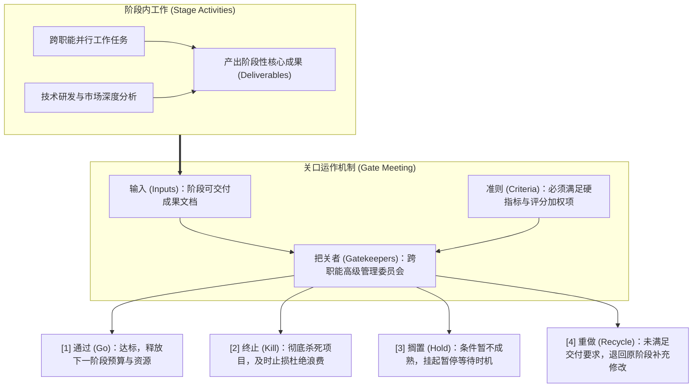

# 3.7 & 3.18 博斯六阶段与库珀门径管理流程（Stage-Gate六阶段五关口全解）

> [!IMPORTANT] 核心提要
> 新产品开发管理的发展史上，**博斯咨询公司（Booz, Allen & Hamilton, BAH）提出的六阶段模型**奠定了现代产品开发流程的理论基石；而加拿大著名管理学者**罗伯特·G·库珀（Robert G. Cooper）**在此基础上创造性地引入了**关口（Gate）机制**与**把关者（Gatekeeper）制度**，正式创立了风靡全球工业界的**门径管理流程（Stage-Gate Process / 阶段关口模型）**。
> 门径管理流程的核心灵魂在于**“过五关斩六将”**与**“阶段投入、动态止损”**：将充满不确定性的开发旅程切分为若干结构化阶段（Stages），并在每个阶段之间设立强制评审的关口（Gates），由跨职能高管担任把关者，依据硬性准则实施**通过（Go）、终止（Kill）、搁置（Hold）或重做（Recycle）**决策，有效扼杀劣质项目，确保资源流向最具商业价值的战略产品。

---

## 1. 理论演进：从博斯六阶段到库珀门径管理

### 1.1 博斯六阶段论（Booz, Allen & Hamilton 六阶段模型）

20 世纪 60 年代，管理咨询巨头博斯公司系统性总结了工业界新产品开发的生命周期，提出了经典的六阶段划分：
1. **探索阶段（Exploration）**：全面发散，寻找潜在的业务问题、用户痛点与技术解决方案雏形，尽可能拓宽创意来源；
2. **筛选阶段（Screening）**：建立初步评价逻辑，快速淘汰大量天马行空、不切实际或明显违背常理的构想，保留少数具备潜力的靠谱想法；
3. **商业评估阶段（Business Evaluation）**：即详尽的**立项可行性分析（Business Case）**，严密测算成本、收益、回收周期与投资回报率，决定是否值得商业化立项；
4. **开发阶段（Development）**：明确产品规格，调配预算，招兵买马组建跨职能研发团队，进行工程化物理设计与样品实现；
5. **测试阶段（Testing）**：不仅包含技术维度的功能性测试、安全测试与耐用性测试，更核心的是开展**商业/市场测试（Market Testing）**，验证目标客户是否愿意为此买单；
6. **商业化阶段（Commercialization）**：从小批量试制与局部试销开始，逐步拓展至全供应链规模化大批量生产，展开全面的市场分销与品牌推广。

---

### 1.2 库珀门径管理流程（Stage-Gate）的革命性突破

库珀教授敏锐地指出：博斯六阶段论虽界定了研发各阶段的任务，但在实际企业运作中，团队往往为了追求进度而“一路狂奔到底”，缺乏阶段性的硬性踩刹车机制，导致大量注定失败的产品白白耗尽企业所有预算。
为此，库珀将**阶段（Stage）**与**关口（Gate）**高度统一，构建了著名的 **Stage-Gate 模型**：

### 1.3 博斯六阶段与门径管理六阶段一一对应映射

| 阶段序号 | 博斯六阶段论（BAH） | 库珀门径管理流程（Stage-Gate） | 阶段核心使命与本质映射 |
| :---: | :--- | :--- | :--- |
| **0** | **探索（Exploration）** | **发现（Discovery）** | 发掘市场机会、收集技术与业务创新创意 |
| **1** | **筛选（Screening）** | **筛选（Scoping / 范围界定）** | 概念生成，开展低成本案头研究与快速初筛 |
| **2** | **商业评估（Business Evaluation）** | **商业论证（Business Case / 立项分析）** | 详尽商业分析、市场研究、可行性评估（FFE终点） |
| **3** | **开发（Development）** | **开发（Development）** | 跨职能团队协作，将纸面概念转化为实体工程样品 |
| **4** | **测试（Testing）** | **测试与验证（Testing & Validation）** | 功能测试、合规认证及小范围用户市场试销验证 |
| **5** | **商业化（Commercialization）** | **上市（Launch）** | 规模化批量制造、营销推广与全渠道铺货 |
| **—** | *（传统流程中缺失）* | **上市后审查（Post-Launch Review）** | 上市 6~24 个月后，对照初始商业计划复盘财务回报 |

> [!NOTE] 核心差异总结
> 两套模型在六大核心阶段的认知逻辑上完全同构，门径管理模型的关键飞跃在于：**在每个阶段之间植入了强制性的关口评审（Gate）**，实现了资源投入的阶梯式渐进释放与风险的硬性把控。

---

## 2. 阶段（Stage）与关口（Gate）的微观运作机制

### 2.1 关口的本质与隐喻

* **文化隐喻**：关口恰如中国古代名将“过五关斩六将”中的每一道关隘，又如“一夫当关，万夫莫开”的军事要塞。
* **职能定位**：关口是项目生命周期中的**质量门槛、资源释放枢纽与战略过滤器**。未经关口审查通过，任何项目严禁擅自消耗下一阶段的预算与人力。

### 2.2 关口的三大核心要素

1. **输入（Inputs）**：上一阶段执行完毕后交付的核心成果物（如商业需求文档 BRD、可行性研究报告、工程原型机、市场测试数据等）。
2. **评估准则（Criteria）**：评审采用的硬性指标体系，通常分为两类：
   * **必须满足准则（Must-Meet Criteria）**：杀手级硬指标（如不违背法律法规、符合公司核心战略、具备基本安全认证），实行一票否决；
   * **应该满足准则（Should-Meet Criteria）**：加权评分指标（如预估投资回报率 ROI、技术成熟度、市场吸引力），用于横向排序项目优先级。
3. **输出（Outputs）**：把关者团队在关口会议（Gate Meeting）上做出的权威法定结论与资源划拨决策。

### 2.3 把关者（Gatekeeper）与四大决策路径

* **把关者角色**：通常由企业高管（业务线总裁、研发副总裁、财务总监、市场营销总监等）组成的跨职能委员会担任，他们掌握核心资源分配权。
* **四大裁决路径**：
  * **通过（Go / Pass）**：交付物达到全部标准，高管当场签字批准，正式拨付下一阶段所需资金与团队编制；
  * **终止（Kill）**：市场风向突变、技术遇到无法跨越的硬死穴或财务测算彻底亏损，**立即下马项目并封存经验教训，实现“及时止损”**；
  * **搁置（Hold）**：项目本身尚有潜力，但由于当前公司优先级调整或外部供应链受阻，暂时挂起，等待窗口期；
  * **重做/循环（Recycle / Rework）**：调研深度不足或关键指标存在疑问，命令项目团队返回原阶段限期补全数据后重新上会。

### 2.4 阶段关口模型的灵活裁剪与适配

> [!TIP] 管理最佳实践：反对流程教条主义
> 门径管理流程并非僵化刻板的教条。企业应根据项目的**技术复杂度、市场不确定性与投资规模**进行敏捷剪裁：
> * **高风险、超大型创新项目**：必须完整保留甚至细化增加阶段与关口（如军工、航天、高端医疗器械，强调“数十道严格工序，道道严格把关”）；
> * **低风险、改良型小项目（衍生产品/Line Extension）**：可采用 **Stage-Gate Xpress（速递版）** 或合并阶段（如合并阶段1与阶段2，减少部分关口审查），加速产品上市节奏。

---

## 3. 六阶段五关口全流程要素深度拆解

### 3.1 阶段0：发现阶段（Discovery）与关口1：创意筛选（Idea Screen）

* **阶段0 核心使命**：广泛捕捉创新机遇。
  * **创意来源矩阵**：竞品拆解分析、前沿技术演进、终端用户未满足痛点调研、一线员工/销售提案、外部供应链技术趋势；
  * **关键推动者**：**产品倡导者（Product Champion）**，负责在组织内奔走呼号、推介概念。
* **关口1 创意筛选**：
  * **评审核心**：评估想法是否符合公司基本战略方向，技术上是否明显反人类或违背常理，成本是否过于离谱。通过后发放少量调研经费进入阶段1。

---

### 3.2 阶段1：筛选阶段（Scoping / 范围界定）与关口2：二次筛选（Second Screen）

* **阶段1 核心使命：概念生成（Concept Generation）与低成本案头调研**。
  * **概念生成标准化表达（电梯演讲 Elevator Pitch 句式）**：
    > “面对【目标细分人群/用户画像】，为了解决其在【特定场景下的痛点需求】，我们提供【产品名称/类别】，它具备【核心功能与解决方案】。与【主要竞争对手】相比，我们独具【核心差异化特性与竞争优势】。”
  * **调研特征**：坚持**低成本原则**，以**案头研究（Desk Research）**与**次级研究（Secondary Research，即查阅公开报告、行业二手数据）**为主，进行粗略的技术与商业评估；
  * **核心交付物**：在软件领域通常形成**商业需求文档（BRD, Business Requirements Document）**草案。
* **关口2 二次筛选**：
  * **评审核心**：基于二手数据与粗略概念，判断是否值得投入跨职能团队的专门精力进行深度的商业论证。

---

### 3.3 阶段2：商业论证阶段（Business Case / 概念评估）与关口3：进入开发关口

* **阶段2 核心使命：全方位的概念深度评估与商业可行性论证**。
  * **核心考量维度**：
    * **商业赚钱能力**：市场总容量多大？生命周期利润预测、定价策略与投资回收期；
    * **技术与制造能力**：核心技术能否突破？公司是否有生产线？供应链物料能否可靠获得？
    * **法律与社会合规**：知识产权风险（IP 专利排查）、环保合规、社会责任；
  * **跨职能协同作战**：技术、市场、制造、财务、法务全员深度介入，开展一级原始调研（Primary Research，深度访谈、问卷）；
  * **核心交付物**：详尽的**商业论证报告（Business Case）**、可行性研究报告，在软件/互联网领域对应输出**市场需求文档（MRD）**与**产品需求文档（PRD）**。
* **关口3：进入开发的关口（Go to Development）——决定企业生死的“分水岭”**：
  * **战略地位**：**关口3是模糊前端（FFE）通往重资产研发的终极闸门**！
  * **严苛程度最高**：在此关口之前，沉没成本仅为少量的纸面调研经费；一旦越过关口3，企业将正式启动大规模招兵买马、采购核心芯片、开模注塑、搭建中试产线，海量资金将喷涌而出。因此把关者必须实施最严密的财务与可行性盘查。

---

### 3.4 阶段3、4、5与上市后审查

* **阶段3：开发（Development）与关口4（进入测试）**：
  * 研发与工程团队将纸面规格转化为工程样品（Alpha 测试样机、软件测试版本）；关口4重点审查样机是否达成技术指标，是否具备开展严苛测试的条件。
* **阶段4：测试与修正（Testing & Validation）与关口5（进入上市）**：
  * 开展 Beta 客户测试、现场试用、极端环境测试及区域市场小批量试销（市场反应测试）；关口5重点审查制造就绪度（产线合格率）、供应链备料情况与营销方案。
* **阶段5：上市（Launch）与商业化运作**：
  * 产线全面开动，全面铺开渠道货架，启动立体化营销宣发。
* **上市后审查（Post-Launch Review）**：
  * **时间窗口**：上市后 6 个月、12 个月或 24 个月；
  * **核心目的**：对比实际销售额、利润率与关口3承诺商业计划书的差距，复盘研发偏差，沉淀组织资产。

---

## 4. 博斯与门径管理核心机制速查表

| 维度 / 模块 | 核心内涵与定义 | 关键活动与机制 | 核心交付物 / 工具 | 决策输出 / 核心考点 |
| :--- | :--- | :--- | :--- | :--- |
| **博斯六阶段（BAH）** | 探索 $\rightarrow$ 筛选 $\rightarrow$ 商业评估 $\rightarrow$ 开发 $\rightarrow$ 测试 $\rightarrow$ 商业化 | 工业界最早定义的线性产品开发阶段生命周期 | 行业可行性与技术报告 | 奠定开发流程阶段划分理论基石，但早期缺乏强制关口机制 |
| **门径管理流程（Cooper）** | 发现 $\rightarrow$ 筛选 $\rightarrow$ 商业论证 $\rightarrow$ 开发 $\rightarrow$ 测试 $\rightarrow$ 上市（阶段关口并存） | 阶段（Stage）做交付物，关口（Gate）做把关裁决 | 6阶段 + 5关口 + 1上市后审查 | 核心价值：渐进式资源投入，及早止损，降低商业风险 |
| **把关者与关口会议** | 高管组成的跨职能委员会主持 Gate Meeting，对照准则严格评估 | 依据“必须满足”硬指标与“应该满足”加权分评审 | 关口评审决策表、资源拨付红头文件 | 四大决策路径：通过（Go）、终止（Kill）、搁置（Hold）、重做（Recycle） |
| **关口3（Go to Dev）** | 模糊前端（FFE）与正式重资产研发的分水岭 | 评估商业论证的严密性、市场容量与财务回报 | 商业论证报告（Business Case）、MRD / PRD | NPDP 考题高频重点：审查最严苛、资金投入出现指数级爆发的分界线 |
| **阶段1 vs. 阶段2** | 阶段1为初步筛选（案头/二手数据）；阶段2为商业论证（跨职能/一手深度调研） | 阶段1生成概念做电梯演讲；阶段2论证盈利性与制造可行性 | 阶段1产出初步概念/BRD；阶段2产出详尽商业报告 | 严禁混淆：阶段1是低成本粗筛，阶段2是重度跨职能可行性论证 |
| **上市后审查** | 产品走向市场运营一段时间后的战略复盘 | 上市 6~24 个月后回溯实际财务指标与原商业计划比对 | 经验教训总结报告、运营财务偏差分析 | 考点：开发阶段无法检验实际盈利，必须在商业运营稳定后进行后审查 |
