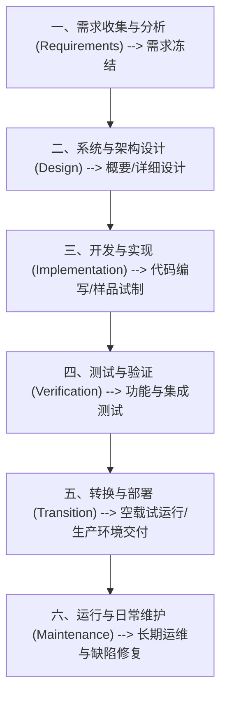
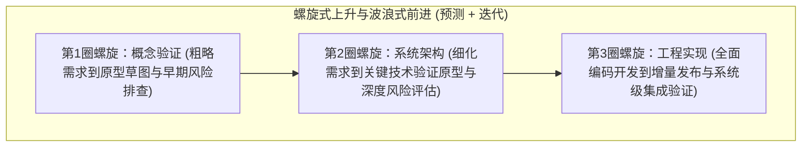
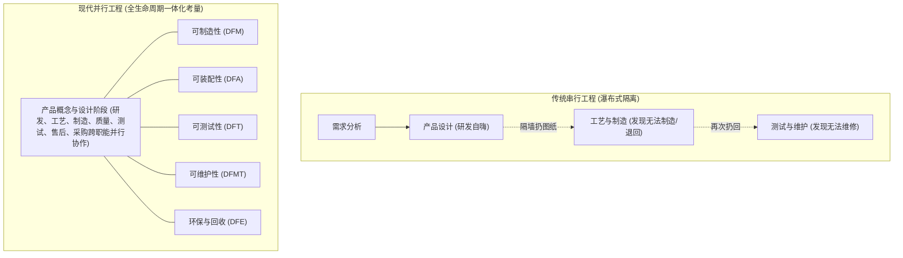
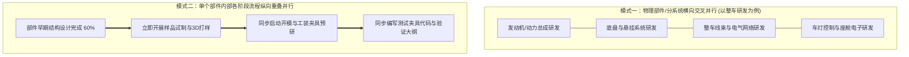

# 3.9-3.10 罗伊斯瀑布模型与并行工程对比

> [!IMPORTANT] 核心提要
> 在产品工程与开发方法论演进史中，**罗伊斯（Winston W. Royce）于 1970 年代提出的瀑布模型（Waterfall Model）**开启了规范化、按部就班的**预测型生命周期**时代，确立了“需求冻结—设计—编码—测试—部署”的线性串行范式；
> 随着 1990 年代航空航天与汽车等高精尖复杂系统的崛起，传统的串行“扔过墙（Over the Wall）”模式因周期冗长、后期设计变更代价惨重而遭遇瓶颈，**并行工程（Concurrent Engineering, CE）**应运而生。并行工程秉持**“以终为始”**的哲学，强调在项目初期即跨职能协同通盘考量涵盖制造、测试、维护、报废的全生命周期要素（DFX），并通过模块解耦与流程重叠将研发周期大幅压缩。

---

## 1. 经典预测型范式：罗伊斯瀑布模型（Waterfall Model）

### 1.1 瀑布模型的核心理念与线性特征

1970 年代，温斯顿·罗伊斯在软件工程领域正式总结了这一如瀑布之水“自上而下、顺流直下”的开发框架。其本质是一种**线性的、预测型的（Predictive）项目生命周期模型**。

* **核心执行特征**：
  1. **按部就班与阶段边界清晰**：每一个阶段都有极其明确的工作边界和产出标准，前一个阶段未完成并验收，严禁开启下一阶段；
  2. **需求冻结机制（Requirements Freeze）**：瀑布模型要求在进入设计与编码前，**将客户需求全部锁定并打上基线**。原则上在后续研发过程中不允许随意变更需求；
  3. **文档驱动（Document-Driven）**：每一个阶段的流转必须依赖完备的工程文档作为交付物凭证。

---

### 1.2 瀑布模型全生命周期的六大阶段

以典型复杂系统或大型企业级软件为例，瀑布模型涵盖：
1. **需求获取与分析（Requirements）**：全面梳理用户需求与业务场景，形成规范的需求规格说明书并予以**冻结**；
2. **系统设计（System & Detailed Design）**：包括系统架构设计、接口设计（API）、数据库建模以及软硬件分层设计；
3. **开发与构建（Implementation / Coding）**：工程师根据设计文档进行编码或硬件组装，产出实际的代码组件或可运行工程构件；
4. **测试与质量验证（Testing & Verification）**：执行单元测试、集成测试、系统压力测试及用户验收测试（UAT），排查缺陷并验证规格契合度；
5. **转换与试运行（Transition & Deployment）**：
   * **从研发实验室环境向真实运行环境的平滑过渡**；
   * **实战案例（新型地铁与轨道交通列车研发）**：地铁列车或新建地铁线路在研发制造完成后，**必须进行长达 6 个月至 1 年的“空车试运行/跑空车”**。通过高强度的空车动态磨合，提前排查并修复轨道兼容性、信号通信、制动刹车等潜在故障，经过严格试运行评估通过后，方可正式载客商业运营；
6. **运行与维护（Maintenance / Operations）**：进入长期的客户使用与运维阶段，响应故障报修，提供补丁与版本升级。

---

### 1.3 瀑布模型的优势、致命弊端与适用场景

* **核心优势**：
  * **纪律性严明**：流程高度规范化，分工明确，职责清晰；
  * **可追溯性极强**：文档完备，管理层容易依据里程碑评估项目整体进度；
  * **避免反复弯路**：在需求极度明确的前提下，能按既定轨迹高效达成目标。
* **致命弊端**：
  * **僵化呆板，极度缺乏灵活性**：面对瞬息万变的市场与需求变更，瀑布流程反应极其迟钝；
  * **风险后置**：所有模块必须到最后集成测试阶段才能看到可工作的完整形态，一旦此时发现早期需求或架构设计存在根本性缺陷，**返工代价将呈灾难级上升**；
  * **价值交付延迟**：客户只有在项目生命周期行将结束的最后时刻，才能接触到实际产品。

---

### 1.4 瀑布模型的改良形态：螺旋式瀑布模型（Spiral Model）

为了在保留瀑布流程规范性的同时引入对不确定性的吸收能力，业界演化出了**螺旋式瀑布模型（Spiral Waterfall Model）**：

* **核心特征**：
  * **迭代渐进（Iterative & Incremental）**：做事情并非一条直线冲到底，而是“一轮粗略草图 $\rightarrow$ 一轮素描图 $\rightarrow$ 一轮精细产品”，每一圈螺旋都让产品更健全；
  * **强风险驱动（Risk-Driven）**：每一圈螺旋都强制设置**“风险分析与原型制作（Prototyping）”**环节，通过先制作低成本原型验证高风险假设；
  * **与纯敏捷的本质区别**：大方向与顶层计划依然由严谨的预测型阶段主导，每一轮的目标非常明确，是在可控框架内做受控增量改善。

---

## 2. 现代工程革命：并行工程（Concurrent Engineering, CE）

### 2.1 并行工程的诞生背景与核心哲学

20 世纪 90 年代，以美国国防部、波音航天、丰田汽车为代表的尖端工业体系面临产品复杂度剧增与上市周期严酷缩短的双重挑战。传统瀑布式“串行交接（Sequential）”被戏称为**“隔墙扔图纸（Throwing over the wall）”**——设计部门设计完图纸扔给制造部门，制造部门发现无法装配再扔回设计部门修改，导致研制周期长达十数年。
**并行工程（Concurrent Engineering, CE）**由此诞生，其核心哲学是：**“以终为始（Begin with the end in mind）”**。

---

### 2.2 并行工程的两大核心支柱

#### 支柱一：全生命周期要素通盘前置考量（DFX 全面导入）
* **打破局部狭隘视野**：传统模式下研发工程师只关心“功能是否酷炫”，往往忽视产线能否打得出来、工人能否拧得上螺丝、售后能否拆得开维修；
* **从第一天起考虑全生命周期**：在早期产品概念设计阶段，就必须同步考虑涵盖整个生命周期的所有下游环节：
  * **产品功能与性能（Functionality）**；
  * **可制造性设计（Design for Manufacturing, DFM）**与**可装配性设计（Design for Assembly, DFA）**；
  * **可测试性设计（Design for Testing, DFT）**与**可维护性设计（Design for Maintenance, DFMT）**；
  * **客户使用安全与人机工程学**；
  * **最终报废、无害化处置与环保回收（Design for Environment, DFE）**。

#### 支柱二：跨职能团队同步协同与流程重叠
* 研发、工艺、制造生产、质检、采购、售后服务各部门人员自第一天起组建**跨职能团队（CFT, Cross-Functional Team）**；
* 其它专业视角的早期介入，能瞬间戳破研发人员的盲区，**将后期高昂的工程变更指令（ECO）提前消灭在纸面设计期**。

---

### 2.3 并行工程的两大具体实施模式

并行工程在复杂工程系统中的推进主要通过以下两种形态实现：

1. **按物理部件/系统模块交叉并行**：
   * 在研发一款新型汽车时，发动机研发、底盘轴承调教、整车高低压线束设计、车灯与车机控制系统，由不同的专项跨职能小组**同步推进**，绝不需等待发动机彻底定型后再开始研发车灯；
2. **单个部件内部工作流程交叉重叠并行**：
   * 单一关键零部件的设计、开发与制造环节不必等待上一环节 100% 结束。当核心结构设计明确 60%~70% 时，制造工艺人员即同步启动模具结构预研、试制样品小样并验证工艺，大幅压缩串行等待耗时。

---

## 3. 罗伊斯瀑布模型与并行工程深度全景对比

| 比较维度 | 罗伊斯瀑布模型（Waterfall） | 并行工程（Concurrent Engineering） |
| :--- | :--- | :--- |
| **理论起源与时代** | 1970 年代，温斯顿·罗伊斯提出，起源于软件与预测型项目 | 1990 年代，源自航空航天与汽车等高精尖离散制造工业 |
| **工程哲学** | **自上而下、线性顺序、分段移交** | **“以终为始”、跨职能协同、全生命周期统筹** |
| **工作流组织模式** | 串行推进（上一阶段完全结束并冻结，才开始下一阶段） | 并行推进（子系统横向并行，单系统设计制造纵向重叠） |
| **部门协同机制** | “隔墙扔图纸”模式，各部门阶段性交接，存在部门壁垒 | 跨职能联合项目组（CFT），研产供销测全流程深度捆绑 |
| **需求与变更应对** | 强调**“需求冻结”**，严格控制并排斥中期变更 | 早期接纳全生命周期约束反馈，主动在前端暴露并化解冲突 |
| **设计考量范围** | 早期过度聚焦功能规格与设计实现本身 | 早期全面导入 **DFX**（涵盖制造、装配、测试、维护、回收） |
| **研发交付周期（TTM）** | 周期漫长，各环节等待与移交摩擦损耗严重 | **大幅压缩 30%~50% 以上**的产品上市周期与试错时间 |
| **设计变更代价** | **极高**（集成测试或制造期才发现缺陷，引发灾难性返工） | **极低**（各领域专家在方案设计阶段即提出修正意见） |
| **典型代表案例** | 传统政企管理系统、地铁列车研发与空载试运行测试 | 波音航天飞行器、丰田新车开发、高端电子与半导体制造 |

---

## 4. 核心概念与考点速查表

| 核心知识点 | 核心定义与内涵 | 典型特征 / 机制 | 实操案例 / 隐喻 | 核心考点与风险警示 |
| :--- | :--- | :--- | :--- | :--- |
| **罗伊斯瀑布模型** | 预测型线性开发框架，阶段按固定顺序流转 | 需求冻结、文档驱动、阶段边界分明 | 软件开发五阶段（需求 $\rightarrow$ 设计 $\rightarrow$ 编码 $\rightarrow$ 测试 $\rightarrow$ 运维） | 误区：认为瀑布可以随意中途插队；考点：需求变更代价极大，风险集中在测试期 |
| **转换与试运行** | 从研发实验室/测试环境向真实生产环境交付的阶段 | 排除真实复杂场景下的环境耦合缺陷 | 地铁与轨道交通研发制造后必须“跑空车试运行半年至一年” | 考点：大型复杂工程不可直接商业载客，必须历经严密的试运行过渡期 |
| **螺旋式瀑布模型** | 结合瀑布线性框架与迭代风险控制的演化模型 | 螺旋上升，原型验证，强风险分析驱动 | “第一圈草图 $\rightarrow$ 第二圈素描 $\rightarrow$ 第三圈精细工程图” | 考点：虽有迭代，但大框架仍是预测型瀑布，核心目的是**降低未知风险** |
| **并行工程（CE）** | 以终为始，早期全生命周期考量与跨职能并行 | DFX 通盘考量、物理部件与流程双重重叠 | 航天飞机研制、汽车各零部件（发动机/车灯/底盘）同步并行研发 | 误区：认为并行只是多派人干活；考点：核心在于**早期跨职能协同与前置考虑全生命周期** |
| **全生命周期设计（DFX）**| 在设计阶段注入全链条约束条件的工程方法 | DFM 可制造性、DFA 可装配性、DFT 可测试性、DFE 环保回收 | 研发设计时即邀请产线装配工与售后维修工程师审图 | 考点：将后期的工程变更（ECO）消灭在纸面阶段，大幅压降全寿命周期成本（TCO） |
