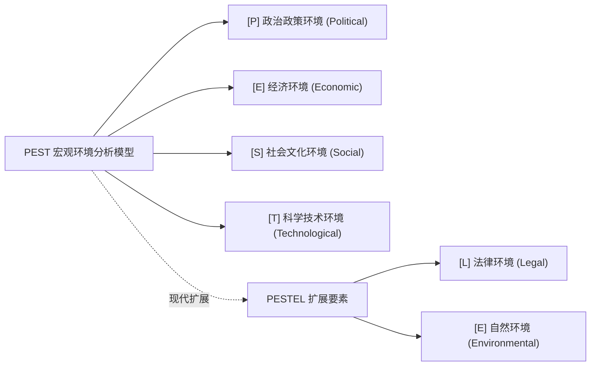
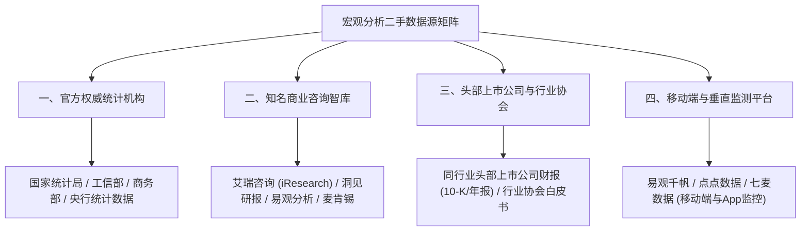

# 1.5 【实操】PEST 宏观环境分析实战

> [!IMPORTANT] 核心提要
> **PEST 分析模型**是产品经理在开展 0 到 1 新业务孵化、将现有业务推向全新市场，或者撰写高规格行业与竞品分析报告时，最基础且不可或缺的**宏观外部环境分析工具**。它从**政治政策（Political）**、**经济环境（Economic）**、**社会文化与人口（Social）**、**科学技术（Technological）**四大维度系统性扫描外部不可抗力因素。后续通常与 SWOT 分析工具结合，将外部宏观环境转化为产品业务的具体**机会（Opportunities）**与**威胁（Threats）**。

---

## 一、PEST / PESTEL 模型核心概念与演进

PEST 分析模型源自战略管理理论，教材与现代管理学中已进一步拓展为 **PESTEL 模型**：

### 1. 四大核心要素定义
* **P - 政治政策（Political）**：政局稳定性、国际关系与对外贸易政策、政府产业规划与扶持倾斜、行政监管法规。核心特征是**带有国家统治阶层或政府行政管理的主观意识形态与干预意志**。
* **E - 经济环境（Economic）**：宏观经济增长率（GDP 增速）、人均可支配收入、通胀率（CPI）、失业率、利率、汇率、恩格尔系数等。核心特征是**直接与货币、资本、资产价值与消费购买力紧密挂钩**。
* **S - 社会文化与人口（Social）**：人口总量与结构（老龄化、新生代特征）、地域分布、国民受教育程度、宗教信仰、文化传统、主流生活方式、群体消费行为习惯等。核心特征是**社会历史自然演进中形成的客观事实与长期共识**。
* **T - 科学技术（Technological）**：当前前沿与流行技术、未来科技演进趋势、技术普及率与基础设施成熟度（如移动通信 4G/5G/6G、人工智能 AI、大数据算法、扩展现实 XR、新能源与电池技术等）。核心特征是**为商业场景重构与生产力飞跃提供底层工程可行性支撑**。

### 2. 实战中的裁剪与补充原则
* **为何不每次都机械使用 PESTEL**：在 80%～90% 的日常互联网与软硬件产品规划中，法律因素通常可并入政治政策（P）考量，生态环境因素在非高污染、非新能源特定领域中影响有限。因此分析人员无须生搬硬套全部 6 个字母，应根据产品特征按需剪裁。
* **按需扩展行业专属维度**：在部分资本密集型行业（如在线教育、医疗科技、自动驾驶），分析师常在 PEST 基础上主动增加**资本环境（Capital）**维度，评估风险投资热度、二级市场估值倍数与融资窗口期。

---

## 二、关键概念辨析与实操误区（避坑指南）

在日常产研作业与行业分析报告中，产品经理最常犯的错误是将**政治因素（P）**与**社会因素（S）**混淆。二者的边界必须严格明晰：

> [!WARNING] 实战避坑：政治因素 vs 社会因素的本质区隔
> * **政治因素（主观行政干预）**：属于政府部门或立法机构主动出台的法令、法规、政策规划、税收调节。例如“国家发布双减政策”、“财政部提高职工教育经费税前扣除限额至 8%”、“个人所得税专项附加扣除”。
> * **社会因素（客观演进现象）**：属于全社会自发形成的群体行为、人口结构变动或文化观念转向，属于客观事实。例如“国民平均受教育年限逐年提升”、“90 后与 00 后步入职场并成为追星主力”、“年轻人崇尚悦己消费而不愿过早背负房贷”、“社会对于高级复合型人才供不应求”。
> * **判定口诀**：看其背后是“政府行政法条意志（主观干预）”，还是“人民群体生活与思想方式演变（客观共识）”。

---

## 三、宏观环境二手数据调研渠道全景

高质量的 PEST 分析必须建立在真实、权威、不可辩驳的数据指标之上，绝非空泛抒情。产品经理常用的宏观二手数据源涵盖以下五大阵营：

---

## 四、深度实战案例：在线成人职业教育与 MBA 培训行业 PEST 分析

以知名在线培训机构探寻拓展“在职 MBA 考研与职业进阶”新业务方向为例，基于艾瑞咨询《中国企业培训行业研究报告》等资料展开 PEST 调研：

### 1. 政治与政策环境（Political）
* **持续政策支持**：从 2002 年至 2021 年，国家连续出台多项大力发展职业技能培训与继续教育的纲领性文件。
* **财税重磅红利刺激**：国家财政部与税务总局明确提高企业职工教育经费税前扣除限额标准——从原来的 **2.5%** 大幅提升至 **8%**。这一政策彻底激发了企业为员工出资培训的动力，大量知名企业愿意为报考 MBA、NPDP、PMP、软考等高含金量证书的员工报销 **80% 乃至 100%** 的学费支出，企业既提升了团队专业水平又享受了合规避税。
* **“双减”政策的一分为二辩证分析**：
  * **对 K12 学科类培训**：构成毁灭性打击与业务腰斩；
  * **对成人职业教育/学历提升**：反而释放出巨大的**师资红利**。此前三四线城市或初创机构难以与 K12 巨头高薪争夺名师；“双减”后海量优秀教研人才涌入成人职教市场，招聘成本大幅降低。
* **国家战略导向由“人口红利”转向“人才红利”**：“十四五”规划强调高精尖产业突破，早期改革开放依赖廉价劳动力的时代已成历史，国家通过政策全面倾斜支持高端产业工人与现代管理人才的系统性培养。
* **招投标与企业资质硬约束**：现代企业在参与国家级大型项目招投标、申报专精特新或筹备上市时，对核心团队成员的高级管理资质、高级工程师职称与项目管理持证比例提出了明确量化考核指标。

### 2. 经济环境（Economic）
* **居民人均可支配收入稳步增长**：宏观经济中长期向好，城镇居民收入增长为非基本生活支出奠定了资金基础。
* **消费结构沿马斯洛需求层次向上跃迁**：当国民温饱等基本生存需求得到充足满足后，消费预算逐步向自我实现、精神追求、个人终身学习与职业资本投资倾斜。
* **恩格尔系数波动不改长跑逻辑**：虽然受周期性宏观波动或不可抗力影响，部分家庭在短周期内恩格尔系数（食品支出占比）略有反复，但对职业教育“提升自身身价以对抗失业风险”的对冲型投资需求持续坚挺。

### 3. 社会与文化环境（Social）
* **高素质与复合型管理人才供求脱节**：
  * **劳动力受教育结构错配**：与美、德、日等发达经济体相比，我国劳动力总量庞大、熟练产业工人优势突出，但高学历与高级管理人才占总劳动力比例严重偏低。
  * **企业求贤若渴与供给不足矛盾突出**：社会数字化与产业升级倒逼企业急需既懂技术又懂经营的复合型管理者，高校正规扩招难以迅速满足存量职场人的进阶需求，必须由社会化在线职业教育弥补人才缺口。
* **企业对员工培训的投入意愿与日俱增**：尽管我国企业在人均培训预算上相较欧美仍有差距，但近十年来重视程度与预算增速均处于加速上升通道。
* **在线教育的本质社会价值**：在线教育长期存在的根本社会驱动力，在于**抹平一线城市与下沉市场之间优质师资教育资源严重分布不均的鸿沟**。

### 4. 科学技术环境（Technological）
* **通信基础设施升级**：4G 技术的深度成熟与 5G 网络的普及，解决了网络大带宽与低时延问题，使高清双向互动直播教学、百万人同屏互动成为现实。
* **前沿教学工具落地**：AI 大模型、AR/VR/XR 虚拟现实技术的引入，实现了工业仿真操作、应急安全演练等复杂实操场景的沉浸式在线还原。
* **个性化与智能化助学**：大数据智能算法能够实现个性化课程精准推荐、智能错题集生成以及学员学习行为画像报告的自动输出，显著提升教学交付与督学效率。

---

## 五、精选拓展实战案例分析

### 案例 1：在线音乐行业（QQ音乐 / 网易云音乐 / 酷狗音乐）PEST 剖析
* **P（政治）**：国家版权保护政策空前收紧。对比 2010 年前后盗版 CD 遍地、网络免费盗版试听横行的混沌时代，如今音乐版权法规极度严厉（公开翻唱超三句即面临侵权追偿），促成各大巨头斥巨资争夺独家授权，也导致用户因独家曲库分割而手机常备多款音乐 App。
* **E（经济）**：经济水平提高与大众版权付费习惯养成。每月 10～20 元的黑胶 VIP / 豪华绿钻会员费在普通消费者可承受范围内，用户更愿为无损音质与独家曲库付费。
* **S（社会）**：演艺明星与音乐人社会声量巨大，90 后、00 后成为数字音乐消费与“打榜追星”主力军；同时国家大力整治“饭圈乱象”，引导健康文娱消费。
* **T（技术）**：移动通信 4G/5G 资费大幅降低，海量高解析度无损无压缩音频流（FLAC/Hi-Res）能够实时云端加载，推荐算法与云端歌单多端同步极大地提升了用户粘性。

### 案例 2：共享汽车出行行业 PEST 剖析
* **P（政治）**：国家长期推行“碳达峰、碳中和”战略，严控城市燃油车尾气排放与限牌限号；政策大力鼓励循环经济与集约化共享经济；芝麻信用等国家级社会信用体系建设，为“免押金租赁”扫清了制度与风险障碍。
* **E（经济）**：居民消费水平提高，对公共交通之上的“点对点私密舒适出行”具备明确支付能力。
* **S（社会）**：全国持驾照人数连年激增但大城市购车养车（车位、牌照、保养、折旧）成本高昂，“有本无车”青年群体的自驾出行刚需极其旺盛。
* **T（技术）**：移动在线免密支付成熟；北斗与高精度 GPS 车联网实时定位导航与电子围栏技术成熟；新能源动力电池快充与整车智能电控系统普及。

---

## 六、全景对比与速查矩阵（Cheat Sheet）

| 维度 | 英文全称 | 核心考察内容 | 典型指标与数据源 | 实战误区与避坑要点 |
| :--- | :--- | :--- | :--- | :--- |
| **P (政治政策)** | Political | 政府体制、政局稳定性、法律法规、贸易政策、产业规划扶持与监管限制 | 5年规划纲要、部委政策红文、税收扣除比例、行业准入白皮书 | 严禁与社会客观现象混淆；仅包含体现政府意志、法律与主观行政干预的要素。 |
| **E (经济环境)** | Economic | 宏观经济增速、居民购买力、物价通胀水平、资本利息与汇率变动 | GDP 增速、人均可支配收入、CPI、失业率、恩格尔系数 | 不能仅看绝对总量，需结合“二八/一九财富分布”评估目标客群的价格敏感区间。 |
| **S (社会文化)** | Social | 人口规模与老龄化结构、受教育水平、文化习惯、群体心理与生活方式 | 人口普查公报、受教育年限统计、年轻客群代际行为报告 | 属于长期客观演化事实，而非某个部门临时发文；重点挖掘未被满足的人才/心理供求缺口。 |
| **T (科学技术)** | Technological | 现存基础设施瓶颈突破、前沿新兴技术商用化、技术生命周期演进 | 5G/6G 渗透率、算法算力指标、软硬件专利白皮书、行业技术路线图 | 技术并非终极目的，重点关注底层技术成熟是否能将原本不可行的高成本方案“平民化落地”。 |
