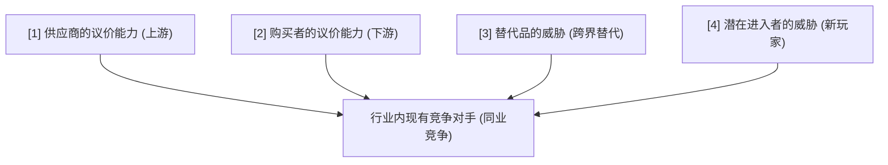
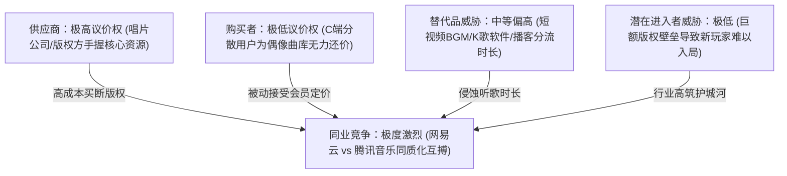
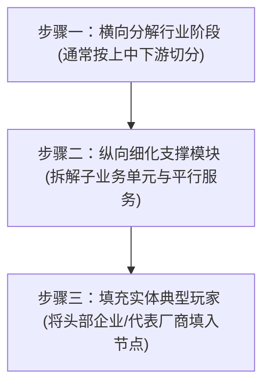
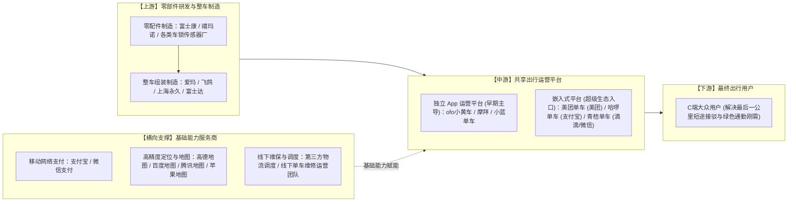

# 1.6-1.7 【实操】波特五力竞争分析与产业地图分析

> [!IMPORTANT] 核心提要
> 在完成 PEST 宏观大环境扫描之后，产品经理必须进一步下沉到**中观产业层级**，深入洞察行业内部的**竞争博弈态势**与**产业链条分工全景**：
> 1. **波特五力模型（Porter's Five Forces）**：由迈克尔·波特提出，侧重于从**利益博弈**视角，衡量行业内五股核心力量的对抗强弱与议价能力，揭示行业利润池的分配逻辑与进入吸引力；
> 2. **产业地图分析（Industry Map）**：侧重于从**生态结构**视角，将行业划分为上中下游并细化核心支撑模块，标注实体玩家落位，清晰展现业务流、价值流与合作供给关系。

---

## 一、波特五力竞争态势分析模型

### 1. 五大竞争力量构成与内在机理
波特认为，一个行业的竞争程度与最终盈利能力，取决于五种核心竞争力量的综合博弈：

* **[1] 供应商的议价能力（上游）**：上游提供原材料、核心零配件或关键版权资源的机构，对其买方（本行业平台/企业）讨价还价的能力。
* **[2] 购买者的议价能力（下游）**：下游最终消费者或采购企业对本行业产品/服务讨价还价的能力。
* **[3] 替代品的威胁（跨界替代）**：属于不同行业形态、但在本质上能满足用户相同需求的产品或服务。
  * **典型概念辨析（同行竞争 vs 替代品）**：喝绿茶与喝红茶，属于同一个茶饮行业内部的“同业竞争”；而用咖啡、奶茶或矿泉水满足解渴/提神需求，则属于“替代品”威胁。
* **[4] 潜在进入者的威胁（外来新玩家）**：当前尚未在该行业经营，但拥有雄厚资本、技术或渠道实力，能够轻易跨界切入并打破行业平衡的潜在对手。
* **[5] 行业内现有竞争对手的博弈（同业竞争 - 核心力量）**：同赛道现有玩家在产品功能、价格、服务及市场份额上的直接肉搏，通常表现为产品同质化与恶性价格战。

### 2. “议价能力”的通俗本质解读
* **何为议价能力**：即俗称的“讨价还价能力”。其高低取决于**双方供求关系的紧迫度与可替代选择的多寡**。
* **生活化通俗案例（菜市场买菜法则）**：
  * **买方议价能力强**：菜贩子堆积了大量快变质的蔬菜急于出清，而整条街有几十家同类摊位且顾客并不急需，此时顾客拥有极高议价权，能大幅压价；
  * **卖方议价能力强**：台风过境后全市场仅有一家摊位有新鲜蔬菜，而顾客家中急缺做饭食材，此时菜贩子拥有极高议价权，不接受任何还价。

---

## 二、实战案例剖析：在线音乐平台波特五力深度分析

以国内主流在线音乐平台（腾讯音乐 TME 旗下 QQ 音乐 / 酷狗音乐 / 酷我音乐，以及网易云音乐）为例，展开五力博弈推演：

### 1. 供应商议价能力（极强 / 处于强势地位）
* **角色定位**：拥有音乐作品独家版权的海内外唱片公司（如环球、索尼、华纳等）及头部知名音乐人工作室。
* **博弈现状**：在线音乐平台必须依赖正版曲库才能吸引用户。核心版权具有不可替代的垄断属性，版权方手握稀缺资源，遵循“价高者得”或逼迫平台签订天价预付保底协议。平台议价空间极小，处于极其被动的买方地位。

### 2. 购买者议价能力（极弱 / 处于弱势地位）
* **角色定位**：C 端广大个人听歌爱好者及明星粉丝。
* **博弈现状**：用户对特定偶像歌手的曲库具有高度情感粘性。平台将热门歌曲设为 VIP 专享，每月十余元的订阅费用处于大众普遍承受区间。分散的个人消费者既无法联合向平台压价，也无法在其他免费渠道合法获取同等体验，只能被动接受平台的定价策略。

### 3. 替代品威胁（中等偏高 / 碎片化分流）
* **替代场景**：听音乐的本质需求之一是“打发碎片化闲暇时间”与“情绪共鸣”。
* **典型替代品**：
  * **短视频平台（抖音、快手）**：通过 15 秒热门 BGM 与视觉刺激，大幅蚕食用户的纯音频使用时长；
  * **K 歌软件（全民 K 歌、唱吧）**：将单向倾听升级为双向互动参与；
  * **线下音乐节与演唱会**：提供无可比拟的临场视听体验；
  * **播客与长音频（小宇宙、喜马拉雅）**：在通勤场景下成为听音乐的重要替代选择。

### 4. 潜在进入者威胁（极弱 / 行业壁垒极高）
* **准入门槛**：在线音乐行业已被行业先发者筑起了极高的资金壁垒与版权城墙。新入局者不仅需要支付百亿级的全量版权采购费用，还需承担海量服务器带宽及 CDN 成本。当前除了兼具资本与流量的超级巨头（如字节跳动推出汽水音乐做局部试探）外，普通创业团队与资本几乎不再可能平地崛起新平台。

### 5. 行业内现有竞争对手的博弈（极强 / 同质化焦灼）
* **竞争格局**：行业已进入存量博弈期。各大平台的核心播放功能、UI 界面布局高度同质化；由于反垄断政策解除部分独家协议，竞争从单一的版权封锁演变为围绕社区评论氛围（网易云“网抑云/云村”文化）、Live 现场直播联动、智能算法推荐准确度及车载端生态的全方位缠斗。

---

## 三、产业地图分析（Industry Map Analysis）

### 1. 什么是产业地图
* **核心定义**：产业地图是对某一特定产业格局进行**结构化、全景式、可视化**的推演表达。
* **核心价值**：帮助产品经理与业务团队俯瞰全产业链的运转法则，明确上游供给方是谁、下游买单方是谁、中游核心枢纽由哪些模块组成，厘清价值流动路径，识别潜在合作伙伴与直接竞品。

### 2. 波特五力模型 vs 产业地图分析的核心差异

> [!WARNING] 实操避坑：两大分析工具定位切勿混淆
> * **波特五力侧重于“博弈与权力分配”**：研究力量强弱、谁在剥削谁的利润、行业受谁制约，输出的是**竞争态势与战略应对结论**；
> * **产业地图侧重于“全景与角色定位”**：研究产业链由哪些环节串联、每一个节点上有哪些真实企业在参与、业务数据从哪里流向哪里，输出的是**全产业链结构图谱与玩家落位矩阵**。

### 3. 产业地图绘制的三大标准化步骤

* **步骤一：分解行业阶段（横向流向切分）**：
  * **上中下游划分法（最常用）**：上游（核心部件与生产制造）、中游（平台运营与整合分发）、下游（最终消费与商业客户）；
  * **生命周期/时间顺序法**：部分注重前后道工序的项目，可按项目推进时间链条切分。
* **步骤二：细分阶段模块（结构化细化）**：
  * 针对中游核心平台进行二级分类（例如独立 App 平台 vs 宿主嵌入式平台）；
  * 补充横向平行的“基础支撑服务商”（如底层支付结算、地图位置 LBS、硬件维保与线下调度等）。
* **步骤三：填充典型玩家（Entity Mapping）**：
  * 在每个具体模块中，调研并填入行业头部上市公司、独角兽企业或代表性品牌，完成行业图谱闭环。

---

## 四、深度实战案例：共享单车产业地图全景绘制

以共享单车出行行业为例，严格按照三步法推演绘制产业地图：

### 共享单车产业各节点详细映射
1. **上游产业链**：
   * **零配件制造商**：提供智能车锁芯片、GPS/北斗定位模块、太阳能电池板、特种免充气轮胎（如富士康代工模组、精密传动部件等）；
   * **整车组装厂**：传统自行车制造巨头（如天津飞鸽、爱玛运动、上海永久等），为共享单车品牌提供大规模标准化代工量产。
2. **中游运营平台**：
   * **独立平台模式**：需要用户单独下载 App 并缴纳押金运营的平台（以早期的 ofo 小黄车、摩拜单车独立 App 为代表，因获客成本高已基本退出历史舞台）；
   * **嵌入式生态模式**：依托巨头超级流量入口（如支付宝内置哈啰单车、美团 App 内置美团单车、滴滴出行/微信生态内置青桔单车），免押金且即用即走。
3. **横向基础支撑服务商**：
   * **网络在线支付**：微信支付、支付宝；
   * **位置服务（LBS）**：高德地图、百度地图、腾讯位置服务（提供精准电子围栏划定与逆向寻车导航）；
   * **线下运维调度体系**：城市网格化巡检、破损车辆回收维保、潮汐运力平衡货车车队。
4. **下游终端客群**：
   * 地铁与公交接驳的都市通勤白领、校园师生、短距离休闲代步群体。

---

## 五、实操方法论的取舍与组合应用原则

在实际产品规划或行业研报编写中，面对 PEST、波特五力与产业地图三大工具，切忌盲目“堆砌模型”：

1. **优先复用权威现成资产**：若艾瑞、麦肯锡、洞见研报等专业智库已发布近期与业务 100% 契合的产业地图或五力模型，产品经理应直接引用并标明出处，把精力聚焦在微观业务落地；
2. **依据核心目标定向挑选 1～2 种**：
   * 若业务处于 **“要不要进赛道、是否会被巨头或供应链掐死”** 的决策期：首选**波特五力模型**，研判利润池与谈判话语权；
   * 若业务处于 **“找谁供货、怎么整合上下游生态资源、自身定位卡位”** 的规划期：首选**产业地图分析**，梳理业务流向与合作边界；
3. **二者可协同互补**：产业地图梳理出的上中下游实体，恰好对应波特五力中的供应商（上游）、客户（下游）与同业竞品（中游），两者互为推导依据。

---

## 六、全景对比与速查矩阵（Cheat Sheet）

| 分析工具 | 核心分析视角 | 解决的关键业务问题 | 核心产出物 | 经典实战案例 | 避坑警示 |
| :--- | :--- | :--- | :--- | :--- | :--- |
| **波特五力模型 (Porter's Five Forces)** | 中观微观跨界博弈、权力与利润池分配 | 这个行业赚钱容不容易？利润被谁盘剥？平台话语权大不大？ | 五股力量强弱评估矩阵及应对策略 | 在线音乐平台（上游版权方极度强势，同业高度同质化） | 切忌把满足相同需求但形态不同的“替代品”误当成“同业竞争对手”。 |
| **产业地图分析 (Industry Map)** | 产业链生态结构、实体分工与价值流动 | 行业由哪些环节构成？上中下游分别有哪些企业？自身处于什么生态位？ | 结构化产业全景图（含支撑模块与玩家落位） | 共享单车全产业链（零部件制造 $\rightarrow$ 整车制造 $\rightarrow$ 嵌入式平台 $\rightarrow$ 基础服务支撑 $\rightarrow$ 终端用户） | 切忌只画单链条，必须补充横向不可或缺的基础支撑服务商（如支付、定位、运维）。 |
| **二者组合应用** | 结构与动力的系统化推演 | 既搞清行业“有哪些人、怎么流转”，又搞清“谁说了算、怎么分钱”。 | 完整产业分析章节 | 从共享单车产业图谱映射出单车制造端与互联网巨头生态入口之间的议价权力转移。 | 调研报告切忌生搬硬套全部模型，按业务目标挑选最契合的 1～2 种深入展开即可。 |
