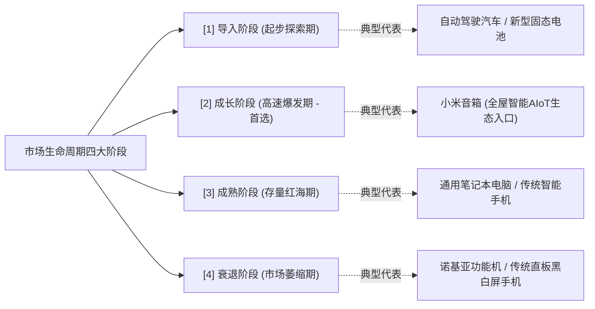
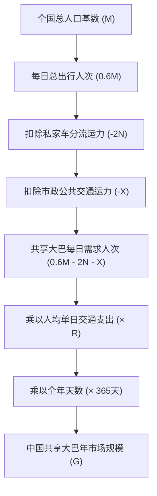
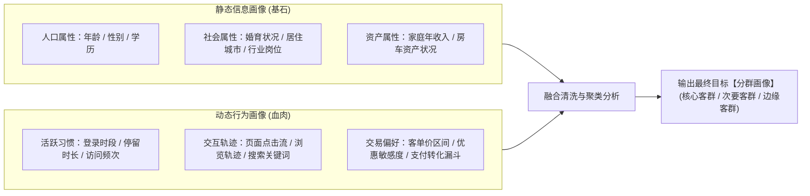

# 1.8 【实操】市场阶段判断与市场规模测算方法（上+下）

> [!IMPORTANT] 核心提要
> 当产品经理完成宏观外部环境与产业链竞争分析后，业务决策必须落地到具体的细分市场研判。本节解决三大核心问题：
> 1. **市场阶段判断（Market Stage）**：明确目标市场所处的生命周期阶段，决定“该不该在当前时机切入”；
> 2. **市场规模测算（Market Sizing）**：掌握产品经理核心的“费米估算”逻辑推演框架，算清“蛋糕到底有多大、值不值得做”；
> 3. **目标用户画像（User Persona）**：融合静态信息画像与动态行为画像，明确“谁是核心买单用户、他们的共性诉求是什么”。

---

## 一、市场生命周期阶段判断与切入时机抉择

与 NPDP 体系中产品生命周期相呼应，市场发展同样经历**导入阶段（引入期）**、**成长阶段（成长期）**、**成熟阶段（成熟期）**与**衰退阶段（衰退期）**四大阶段：

### 1. 经典产品市场阶段连线实战解析
* **自动驾驶汽车 $\rightarrow$ 导入阶段**：虽然热度极高，但根据行业技术路线图划分（L1 至 L5），当前大多仍处于早期辅助驾驶阶段，底层高能量密度电池、超算芯片算力、极端路况安全冗余等技术难关尚未完全攻克，行业标准与法律法规仍在制定中。
* **小米音箱 $\rightarrow$ 成长阶段**：作为传统硬件，单一音频音箱的制造技术早已饱和；但将小米音箱置于 **AIoT（物联网）与智能家居** 生态中，它扮演着全屋智能的语音交互核心中枢入口。当前智能家居渗透率仍处于向大众家庭加速普及的爬坡期，故属于成长阶段。
* **通用笔记本电脑 $\rightarrow$ 成熟阶段**：各大品牌（联想、戴尔、惠普、华硕等）产品配置、外观架构高度同质化，技术更迭趋于平缓，市场进入存量置换期。
* **诺基亚直板功能手机 $\rightarrow$ 衰退阶段**：尽管诺基亚在通信基站与网络设备领域仍是全球仅次于华为的核心供应商，但其昔日辉煌的塞班系统与物理按键直板手机业务已被触摸屏智能手机彻底颠覆淘汰。

### 2. 商业切入时机的理性决策逻辑

> [!WARNING] 实战抉择：切勿在成熟期与衰退期盲目入场
> * **绝不切入【衰退期】**：市场需求不可逆萎缩，用户快速流失，入场即当“接盘侠”。
> * **极力规避【成熟期】（红海市场）**：成熟市场如同挤满参赛者的游泳池，先发巨头已建立起坚不可摧的供应链与渠道壁垒，后发初创产品缺乏独特核心优势，极易沦为价格战炮灰。
> * **有条件选择【导入期】（高风险高回报）**：需要承担巨额前置研发成本与市场教育成本，充当“摸着石头过河”的探路者。若能成功跨越鸿沟即可制定行业标准，但面临技术方向走偏或资金断裂的致命夭折风险，仅适合研发资金雄厚的先锋巨头。
> * **强烈推荐【成长阶段】（蓝海向主流跨越的最佳窗口）**：产品已完成前期概念验证，市场接受度逐步攀升，未来商业走向清晰；行业格局尚未完全固化，仍有充足的市场空白可供后发者突围抢占。

---

## 二、市场规模测算方法（Market Sizing 推演逻辑）

### 1. 产品经理掌握市场规模测算的本质
* **核心考察本质**：在求职面试或公司内部开启全新业务线立项时，业务方常抛出冷门甚至从未涉足的赛道规模估算题。**面试官与高管绝非要求给出绝对精准的审计数字，而是考核产品经理面对未知复杂问题时的底层逻辑思维、变量抽象能力与结构化拆解推演框架。**
* **专业咨询公司深度核算 vs 产品经理费米估算**：
  * **咨询公司**：多端口收集一手调研数据、建立多元回归统计模型、大规模消费者抽样问卷、清洗校对、交叉验证；
  * **产品经理（费米估算）**：明确核心变量约束，构建供需平衡或漏斗转化方程，实现合理的量级推导。

---

### 2. 估算模型一：中国共享大巴市场规模测算（供需运力排除法）

#### （1）业务概念边界界定
共享大巴绝非任何人投币即上的普通市政公共交通（公交车/地铁），而是指**受特定区域、企业主体或团体约定的集约化客运服务**，例如企业园区上下班定制员工班车（如中电软件园专线）、跨城集体团建/会展包车租赁等。

#### （2）参数假设与变量定义
* 设全国总人口基数为 $M$ 人；
* 设每日有确定城市出行需求的人群占比为 $60\%$，则每日出行总人次为 $0.6M$；
* **互斥替代运力排除**：
  * 市场上现有私家车/网约车总数为 $N$ 辆，按每车平均实际运载 $2$ 人计算，每日私家车运力分流为 $2N$ 人；
  * 市政公共交通（公交、地铁、轻轨等）每日总运力设为 $X$ 人；
* 设人均单日城市交通出行消费支出为 $R$ 元。

#### （3）数学推演公式构建
必须乘坐共享大巴的每日潜在消费人群，等于总出行人群扣除两类主要互斥运力：

$$\text{每日共享大巴消费人次} = 0.6M - 2N - X$$

$$\text{年市场规模（元）} = [(0.6M - 2N - X) \times R] \times 365$$

---

### 3. 估算模型二：在线在职 MBA 培训市场规模测算（漏斗式自上而下法）

以在线教育机构评估开辟在职 MBA 考研辅导赛道为例，通过层层漏斗过滤核心刚需客群：

```mermaid
flowchart TD
    Step1["全国总人口基数：14 亿人"] --> Step2["资格门槛过滤：满足大专/本科及工作年限硬性要求的比例 (70%)"]
    Step2 --> TargetPool["符合报考资质客群：9.8 亿人"]
    TargetPool --> Step3["意愿漏斗：具备考研提升与就读MBA意愿比例 (20%)"]
    Step3 --> IntendPool["潜在报考人群：1.96 亿人"]
    IntendPool --> Step4["付费转化：不选择完全自学、具备报班培训意向比例 (20%)"]
    Step4 --> FinalUsers["最终目标付费学员基数：3,920 万人"]
    FinalUsers --> Step5["客单价区间乘积：5,000 元 ～ 20,000 元 (行业均价约 10,000 元)"]
    Step5 --> TotalRevenue["MBA在线培训市场空间：1,960 亿 ～ 7,840 亿元 (均值约 3,920 亿元)"]
```

#### （1）详细参数漏斗拆解
1. **全国总人口基数**：$14\text{ 亿人}$；
2. **法定学历与工龄资质过滤**：报考 MBA 要求大学本科毕业后有 3 年以上工作经验，或大专毕业后有 5 年以上工作经验。结合适龄劳动人口结构，假设符合报考条件门槛的人群占比为 **$70\%$**；
3. **真实考研进阶意愿**：在符合资格的人群中，有职场晋升焦虑、名校背书需求或人脉拓展意向的客群比例假设为 **$20\%$**；
4. **报班付费意愿比例**：在有报考意向的考生中，排除自学备考群体，认可在线课程并愿意支付培训费用的比例假设为 **$20\%$**；
5. **行业课单价区间**：市面在职 MBA 辅导主流客单价区间为 **$5,000 \sim 20,000\text{ 元}$**（取基准平均课单价 $10,000\text{ 元}$）。

#### （2）数学计算过程
* **最终目标培训学员基数**：
  $$14\text{ 亿} \times 70\% \times 20\% \times 20\% = 3,920\text{ 万人}$$
* **年潜在市场规模测算区间**：
  * **保守估值（按 $5,000\text{ 元}$ 课单价）**：$3,920\text{ 万人} \times 5,000\text{ 元} = 1,960\text{ 亿元}$
  * **基准估值（按 $10,000\text{ 元}$ 均价）**：$3,920\text{ 万人} \times 10,000\text{ 元} = 3,920\text{ 亿元}$
  * **乐观估值（按 $20,000\text{ 元}$ 课单价）**：$3,920\text{ 万人} \times 20,000\text{ 元} = 7,840\text{ 亿元}$

---

## 三、目标用户画像（User Persona）构建全流程

市场规模明确后，产品经理必须回答“这个市场中的典型用户到底是谁”。

### 1. 用户画像的本质定义
用户画像不是某一个真实具体的人，而是**建立在一系列真实数据之上的目标用户模型（虚拟代表）**，是对某特定客群共同特征、偏好、痛点与行为模式的抽象提炼。

### 2. 双支柱数据支撑：静态信息画像 vs 动态行为画像

* **[1] 静态信息画像（基本属性）**：
  * **核心内容**：年龄、性别、最高学历、婚姻状况、居住城市等级、工作年限、家庭收入等；在短时间内保持相对稳定。
  * **获取途径**：平台注册必填项、实名认证绑定、第三方快捷授权登录（微信、QQ、手机号一键认证等）。
* **[2] 动态行为画像（网络行为轨迹）**：
  * **核心内容**：用户在 App/网页内的实时操作行为——什么时段打开、停留多长时间、点击了哪些组件、完整浏览路径（从哪进、从哪出）、跳出率与购买转化周期。
  * **获取途径**：前端全埋点或代码埋点（SDK 数据抓取）、服务器访问日志清洗与大数据分析。
* **[3] 终极产物：分群画像（分级运营与产研排期）**：
  * 一个成熟的产品不可能只有单一的用户画像。通过对静态与动态数据的交叉聚类，通常提炼出：**核心理想型用户（优先级最高）**、**次级潜在用户**、以及**长尾边缘用户**，为产研功能设计提供明确的侧重基准。

---

## 四、全景对比与速查矩阵（Cheat Sheet）

| 核心分析模块 | 核心分析模型 / 公式 | 核心输入变量 | 产出成果与业务指导价值 | 实操避坑指南 |
| :--- | :--- | :--- | :--- | :--- |
| **市场阶段判断** | 市场生命周期（导入期 $\rightarrow$ 成长期 $\rightarrow$ 成熟期 $\rightarrow$ 衰退期） | 技术突破度、竞争烈度、用户认知普及度、标准确立状态 | 决定产品进入时机，**首选成长期切入**，避开成熟期红海与衰退期萎缩 | 避免孤立看待硬件，需结合其所处的战略生态位（如小米音箱置于 AIoT 智能家居中处于成长期）。 |
| **市场规模估算 (排除法)** | $\text{规模} = [(0.6M - 2N - X) \times R] \times 365$ | 总人口 $M$、私家车总运力 $2N$、市政公共运力 $X$、人均消费 $R$ | 快速评估具备替代/互斥特征的公共交通服务规模（如共享大巴） | 明确产品定义边界，共享大巴是特定团体的排他性服务，严禁混同于普通公交。 |
| **市场规模估算 (漏斗法)** | $\text{规模} = \text{总人口} \times \text{资质率} \times \text{意愿率} \times \text{报班率} \times \text{客单价}$ | 人口基数、法定资格比例、报考意愿率、付费参培率、课单价区间 | 逐层过滤自上而下计算教育培训、SaaS订阅等赛道的产值天花板 | 面试或立项时不纠结绝对数字准确性，核心在展示环环相扣的逻辑闭环与假设合理性。 |
| **用户画像构建** | 静态信息画像 + 动态行为画像 $\rightarrow$ 分群画像 | 年龄学历城市等人口属性 + 埋点轨迹停留时段等行为属性 | 抽象出具备代表性的典型目标客群，指导功能设计与交互体验优先级 | 绝非凭空捏造单一自然人，中小企业初期可借力友盟等第三方工具或智库行业报告进行画像还原。 |
