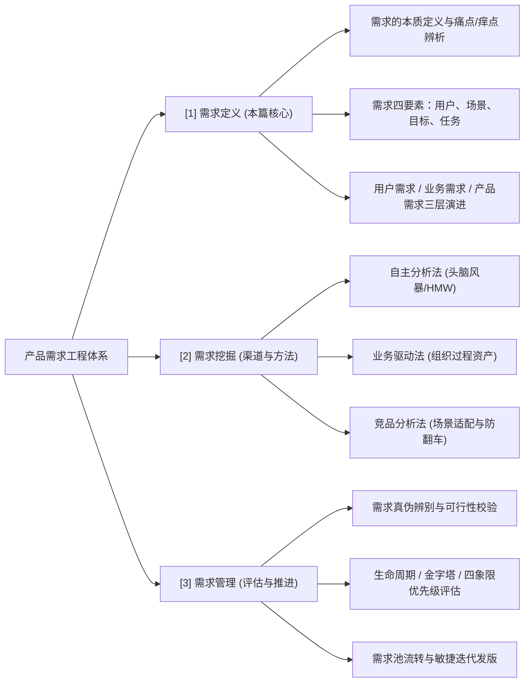
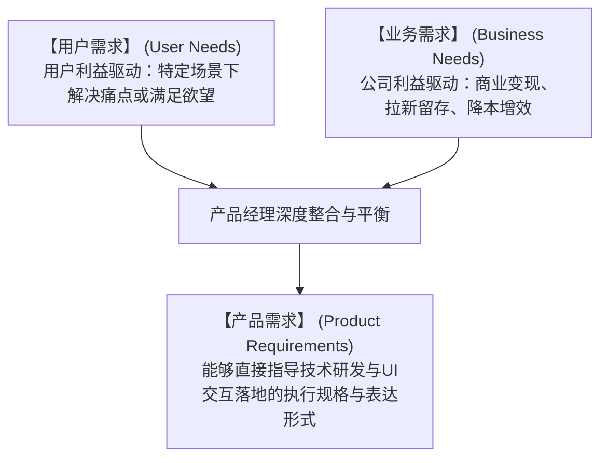
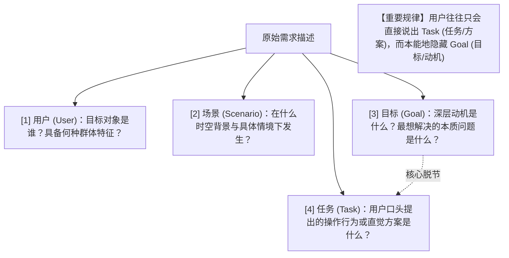
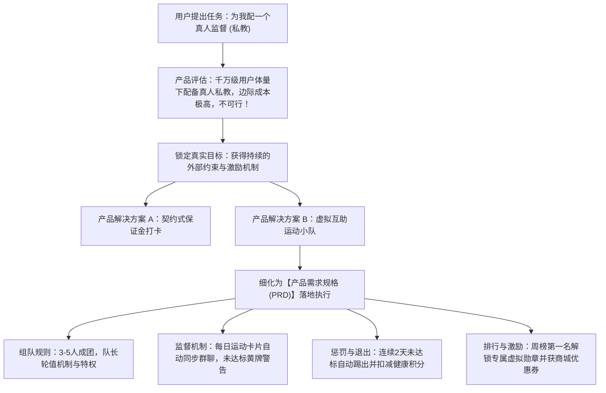
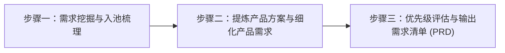

# 2.1-2.2 【实操】需求定义与需求四要素（用户、场景、目标、任务）

> [!IMPORTANT] 核心提要
> 无论宏观市场分析还是微观竞品调研，最终都必须落脚到**“产品做什么、怎么做”**的核心命题上。而做产品的本质，就是**通过不断识别并满足真需求来创造商业与用户价值**。
> 需求工程包含三大支柱模块：**需求定义（Definition）**、**需求挖掘（Mining）**与**需求管理（Management）**。本篇作为需求工程的奠基篇，重点厘清**需求的本质定义**、**用户需求/业务需求/产品需求的三层转化关系**，以及产品经理最强大的透视分析武器——**需求四要素模型（User, Scenario, Goal, Task）**。

---

## 一、需求工程全景体系认知



---

## 二、需求的本质定义与深层内涵剖析

### 1. 什么是需求
* **标准定义**：**需求是用户在特定的场景之下，为了解决某一问题或满足某种欲望，而产生的解决需要的诉求。**
* **生活化通俗案例拆解（《海尔兄弟》主题曲）**：
  * “打雷要下雨，下雨要打伞；天冷穿棉袄，天热脱衣穿衫”；
  * **辨析**：“打雷、下雨、天冷、天热”是客观**场景**或环境状态，其本身不是需求；在下雨场景下，人为了“不被雨水淋湿身体”（**问题解决**）而产生“想要一把伞来遮雨”的需要，这才是真正的**需求**；至于把伞做成手动的、折叠的、自动弹开的还是扫码共享的，则是后续衍生的**产品功能方案**。

### 2. 需求的层次拓展：痛点 vs 痒点 / 兴奋点
* **痛点（基本问题解决 - 基础型需求）**：在极度饥饿的场景下，为了解决温饱生存问题，给用户一碗白米饭或一个白馒头，痛点即被完全消除。
* **痒点 / 兴奋点（欲望追求 - 增值型需求）**：在基础温饱满足后，用户追求满汉全席、极致摆盘、发朋友圈拍照炫耀、享受尊贵服务体验。这种追求“吃得更爽、更有格调、获得社交认可”的心理，属于在解决基础问题之上的欲望延展，是产品构建差异化溢价与高粘性的关键。

### 3. 亨利·福特名言的世纪拷问：分清“需求”与“方案”
> “如果当时我问人们想要什么，他们会说：我想要一匹更快的马。”

```mermaid
flowchart TD
    Customer["用户口头表达：我想要一匹更快的马"]
    Customer --> Analysis{"产品经理底层透视"}
    
    Analysis -->|表象方案 (Task)| Solution["马 (用户基于当时认知局限提出的方案)"]
    Analysis -->|本质需求 (Goal)| RealGoal["更快 (缩短从A点到B点通勤时间的诉求)"]
    
    RealGoal --> Breakthrough["更高维产品解决方案"]
    Breakthrough --> Car["汽车 (比马快数倍，颠覆出行)"]
    Breakthrough --> Airplane["飞机 (比汽车更快，跨越洲际)"]
```

> [!WARNING] 实战警示：严禁把“用户提出的方案”直接当作“产品需求”
> * **平庸产品经理的通病（传话筒）**：客户或领导说要加什么按钮就直接交给开发加什么按钮，把用户基于自身狭窄认知提出的表层“任务/方案”当成“真需求”，最终导致产品功能臃肿不堪、逻辑支离破碎、越改越乱。
> * **优秀产品经理的法则**：洞察用户口头诉求背后的**本质动机与底层目标**。如果用户知道汽车比马更快，他们绝不会再坚持要马；如果知道飞机比汽车更快，他们会渴望登机。产品经理的价值在于：**在探明用户真实目标后，设计出超越用户认知边界的最佳解决方案！**

---

## 三、用户需求、业务需求与产品需求的三层转化体系

在日常产品研发中，需求必然由两条主线汇聚，并最终转化为产品落地规格：



### 1. 三大需求概念的本质区隔
* **用户需求**：**用户利益驱动**。解决的是终端用户的切身问题（如方便快捷转账、打发无聊时间、自我技能提升）。
* **业务需求**：**公司商业利益驱动**。解决的是企业生存与增长问题（如广告创收、增加高毛利 VIP 订阅、拉新裂变获客、延长用户使用时长、提升客单价 GMV）。
* **产品需求**：**产品经理针对用户需求与业务需求的平衡表达**。它是将宏观方案拆解为**可被研发工程师与 UI/UX 设计师无歧义理解并执行的详细功能规格、交互逻辑与技术规则**。

### 2. 三款国民级 App 页面实战透视

| 产品界面 | 用户需求层（用户要什么） | 业务需求层（公司要什么） | 产品需求落地层（研发怎么做） |
| :--- | :--- | :--- | :--- |
| **微信支付界面** | 快速扫码付款、离线付款码展示、收付款账单清晰实时可查（解决便捷安全交易痛点）。 | 底部九宫格与第三方商户资源位（美团、滴滴、拼多多入驻），实现平台海量流量商业变现与利润分成。 | 界面分为上部核心收付款功能区与下部生活/金融服务区；按生活服务与金融理财进行网格化模块布局与权限控制。 |
| **爱奇艺视频播放页** | 海量高清视频流畅播放、无卡顿播放器、全屏手势调节亮度音量（解决碎片时间无聊娱乐痛点）。 | 右上角引导开通 VIP 会员、视频前后贴片广告、引导一键分享到微信群（提升平台拉新裂变与商业变现）。 | 会员与非会员播放清晰度限制规则、广告倒计时跳过逻辑、基于用户历史观看兴趣标签构建协同过滤个性化推荐流。 |
| **主流资讯新闻客户端** | 实时获取重大新闻要闻、查看深度热点评论、搜索行业知识（满足求知与信息获取需求）。 | 信息流中穿插原生赞助广告位、诱导点击推广链接（增加商业广告曝光量与点击转化率收入）。 | 原生广告混排规则（例如每隔 5 条资讯插入 1 条标记明显的商业推广）、个性化兴趣算法模型持续迭代优化。 |

---

## 四、需求四要素模型（User, Scenario, Goal, Task）实战拆解

需求四要素是产品经理开展需求分析最基础、最精密的解构框架：



---

### 实战案例 1：通勤听歌需求拆解
* **原始需求**：“小明希望能够在上下班的公交车上听歌。”
* **四要素深度解构**：
  * **用户（User）**：小明 $\rightarrow$ 抽象为“早晚高峰依赖公共交通出行的年轻职场白领群像”；
  * **场景（Scenario）**：上下班路上，身处嘈杂、拥挤、颠簸的公交或地铁车厢内；
  * **目标（Goal）**：核心动机是**打发无聊时间**（亦可能包含“隔绝车厢嘈杂噪音”、“闭目养神发呆放松”）；
  * **任务（Task）**：戴上耳机打开音乐 App 听歌。
* **产品经理启示**：
  * 如果调研确认用户核心目标是“打发无聊时间”，那么**听歌绝非唯一解法**！
  * 看电子书、刷短视频、玩休闲小游戏、听播客广播，均可作为满足该目标的优质产品备选项。

---

### 实战案例 2：App 详情页改版被用户吐槽的反思
* **用户原始反馈**：“新版商品详情页太难用了！请立刻改回以前‘左滑直接进入商品详情’的交互模式！”、“切换书籍信息居然必须一直滑到底部，极其反人类！”
* **四要素与目标透视**：
  * 用户口头提出的 **Task（任务）** 是“回退旧版本”、“还原左滑手势”；
  * 但用户的真实 **Goal（目标）** 是**“希望在列表页能够以最低的交互成本、极快地获取商品/书籍的关键核心信息”**。
* **产品经理应对策略**：
  * 切忌因一两句差评就盲目回滚版本；
  * 应当在保留新架构优势的同时，针对其真实目标进行交互微调（例如增加卡片轻触浮层快速预览、优化首屏核心信息层级密度），以更优雅的产品方案兼顾体验与框架迭代。

---

### 实战案例 3：Keep“找个人监督我运动”全流程落地推演
* **用户原始反馈**：“我想找一个人来监督我每天运动。”
* **四要素解构**：
  * **用户（User）**：Keep 健身爱好者（典型心理特征：自控力薄弱、常态化拖延、有强烈的减脂塑形愿望但意志力易瓦解）；
  * **场景（Scenario）**：下班回家后身心疲惫，缺乏自我驱动力，独自运动极易半途而废；
  * **目标（Goal）**：**借助持续的外部约束力与正向心理激励，克服惰性，按期达成健身目标**；
  * **任务（Task）**：找一个真人每天盯着我。



> [!IMPORTANT] 核心升华：产品解决方案 vs 产品需求规格的根本区别
> * **产品解决方案**：指出业务探索的**宏观方向**（例如“通过组队互相监督”或“通过缴纳保证金对赌打卡”）。它指引了方向，但**无法直接交付开发写代码**。
> * **产品需求（PRD 规格）**：必须穷尽**所有的交互细节、异常分支、规则边界与数据逻辑**：
>   * 组队人数上限是多少？是主动建队拉人还是系统智能匹配同城跑友？
>   * 谁来当队长？队长能否剔除掉队成员？群名称能否修改？敏感词如何过滤？
>   * 每日运动打卡数据是实时刷新还是次日凌晨统一结算？
>   * 保证金模式中，资金托管通道如何对接？退款流程是按日退还还是全周期完成后统一退还？如果银行卡原路退回失败如何短信触达用户？
>   * **判定合格标准**：产品需求是否能够让研发工程师、测试工程师直接无歧义地展开编码与用例编写。

---

## 五、需求分析的四大原则与三大落地步骤



### 1. 需求分析的四大核心原则
1. **追根溯源**：对收到的每一个需求刨根问底，核查其原始背景、提出人真实业务场景，确保数据源真实可靠。
2. **抽丝剥茧**：穿透表面纷繁复杂的诉求表象，剥离主观情绪，精准锁定底层的核心动机与业务目标。
3. **辨别真伪**：严格剔除伪需求。必须通过“证明需求客观存在”、“需求具有普遍代表性而非极端偶发”、“研发成本与投资回报率（ROI）合理”三重校验。
4. **决策判断**：依据产品整体战略，果断决策“做不做（Go/No-go）”、“何时做（排期阶段）”以及“如何以最低研发成本优雅实现”。

---

## 六、全景对比与速查矩阵（Cheat Sheet）

| 核心概念 / 要素 | 核心定义与内涵 | 典型实战表达案例 | 产品经理决策误区 | 落地规范与检验标准 |
| :--- | :--- | :--- | :--- | :--- |
| **用户需求 (Needs)** | 用户在特定场景下解决痛点或欲望的需要 | “我要更便宜快捷地从家到地铁站” | 把用户的抱怨当成产品必须履行的指令 | 必须回归到用户群像与场景中验证是否具备广泛共性。 |
| **业务需求 (Business)** | 公司商业利益驱动的创收、增长或降本指标 | “本季度微信端要新增 10 个第三方商业导流位” | 忽视用户体验，过度商业化导致用户流失 | 商业诉求必须克制，在不损害核心主流程体验的前提下合理穿插。 |
| **产品需求 (Requirements)**| 经整合平衡后能直接指导研发落地的功能规格 | 组队人数限制、异常退款状态机、定时刷新逻辑 | 只给大方向概念（“做个组队功能”），缺少细节规则 | 必须具备明确的前置条件、操作流程、异常分支与数据落库规范。 |
| **四要素：用户 (Who)** | 产品的目标对象与典型人群抽象 | “自律性差但渴望塑形的减脂人群” | 泛泛而谈“所有大众”，导致客群特征模糊 | 提取核心共性特征标签，支撑后续功能针对性设计。 |
| **四要素：场景 (Where/When)**| 诉求产生的时间、物理空间与上下文情境 | “拥挤颠簸、无座位的早高峰地铁车厢” | 忽略物理约束，设计了需要双手高频复杂操作的交互 | 场景决定了交互方式（如单手操作、暗黑模式、弱网适配）。 |
| **四要素：目标 (Why/Goal)** | 用户最根本的动机与需要解决的核心本质 | “在通勤路上打发无聊时间” | 把表象手段（听歌）误认为最终终点（目标） | 目标是衡量后续所有替代性技术方案有效性的唯一度量衡。 |
| **四要素：任务 (How/Task)** | 用户受限于现有认知所直觉提出的操作手段 | “找个真人私教 1 对 1 每天发微信监督我” | 用户提什么功能就给开发排期做什么功能 | 剖析任务背后的目标，用成本更优、可规模化的产品方案替代。 |
