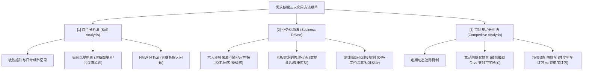
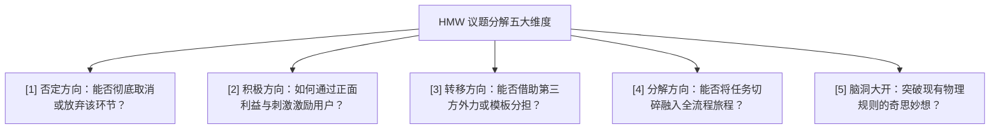
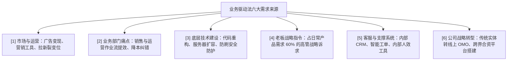
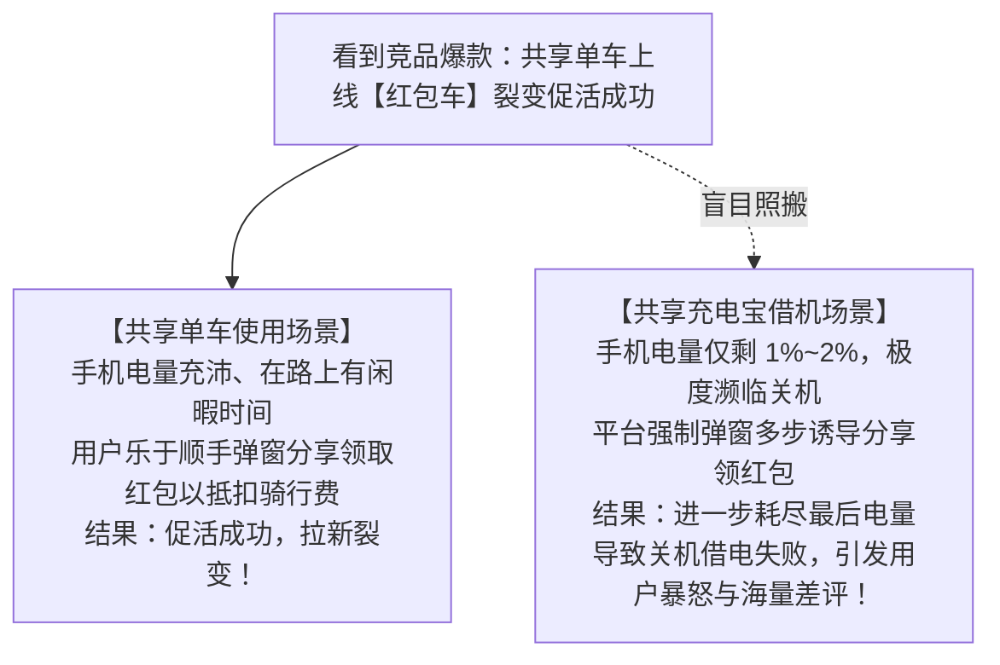

# 2.3 【实操】需求挖掘三大方法（自主分析法、业务驱动法、竞品分析法）

> [!IMPORTANT] 核心提要
> **需求挖掘（Requirements Mining）**解决的是“从哪里找到更多、更真实的潜在需求，为后续提炼转化为产品需求提供充沛原料”的核心问题。
> 行业通用的需求挖掘方法涵盖四大阵营：**自主分析法**、**业务驱动法**、**市场竞品分析法**以及**用户研究分析法**。本篇聚焦前三大实用方法的理论框架、操作标准与落地避坑指南。

---

## 一、需求挖掘全景与三大方法概览

---

## 二、方法一：自主分析法与头脑风暴实战

### 1. 自主分析法的核心内涵
* **定义**：产品经理依靠自身对业务的深刻理解、敏锐的感知力、日常产品的深度使用与复盘，自主发现产品的优化空间与潜在需求点。
* **新手与资深产品经理的差距**：面对同一个业务界面或用户反馈列表，资深产品经理能迅速提炼出十余条结构化、高价值的迭代需求，而新手往往一条都看不出来。这取决于日常是否养成了“**随时随地体察细节、体验反思、及时记录**”的职业习惯。

### 2. 头脑风暴法（Brainstorming）的标准执行体系
头脑风暴是团队自主激发需求的最常用工具，但许多团队常常流于形式、无法产出有效结论。高效的头脑风暴必须严守“准备四要素”与“执行四原则”：

#### （1）会前准备四要素
1. **明确议题目标**：聚焦一个清晰明确的具体业务难点，严禁大而无当；
2. **参会规模适度**：以 **5～10 人** 为最佳区间，人太少难以碰撞，人太多极易发散失控；
3. **严格控制时长**：会议严控在 **1 小时以内**，人类大脑高强度思维超过 60 分钟效率将断崖式下跌；
4. **指定专职主持人**：必须配备具备控场与引导能力的会议主持，负责把控节奏与防止偏题。

#### （2）会中执行四大核心原则
1. **自由畅想**：无拘无束，想到什么说什么，鼓励跳出常规框架；
2. **禁止批评**：杜绝自我贬低，严禁在发散阶段批评、反驳或嘲弄他人的任何点子；
3. **独立思考（借力打力）**：严禁交头接耳干扰他人；可以在他人观点的基础之上叠加延伸，但不可中途打断；
4. **追求数量而非质量**：发散阶段“数量第一，质量第二”，先把池子填满，坚决不在前半段做筛选。

---

### 3. 高阶引导工具：HMW 分析法（How Might We，我们可以如何做）
当议题过于庞大抽象时，参会者常陷入无从下手的僵局。此时引入 **HMW 分析模型**，将大难题拆解为五大思考维度：

#### 实战推演：解决“在线教育学员无法按时完成作业、导致学习效果下降”难题

* **[1] 否定维度（世上无难事，只要肯放弃）**：
  * **破局思考**：做作业真的是唯一途径吗？能否让学员彻底不写作业？
  * **落地方案**：取消繁重的课后大作业，改为老师在课堂直播中随堂出小测验，现场随堂消化，课后零负担。
* **[2] 积极维度（利益驱动与正面刺激）**：
  * **破局思考**：如何让学员对做作业产生愉悦感与成就感？
  * **落地方案**：引入连续打卡机制；每提交一份作业奖励学习积分；积分可直接兑换现金红包、高额购课优惠券或实物奖品；设立优秀作业排行榜与班级 PK。
* **[3] 转移维度（移花接木与借助外力）**：
  * **破局思考**：为什么一定要学员从零写起？能不能让别人帮他做，或者平台代劳？
  * **落地方案**：平台提供标准化精美报告模板与工具，学员仅需填空式修改关键参数即可一键生成作业；引入助教 1 对 1 梳理框架。
* **[4] 分解维度（化整为零，步步为营）**：
  * **破局思考**：动辄几千字的竞品分析报告让学员产生严重的畏难情绪与拖延症，如何切碎？
  * **落地方案**：按学员学习旅程切分：
    * 报名期：明确告知作业阶段规划，建立心理预期；
    * 授课期：将大报告拆分为 5 个知识模块，讲完宏观部分先练宏观案例，分步打通；
    * 复习期：系统定时触发 Push 消息与班主任微信提醒；
    * 成果期：阶段性产出打卡与评奖。
* **[5] 脑洞大开维度（突破常规，天马行空）**：
  * **破局思考**：摆脱传统的键盘打字和写字形式，还能怎么交付作业？
  * **落地方案**：把写作业改为“微信语音连线 5 分钟口头汇报”；设计“学霸与学渣积分生态闭环”——高分学员辅导低分学员可获得低分学员消耗的积分，形成互帮互助学习共同体。

---

## 三、方法二：业务驱动法与组织过程资产管理

### 1. 业务驱动法的内涵与六大需求来源
业务驱动法围绕**公司商业变现、组织运营提效、系统技术演进与战略调整**展开，涵盖六大细分端口：

---

### 2. 深度案例拆解：业务部门提出“增加订单导出系统”的辨析
* **场景对话**：
  * 运营提出：“我们需要在管理后台增加一个复杂的订单 Excel 导出系统。”
  * 产品经理追问：“后台已有完善的订单数据统计看板与图表，为什么一定要把数据导出到本地？”
  * 运营回答：“因为后台现有的统计功能，无法单独统计那些**中途被取消的异常订单**！”
* **四要素深度透视**：
  * 运营提出的 **Task（任务）** 是“开发一套订单批量导出系统”；
  * 但运营的真实 **Goal（目标）** 仅仅是“**核算并统计取消状态的订单数据**”。
* **产品经理价值**：在现有后台列表增加一个“订单状态：已取消”的筛选标签与汇总字段，研发仅需半天即可搞定；而盲目开发订单导出系统可能耗费两周工时。**多问几个为什么，避免把表层任务当成底层需求！**

---

### 3. 底层技术类需求：不可忽视的“隐性成本”
代码重构、架构升级、服务器扩容抗高并发、防外挂与防刷单安全盾等底层需求，虽不直接面对终端 C 端用户，但决定了产品的生命周期与抗风险底线。产品经理在版本排期中**必须为技术驱动需求预留 15%～20% 的固定研发资源配额**。

---

### 4. 老板需求的管理心法（高情商与高专业度）
统计表明，产品经理日常接到的需求中，有接近 **60%** 直接或间接来自老板。如何管理老板需求是职场核心生存技能：

> [!IMPORTANT] 老板需求的三大应对法则
> 1. **带着思考去执行**：绝不盲目充当传话筒或立刻拍马屁照办，必须用真实数据、用户调研事实说话；
> 2. **尊重事实，敢于提出更优替代方案**：如果经过严谨调研确认老板提的点子不可行，切忌生硬顶撞，应以开放心态向老板展示数据，并拿出“同样能达成老板目标、但成本更低风险更小”的替代方案；
> 3. **无法证伪时坚决尊重商业直觉**：如果经过深度分析，自己既无法用数据推翻、也没有绝对把握，必须尊重老板凭借多年商业搏杀形成的战略敏感度与商业直觉。

---

### 5. 业务需求规范化对接机制与 OPA 文档化（避坑防甩锅）

> [!WARNING] 实战避坑：口头需求坚决不接，必须文档留痕！
> * **组织过程资产（OPA）价值**：在项目管理中，所有内部需求必须形成正式文档归档。如果某业务部门天天催着产品加功能，开发上线后该部门却根本不用，导致研发资源严重空转浪费；
> * **问责与优先级降级依据**：留存的文档记录是产品经理在复盘会上追责的铁证。对于“提了不用”的部门，产品经理有充分的正当理由将其后续需求全部压至最低优先级；
> * **规范对接模板**：强迫业务方按模板填写，能倒逼业务方深度思考其诉求的合理性。

#### 标准业务需求对接模板核心要素
1. **需求提出人与对接时间**：明确责任人；
2. **需求背景与业务现状**：遇到什么具体业务卡点？
3. **核心目标与衡量指标**：做完此功能后，GMV 提升多少？流失率降低多少？运营人效提升百分之几？
4. **期望解决方案**：业务方预期的操作路径，附参考竞品交互配图；
5. **需求分类**：明确属于日常缺陷优化还是战略专项项目。

---

## 四、方法三：市场竞品分析法与防翻车案例

### 1. 竞品分析法的运作机理
* **定义**：通过持续、系统地追踪同行业核心竞品及跨界标杆的产品动态，从中汲取灵感。**“别人做的好我们追赶，别人做的不好我们超越。”**
* **经典同质化跟进案例**：微信支付推出“鼓励金”后，支付宝迅速上线几乎同等玩法的“奖励金”；手机行业在曲面屏、多摄像头、全面屏形态上的高度快速趋同。
* **定期追踪机制**：竞品追踪绝非心血来潮，产品经理必须建立**按月度/季度的竞品动态监控台账**，并根据企业发展阶段动态调整核心竞品清单。

---

### 2. 深度血泪案例：盲目照搬竞品翻车（共享单车红包 vs 共享充电宝红包）

> [!WARNING] 致命教训：脱离场景的“像素级抄袭”必遭反噬
> 很多产品经理看到其他共享产品推红包大获成功，便毫无逻辑地将红包裂变强加给共享充电宝。
> * **单车用户场景**：手机有电、心态放松，为了省几毛钱愿意多点两次屏幕；
> * **充电宝用户场景**：属于**极度紧急、焦虑的绝地救命场景**！此时用户唯一的刚需是以秒级速度扫码弹出充电宝。多一个弹窗、多一步分享诱导，都会消耗那岌岌可危的最后 1% 电量，甚至直接导致手机黑屏关机无法扫码，给用户带来毁灭性体验。
> * **实操金句**：**参考竞品绝非抄袭表层功能，必须穿透表象，严格论证该功能所依托的“用户场景、心理压力与真实目标”是否与自身产品完全契合！**

---

## 五、全景对比与速查矩阵（Cheat Sheet）

| 挖掘方法 | 核心信息源 | 核心工具 / 实操动作 | 适用场景与优势 | 致命实操避坑警示 |
| :--- | :--- | :--- | :--- | :--- |
| **自主分析法** | 产品经理个人敏锐度、深度体验、团队智慧 | 头脑风暴（4准备+4原则）、HMW 五维拆解法（否定/积极/转移/分解/脑洞） | 0到1功能预研、复杂难题突围；能突破既有业务认知框架 | 切忌在发散阶段批评质疑他人；议题必须聚焦，严格限时 1 小时内。 |
| **业务驱动法** | 市场运营、技术架构、老板指令、客服反馈、战略规划 | 组织过程资产（OPA）留痕、标准需求提报模板、深度追问“为什么” | 支撑公司商业变现、降本增效与系统稳定性；具备极强内部确定性 | 严禁接口头需求；杜绝被动充当传话筒；警惕“提了不用”的资源浪费。 |
| **市场竞品分析法** | 核心直接竞品、垂直竞品、跨界优秀产品 | 定期竞品追踪台账、功能场景还原、差异化超越矩阵 | 快速追赶行业主流标准，降低市场试错与用户教育成本 | **严禁脱离自身用户场景盲目像素级照搬**（谨记共享单车与充电宝红包惨案）。 |
