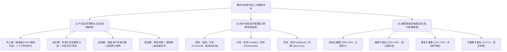
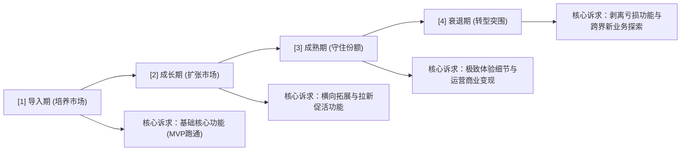
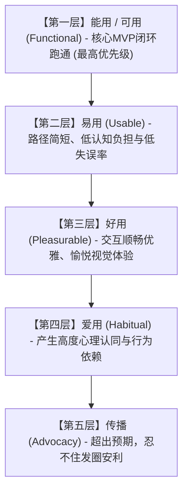
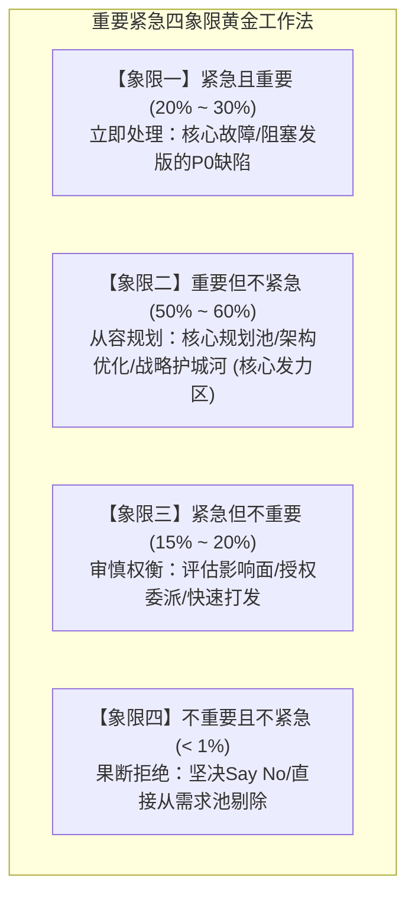
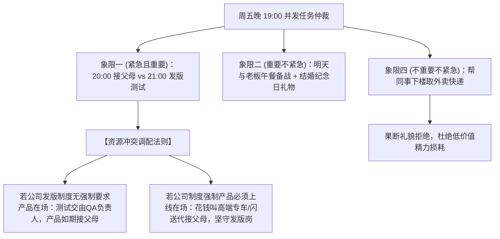

# 2.6 【实操】需求优先级评估三大模型（生命周期、用户金字塔、重要紧急四象限）

> [!IMPORTANT] 核心提要
> 任何企业与产研团队的资源（人力、预算、时间）永远是稀缺有限的，而来自用户、业务、技术与高管的需求永远是无限膨胀的。因此，产品经理的核心功力不在于收集了多少需求，而在于**如何科学、客观地建立规则进行优先级的权衡取舍与论资排辈**。
> 本节重点拆解三大实操评估模型：
> 1. **产品生命周期法**：从**宏观企业发展阶段**，界定各时期研发战略重心；
> 2. **用户使用金字塔模型**：从**微观体验层次**，精准切割“基础能用”与“体验改善”；
> 3. **重要紧急四象限法则**：从**日常执行排期**，实现 50%～60% 重要规划的科学精力布局。

---

## 一、需求优先级评估三大模型全景图

---

## 二、模型一：产品生命周期法（宏观战略维度）

产品在不同发展时期所承担的商业使命截然不同，需求的排期权重必须严格与生命周期对齐：

### 1. 四大阶段功能优先级侧重
* **[1] 导入期（市场培育阶段）**：
  * **战略目标**：以最低成本验证核心假设，完成 0 到 1 破局；
  * **功能侧重**：**坚守基础功能（Must-have）必须稳定跑通**，切忌贪大求全；在基础可用前提下，全力打造 **1～2 个差异化杀手级特色亮点**。
* **[2] 成长期（市场扩张阶段）**：
  * **战略目标**：快速跑马圈地，吞噬市场份额；
  * **功能侧重**：**横向拓展类需求**。扩充产品品类、接入更多第三方支付渠道、丰富营销获客裂变工具、增加社交互动与促活模块。
* **[3] 成熟期（存量博弈阶段）**：
  * **战略目标**：维系既有市场霸主地位，追求商业利润变现；
  * **功能侧重**：**极致用户体验优化需求与商业运营变现需求**。深耕千人千面智能推荐算法，降低操作跳出率，优化客单价与广告转化率。
* **[4] 衰退期（业务转型阶段）**：
  * **战略目标**：延长衰退周期，寻找第二增长曲线；
  * **功能侧重**：**战略转型与新赛道探索类需求**。剔除低效负资产功能，跨界孵化全新子业务形态。

---

### 2. 标杆案例透视：今日头条发展史的演进轨迹
* **导入期**：聚焦“聚合全网资讯”（基础功能）与“个性化机器学习推荐”（颠覆级特色功能），解决用户找新闻痛点；
* **成长期**：为扩大用户体量与增强粘性，大规模上线“微头条发帖”、“作者关注系统”与“爆款神评互动区”，实现内容自裂变；
* **成熟期**：资讯市场饱和后，技术重心转向极致的算法优化（千人千面，毫秒级兴趣探测），全面商业化穿插信息流广告；
* **衰退/转型期**：图文资讯红利见顶，全面跨界发力西瓜视频、抖音短视频与直播电商生态，开辟第二曲线。

---

### 3. 实战推演：四家公司与四大需求的连线决策

| 待评估需求项 | 需求属性判别 | 对应最佳公司匹配 | 生命周期决策逻辑 |
| :--- | :--- | :--- | :--- |
| **① 产品按钮布局不合理、不好点** | **体验改善型需求**（能点，但不好点） | **京东**（电商成熟期巨头） | 成熟期存量竞争，任何细微的交互卡顿都会影响转化，体验优化优先级极高。 |
| **② 拓展支持多种第三方支付方式** | **获客拓展型需求**（增加渠道受众） | **懂车帝**（2017推出，高速成长期） | 处于用户量爆发期，支付渠道越丰富，覆盖人群越广，符合成长期扩张诉求。 |
| **③ 增加核心“支付分期”业务功能** | **核心基础型需求**（没有分期无法闭环） | **初创二手车分期购平台**（新赛道导入期） | 作为主打分期购车的初创平台，分期是核心 MVP 主流程，必须排在最高优先级。 |
| **④ 拓展孵化全新产品业务赛道** | **战略转型需求**（寻找第二曲线） | **诺基亚**（手机业务衰退期） | 直板手机业务彻底被智能机取代，必须全面转型深耕通信基站与网络服务。 |

---

## 三、模型二：用户使用金字塔模型（微观体验维度）

针对产研团队经常出现的“把优化体验误当成基础缺陷”的争议，引入**可用到传播的用户使用金字塔模型**：

### 1. 精益创业与 MVP（最小可行产品）思想
敏捷开发倡导**“先完成，再完美”**。产品经理必须死守底线：在任何版本规划中，**第一层“能用/可用”的基础业务闭环拥有绝对不可撼动的最高优先级**，必须优先保证能跑通，之后再逐层向上追求易用、好用与自发传播。

### 2. 生活化通俗演进案例：从“树墩子”到“智能按摩沙发”
* **能用（树墩子）**：满足最底层“让人坐下休息”的物理诉求；
* **易用（木板凳）**：平整稳当，避免了树墩子表皮粗糙划破裤子的麻烦；
* **好用（带靠背的椅子）**：提供脊柱支撑，久坐不累，舒适感明显提升；
* **爱用（高档真皮软沙发）**：材质奢华贴合身体，让人产生强烈的放松依赖感；
* **传播（AI 智能语音按摩沙发）**：集成语音交互、热敷滚轮与蓝牙音箱，震撼体验超出一切预期，促使用户忍不住拍照发小红书自发安利。

---

### 3. 实战练习：瑞幸咖啡（Luckin Coffee）功能优先级分类

| 需求描述 | 金字塔层级判别 | 优先级定级 | 决策理由 |
| :--- | :--- | :--- | :--- |
| **A. 用户端偶发“无法支付订单”** | **第一层：能用 / 可用缺陷** | **P0（最高优先级，立即紧急修复）** | 直接打断主交易流程，导致订单流失与现金流中断，属于致命级底线问题。 |
| **B. 个人中心“客服电话很难找到”** | **第二层：易用性优化** | **P2（排期优化）** | 电话客观存在只是折叠过深，影响售后体验，但不阻碍购咖啡核心链路。 |
| **C. 按钮位置过偏、单手操作不好点**| **第二层：易用性优化** | **P2（迭代优化）** | 功能能够触发，仅需优化点击热区与栅格布局。 |
| **D. 个人偏好智能推荐与猜你喜欢** | **第三/四层：好用 / 爱用增值** | **P3（算法演进）** | 属于提升复购与客单价的锦上添花功能，需在核心下单稳定后再发力。 |

---

## 四、模型三：重要紧急四象限法则（执行管理维度）

在产品经理的日常需求管理与敏捷 Sprint 迭代排期中，**艾森豪威尔法则（重要紧急四象限）**是规避无序救火的终极利器：

### 1. 科学的精力与需求池配比标准
很多产品经理感到“每天都在被各方追着救火、精疲力竭”，根本原因在于四象限配比严重失调：
* **【紧急且重要】（20%～30%）**：控制在此比例内。若超过 30%，表明产品架构脆弱或前期规划严重失控，必须立即申请增加研发资源或对紧急事项强制降级；
* **【重要但不紧急】（50%～60% - 核心根据地）**：**优秀产品经理必须将绝大部分精力投入此象限**！它包含长线产品规划、核心模块架构、战略功能打磨。在此象限投入越充分，被动滑向第一象限的突发危机就越少；
* **【紧急但不重要】（15%～20%）**：通常来自外部部门的琐碎催促。需严格评估其真实影响范围，能授权就授权，切忌被表面时效恐慌牵着鼻子走；
* **【不重要且不紧急】（< 1%）**：**学会拒绝是产品经理成熟的第一标志**！对无价值需求坚决说不，否则将使需求池陷入灾难性混乱。

---

### 2. 实操模拟：晚 19:00 五大并发突发需求排期抉择

假设时间为周五晚 19:00，产品经理面临以下五项任务并发冲突：
1. **① 老板约明天中午一起吃工作午餐**；
2. **② 今晚必须去火车站接 20:00 抵京的年迈父母**；
3. **③ 研发团队今晚 21:00 安排核心大版本上线发版测试**；
4. **④ 明天是结婚纪念日，需提前订购鲜花礼物**；
5. **⑤ 隔壁工位俊男靓女同事微信发消息，请你下楼帮忙代取外卖和快递**。

#### 冲突调配决策逻辑：
* **任务⑤（帮取外卖）**：纯属象限四（不重要且不紧急），果断委婉拒绝；
* **任务①与④（老板午宴与纪念日）**：属于象限二（重要但不紧急），今晚睡前在手机端在线下单礼物，并规划好明日与老板沟通的提纲；
* **核心冲突（接父母 vs 发版测试）**：二者均属于象限一（紧急且重要）。此时产品经理必须启动**资源调配思维**：
  * **辨析机制**：核查发版规约。若非必须产品经理在线签字，则授权测试主管全权跟进；
  * **资源置换**：若规定必须产品在场，切忌分身乏术两头搞砸，应立即花钱预约高铁站高端迎送接站服务或托付亲友代接，保障公司生产发版万无一失。

---

## 五、全景对比与速查矩阵（Cheat Sheet）

| 评估模型 | 核心考察维度 | 划分层级与核心规则 | 解决的关键决策问题 | 实战避坑指南 |
| :--- | :--- | :--- | :--- | :--- |
| **产品生命周期法** | 宏观企业与业务发展阶段（时间跨度） | 导入期（跑通核心MVP） $\rightarrow$ 成长期（横向拉新扩张） $\rightarrow$ 成熟期（极致体验+变现） $\rightarrow$ 衰退期（转型探索） | 决定当前产品版本的总体战略走向与主线侧重 | 严禁在导入期追求大而全的体验优化；成长期必须大胆铺开获客与拓展功能。 |
| **用户使用金字塔** | 微观用户心理与产品体验深度 | 能用（MVP） $\rightarrow$ 易用 $\rightarrow$ 好用 $\rightarrow$ 爱用 $\rightarrow$ 传播（自发安利） | 识别哪些是不可动摇的底线，哪些是增值体验 | 切忌把“不好点”（易用问题）误判为“系统挂了”（可用底线问题）；坚决先完成再完美。 |
| **重要紧急四象限** | 敏捷研发执行与版本工时分配 | 紧迫度 vs 重要性（20%~30% 紧急重要；50%~60% 重要不紧急；15%~20% 紧急不重要；<1% 不做） | 指导每日与每两周 Sprint 迭代的研发资源配比 | 警惕陷入“全员天天救火”陷阱；必须牢牢守住 50%～60% 的重要规划从容发力区。 |
