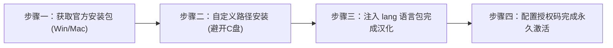
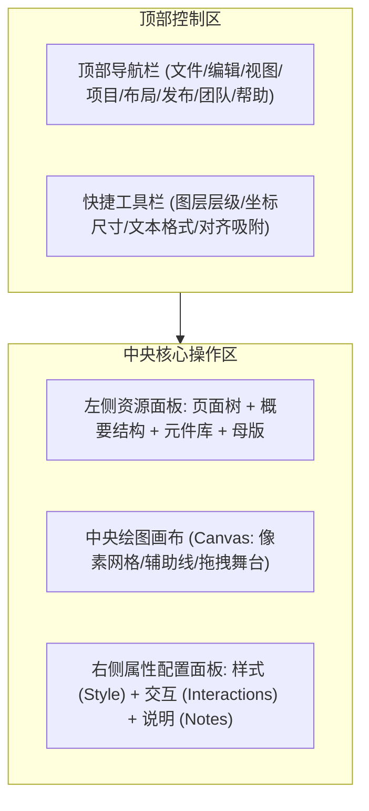
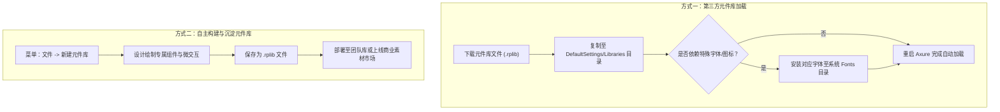
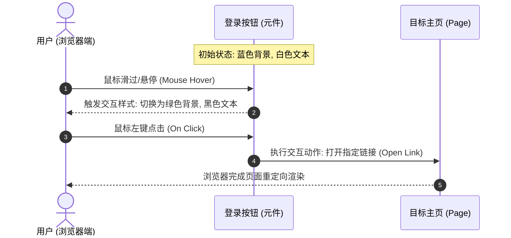

# 3.1-3.6 【实操】Axure 9.0 原型设计从入门到交互实战（木木老师）

> [!IMPORTANT] 核心提要
> 原型设计是产品经理将抽象业务需求转化为可视化落地方案的核心媒介。Axure RP 作为业内高保真与逻辑原型的事实标准，其核心价值在于通过结构化的元件、母版、交互事件与状态管理，精确表达产品的业务流向、信息架构与用户交互体验。掌握 Axure 9.0 的面板组织逻辑、元件库资产沉淀与交互样式规范，是产品经理从“画图员”迈向“专业交互设计与逻辑表达专家”的基础功底。

---

## 一、Axure RP 9.0 运行环境部署：下载、安装、汉化与授权

软件环境的标准配置是高效产出原型的前提，包含下载安装、汉化语言包注入以及正版/密钥授权四个标准环节。

### [1] 软件获取渠道
* **官方下载**：推荐通过 Axure 官方网站下载对应操作系统版本（Windows 或 macOS 安装包）。Axure 9.0 在渲染速度、自适应视图与交互逻辑上较早期的 7.0/8.0 做了大幅重构优化。
* **专业社区**：亦可从 Axure 中文学习网等专业技术社区获取历代归档安装文件及配套素材包。

### [2] 安装路径最佳实践
* 双击运行安装引导程序，同意软件使用许可协议（Accept License Agreement）。
* **安装路径配置**：切忌直接安装在系统盘（C 盘）。随着后续长期使用，Axure 的自动备份文件、缓存与加载元件库会迅速膨胀，影响系统盘使用效率。建议将盘符重定向至数据盘（例如修改为 `D:\Program Files\Axure\Axure RP 9`），随后点击 `Install` 等待解压安装完毕。

### [3] 完整中文汉化包注入
Axure 官方原生为英文界面。为提升日常工作认知效率，可手动注入汉化包：
1. 下载对应 Axure 9.0 版本的中文汉化语言补丁包，解压后获取名为 `lang` 的语言资源文件夹。
2. 复制该 `lang` 文件夹。
3. 打开 Axure 9.0 的安装根目录（如 `D:\Program Files\Axure\Axure RP 9`）。
4. 将 `lang` 文件夹直接粘贴到根目录下。
5. 退出正在运行的 Axure 并重新启动软件，所有主菜单、右键上下文菜单及面板工具栏即可完全切换为中文字符显示。

### [4] 商业授权激活与管理
未授权状态下软件享有 30 天的全功能免费试用期。试用期结束后必须进行授权配置方可继续使用：
1. 启动 Axure，进入顶部主菜单栏，依次点击【帮助】（Help） $\rightarrow$ 【管理授权】（Manage License）。
2. 在弹出窗口中选择【输入授权密钥】（Enter License Key）。
3. 分别输入授权主体名称（Licensee）与对应的有效数字密钥（Key）。
4. 点击【提交】（Submit），系统校验无误后提示“祝贺你，已授权成功”，此时授权面板显示对应的授权者信息与生效状态。

> [!WARNING] 实操避坑
> 汉化时切勿重命名 `lang` 文件夹内部的 `.dll` 或语言定义文件，且必须将整个 `lang` 目录直接放置在包含 `AxureRP9.exe` 的主安装目录下；若放置在子层级目录，软件将无法识别本地化包，导致汉化失效。

---

## 二、Axure RP 9.0 界面与工作区面板架构深度剖析

Axure 9.0 的工作区设计高度集约，主要由顶部导航菜单栏、快捷工具栏、中央画布区以及四周的核心支撑面板构成。

### [1] 顶部导航菜单栏（Menu Bar）功能分解
* **文件（File）**：负责项目工程的新建、已有 `.rp` 文件打开、项目存储（快捷键 `Ctrl + S`）、文件导入与导出。
* **编辑（Edit）**：负责对象的撤销、重做、剪切（`Ctrl + X`）、复制（`Ctrl + C`）、粘贴（`Ctrl + V`）以及格式刷操作。
* **视图（View）**：控制工作区各类面板与标尺、辅助线、网格的显隐。若因误操作导致“页面”、“概要”或“交互”面板丢失，可在【视图】 $\rightarrow$ 【面板/工具区】中重新勾选复原。
* **项目（Project）**：定义页面样式管理器、元件样式管理器、自适应视图规则等全局规范。
* **布局（Arrange）**：控制选中元件的图层堆叠次序（置于顶层、置于底层、上移一层、下移一层）、对齐方式（左对齐、居中、等间距分布）与编组（`Ctrl + G`）。
* **发布（Publish）**：提供本地与在线预览功能（快捷键 `F5`），支持将原型一键生成标准的离线 HTML/JS/CSS 静态网站包，供前端研发直接查验。
* **团队（Team）**：面向中大型协作团队，支持通过 Axure Cloud 或自建 SVN/Git 版本服务器进行多产品经理协同作业（如一人负责用户端，一人负责后台端），支持“签入（Check In）”与“签出（Check Out）”锁定编辑。
* **账户与帮助（Help）**：提供登录账户同步、检查软件更新及管理软件授权等服务。

### [2] 快捷工具栏（Toolbar）
集成在顶部菜单下方，提供最常用的高频操作快捷入口：
* 剪切、复制、粘贴与撤销重做；
* 图层顺序快速调节按钮与组合/解组按钮；
* 元件基础属性：水平绝对坐标 $X$、垂直绝对坐标 $Y$、元件宽度 $W$、元件高度 $H$；
* 排版修饰：字体家族、字号大小、加粗、倾斜、下划线、字体颜色、边框填充颜色与粗细。

### [3] 四大核心操作面板详解

#### 一、页面与概要面板（Pages & Outline）
* **页面面板（Pages）**：以树状文件目录的形式组织整个原型工程的信息架构。支持新建文件夹、同级页面与子页面。例如在根目录下创建“用户模块”文件夹，内部嵌套“登录页面”、“注册页面”与“找回密码页面”，清晰映射真实系统的路由结构。
* **概要面板（Outline）**：实时罗列当前激活画布中所包含的所有元件层级树，反映组件的嵌套状态与命名。当页面内元件众多、重叠遮挡或设置了动态面板隐藏状态时，概要面板是精准选中目标图层的核心入口。

#### 二、元件面板与母版面板（Libraries & Masters）
* **元件面板（Libraries）**：包含基础系统元件（矩形、文本标签、文本框、图片、占位符、水平/垂直线、下拉列表、中继器、内联框架等）以及第三方外部加载的高级元件库。元件是构成原型界面的基础视觉积木。
* **母版面板（Masters）**：用于将多页面通用的高频组件（如顶部全局导航 Header、底部通栏 Footer、通用侧边栏 Menu）封装为独立母版。
  * **母版的核心价值**：一次修改，全局同步生效。例如当全局底部导航发生增删改动时，只需编辑该母版，所有调用该母版的数十个页面将全部自动更新，极大降低原型的维护与重构成本。
  * **创建母版路径**：在画布中选中组合好的复合图形，右键选择【转换为母版】（Convert to Master），命名后即可在母版面板中随时拖拽复用到任何新建页面。

#### 三、属性配置三合一面板（Inspector）
* **样式面板（Style）**：精准控制选中元件的静态视觉特征，包括精确像素坐标（$X/Y$）、尺寸大小（$W/H$）、旋转角度、圆角弧度（可独立调整各角或统一拖拽）、填充颜色、线性/径向渐变、边框样式、内边距、字体排版及元件透明度与阴影。
* **交互面板（Interactions）**：为元件附加动态行为响应机制。支持事件监听（如单击时、双击时、鼠标移入时）、动作指派（如页面跳转、元件显隐、切换动态面板状态、赋值变量）与触发条件分支判断。
* **说明面板（Notes）**：为元件添加产品业务说明备注，支持对组件的业务逻辑、输入限制、字段校验边界（如手机号正则格式、密码最大位数）进行文字阐述，生成 PRD 文档时会自动提取并对应附着在元件旁。

---

## 三、Axure 元件库（Libraries）生态与实战：加载、字体依赖与自主制作

在实际敏捷产品研发中，如果所有输入框、列表、图表都从零绘制，效率极低。元件库就是预先制作封装好的组件与交互资产模板，是产品经理提升产出效率与沉淀资产的杀手锏。

### [1] 元件库与母版的本质区别
| 对比维度 | 页面母版（Masters） | 元件库（Libraries） |
| :--- | :--- | :--- |
| **生效作用域** | 仅限于当前单个 `.rp` 项目工程文件内部 | 跨项目全局生效，任意新建 `.rp` 均可加载使用 |
| **实例修改关系** | 修改母版，所有引用页面的母版实例**联动同步改变** | 从元件库拖出到画布后成为独立元件，**互不影响** |
| **主要定位** | 单个系统内的公共组件抽象（如统一导航头/尾） | 跨项目、跨团队沉淀的通用设计资产（如 Ant Design、iOS 规范组件库） |

### [2] 第三方元件库加载全步骤
1. 获取 `.rplib` 格式的元件库文件（如 iOS 风格移动端组件库、微信小程序标准组件库、Element UI 桌面端套件）。
2. 定位 Axure 的系统元件库存储路径：
   * 路径示范：`Axure安装根目录\DefaultSettings\Libraries`（如 `D:\Program Files\Axure\Axure RP 9\DefaultSettings\Libraries`）。
3. 将解压出来的 `.rplib` 文件直接拷贝粘贴至该 `Libraries` 文件夹内。
4. 重启 Axure 9.0，打开元件面板，在下拉选择列表即可直接看到新加入的元件库。
5. *注：亦可在元件面板右上角直接点击【+】号（加载元件库）按钮，手动浏览选取本地路径加载。*

### [3] 字体与矢量图标库的依赖处理
许多高质量元件库内部集成了矢量图标字体（如 FontAwesome、iconfont 等）。若本地未安装对应字体文件，元件库在画布或预览时将出现乱码或空白方块：
* **安装方法**：将元件库配套提供的 `.ttf` 或 `.otf` 字体文件，直接拷贝到 Windows 系统的 `C:\Windows\Fonts` 目录下（或双击点击“安装字体”）；亦可放置在 Axure 安装目录下的 `Fonts` 文件夹内，重启软件后即可正常渲染图标。

### [4] 自主构建企业级元件库全流程
1. 打开 Axure 9.0，点击顶部菜单栏【文件】 $\rightarrow$ 【新建元件库】（New Library）。
2. 在新建的元件库工程中，通过页面面板重命名组件名称（如“标准输入框”、“主操作按钮”、“卡片容器”）。
3. 在画布上绘制标准形状，配置字体、圆角、预设尺寸并设置好内边距与交互样式。
4. 点击保存，文件将以 `.rplib` 后缀持久化存储在磁盘中。
5. 产品经理可将此文件分发给整个产品团队作为统一设计语言，或在 Axure 中文社区等素材市场上线，实现个人或团队设计资产的商业化变现。

---

## 四、元件样式、事件交互与交互样式实战演练

为系统化讲透样式（Style）、交互（Interaction）与交互样式（Interaction Style）的联动机制，以最经典的**用户登录与主页跳转案例**进行端到端实操拆解。

### [1] 三大核心概念定义与逻辑映射
* **元件样式（Style）**：元件在界面中呈现的**静态外观参数集合**，决定了其“长什么样”（坐标 $X/Y$、宽高 $W/H$、填充色、边框、投影等）。
* **事件交互（Interaction）**：用户在界面中对元件进行操作时，系统做出的**动态功能反馈**，决定了其“做什么”（如点击后弹窗、翻页、提交数据）。
* **交互样式（Interaction Style）**：交互与样式的合集，是 Axure 提供的**快捷状态渲染机制**。当元件处于特定交互状态（如鼠标悬停、按下、选中、禁用）时，**自适应改变其自身的静态外观样式**，决定了其“在特定状态下如何即时变脸反馈”。

---

### [2] 登录界面元件搭建与静态样式设置
在页面面板新建“登录页面”，拖拽以下元件入场：

1. **用户名/密码文本标签（Label）**：
   * 拖入文本标签，修改文案为“用户名：”与“密码：”，字号设为 16px，设置统一的左对齐坐标。
2. **文本输入框（Text Field）**：
   * 拖入两个单行文本框，分别放置在用户名与密码标签右侧，调整宽高为 $240 \times 40\text{ px}$。
   * **密码输入框安全属性配置**：选中密码文本框，在右侧样式面板中，找到【输入类型】（Type），从默认的“文本”切换为**“密码（Password）”**。此设置可确保用户在预览输入时，字符自动脱敏掩码显示为圆点或星号（$\bullet\bullet\bullet\bullet$）。同时可在下方属性中配置【最大长度】（Max Length）限制（如设为 16 位）。
3. **操作按钮（Button）**：
   * 拖入两个矩形元件作为“登录按钮”与“注册按钮”。
   * 调整登录按钮尺寸为 $240 \times 44\text{ px}$，拖拽左上角黄色三角形控制手柄将圆角调整为胶囊圆角，背景填充设为品牌蓝色（`#1890FF`），字体为白色 16px 居中对齐。

> [!IMPORTANT] 黄金规范：元件必须重命名！
> 在拖入元件后，必须第一时间在右侧面板顶部为其赋予明确的业务标识名（如 `Input_UserName`、`Input_Password`、`Btn_SubmitLogin`）。绝不可保留默认的“矩形 1”、“文本框 2”。当原型页面复杂包含数十个元件或复杂动态面板时，未命名的元件将导致交互用例中的目标拾取极为混乱，大幅增加排错成本。

---

### [3] 完整事件交互配置：实现页面重定向
配置当用户点击“登录按钮”时，系统校验并跳转至“主页”页面：

1. **准备目标页面**：
   * 在页面面板点击【新建页面】，命名为“主页”。
   * 打开主页，拖入占位符（Placeholder）及文本标签，分别模拟页面头部导航（Header）、主体信息展示区与底部版权区（Footer），作为跳转验证靶点。
2. **为登录按钮绑定跳转交互**：
   * 回到“登录页面”，鼠标左键选中“登录按钮”。
   * 在右侧【交互】面板中，点击【新建交互】（New Interaction）按钮。
   * **选择触发事件（Event）**：在事件列表中展开【常用操作】或【鼠标单击时】（On Click）。
   * **选择响应动作（Action）**：选择【打开链接】（Open Link） $\rightarrow$ 【当前窗口打开】。
   * **选择跳转目标（Target）**：在展开的项目页面树中勾选“主页”。
   * 点击【完成】。保存工程（`Ctrl + S`）。
3. **运行与验证**：
   * 点击工具栏右侧的【预览】（Preview）按钮（或快捷键 `F5`），Axure 将在默认浏览器中加载 HTML 渲染界面。
   * 在用户名输入“木木”，在密码框输入“123456”（验证是否掩码隐藏），点击登录按钮，浏览器即刻平滑跳转至“主页”，交互逻辑闭环完成。

---

### [4] 交互样式配置：鼠标悬停（Hover）微交互实现
为了让原型达到接近真实上线应用的高保真质感，需要为按钮配置状态反馈：

1. 选中“登录按钮”，在右侧交互面板的属性区域找到【交互样式】（Interaction Styles）。
2. Axure 官方提供五大预设交互样式：
   * **鼠标悬停（MouseOver / Hover）**：光标滑入元件边界上方时触发。
   * **鼠标按下（MouseDown / Pressed）**：光标在元件上按住左键尚未松开时触发。
   * **选中（Selected）**：元件处于被激活选定状态时触发（常用于 Tab 切换或多选框）。
   * **禁用（Disabled）**：元件被置为不可用状态时的置灰表现。
   * **获取焦点（Focused）**：光标聚集在输入框内部时的边框高亮表现。
3. **实战配置鼠标悬停样式**：
   * 点击选择【鼠标悬停】样式选项卡。
   * 在弹出的属性重载面板中，勾选【填充颜色】，将其从原先的蓝色覆盖重载为高亮绿色（`#52C41A`）。
   * 勾选【字体颜色】，将字体颜色重载为纯黑（`#000000`）。
   * 点击【确定】。
4. **浏览器预览体验**：
   * 重新刷新预览页面，光标未移入前，按钮为标准蓝底白字；
   * 当鼠标移动至登录按钮上方时，按钮背景瞬间平滑响应切换为绿色底色、黑色字体；
   * 光标移出按钮范围，按钮自动瞬时复原为初始蓝底白字状态。这一交互样式完全无需手动编写复杂条件逻辑，由 Axure 底层状态机原生驱动完成。

---

## 五、Axure 9.0 核心功能与操作全景速查表

| 功能模块 | 对应核心面板/入口 | 快捷键 / 菜单路径 | 核心业务用途 | 实操避坑与黄金准则 |
| :--- | :--- | :--- | :--- | :--- |
| **工程管理** | 文件菜单 / 快捷栏 | `Ctrl + S` / `Ctrl + O` | 原型存储、版本打开、工程导入 | 切忌直接保存在桌面或系统 C 盘，建立规范的归档目录。 |
| **环境汉化** | 系统安装目录 | `\Axure RP 9\lang` | 本地化汉化包覆盖 | 必须将 `lang` 文件夹整包放入主目录，不可更改其内部结构。 |
| **授权管理** | 帮助菜单 | 【帮助】 $\rightarrow$ 【管理授权】 | 录入 Licensee 与 Key 激活 | 试用期 30 天，企业环境建议配置正版团队许可。 |
| **页面树管理** | 页面面板（Pages） | 左侧面板区 | 映射项目路由与信息层级结构 | 善用文件夹组织同模块页面（如独立的用户中心、商品模块）。 |
| **画布结构查验** | 概要面板（Outline） | 左侧面板区 | 查验元件图层堆叠与父子从属 | 当元件被遮挡或置于隐藏面板时，通过概要面板快速拾取。 |
| **母版组件抽象** | 母版面板（Masters） | 右键 $\rightarrow$ 【转换为母版】 | 全局通用模块复用（Header/Footer） | 修改母版会全局联动更新；若需局部独立定制需先“脱离母版”。 |
| **元件库扩展** | 元件面板（Libraries） | `DefaultSettings\Libraries` | 加载第三方库与自主沉淀资产 | 若加载后出现图标乱码，务必将配套字体安装至系统 `Fonts`。 |
| **安全输入配置** | 样式面板（Style） | 文本框 $\rightarrow$ 【输入类型: 密码】 | 密码掩码显示与最大输入长度限制 | 涉及敏感数据展示时，务必将输入框属性设为 Password 类型。 |
| **页面跳转交互** | 交互面板（Interactions） | 【新建交互】 $\rightarrow$ 【单击时: 打开链接】 | 模拟业务流转与页面跳转 | 先建好目标结果页，再回到来源页面绑定跳转目标。 |
| **状态微反馈** | 交互面板 $\rightarrow$ 交互样式 | 【鼠标悬停】 / 【选中】 / 【禁用】 | 赋予元件真实的原生即时视觉反馈 | 避免设置过于刺眼的颜色跳变，通常保持同一色系的明度微调。 |
| **原型导出验证** | 发布菜单（Publish） | `F5`（预览） / `Ctrl + F5`（生成HTML） | 交付前端与业务方体验核验 | 交付开发核对前，必须在标准分辨率浏览器下完整走通主流程。 |
