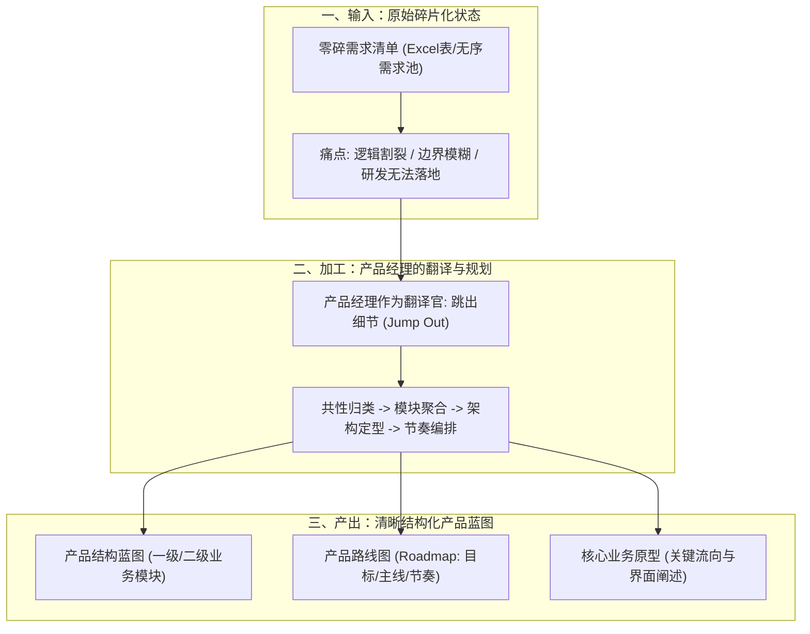
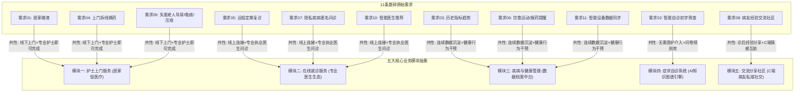
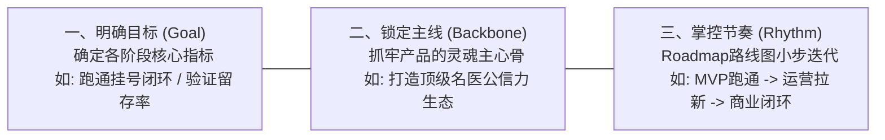
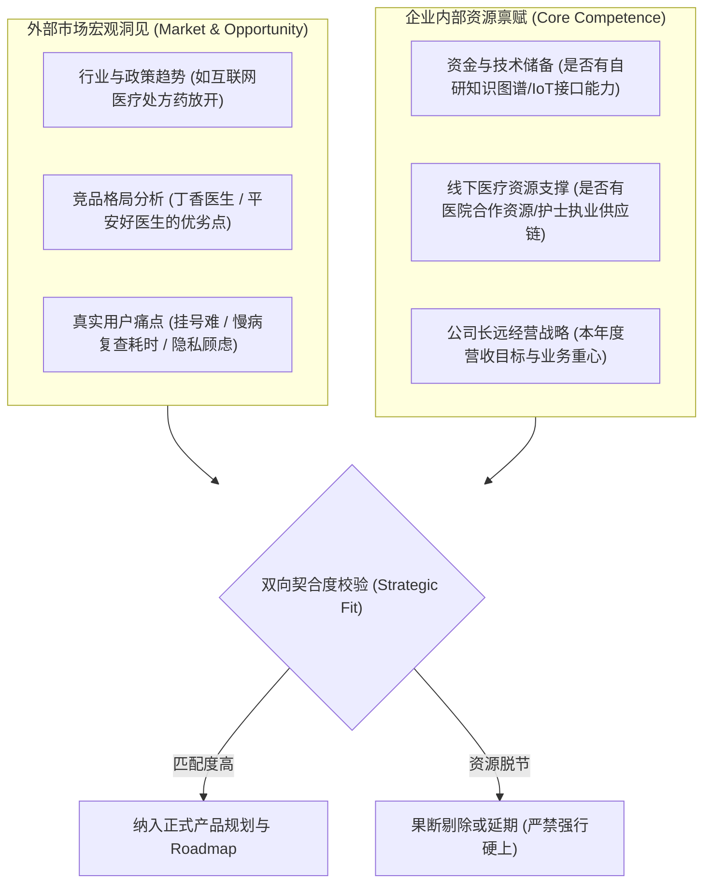
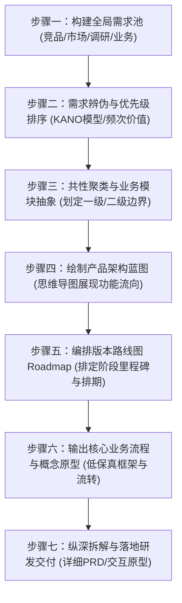

# 什么是产品规划（上）：产品定位与规划框架

> [!IMPORTANT]
> 产品经理在实际业务中最常遇到的困境，往往不是“缺乏需求”，而是“面对成百上千条零散、碎片化且各自看似合理的需求时，完全不知从何下手”。产品规划的本质，就是产品经理作为“业务战略与研发技术之间的超级翻译官”，将散碎的原始需求池通过抽象归类、主线提炼与节奏划分，演进为结构清晰、可行性明确的产品蓝图与演进路线图（Roadmap）。

---

## 一、从需求管理到产品规划：认清产品规划的根本意义

在敏捷开发流程中，产品经理通过用户访谈、问卷调查、业务方诉求和竞品分析，梳理出包含了角色、场景、任务与优先级的“需求清单”。然而，一张罗列数十条按优先级排序的 Excel 需求清单，并不能直接指引开发团队开工。

### [1] 为什么单纯的需求清单无法指导落地？
* **碎片化割裂**：需求清单往往是离散的“点”（如“用户想看指标趋势”、“术后需要上门拆线”），缺乏上下文业务闭环与模块归属。
* **缺乏系统骨架**：没有软件架构师能仅凭散装表格直接设计数据表或路由体系。产品经理必须先输出“骨干架构”，再往框架中填充细节肌肉。
* **过度纠缠局部细节**：若未做顶层规划，团队极易陷入对琐碎技术细节的无休止争论（例如过早讨论匿名头像该用卡通还是真人、就近派单算法如何精确到米），从而错失项目推进的大方向。

---

## 二、经典案例推演：健康医疗 App 11 条散碎需求的归类与模块抽象

为彻底理解规划是如何化混乱为秩序的，以一款类似平安好医生、丁香医生的“健康医疗移动端 App”虚拟项目为例，完整复盘 11 条散碎需求的推演归类全过程。

### [1] 原始需求清单审查与合理性判定
| 序号 | 目标用户与核心场景 | 原始需求描述 | 业务场景合理性判定 |
| :---: | :--- | :--- | :--- |
| **01** | 常年卧床的老年患者、感冒患者 | 需要在家享受专业输液服务 | **合理**：老年人/行动不便者去大医院挂号排队极易周车劳顿，居家轻医疗服务具备强痛点。 |
| **02** | 出现轻微症状的疑似患病人群 | 希望通过在线自诊快速初步判断病情 | **合理**：为轻微症状跑医院费时费力（开车、找车位、排队半天可能仅是普通感冒），自诊可大幅降本。 |
| **03** | 慢病患者（高血压、糖尿病等） | 希望查验并对比历史健康指标变化趋势 | **合理**：慢病需长期监测血压/血糖波动，数据可视化趋势有助于指导医生调整用药方案及剂量。 |
| **04** | 刚出院的外科术后患者 | 需要专业人士上门提供伤口拆线、换药服务 | **合理**：伤口愈合期行动困难，线下往返院端极易造成二次感染风险，居家换药拆线是高频刚需。 |
| **05** | 明确确诊需要长期随访的患者 | 需要定期与主治医生进行远程图文/音视频复诊 | **合理**：复诊周期固定且病情已明确，线上远程问诊可极大释放院端医疗资源并方便患者。 |
| **06** | 需健康干预的慢病或亚健康人群 | 需要系统提供专业的饮食、运动调理与服药提醒 | **合理**：现代人生活节奏快，极易漏服药物或缺乏健康作息指引，自动化定时推送能提升干预成效。 |
| **07** | 涉及敏感隐私疾病的就诊患者 | 强烈希望在问诊过程中实现匿名化脱敏诊疗 | **合理**：男科、妇科、皮肤科等疾病具有极高隐私敏感度，匿名机制可大幅降低患者就医心理门槛。 |
| **08** | 经历过特殊病程的康复期患者 | 希望通过平台结识同病相怜的病友，交流诊疗心得 | **合理**：同类病友具有极强的情感共鸣与经验互助需求，构建病友圈有助于建立精神互助与平台粘性。 |
| **09** | 家有失能老人的非专业照护家属 | 老人长期卧床无法移动，需专业人员上门导尿、吸痰、压疮护理 | **合理**：导尿、吸痰若由非专业家属操作极易引发喉道破损或感染大出血，属强技术门槛的刚性护理。 |
| **10** | 对专家专科资质有要求的初诊患者 | 希望平台能根据症状与诉求智能推荐最合适的医生 | **合理**：面对繁杂的科室分类患者常有认知盲区，智能分诊推荐能提升医患匹配效率与平台公信力。 |
| **11** | 拥有家用智能监测仪器的慢病人群 | 家用血糖仪、血压计监测数据能自动蓝牙/WiFi同步至 App | **合理**：免去繁琐的手工记账输入，确保健康档案历史基准数据的连续性、真实性与完整性。 |

---

### [2] 需求归类聚合推演：从单点诉求到五大独立产品模块
通过提炼各条需求的“服务提供者属性”、“业务交互逻辑”与“底层支撑资源”，11 条无序需求被精准归纳聚合为五大独立业务子系统：

#### 一、模块一：【护士上门】（聚合需求 01, 04, 09）
* **共性特征**：均属于“线下上门交付”的基础医疗操作，服务主体是**专业注册护士**，完全不需要调动高成本的主治医师。
* **规划范畴**：该模块负责承载输液、伤口换药、拆线、导尿管护理、吸痰与压疮清洁等上门订单流转，其内部细节（如派单调度算法、护士资质审核）后续可在模块内独立细化。

#### 二、模块二：【在线就诊】（聚合需求 05, 07, 10）
* **共性特征**：必须由具备执业资格的**专业医生**参与，交付形态为线上音视频或图文咨询，旨在替代线下普通门诊与复诊。
* **规划范畴**：涵盖基于症状算法的“名医智能推荐”、问诊单流转、音视频通话链路，以及针对特殊病患的“匿名脱敏隐私就诊通道”。

#### 三、模块三：【疾病与健康管理】（聚合需求 03, 06, 11）
* **共性特征**：侧重于用户个人长期健康档案的**数据沉淀、指标趋势呈现与日常行为干预**。
* **规划范畴**：构建健康档案中台，实现家用智能硬件（血糖仪、血压计等）IoT 数据无感同步，生成历史多维图表趋势，并配套用药闹钟与生活干预建议。

#### 四、模块四：【症状自诊】（聚合需求 02）
* **共性特征**：属于**前置轻量化分流工具**，不涉及医患双方的实时即时通信，由系统规则引擎自动化处理。
* **规划范畴**：采用医学知识图谱或多轮结构化问卷，根据患者点选的身体部位与伴随症状，秒级出具初步筛查指引与就诊挂号建议。

#### 五、模块五：【交流分享社区】（聚合需求 08）
* **共性特征**：属于**诊后与长尾阶段的 C 端内容生态与社交粘性资产**。
* **规划范畴**：构建病友互动圈子、治疗体验经验帖、点赞评论机制与抗癌/康复精神互助阵地，补齐严肃医疗工具类产品的用户留存短板。

---

## 三、产品规划的本质三要素：目标、主线与节奏

经历了从“散碎需求”到“业务模块”的归类，规划工作便上升为战略推演。优秀的产品规划必须由三根顶梁柱牢牢支撑：

### [1] 确定目标（Goal）
每次产品迭代必须有极其明确且唯一的业务靶心：
* 第一个版本（MVP）只验证核心业务假说：例如先跑通“在线名医复诊的完整支付与开方闭环”，切忌贪大求全试图在一期将护士上门、社交社区、智能硬件全部上线。
* 明确界定什么是“完成”与“成功”：通过量化业务指标（如首期线上复诊履约完成率达 85%）指引团队资源聚焦。

### [2] 确定主线（Backbone）
主线是整个产品的灵魂与价值定位，是过滤与拒绝边缘需求的最高准绳：
* **以健康医疗 App 为例**：该产品在市场立足的核心主线是**“打造权威、高公信力的专业医生诊疗生态”**。
* **战略主线指导设计**：所有产品设计均需围绕公信力展开——优先汇聚三甲名医资源、打造权威资质背书、优化精准对口推荐。即使社交功能或硬件同步看似诱人，在资源受限时也必须让位于主线任务。

### [3] 掌控节奏（Rhythm）
将终极愿景（Vision）拆解为有章可循的落地节奏，通过产品路线图（Roadmap）承载：
* **渐进式交付**：设定各版本之间的时间窗口（如双周敏捷迭代或季度大版本发布）。
* **依赖关系编排**：明确哪些是前置基础底层（如用户认证、医生资质库），哪些是依附其上的业务增量（如上门服务、慢病管理），确保研发流水线平稳高效。

---

## 四、双向平衡法则：外在市场机会与内部企业能力的契合

产品规划绝不是产品经理的“天马行空”，而是在外部客观环境与企业自身资源禀赋之间寻找最优解的动态平衡艺术。

> [!WARNING]
> **警惕“伪机会”陷阱**：
> 某些需求在外部市场看似极具前景（如“全国三甲医院全流程绿色通道挂号”），但若企业自身根本不具备强有力的线下公立医院行政准入关系与卫健委资质背书，该规划在立项之初即注定失败。产品规划必须遵循“能力与机会强匹配”原则，有多大资源做多大规划，严禁脱离实际商业基础盲目跟风。

---

## 五、产品规划落地全流程标准体系

规范的产品规划应遵循一套自顶向下、逻辑闭环的标准化实施路径：

### [1] 步骤一：构建全局需求池
通过竞品拆解、市场调研、前线业务部门访谈及用户反馈，汇聚全量原始需求，建立集中化的统一需求管理台账。

### [2] 步骤二：需求辨伪与优先级排序
剔除伪需求与虚假繁荣需求，运用用户体验价值、业务痛点强度、发生频次及研发ROI，完成全量需求的基础优先级评估。

### [3] 步骤三：共性聚类与业务模块抽象
跳出单点细节，根据业务参与主体、交互逻辑与核心链路，将离散需求归纳到对应的产品子系统或功能模块中。

### [4] 步骤四：绘制产品架构蓝图
采用思维导图或结构拓扑图，清晰标明产品的一级功能模块、二级功能组件及其上下游依赖与数据流转关系。

### [5] 步骤五：编排版本演化路线图（Roadmap）
界定 MVP（最小可行性产品）的核心边界，明确 V1.0、V2.0 各阶段的版本战略目标、功能交付清单与发布里程碑。

### [6] 步骤六：输出核心流程与概念原型
针对最具核心价值的业务主链路（如在线问诊开方、护士上门履约），产出关键节点的概念原型图，辅助技术团队理解全局业务意图。

### [7] 步骤七：纵深拆解与落地研发交付
在已确定的系统骨骼架构之下，针对各细分模块开展下沉式的详细 PRD 规范编写、精细交互设计与研发协同落地。

---

## 六、产品规划方法论与模块推演全景速查表

| 核心模块 / 规划维度 | 归属需求序号 | 核心解决场景 | 业务交付形态与关键资源 | 规划阶段注意事项与避坑指南 |
| :--- | :--- | :--- | :--- | :--- |
| **护士上门** | 需求 01, 04, 09 | 居家输液、术后换药拆线、失能老人压疮/导尿 | 线下专业护士上门服务，依托区域医护调度供应链 | 必须重视医疗纠纷免责协议与护士执业安全，切忌规划初期由医生承担基础护理。 |
| **在线就诊** | 需求 05, 07, 10 | 慢病远程复诊、智能医生推荐、隐私脱敏问诊 | 线上图文/音视频通信，依托三甲执业医师资源 | 初期重在建立医患问诊信任与开方合规性，不可过早深究复杂的精准画像算法。 |
| **疾病管理** | 需求 03, 06, 11 | 历史指标多维对比、用药饮食提醒、IoT无感同步 | 数据报表与分析中台，依赖硬件蓝牙/WiFi标准协议对接 | 硬件同步接口需制定统一通信标准，优先保障血压/血糖核心指标的连续性。 |
| **症状自诊** | 需求 02 | 轻微不适初步自查，避免线下盲目挂号排队 | 自动化多轮问答问卷系统，依赖底层医学知识图谱 | 严格标注“仅供参考，不作为最终医疗诊断”，规避不可控法律医疗风险。 |
| **交流分享** | 需求 08 | 康复心得分享、病友圈精神互助与经验互鉴 | C 端内容社区（图文发帖、评论点赞、话题聚合） | 医疗社区必须建立极其严苛的涉医涉药内容审核机制，严防医疗广告与虚假导医。 |
| **核心规划三要素** | 全局战略 | 目标（Goal）+ 主线（Backbone）+ 节奏（Rhythm） | 产品定位与演进 Roadmap 路线图文档 | 避免“想到哪做哪”，杜绝脱离公司现有核心资源能力盲目立项。 |
| **推演避坑准则** | 执行策略 | 先定骨干架构，再填细节肌肉；先定主线，再顾细枝 | 架构蓝图与概念原型交付物 | 绝不可在规划会议上纠结按钮颜色、头像样式等琐碎视觉细节。 |
