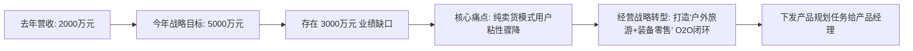
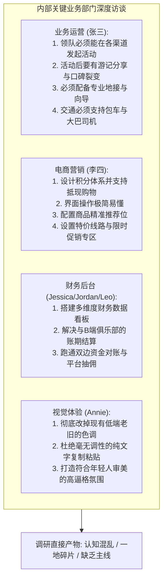
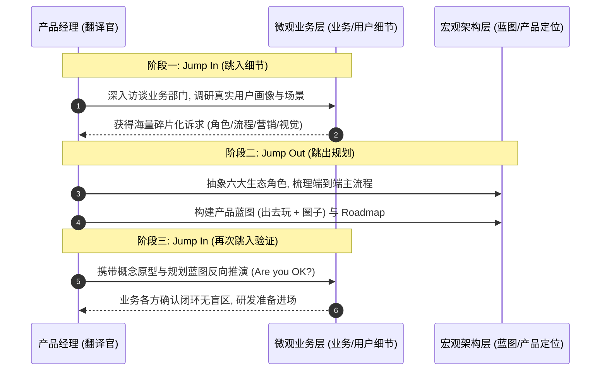
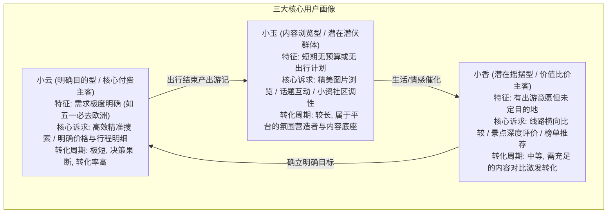
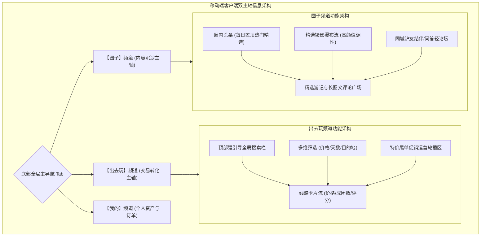

# 什么是产品规划（下）：健康医疗App虚拟产品规划实战

> [!IMPORTANT]
> 真正的产品规划从来不是坐在办公室凭空构想，而是在复杂多变的商业战略与杂乱无章的业务诉求碰撞中诞生。在上一讲中，我们借助健康医疗 App 案例完成了产品规划基础框架的抽象；本讲将通过一个高度还原真实企业战场的深度实操案例——**“户外运动装备电商转型户外旅游 O2O 平台”**，完整演绎产品经理如何将老板模糊的商业战略、业务方“一地鸡毛”的碎片化诉求，一步步提炼为逻辑严密的产品蓝图与具有极高商业可行性的产品路线图（Roadmap）。

---

## 一、虚拟项目背景：企业经营战略危机与转型破局

在实际企业环境中，产品需求的源头往往直接来自于**公司高层的经营战略与业绩缺口**，这与 NPDP（新产品开发体系）中的“战略驱动新产品开发”理论高度契合。

### [1] 战略动因与经营现状
* **公司业绩目标**：公司去年主营户外装备电商，全年营收 2000 万元；今年高层制定了 5000 万元的激进增长战略，面临 3000 万元的巨大经营缺口。
* **业务增长瓶颈**：近期运营数据表明，平台用户的**活跃度与粘性出现断崖式下滑**，传统的“纯货架式卖货”模式已无法建立用户的情感与服务连接。
* **核心业务洞察**：大量户外爱好者在实际出游过程中，往往被当地的地接、导游裹挟消费，未能提前在线上商城采购专业装备；若能在出游前提供专业的线路与旅游服务，便能自然将服务场景延伸至装备销售，通过高频、深度的服务体验带动高客单价商品的复购。
* **战略定调**：公司决定进军 O2O（Online to Offline）户外旅游服务领域，以自有平台打通线上信息聚合与线下履约服务，通过“户外旅行 + 装备零售”的双轮驱动重塑用户粘性。

---

## 二、内部业务调研：“一地碎片”的需求困境与破局思路

老板将经营战略目标拆解给产品经理后，指定其与公司内部各关键业务部门对接。产品经理通过与各业务方的深度访谈，收集到了大量角度迥异、诉求分散的原始声音：

### [1] 各业务方诉求深度梳理
1. **业务运营部（张三）**：
   * 户外旅游活动需要“灵魂人物”，必须支持**专业领队**自主发布并管理活动。
   * 必须注重闭环口碑传播，活动结束后必须有**写游记、发照片**的分享阵地（符合 NPDP 营销中的“双漏斗模型”，让消费结束成为下一次裂变的开始）。
   * 线下履约不可缺少**地接（负责到站接驳与食宿）**与**向导（负责线路讲解与文化体验）**。
   * 行程运力保障至关重要，必须支持**大巴司机调度与整车包车**功能。
2. **电商与营销部（李四）**：
   * 用户粘性需要利益驱动，必须搭建完整的**用户积分体系**，且积分能够直接冲抵装备购买费用。
   * 操作流转必须傻瓜化；必须设立**热门装备与线路精准推荐位**。
   * 对标途牛、马蜂窝等竞品，必须上线**特价尾单促销**专区。
3. **财务结算部（Jessica、Jordan、Leo）**：
   * 平台作为连接 B 端商户与 C 端用户的中介平台，必须有清晰的**资金清算与财务对账机制**。
   * 需实时掌握资金流向：例如一次活动总报名费 5 万元，平台抽佣 1 万元，结转给 B 端俱乐部 4 万元，系统必须自动生成清晰的往来报表。
4. **设计与品牌部（Annie）**：
   * 现有界面调性太低，缺乏时尚与专业运动感。
   * 现有社区帖子充斥着劣质的 `Ctrl + C` / `Ctrl + V` 搬运内容，必须建立强内容审核机制与高质量的视觉调性。

> [!WARNING]
> **产品经理第一认知铁律：99% 的项目，需求调研的直接结果永远是“一地碎片”！**
> 无论是业务高管还是业务执行人员，绝不会有人主动呈递一套按一级菜单、二级菜单、交互事件编排好的标准化产品方案。业务方只会表达各自岗位利益下的单点痛点。产品经理的不可替代性，正是体现在“将碎片化的业务痛点翻译为严密系统方案”的顶层抽象能力。

---

## 三、产品规划核心方法论：Jumping - Jump Out - Jumping 三段论

面对一地碎片的需求池，产品经理必须遵循经典的“三段论”工作法，在微观细节与宏观架构之间自如切换：

* **第一阶段：Jump In（跳入细节做调研）**：深入业务一线与用户群体，不带偏见地记录每一个真实的角色、场景、痛点与期望。
* **第二阶段：Jump Out（跳出细节做规划）**：抽离琐碎细节，站在企业战略和系统架构的高度，进行共性分类、剔除伪需求、构建核心骨干架构与业务闭环。
* **第三阶段：Jump In（再次跳入做验证）**：带着初步成型的产品蓝图与路线图，反向与业务部门、目标用户及技术团队逐一核对，审查边界漏洞，落地为执行方案。

---

## 四、业务板块与生态角色深度梳理

运用 Jump Out 思维，产品经理将杂乱的调研碎片归类为“人、流程、营销、其他”四大业务基座：

```mermaid
flowchart TD
    subgraph EcoRoles["一、生态角色网络 (人)"]
        Club["B端俱乐部: 活动管理者与资源整合方"]
        Leader["领队: 现场执行召集人, 直接服务C端窗口"]
        Local["地接: 落地接驳第一站, 统筹食宿"]
        Guide["向导: 当地景点向导, 路线指引与讲解"]
        Driver["大巴司机: 交通运力保障, 包车长途接送"]
        User["C端消费者: 核心付费用户, 装备体验与内容创作者"]
        Club --- Leader --- Local --- Guide --- Driver --- User
    end

    subgraph CoreFlow["二、业务链路流转 (流程)"]
        F1["领队/俱乐部发布活动"] --> F2["C端浏览/报名并在线支付"]
        F2 --> F3["根据成团人数调度地接/车辆/住宿"]
        F3 --> F4["线下履约出游与装备实战体验"]
        F4 --> F5["诊后发帖分享游记与私域社群沉淀"]
        F5 --> F6["平台抽佣结算与俱乐部对账打款"]
    end
```

### [1] 六大生态角色定位（人）
* **户外俱乐部（B 端商户）**：具有专业资质的旅游管理机构，是平台活动的法定组织者与责任承担主体（如主营欧洲深度游的俱乐部、国内长线探险俱乐部）。
* **活动领队（执行枢纽）**：具体路线的负责人与召集人，是直接面向 C 端消费者的第一服务窗口，负责社群答疑、出行统筹与现场安全管理。
* **当地地接（落地第一棒）**：消费者抵达目的地机场/高铁站后的对接人，主要负责接机接驳、酒店入住与基础餐饮安排。
* **当地向导（体验掌舵人）**：深谙当地风土人情与游玩路线的专业人士，负责景点深入讲解、小众体验发掘。
* **大巴司机（运力保障者）**：持有营运资质的司机师傅，承接跨城市或景区之间的中长途整车包车运输。
* **终端消费者（C 端用户）**：最终买单体验、输出游记并产生装备消费的核心用户。

### [2] 端到端核心交易链路（流程）
1. **活动策划与发布**：B 端俱乐部或领队在商家后台编辑活动详情、行程排期、包含费用及所需专业装备清单并上线。
2. **C 端发现与支付**：消费者根据目的地、时间及评分筛选活动，完成线上定金或全额支付。
3. **资源协调与履约准备**：报名截止后，领队确认最终成团人数，根据人数在后台按配比下单预定地接房源、向导服务及对应座席的大巴车辆。
4. **线下深度履约**：各角色按既定标准化节点履约，途中自然植入平台自营装备的试用与实战体验。
5. **体验闭环与裂变传播**：行程结束后，系统自动化引导用户上传高清照片、撰写长篇游记并赚取积分；领队引导沉淀至企业微信私域流量池。
6. **财务资金清算**：系统扣除约定比例的平台技术服务佣金后，将款项平稳结算转入俱乐部账户。

### [3] 营销与支撑板块
* **营销板块**：基于报名行程的目的地气候与活动强度，智能算法推荐对应的冲锋衣、防潮垫、登山杖等装备；积分体系打通活动报名与商城抵现；特价线路尾单促销。
* **支撑板块**：简约大气的扁平化 UI 规范；CMS 优质游记推荐算法、论坛热帖人工置顶与多级标签权重管理。

---

## 四、外部 C 端用户画像深度拆解：小云、小香与小玉

仅完成内部业务视角的梳理并不足以保证产品成功，必须跳入用户端进行深度画像提炼。通过对上千份线上调研问卷与深度访谈进行抽象，归纳出三大最具代表性的用户角色：

### [1] 详细用户画像与产品应对策略
| 用户典型 | 核心痛点与行为特征 | 对产品的核心功能要求 | 产品设计的优先响应策略 |
| :--- | :--- | :--- | :--- |
| **小云** （明确目的型） | 假期明确、预算充足，例如已决定“五一假期带伴侣前往欧洲深度游”。决策链条极短，反感复杂的信息干扰。 | 页面显眼处具备**高精准全局搜索框**、多维度筛选器（价格、天数、出发地、成团状态）。 | **最高优先级**。 在首页顶部常驻全局搜索栏，搜索结果页强化价格、排期与剩余名额透明度，提供极简一键支付链路。 |
| **小香** （潜在摇摆型） | 计划年底或节假日出行，但犹豫不决去哪里。常混迹于小红书、马蜂窝，需要大量客观数据辅助决策。 | **线路多维横向对比工具**、真实驴友的历史评分与评价列表、季节性热门榜单推荐。 | **次高优先级**。 提供精选线路集合卡片、真实的带图长评价与综合星级指标，辅助其快速下定决心。 |
| **小玉** （内容浏览型） | 短期内并无实际出行消费计划，热爱美好事物，属于“口嗨型/键盘侠型”看客。极易被优质图文与话题吸引。 | **高颜值图文社区**、热门话题讨论专区、小资排版风格、点赞互动功能。 | **基础优先级**。 打造活跃的“圈子”频道，提供瀑布流精选游记与互动评论，沉淀平台的内容水池与社区调性。 |

### [2] 动态转化闭环的商业价值
小云、小香与小玉并非绝对孤立，而是存在相互跃迁的动态转化链条：
* “小玉”在遭遇职场倦怠或情感变化时，极易被社区美图激发而转化为“小香”；
* “小香”在充分横向对比后明确了目的地，即转化为高价值的“小云”完成大额支付；
* “小云”在线下体验完成后，撰写出高质量游记并分享到平台，又成为了滋养“小玉”和“小香”的核心内容源泉。
* 这一生生不息的内容与交易循环，正是产品规划中梦寐以求的**生态型飞轮效应**。

---

## 五、产品蓝图构建：双主轴信息架构与核心原型推演

将生态角色网络与用户画像诉求投射到前端界面，产品经理推导出一套兼顾交易转化与内容沉淀的“双主轴”产品架构蓝图：

### [1] 核心原型设计推演逻辑
* **首页第一主频设定为【出去玩】**：由于小云与小香是直接产生 GMV（成交总额）的核心用户，必须将交易路径放在第一优先级。页面顶部给予大面积搜索框，下方平铺结构清晰的活动卡片（标明价格、领队资质、成团进度与行程亮点）。
* **首页第二主频设定为【圈子】**：满足小玉的日常驻留及全量用户的诊后分享。顶部配置“圈内头条”置顶高热度内容，中部以瀑布流形式展示精修大图与游记短评，底部设立驴友互动轻论坛，持续释放社区荷尔蒙。

---

## 六、落地战略演进路线图（Roadmap）：可行性博弈与冷启动破局

完成产品架构设计后，最严峻的考验在于：**如何编排开发节奏？第一个版本究竟该做什么？**

```mermaid
flowchart TD
    subgraph PlanA["方案 A: 激进型核心交易优先 (高风险)"]
        A1["首期硬磕核心交易链路与后台支付"]
        A2["无流量无信任, 砸巨资打广告引流"]
        A3["高额双边补贴 (补司机/补用户)"]
        A4["结果: 资金链承压, 极易沦为烧钱炮灰"]
        A1 --> A2 --> A3 --> A4
    end

    subgraph PlanB["方案 B: 稳健型内容冷启动优先 (推荐采纳)"]
        B1["一期上线: 圈子与论坛系统 (内容切入)"]
        B2["极低成本运营: 举办摄影/游记评选大赛"]
        B3["低成本奖励 (数台手机/平板) 撬动海量UGC"]
        B4["积累万级活跃种子流量池与品牌粘性"]
        B5["二期上线: 核心交易闭环与双边精细补贴"]
        B6["结果: 水到渠成, 投入产出比极高且安全"]
        B1 --> B2 --> B3 --> B4 --> B5 --> B6
    end
```

### [1] 两种版本路线图策略深度权衡

#### 策略一：激进型方案（直接上线交易，高举高打）
* **规划逻辑**：V1.0 首期直接研发复杂的活动发布、在线支付、财务结算与大巴调度中台，上线后立即通过百度竞价、户外广告狂砸引流，同时对 B 端俱乐部和 C 端用户实施巨额双边补贴。
* **致命弊端**：新品牌毫无认知度，冷启动获客成本极高；在用户对平台未建立起基本信任前，几千上万元的跨国游活动转化率极低，平台极易在资金耗尽前轰然倒塌。

#### 策略二：稳健型方案（内容先行聚拢人气，低成本撬动飞轮 —— 推荐采纳）
* **Phase 1（第一期：圈子与社区论坛系统上线）**：
  * **核心目标**：以极低研发与运营成本迅速聚合海量目标户外爱好者，搭建属于自己的私域流量池。
  * **运营抓手**：举办“全国户外旅友游记评选大赛”与“最美徒步摄影展”，用户发帖赚取积分（积分承诺后续可抵现）。
  * **成本控制**：企业仅需拿出几台高端智能手机、iPad 平板作为一二三等奖奖品，总成本仅数万元，却能驱动数以千计的资深驴友贡献顶级 UGC 游记。
  * **战略收益**：经过半年至一年的内容深耕，平台不仅彻底去除了“卖货电商”的冰冷刻板印象，还沉淀了上万名高粘性、高质量的户外种子用户。
* **Phase 2（第二期：核心交易闭环上线与双边精准补贴）**：
  * **核心目标**：流量变现与生态闭环，正式启动 B 端俱乐部招商与线上交易。
  * **补贴策略**：
    * **B 端补贴**：俱乐部每成功履约一人，平台定向补贴 5 元，极大激发领队与俱乐部入驻发团的热情。
    * **C 端返现**：参团出游后撰写合格图文评价的用户，返还 50 元现金红包，大幅降低用户的决策阻力。
  * **战略收益**：此时导入核心交易，依托一期沉淀的庞大流量池，B 端的供给与 C 端的消费瞬间实现高效匹配，交易流水迅速破局，以最低风险稳步达成年度 5000 万战略营收目标。

---

## 七、闭环论证与跨职能交付（Are You OK?）

在输出完整的架构蓝图与两期演进 Roadmap 之后，产品经理并未急于推进开发，而是完成了关键的最后一步——**反向穿梭验证（Jump In）**：

1. **跨部门闭环推演**：重新组织张三（业务运营）、李四（营销）、Jessica（财务）及 Annie（设计）召开闭环推演会议。
   * 向张三展示领队发团与游记口碑裂变的原型闭环；
   * 向李四展示积分商城抵现与特价促销的专区架构；
   * 向财务组展示分阶段上线路线图中的二期资金清算模型；
   * 向 Annie 确认以内容大赛为先导的高逼格视觉调性规范。
2. **确认团队共识**：各业务主管对方案逐一给出肯定答复（“Are you OK?” $\rightarrow$ 全体 OK）。
3. **分工拆解与产品责任制**：
   * 在中大型团队中，总产品规划师负责把控全局蓝图与版本节点，随后将一期“圈子内容系统”交由内容产品经理纵深细化 PRD，将二期“交易结算系统”交由交易产品经理提前开展接口调研；
   * 在中小型敏捷团队中，由主产品经理亲自带领技术团队按 Roadmap 里程碑小步快跑迭代推进。

---

## 八、虚拟产品规划实战推演全景速查表

| 实战环节 / 推进阶段 | 核心任务与核心动作 | 典型输入 / 产出物 | 核心避坑指南与战略准则 |
| :--- | :--- | :--- | :--- |
| **战略输入阶段** | 解读企业 5000 万营收战略，剖析电商粘性下滑根因 | 经营缺口分析报表、O2O 商业模式构想 | 规划必须紧贴企业战略生存命脉，切忌脱离实际商业目标自嗨。 |
| **内部调研阶段** | 访谈业务、营销、财务与设计等部门关键人 | 碎片化原始诉求池（一地碎片） | 需求方只会提各自维度的局部痛点，产品经理切忌直接拿碎片充当需求。 |
| **三段论抽象阶段** | Jump In 细化探寻 $\rightarrow$ Jump Out 归类提炼 $\rightarrow$ Jump In 闭环验证 | 四大业务基座（人/流程/营销/支撑） | 善于在宏观蓝图与微观细节间穿梭，先搭骨干框架，再填细节血肉。 |
| **生态角色梳理** | 明确俱乐部、领队、地接、向导、司机与消费者职责 | 六大角色网络拓扑图、端到端交易流向图 | 厘清各参与方的利益诉求与责任边界，杜绝服务真空与纠纷死角。 |
| **C端画像拆解** | 提炼小云（强刚需）、小香（摇摆比价）与小玉（内容看客） | 典型用户画像模型卡、动态转化飞轮 | 优先满足强交易型小云/小香的需求，同时用圈子内容托底小玉的社区活跃。 |
| **蓝图绘制阶段** | 搭建【出去玩】与【圈子】双主轴移动端客户端架构 | 产品架构拓扑脑图、核心流程概念低保真原型 | 规划阶段无需过早纠结细枝末节的按钮像素，重在表达核心功能流向。 |
| **路线图编排阶段** | 拒绝激进烧钱，采纳稳健的“内容大赛冷启动 $\rightarrow$ 核心交易闭环” | 演进路线图 Roadmap（一期与二期里程碑） | 首期重在极低成本沉淀私域流量池，二期启动双边精细补贴撬动变现。 |
| **反向论证阶段** | 携带蓝图与 Roadmap 逐一核对各业务部门（Are you OK?） | 跨部门评审纪要、多产品经理分工台账 | 交付技术团队前，必须让所有利益相关方充分知情并达成底层共识。 |
