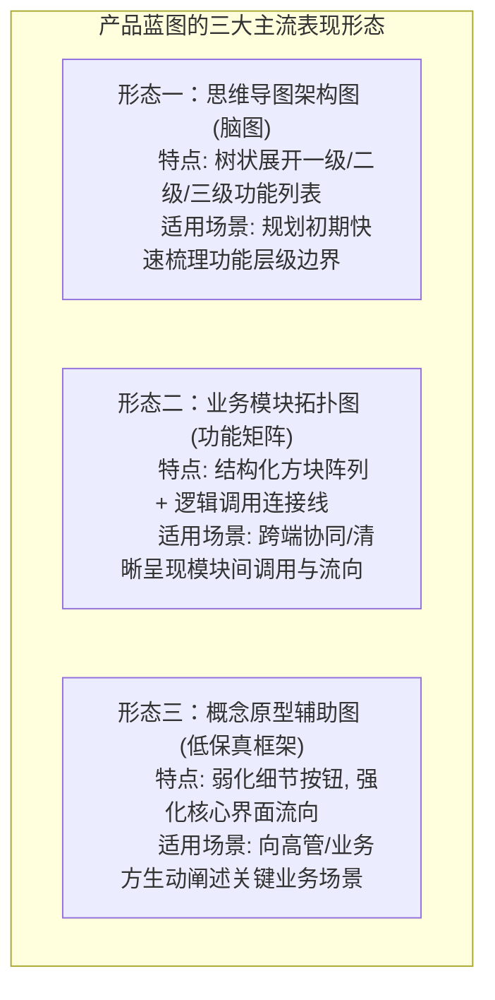
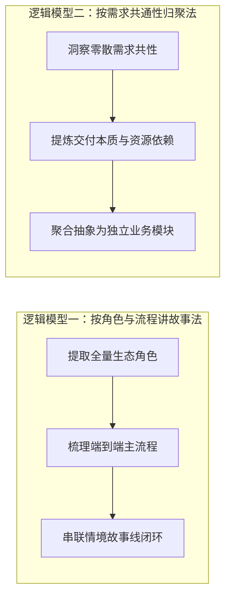
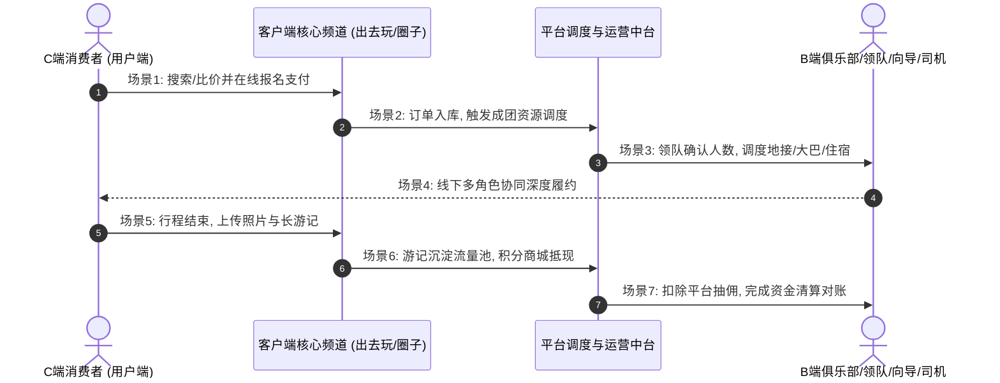
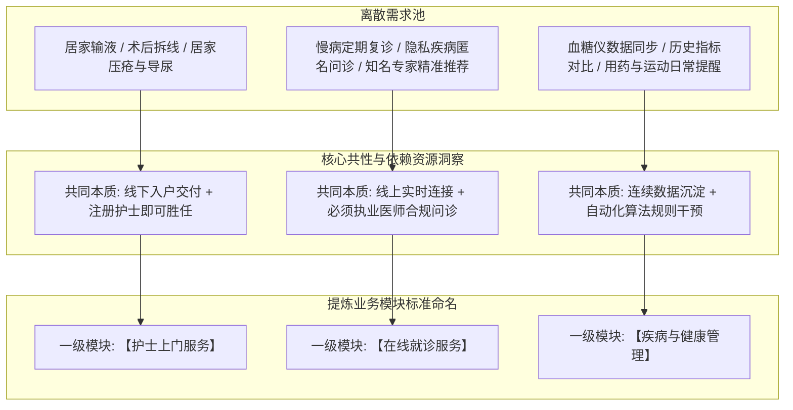
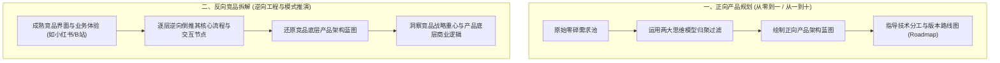
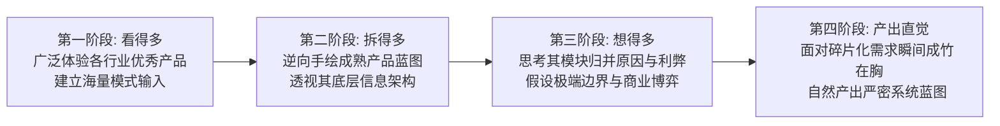

# 如何绘制产品蓝图

> [!IMPORTANT]
> 产品蓝图（Product Blueprint）是产品经理将战略愿景、业务闭环与碎片化需求沉淀为系统级骨干架构的最高设计蓝图。它不仅向研发、测试和业务方清晰揭示了系统包含哪些一级/二级业务模块及其依赖流向，更是防范团队陷入琐碎细节撕扯的全局导航仪。绘制蓝图的能力，是衡量产品经理是否具备“顶层架构抽象与系统级思考力”的分水岭。

---

## 一、产品蓝图的内涵与常见表现形态

产品蓝图并非指高保真的视觉效果图，而是产品架构的骨架展现。其核心目的在于清晰界定系统边界、模块从属以及数据/流程的跳转关系。

### [1] 常见表现形态解析
1. **思维导图结构（脑图）**：以产品核心定位为根节点，自顶向下或左右辐射出业务主轴、一级功能模块、二级功能组件及底座服务，最适合在规划早期快速收敛功能范围。
2. **业务模块拓扑图（方块阵列 + 逻辑流向）**：用不同颜色的矩形方框代表独立子系统或业务模块，使用带箭头的连接线标示模块间的业务跳转与数据流转关系。
3. **概念原型图组合（Low-Fi Wireframe）**：
   * 在蓝图阶段，**切忌绘制过于琐碎的界面细节**（如精准的 Logo 尺寸、具体的次级按钮边距、拟真图标等）；
   * 采用占位符方块代替功能区，将 2~3 个核心节点的概念原型串联成流程图，以极具表现力的方式向非技术利益相关方传达系统愿景。

---

## 二、绘制产品蓝图的两大底层思维模型

市面上没有任何一款软件工具能一键“自动生成”产品蓝图。蓝图绘制的核心是产品经理的**逻辑抽象与归纳总结能力**。在实操中，主要依靠两套经过实战检验的底层推演逻辑：

---

### [1] 逻辑模型一：按角色与流程讲故事法（适用链路型产品）
该方法特别适用于 O2O 平台、电商交易、共享经济等**具有明确角色协作与端到端交付链路的产品**（如前述户外旅游 O2O App）：

#### 推演五步法实施细则：
* **步骤一：全量审查与角色提取**：
  * 把所有收集上来的需求通读一遍，剥离出所有涉及的业务角色（例如：俱乐部、领队、地接、向导、大巴司机、消费者）。
  * 明确每个角色的诉求与核心职能，不遗漏任何一个利益相关方。
* **步骤二：人机交互与全流程梳理**：
  * 产品本质是人机交互。沿主干链路将各角色的操作行为串联成流程图，分为用户前端（App/小程序）与业务后端（商家后台/运营中台/财务中台）。
* **步骤三：业务关联与营销活动配置**：
  * 在主干流程的基础上，外挂增值业务：如根据目的地智能匹配装备推荐、配置限时促销与特价尾单专区、设计积分累积与抵扣通道。
* **步骤四：模糊需求暂存“长尾归箱”**：
  * 对于一时无法明确归属的长尾需求（如特定话题标签打卡、自定义头像挂件），先归入“其他”暂存区，待核心框架定型后再做二轮沉淀或果断剔除。
* **步骤五：以“讲故事”串联验证逻辑闭环**：
  * 采用情境叙事逻辑检验蓝图：“谁在什么场景下遇到什么问题？他打开哪个模块完成了什么操作？系统如何响应？下游的角色接着在后台处理了什么？最后如何完成资金与体验闭环？”
  * 只要故事能在蓝图架构内严丝合缝地流转，系统框架便宣告成立。

---

### [2] 逻辑模型二：按需求共通性归聚法（适用矩阵型服务产品）
该方法特别适用于工具矩阵、综合医疗、企服协同等**服务种类繁杂但链路相对独立的平台型产品**（如前述健康医疗 App）：

#### 推演核心三要诀：
* **要诀一：跳出表象，洞察交付本质**：
  * 不要被具体的医学名词迷惑（如导尿与输液看似完全不同），深入思考其**服务供给端需要何种资源**。
  * 输液、换药、导尿均不需要高成本的医生介入，仅需专业护士即可，因此提炼共性为“护士级轻医疗”。
* **要诀二：辨析关键角色与合规边界**：
  * 涉及疾病诊断、开具处方与复诊调药的，必须依赖三甲执业医师，且涉及医疗合规，因此必须独立成立“在线问诊/就医”模块。
* **要诀三：提炼共性关键词作为模块命名**：
  * 将提炼出的业务共性直接升华为模块名称（如“护士上门”、“在线就诊”、“健康管理”、“自诊引擎”），形成标准化的一级/二级架构字典。

---

## 三、产品蓝图在生命周期中的双向应用体系

产品蓝图不仅在从 0 到 1 的正向规划中发挥决定性作用，在竞品分析与系统逆向工程中同样具备强大的实战威力。

### [1] 正向产品规划应用
* **指导研发排期与解耦**：架构蓝图明确了模块间的调用关系，前后端技术团队可据此提前完成数据库设计、微服务拆分与接口协议定义。
* **支撑版本演化（Roadmap）**：产品经理可在蓝图上用不同颜色标注演进阶段（如绿色代表 V1.0 MVP 范围，黄色代表 V2.0 增量，灰色代表未来探索储备），一目了然展现产品生命周期演进。

### [2] 反向竞品拆解应用
* **逆向工程还原**：在做竞品调研时，产品经理不应只停留在截取精美界面的表层，而应通过实机走通其全链路业务流程，反向倒推竞品的信息架构与后台支撑体系。
* **洞悉商业战略**：例如拆解小红书或 B 站，将其海量页面逆向还原为“内容生产中台、算法分发引擎、商业变现矩阵（电商/直播/广告）”，从而精准捕捉行业龙头的战略意图与业务发力点。

---

## 四、高阶产品经理架构能力进阶路径

对于初级产品经理或转岗新人而言，架构蓝图的绘制往往被视为最具挑战性的高阶技能。这种顶层设计直觉并非一蹴而就，必须通过长期的刻意练习进行沉淀：

> [!TIP]
> **初学者刻意练习指南**：
> 1. 每周挑选一款热门垂直领域应用（如盒马、滴滴、得物），不要阅读其公开软文，仅凭实操体验，尝试在一张白纸上绘制出其端到端的产品蓝图与核心流向；
> 2. 将其归纳的一级/二级模块与官方公开的产品结构进行比对，反思自身在角色挖掘与流程闭环上的盲区；
> 3. 坚持持续训练，面对杂乱无序的需求池时，大脑即可建立起自动分类、聚类与模块化的“思维反射区”。

---

## 五、产品蓝图绘制方法论全景速查表

| 维度 / 推演模块 | 核心思维逻辑 | 典型产出形态与交付物 | 核心适用场景 | 实操关键避坑准则 |
| :--- | :--- | :--- | :--- | :--- |
| **角色流程推演法** | 提取全量角色 $\rightarrow$ 梳理核心链路 $\rightarrow$ 外挂营销支撑 $\rightarrow$ 讲故事验证闭环 | 角色时序图、业务流程拓扑图、核心场景概念原型 | 强流程驱动、多角色协同产品（如 O2O、电商、出行、共享经济） | 必须通盘考虑 B 端商户与后台运营，严禁只画 C 端用户流程而忽略履约与结算。 |
| **需求共性归聚法** | 洞悉需求共性 $\rightarrow$ 抽象底层依赖与服务主体 $\rightarrow$ 提炼标准模块命名 | 功能矩阵图、系统分层架构图、思维导图模块树 | 服务种类繁杂、模块相对独立的平台（如综合医疗、企服 SaaS） | 切忌停留在表面业务词汇，必须深究服务提供方的专业资质与交付形态。 |
| **表现形态选择** | 脑图立骨架，方块拓扑标流向，概念原型显场景 | `.xmind` 架构脑图、Draw.io 模块拓扑、Axure 概念原型流 | 产品规划立项会、跨部门评审会、战略汇报会 | 蓝图阶段严禁过早雕琢高保真界面与按钮像素，重在宏观架构与系统边界。 |
| **反向竞品逆向** | 实操走通主流程 $\rightarrow$ 剥离表层视觉 $\rightarrow$ 倒推系统架构与底层逻辑 | 竞品信息架构还原图、竞品业务模式推演文档 | 竞品分析报告、行业新赛道机会洞察、功能对标推演 | 避免机械复制竞品功能，重在分析竞品架构背后的商业动因与资源门槛。 |
| **能力进阶准则** | 多看、多拆、多想，将抽象归纳内化为专业直觉 | 个人产品架构案例库、业务模式分析笔记 | 初级产品经理向资深/专家级架构师晋升 | 杜绝教条主义，没有固定模版能包打天下，唯有立足商业本质方能运筹帷幄。 |
