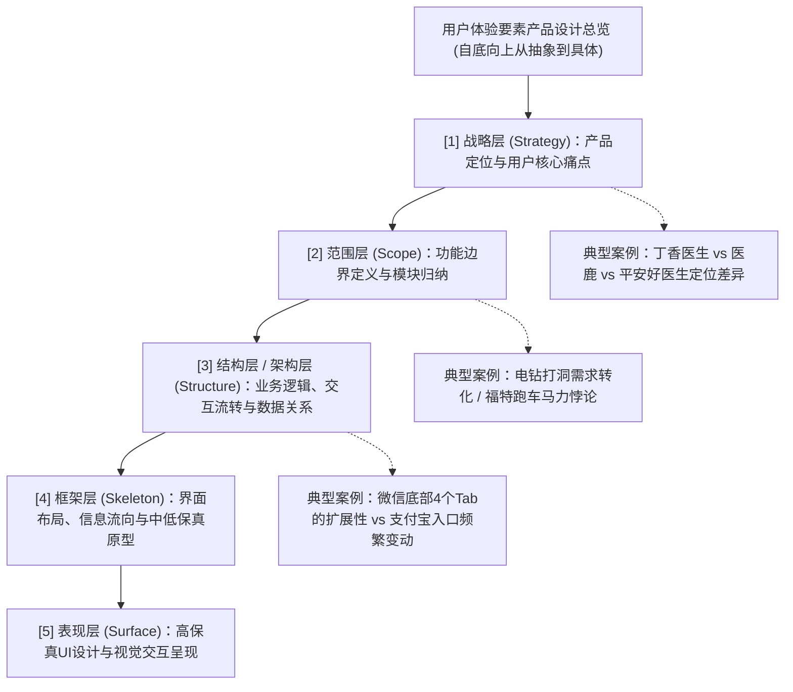
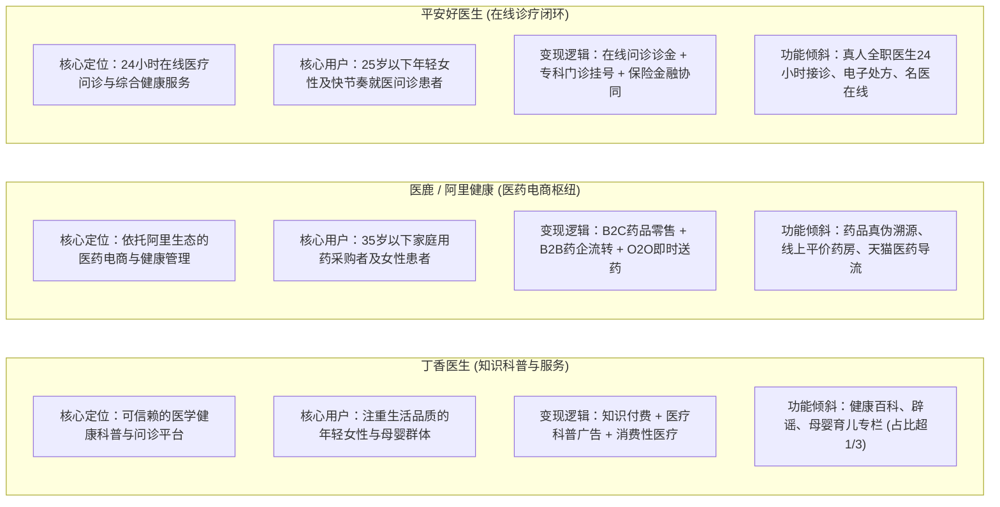
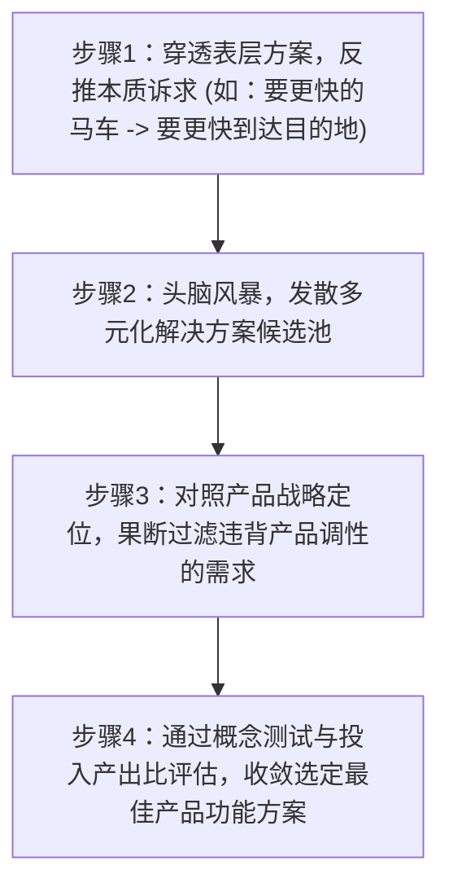
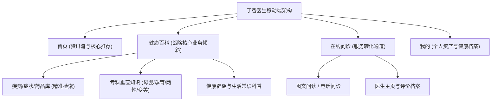
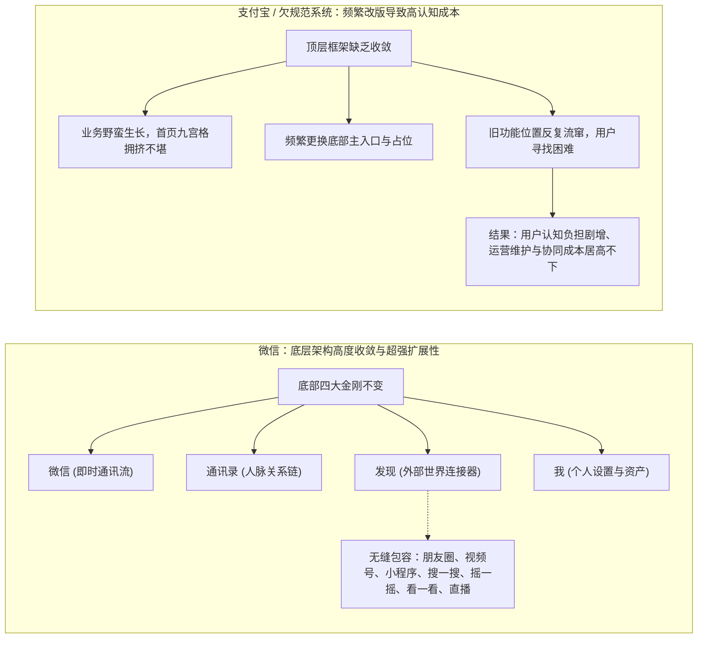

# 5.3-5.6 【实操】产品设计总流程与用户体验要素（战略层、范围层、架构层）

> [!IMPORTANT] 核心提要
> 产品设计本质上是一个**“将人类社会的模糊诉求翻译为技术与系统语言”**的结构化推演过程。在经典“用户体验五要素”模型中，产品设计遵循**自下而上、从抽象到具体、从概念到落地**的演进路径：**战略层**明确商业目标与用户诉求的博弈边界，**范围层**完成从“表层伪需求”向“产品功能包”的穿透与筛选，**架构层**则奠定决定系统数年生命力与扩展性的顶层骨架。

---

## 1. 产品设计总流程与用户体验五要素总览

### 1.1 产品设计的本质：“翻译”工作
在进入产品具体功能设计之前，团队通常会收集到海量散乱的用户需求、业务诉求与市场反馈。对于工程开发团队而言，直接面对这些原始需求往往“看不懂、理不清、无法直接编码实现”。
* **产品经理的核心价值**：充当“需求翻译官”。
* **翻译链路**：将散乱的人类诉求 $\rightarrow$ 转化为具体的业务规则与功能模块 $\rightarrow$ 梳理功能之间的前后勾稽与逻辑关系 $\rightarrow$ 最终以数据结构、原型交互界面与 PRD 规范的形式输出给研发与设计团队落地。

### 1.2 五大层级的流转特征与实操裁剪原则
1. **抽象到具体的递进**：必须从底部的战略层逐步向上推演。底层是顶层的地基，若战略层或架构层存在先天设计缺陷，顶层界面不论多华丽，产品扩展性与体验都会崩溃。
2. **各层级核心产出**：
   * **战略层/范围层**：输出产品规划方案、竞品分析报告、功能清单（Feature List）。
   * **架构层/框架层**：输出功能架构图、信息架构图、PRD（产品需求文档）及中低保真交互原型。
   * **表现层**：输出高保真 UI 设计稿、视觉规范与动效设计。
3. **实操中的非教条主义**：
   * 在实际企业产品研发中，并非所有项目都会完整、线性地严格走完五层标准流程；
   * 产品经理需结合自身产品阶段（0 到 1 探索期 vs 成熟期优化）及公司资源情况灵活裁剪，但大脑中的逻辑链条必须完整。

---

## 2. 战略层（Strategy Plane）：商业目标与用户诉求的博弈

### 2.1 战略层核心关注维度
明确战略层是产品安身立命的前提。界定战略层通常需依托规范化的评估框架，涵盖以下五个关键要素：

| 评估维度 | 核心定义与关注问题 | 典型示例（以“得到 APP”为例） |
| :--- | :--- | :--- |
| **产品名称** | 产品的品牌标识与心智代号 | 得到 APP |
| **产品定位** | 为谁解决什么核心场景下的本质问题 | 聚焦于为终身学习者提供碎片化、高浓度通识与专业知识的音频学习平台 |
| **商业模式** | 价值如何闭环变现，企业如何活下去并盈利 | 知识专栏订阅付费、大师通识课、电子书、实体书及线下大课 |
| **特色功能** | 区别于核心竞品的核心差异化卖点 | 名师主理人每日音频精选、文稿划线笔记、碎片化学习打卡机制 |
| **核心用户** | 具备明确支付意愿与特定痛点的目标客群 | 职场中高层白领、自我成长焦虑型青年、碎片化学习偏好者 |

### 2.2 用户诉求与企业目标的对立统一
> [!IMPORTANT] 核心认知：产品经理是各方利益妥协的操盘手
> * **用户的诉求**：往往追求极致体验与极低成本（例如在电商平台希望“以白菜价买到顶级大牌正品”）；
> * **企业的诉求**：追求存续发展与商业利润最大化（羊毛出在羊身上，企业不可能持续提供不切实际的高亏损服务）；
> * **产品经理的职责**：在用户价值与商业价值之间寻找黄金分割点，绝非盲目迎合用户的每一项要求。

### 2.3 医疗健康三大竞品战略层深度解构实战

通过横向对比丁香医生、医鹿（阿里健康旗下）与平安好医生（平安医家），可清晰观察战略层对后续产品设计的决定性影响：

#### （1）战略层关键洞察
1. **客群为何高度重叠于女性？** 
   医疗健康类产品的核心决策者多为女性，女性更注重全家老小的日常健康管理、养生预防与就医购药决策，具有高频打开与高粘性互动特征。
2. **战略定位决定核心功能侧重：**
   * **丁香医生**重在“知识与信任建立”，因此以疾病百科、谣言粉碎机为核心入口；
   * **医鹿**背靠阿里强大供应链与电商流量，聚焦于“药”的销售与溯源；
   * **平安好医生**重在“医生与诊疗服务”，强调自有全职医生团队 24 小时在线闪电接诊与保险联动。

---

## 3. 范围层（Scope Plane）：从用户需求到产品功能的精准转化

### 3.1 需求 vs 功能：警惕“电钻与打洞”陷阱
* **核心规律**：需求 $\neq$ 功能，需求与功能之间**绝非绝对的一对一映射关系**。
* **电钻理论**：用户买一把电钻（功能/载体），其真正需求是在墙上打一个直径 10mm 的洞（本质诉求）。如果未来有强力粘胶能免打孔承重，用户绝不需要电钻。
* **软件设计案例**：用户提出“希望有人监督我学习”，产品功能方案既可以是“建立学习互助组队系统”，也可以是“打卡保证金阶梯退还机制”，解决方案具备多样性。

### 3.2 深度警示案例：福特跑车马力悖论与体验反噬
> [!WARNING] 实操避坑：盲目迎合表面需求将摧毁核心体验
> * **事件背景**：某款畅销跑车第一代性能优异、市场火爆，最高车速约 180 迈。研发团队进行用户回访调研，询问用户为何喜欢该车，大量车主反馈“因为跑得快、追求速度”。
> * **错误决策**：产品与工程团队据此直接在第二代车型中盲目堆砌马力与流线降噪，将最高时速从 180 迈粗暴拉升至 250 迈。
> * **反常识结果**：第二代跑车推向市场后，**销量出现灾难性大幅下滑**。
> * **本质根因剖析**：
>   * 用户口中的“追求速度”，其潜意识底层的真实渴望是**“追求极速带来的肾上腺素飙升、强烈推背感与发动机排气管震颤轰鸣的刺激感”**；
>   * 盲目将马力拉至 250 迈并做极致流线静音后，日常驾驶中不仅无法合法跑出极速，原有的机械轰鸣与驾驶顿挫刺激感反而荡然无存；
>   * **产品启示**：在做软件产品迭代时，若盲目按照用户字面反馈“界面加个按钮”、“加个快捷做题入口”进行功能堆叠，往往导致整体视觉混乱、链路臃肿，最终引发整体留存与口碑崩塌。

### 3.3 需求向产品功能转化的四大实操步骤

1. **反推底层诉求**：用户往往只能给出他认知范围内的“解决方案”，产品经理必须剥离表象，反推心理动机；
2. **穷举功能方案**：围绕一个核心需求，设计多套可选的技术与业务交互路径；
3. **定位先验过滤**：
   * *案例*：作为深耕职场管理教育的在线机构，若个别学员提出希望开设 K12 辅导、英语口语或大规模线下培训，因与机构“线上线下一体化职业经理人孵化”的战略定位严重脱节，必须在范围层坚决舍弃，绝不可被单一客户需求打乱全盘规划；
4. **决策优选收敛**：结合开发成本、体验链路与商业价值进行综合方案评审与功能定型。

### 3.4 功能范围归纳与模块化拆解
* **避免陷入细节泥潭**：确定功能清单后，切忌过早卷入“具体按钮颜色、页面跳转特效”等细节，必须在宏观视角下对需求进行结构化归类与模块切分。
* **模块拆解原则**：**系统不等于模块**。系统偏向技术实现与架构划分，而**模块是从用户与业务应用诉求出发的功能归类聚合**，同一模块内部的功能逻辑应保持高度内聚。

---

## 4. 架构层 / 结构层（Structure Plane）：决定产品扩展性的顶层骨架

### 4.1 架构层的核心定位与专业壁垒
* **初阶 vs 高阶分水岭**：
  * **0~3 年产品经理**：大多聚焦于范围层与框架层，画原型、梳理页面流程、写具体执行层 PRD；
  * **3~5 年及高阶产品专家**：必须具备顶层产品架构设计能力，思考全局信息流转与系统扩展性；
  * **高阶共性**：优秀的高阶产品经理往往相当于“半个业务架构师或技术架构师”，需对业务逻辑抽象、数据中台流转及底层技术边界拥有极深理解。

### 4.2 B端架构与C端架构的特征差异
1. **B端产品架构（复杂多层）**：
   * *案例（大型政务信息化系统）*：通常自底向上划分为**基础设施层（服务器、硬件、云管平台）** $\rightarrow$ **数据中台与支撑层（多库交互、主数据流转、安全风控）** $\rightarrow$ **业务应用层（审批流、督办系统、协同办公）** $\rightarrow$ **终端信息渠道层（PC门户、移动大屏、政务APP）**；
   * 模块间交互与权限控制极度严密，架构图呈现复杂立体的系统工程特征。
2. **C端产品架构（交互流转为核心）**：
   * 侧重于前端页面的信息架构（Information Architecture）与交互设计（Interaction Design）；
   * 常见架构组织形态：**层级关系（Hierarchical）、线性关系（Linear）、矩阵关系（Matrix）、自然/自由布局（Organic）**。

### 4.3 丁香医生前端功能架构实操剖析
以丁香医生移动端为例，其前端架构高度聚焦于战略层赋予的核心使命：
* **一级导航四大模块**：【首页】、【在线问诊】、【健康百科】、【我的】。
* **业务资源倾斜**：【健康百科】在架构树中层级最深、分支最广，下辖疾病查询、症状检索、名医名院库、疫苗接种表、两性健康、孕育指南等十余个细分目录，彻底将战略层“打造全民医学百科”的定位在架构层面落地坐实。

### 4.4 经典深度对比：底层架构如何决定产品扩展性与认知成本

#### （1）微信的高扩展性典范
* 微信自上线以来，底部四大 Tab（**微信、通讯录、发现、我**）历经十年以上迭代基本固若金汤；
* 无论是后来爆发的**朋友圈、游戏、摇一摇、扫一扫，还是重构微信生态的小程序、搜一搜、视频号与直播**，均能天衣无缝地收敛在【发现】入口中；
* **价值体现**：用户的认知习惯完全被保护，系统扩展成本极低。

#### （2）反面参照：功能频繁变动与认知过载
* 某些产品（如改版初期的支付宝或某些内部做题系统）因前期缺乏顶层架构推演，随着新业务线上线，页面入口打架严重；
* 经常出现“新功能强行占位，导致原有常用功能被挤掉”、“用户需要耗费数分钟翻找入口”的现象；
* 架构混乱将直接诱发用户体验崩塌与运维研发成本指数级上升。

---

## 5. 全景对比与速查表（Cheat Sheet）

| 层级名称 | 核心定义与定位 | 关注核心问题 | 核心交付物 | 经典案例 / 典型陷阱 | 避坑要点与实操原则 |
| :--- | :--- | :--- | :--- | :--- | :--- |
| **战略层** (Strategy) | 产品的地基与商业指南针 | 我们要为谁解决什么本质问题？企业靠什么持续盈利？ | 商业模式画布、竞品分析报告、定位评估表 | **丁香医生 vs 医鹿 vs 平安好医生**：科普/电商/诊疗定位差异决定全盘走向 | 警惕把用户不切实际的愿望直接等同于产品定位；兼顾商业利益与用户体验。 |
| **范围层** (Scope) | 产品功能的边界与选型 | 我们需要做哪些功能去满足需求？哪些需求必须坚决过滤？ | 功能清单（Feature List）、业务需求矩阵、模块拆解图 | **福特跑车马力悖论**：车速从180升至250迈反致销量暴跌，忽视真实感官刺激诉求 | 谨记“电钻与打洞”原理；不可被用户提出的表面方案绑架；模块不等于系统。 |
| **架构层** (Structure) | 系统运作的顶层骨架 | 各功能模块间的信息如何流转？未来新增功能如何无缝承载？ | 功能架构图、信息架构图、业务流程图（Flowchart） | **微信底部Tab十年不变** vs **入口混乱导致用户认知过载** | 3-5年产品核心竞争力；设计之初必须为后续2-3年新业务扩展预留合理的挂载接口。 |
| **框架层** (Skeleton) | 页面布局与导航流转 | 页面界面如何排布？元素之间如何点击交互与反馈？ | 中低保真线框原型（Axure/Figma）、详细 PRD 规范 | 原型图交互逻辑不闭环、无异常状态分支定义 | 避免陷入死抠视觉细节的怪圈；聚焦于信息流向与界面逻辑完整性。 |
| **表现层** (Surface) | 感官视觉与品牌触达 | 用户第一眼感知到的色彩、排版、动效与品质感是什么？ | 高保真 UI 效果图、设计规范库（Design System） | 缺乏设计系统规范，导致各页面色彩、字号、间距风格割裂 | 紧密协同 UI/UE 设计师；确保视觉表现符合战略层确定的品牌调性。 |
