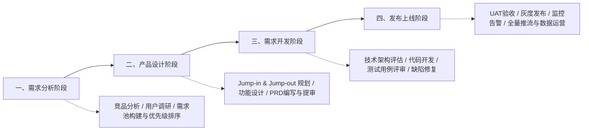
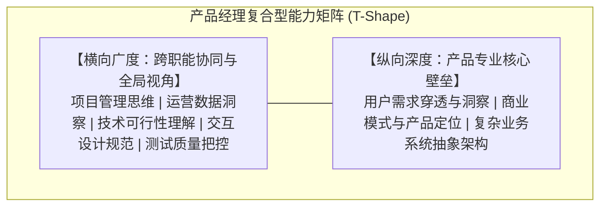
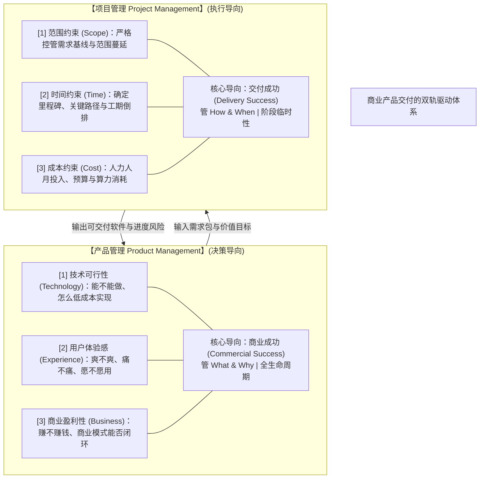

# 6.1-6.2 【实操】项目管理与风险应对规划及产品管理vs项目管理区别

> [!IMPORTANT] 核心提要
> 产品管理（Product Management）与项目管理（Project Management）是驱动商业产品落地的“双引擎”。**产品管理解决“做正确的事（Do the right things）”**，聚焦于用户体验、商业模式与技术可行性的三维交集，追求终极的**商业成功**与全生命周期价值；**项目管理解决“把事情做正确（Do the things right）”**，聚焦于范围、时间与成本的“铁三角”约束，追求阶段性确定目标的**高质量交付成功**。作为复合型产品经理，必须打破单一原型思维，建立全流程项目化视角与风险感知雷达。

---

## 1. 互联网产品开发全流程与项目化视角

### 1.1 互联网短平快开发 vs 传统制造业门径流程
* **传统 NPD（软硬件/制造业）**：流程拉得很长，采用严格的阶段门径（Stage-Gate）管理，前期开模、试制、供应链备货周期往往长达数月乃至数年，试错成本高昂。
* **互联网 C 端产品**：核心特征是**短、频、快**。采用敏捷迭代（Agile/Scrum）模式，版本按周或双周滚动演进，快速试错、快速上线、快速验证。

### 1.2 互联网产品诞生的四大核心阶段

1. **需求分析阶段**：
   * 借助一手定性/定量调研与二手竞品数据，洞悉用户真实心声；
   * 搭建需求池（Backlog），辨别真伪需求，完成优先级排序。
2. **产品设计阶段**：
   * 采用“跳进细节（Jump-in）与跳出全局（Jump-out）”的反复推演；
   * 产出功能架构、原型交互与标准化 PRD（产品需求文档），完成跨部门“提审”。
3. **需求开发阶段**：
   * 研发排期、技术编码、接口联调；
   * QA 编写并评审测试用例，实施功能测试、性能测试与 Bug 闭环。
4. **发布上线阶段**：
   * 产品走查与 UAT（用户验收测试）；
   * 灰度发布（Canary Release）、线上运行监控、全量发布及后续数据沉淀。

### 1.3 “一切皆可项目化”的管理延伸
> [!NOTE] 认知升级：项目管理绝不仅限于研发编码期
> 传统狭义理解往往将项目管理局限于“开发与测试排期”。但在现代互联网管理中，**每一个阶段均可被视作独立子项目进行精细化管理**：
> * 需求挖掘阶段：有明确的起止时间点、调研范围与交付物（需求池），是一个“需求调研项目”；
> * 原型设计阶段：有严格的评审节点与交付排期，是一个“产品规划设计项目”。

---

## 2. 产品经理能力进阶：构建“T型人才”知识模型

作为产品经理，不仅需要纵向深耕专业能力，更需横向构建多元视角的“T型（或 π型）人才”结构：

* **横向协同价值**：
  * **懂项目管理**：才能在资源短缺、排期延误时与项目经理、技术负责人平等对话，合理砍需求、保主干；
  * **懂运营管理**：才能在设计之初为后续数据埋点、拉新裂变与商业变现预留接口；
  * **懂技术边界**：才能准确评估方案可行性与研发复杂度，避免提出不切实际的天马行空方案。

---

## 3. 产品管理 vs 项目管理深度辨析

### 3.1 核心定义与内涵差异

#### （1）产品管理：关注“商业成功”与全生命周期
* **核心交集**：产品管理位于**技术、用户、商业**三大圈层的核心交界处；
* **终极目标**：**商业成功（Commercial Success）**。单纯把功能开发出来（研发成功），但若用户不买单、体验差、无变现能力，从产品角度看仍是彻底失败；
* **生命周期**：“既要负责十月怀胎生下孩子，更要负责抚养成人、走向社会创造价值”，贯穿概念酝酿、研发交付、运营推广直至产品退市的全流程。

#### （2）项目管理：关注“交付成功”与铁三角约束
* **核心概念**：项目是为创造独特的产品、服务或成果而进行的**临时性（有明确起止时间）**努力；
* **终极目标**：**交付成功（Delivery Success）**。在**范围（Scope）、时间（Time）、成本（Cost）**三大约束（项目管理铁三角）平衡下，按时按质按量产出交付物；
* **生命周期**：具有清晰的起止节点。功能交付上线、项目复盘验收完成，项目组织即告解散或转入下一周期。

---

### 3.2 产品管理与项目管理全景对比表

| 对比维度 | 产品管理（Product Management） | 项目管理（Project Management） | 实操冲突与协同建议 |
| :--- | :--- | :--- | :--- |
| **核心提问** | **What & Why** （我们要做什么？为什么做这个而不是那个？） | **How & When** （如何落地执行？何时能够交付上线？） | 产品定目标，项目保交付；产品不能越权包办具体技术排期细节。 |
| **导向属性** | **决策导向（Strategy & Discovery）** | **执行导向（Execution & Delivery）** | 产品决定“往哪里开炮”，项目确保“炮弹按时精准打出去”。 |
| **成功标准** | **商业成功** （市场占有率、留存率、ROI、收入与利润） | **交付成功** （按时交付率、Bug收敛率、成本预算偏差） | 严防“研发成功了但商业彻底失败”的自嗨陷阱。 |
| **管理周期** | **长期连续性** （涵盖创意、孵化、成长期、成熟期与退市全流程） | **短期临时性** （明确的启动点与验收关闭点） | 产品跨越多个迭代版本，每个迭代版本常由数个独立项目支撑。 |
| **约束条件** | 市场竞争格局、用户真实需求、商业闭环模式 | **范围、时间、成本（质量为底线铁三角）** | 遇到资源瓶颈时，产品经理应依据价值优先级主动作出范围取舍。 |
| **组织主导权** | **产品型公司**中产品处于主导核心，项目赋能落地 | **外包/项目制公司**中项目合同至上，产品往往弱化为客户代表 | 明确当前所在企业的组织形态，找准自身定位与发力切入点。 |

---

## 4. 实操中的博弈、冲突与避坑指南

### 4.1 典型冲突：需求变更与排期锁定的博弈
> [!WARNING] 实操避坑：严防“无节制范围蔓延”导致全员疲劳
> * **冲突根源**：产品经理出于市场敏锐度，在开发中途频繁新增或调整需求；项目经理与研发团队则以工期基线已锁死为由坚决拒收。
> * **破解法则**：
>   1. **守住基线原则**：进入冲刺（Sprint）编码期后，除致命阻断缺陷与重大合规风险外，非紧急新需求一律入池进入下一迭代，绝不在开发中途随意插单；
>   2. **等价交换原则**：若必须强行插入 P0 级战略新需求，产品经理必须遵循“加一必减一”规则，由产品经理主动裁撤同等开发工作量的低优先级需求，严禁“既要、又要、还要”。

### 4.2 避免认知误区：产品与项目的“包办与对立”
* **误区一：把技术交付当终点**。部分产品经理认为“PRD讲完、排期排好就万事大吉，上线了就算完事”，彻底丢失了运营思维与数据复盘意识；
* **误区二：在纯项目制企业中空谈产品定位**。若企业属于软件外包（甲乙双方合同制交付），此时满足客户合同范围、严控人力人月成本（项目成功）是第一优先级，强推长周期商业闭环往往与企业考核脱节。

---

## 5. 全景对比与速查表（Cheat Sheet）

| 管理领域 | 核心角色 | 核心关注点 | 核心工具/方法 | 交付成果物 | 关键避坑要点 |
| :--- | :--- | :--- | :--- | :--- | :--- |
| **需求与战略** | 产品经理 (PM) | 用户痛点、市场规模、竞争壁垒、商业变现路径 | 竞品分析画布、KANO 模型、用户画像 Persona、价值主张模板 | 商业需求文档 (BRD)、市场需求文档 (MRD)、初始需求池 | 警惕把内部伪需求或少数极端用户声音误判为大众刚需。 |
| **规划与设计** | 产品经理 (PM) | 场景闭环、业务规则、交互体验、架构可扩展性 | 流程图 (Flowchart)、Axure/Figma 原型、PRD 文档标准规范 | 产品需求文档 (PRD)、功能架构图、可交互中保真原型 | 严禁跳过架构规划直接抠视觉细节；确保所有异常状态闭环。 |
| **排期与研发** | 项目经理 (PjM) / 技术负责人 | 工期估算、关键路径、人员配比、代码质量与接口联调 | WBS 工作分解结构、甘特图、燃尽图、Jira / TAPD 任务板 | 研发排期表、技术架构设计说明书、每日站会进度日报 | 警惕工期预估过于乐观；必须预留联调缓冲（Buffer）时间。 |
| **测试与验收** | 测试工程师 (QA) / 产品经理 | 边界覆盖、缺陷等级、兼容性验证、业务逻辑还原度 | 脑图测试用例、Bug 缺陷跟踪平台、自动化回归脚本 | 测试用例评审纪要、Bug 统计看板、UAT 验收签字报告 | 坚决杜绝测试用例未经产品评审即执行，严防漏测核心主干逻辑。 |
| **发布与运营** | 产品/运营/运维联合团队 | 线上稳定性、灰度回滚策略、用户活跃留存、变现转化 | 灰度分流机制、埋点数据监控 (神策/Sensors)、APM 异常报警 | 灰度放量计划表、上线发布告警总结、产品迭代复盘报告 | 严禁全量一次性推流；必须制定详尽的线上回滚与故障应急预案。 |
