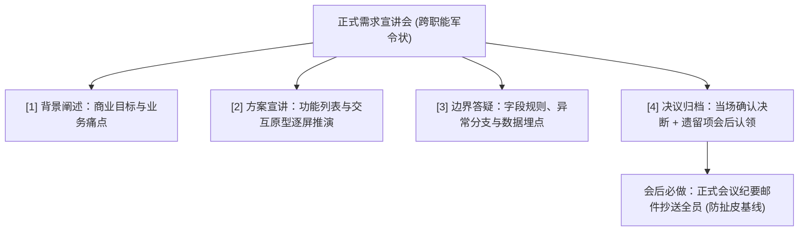
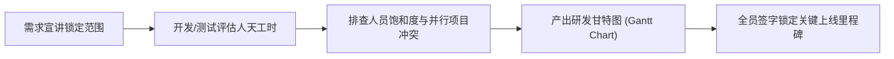
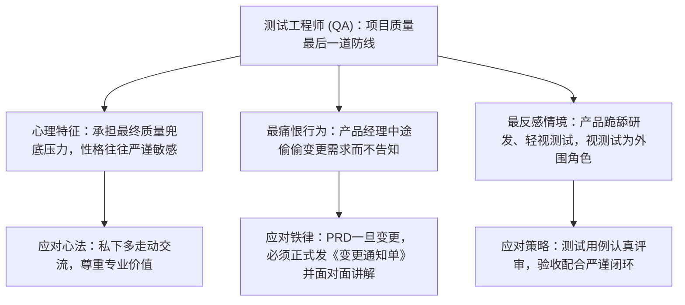

# 6.7-6.8 【实操】需求宣讲、确认资源排期、测试用例评审与开发进度跟踪

> [!IMPORTANT] 核心提要
> 当产品经理完成功能架构设计、交互原型绘制及 PRD（产品需求文档）编写后，项目便正式由“纸面规划”跨入“工程实施”。从设计阶段向开发阶段跨越的过程中，**需求宣讲会（需求评审会）是全员共识的军令状，资源排期是确定交付节奏的契约，测试用例评审是铸造质量防线的关卡，进度跟踪则是动态纠偏的雷达**。产品经理必须兼备专业深度与高情商博弈能力，牢牢掌控推进节奏。

---

## 1. 需求宣讲会（正式需求评审）：全员共识的现场控场与博弈

### 1.1 内部需求评审 vs 正式需求宣讲会
* **产品内部需求评审**：范围局限于产品团队内部及少数核心部门 Leader，聚焦于产品商业定位、核心场景闭环与逻辑合理性。
* **正式需求宣讲会（跨职能需求评审会）**：
  * **参会人员**：辐射全体项目团队，包括**前端开发、后端开发、测试（QA）、UI/UE 设计师、运维、运营及项目经理（PjM）**；
  * **会议目标**：达成跨部门共识。此会议一旦通过，研发团队将直接进入工程开发排期，是项目正式启动的法定标志；
  * **PRD 必备要素清单**：需求背景与商业目标、版本修订记录、功能架构列表、详细交互原型、字段级业务规则说明、数据埋点需求、非功能性/性能安全指标。

---

### 1.2 需求宣讲会五大高频冲突场景与实操破局法

#### 场景一：业务价值与优先级反复被挑战
* **开发/测试质疑**：“为什么要做这个需求？这个需求真有价值吗？上个版本做的那一堆东西也没人用啊！”
* **错误应对**：态度傲慢或不耐烦地回呛——*“这个方案我早就跟你们老大对过了，难道你们 Leader 没在部门内同步吗？”*（极易引发对立情绪）。
* **正确破局法**：
  * **不厌其烦地重申业务全局**：将业务痛点、竞品态势与商业目标清晰传达给基层研发工程师，让执行层明确感知“所做工作的业务价值与成就感”；
  * **用数据说话**：列出用户调研访谈原声或运营埋点数据，增强需求的客观说服力。

#### 场景二：研发工程师以“技术难度极大/排期一个月”为由推脱
* **研发真实心理**：研发团队天生具备防御心理，常通过虚报工期或夸大技术壁垒来试探产品经理的专业底线，争取摸鱼缓冲。
* **正确破局法**：
  1. **会前非正式对齐（私下先沟通）**：
     > [!TIP] 会议潜规则：会前做足功课，会上只做决策
     > 绝不可在毫无铺垫的情况下把复杂新功能直接扔上评审会。应在会前提前找核心技术骨干、架构师进行 1 对 1 技术预估，给予充分尊重，避免在评审会上遭遇当场突袭与公然反对。
  2. **任务倒排推演法**：
     * 产品经理保持底线（锁死最终上线节点），反推研发工期：*“请帮忙拆解一下这一个月的具体计划，第一天做什么？接口联调几天？核心卡点在哪？”*
     * 绝大多数水分过大的工期预估在细化拆解推演下均会自然收敛。
  3. **战略弹性与折中**：在不影响核心上线节奏的前提下，产品经理可适当做非核心体验的妥协，有理有据有节。

#### 场景三：原型交互细节与边界条件当场被钻漏洞
* **典型问题**：开发突然提问——*“这个输入框限制最多几个字符？未满限制怎么报错？网络超时怎么降级？断网重连怎么处理？”*
* **应对原则**：
  * **小问题现场拍板**：对于字符数限制、占位文案、常用校验等通用交互问题，产品经理必须依据行业成熟规范当场决断，**切忌犹豫不决、支支吾吾**，展现专业自信；
  * **大问题列入待跟进项（Pending List）**：对于涉及跨系统架构调整的复杂细节，当场记录为遗留事项，约定会后小范围对齐，严防会议被个别细节拉偏跑题。

#### 场景四：跨部门资源依赖与“推诿甩锅”
* **开发推诿说辞**：*“做这个功能必须调用某中台部门/某业务线的数据接口，你们产品跟他们打过招呼了吗？他们不给接口我们没法做！”*
* **正确破局法**：
  * **会前闭环**：在开会前务必先与外部依赖部门 Leader 取得书面或邮件确认，会上直接出示证明，瞬间堵住借口；
  * **现场电话连线**：若会前确实遗漏，**必须当着全体参会人的面直接打电话沟通**，当场明确对方支持意愿与时间表，**坚决杜绝“会后再说”**（会后极易无限期搁置导致项目流产）。

#### 场景五：会后口头答应、事后扯皮赖账
> [!WARNING] 实操死穴：开会不开纪要，等于全盘白开
> 所有人都在会议室口头点头，但会议一旦结束，极易出现“记忆偏差”或“选择性遗忘”。
> * **铁律**：评审会结束后 **2 小时内**，产品经理必须发布标准格式的《需求评审会议纪要》，通过**工作邮件正式抄送项目组全员及各部门总监**（微信/企微群发仅作通知，邮件作为法律证据基线）；
> * **纪要核心内容**：通过的功能范围清单、砍掉或延期的功能、新增待跟进项负责人及 Deadline、确定的正式研发与上线排期基线。

---

## 2. 确认资源排期：锁定研发执行的关键路径

### 2.1 角色定位与职责边界
* **在正规中大型团队中**：由项目经理（PjM）主导工期排定，产品经理协助对齐优先级；
* **在中小型敏捷团队中**：产品经理往往身兼项目经理职责，必须直接掌控资源排期。

### 2.2 资源排期两大顽疾与应对策略
1. **“人手不足/人都在别的项目上”**：
   * **协同借力**：排查其他项目是否有类似功能正在开发，推动架构层抽象为通用组件或微服务模块，实现**跨项目复用与平台化开发**；
   * **长期资源过载**：若研发长期处于超负荷饱和状态，产品经理需运用 NPDP 组合管理（Portfolio Management）工具，向管理层提报资源瓶颈，推动招聘编制或优先级重新洗牌。
2. **“排期被压后/时间冲突”**：
   * 采用“工作量挤压与时间倒排”，依据商业上线的刚性节点（如电商大促、行业政策截止期）倒逼工期，与技术负责人协商砍掉 P2/P3 级非核心功能以保主干。

---

## 3. 测试用例评审：质量防线与跨职能协同心法

### 3.1 测试用例（Test Case）的核心价值与产品参与的必要性
* **什么是测试用例？** 测试工程师（QA）基于 PRD 和原型，穷举产品在正常流、逆向流、极端网络、边界输入、高并发等多元场景下的期望表现与校验规则集合。
* **产品经理为何必须全程参加用例评审？**
  * 验证 QA 对需求业务逻辑的理解是否与产品初衷存在偏差；
  * 补齐 PRD 中未能完全覆盖的极端边界场景与降级逻辑；
  * 提前规避开发阶段的理解割裂，确保验收测试一次性过关。

### 3.2 跨职能协同：产品经理与测试工程师的相处艺术

> [!CAUTION] 团队协作最大雷区：静默变更需求
> 测试工程师严格按照第一版 PRD 耗费数天编写了上百条测试用例，结果在执行测试时发现“功能早已变动、而自己竟毫不知情”，这将导致 QA 前期工作全盘作废，直接诱发激烈的团队信任危机。
> **铁律**：PRD 一旦发生任何字段、逻辑或流程变更，产品经理必须做到：
> 1. 更新 PRD 顶部版本修改记录（详细标红变动内容）；
> 2. 第一时间在项目群中发布正式变更公告；
> 3. 亲自走到测试工位前面对面口头同步并确认答疑。

---

## 4. 开发进度多维跟踪与敏捷沟通闭环

项目进入工程编码阶段后，产品经理必须通过严密、多维的沟通机制监控进度偏差，确保“过程透明、风险早现、动态纠偏”。

### 4.1 正式沟通机制矩阵

| 沟通机制 | 频次 / 周期 | 核心参会人 | 核心关注内容 | 交付成果物 |
| :--- | :--- | :--- | :--- | :--- |
| **每日站会** (Daily Standup) | 每日早晨 (15分钟内) | 全体项目成员 | 1. 昨天完成了什么？ 2. 今天计划做什么？ 3. 遇到了什么卡点与阻碍？ | 每日进度简报 / 敏捷看板更新 |
| **每周项目例会** (Weekly Meeting) | 每周固定时间 (45~60分钟) | 项目核心负责人 | 1. 本周里程碑达成情况 2. 关键路径进度偏差分析 3. 风险应对方案落实 | 正式项目周报（抄送领导层） |
| **测试用例评审** (Test Review) | 开发中期 (提测前3~5天) | PM、QA、前后端开发 | 1. 功能分支与异常场景覆盖度 2. 业务逻辑与PRD一致性核对 | 经评审通过的最终测试用例集 |
| **里程碑体验会** (Demo Day) | 关键节点 / 封板前 | PM、UI、核心业务方 | 1. 在演示环境中体验主干流转 2. 提早发现体验走样与交互硬伤 | 体验走查缺陷清单 (Bug List) |

### 4.2 非正式沟通的润滑作用
* 进度跟踪不应完全依赖冰冷的例会与看板；
* 善用“午餐同行、下午茶闲聊、工位小步走动”等非正式沟通，往往能提前嗅探到技术卡点、跨团队配合摩擦或人员负面情绪，在风险彻底爆发前完成私下疏导与资源协调。

---

## 5. 全景对比与速查表（Cheat Sheet）

| 项目管理节点 | 核心目标 | 核心参与方 | 核心输入物 | 核心产出物 | 致命陷阱与避坑秘籍 |
| :--- | :--- | :--- | :--- | :--- | :--- |
| **需求宣讲会** (需求评审) | 达成全员共识，确立项目开发法定基准 | 产品、开发、测试、设计、运维、运营、PjM | PRD文档、交互原型、接口规范草案 | 正式评审会议纪要、待跟进事项列表 | **忌**：会前不做私下沟通导致现场被技术公然否定。 **秘籍**：会前 1 对 1 对齐关键人；小细节当场拍板；大分歧会后跟进；会后必发邮件纪要留痕。 |
| **资源排期确认** | 锁定人员工时，确立关键路径交付节点 | 产品经理、技术主管、PjM、核心开发 | 经过评审定型的功能清单、业务上线死线 | 项目甘特图、开发阶段排期表 | **忌**：轻信研发虚高预估，放任工期失控。 **秘籍**：倒排推演法挤干工期水分；推动模块平台化复用；长期资源短缺上报组合管理。 |
| **测试用例评审** | 筑牢质量防线，消除业务理解盲区 | 测试工程师、产品经理、技术开发 | PRD文档、测试工程师编写的用例草案 | 评审定型用例集、PRD遗漏场景修正项 | **忌**：轻视测试角色；需求偷偷修改不通知测试。 **秘籍**：尊重大结局把关人；任何微小需求变动必须发布正式变更说明并当面答疑。 |
| **开发进度跟踪** | 监控进度偏差，及时拔除阻塞卡点 | 全体项目团队成员 | 项目甘特图、Jira任务看板、代码仓库分支 | 每日站会日报、每周项目例会周报、风险预警通知 | **忌**：等到提测当日才发现进度严重滞后。 **秘籍**：每日站会捕捉阻碍；善用非正式沟通融洽氛围；关键节点提前召开产品体验会走查。 |
