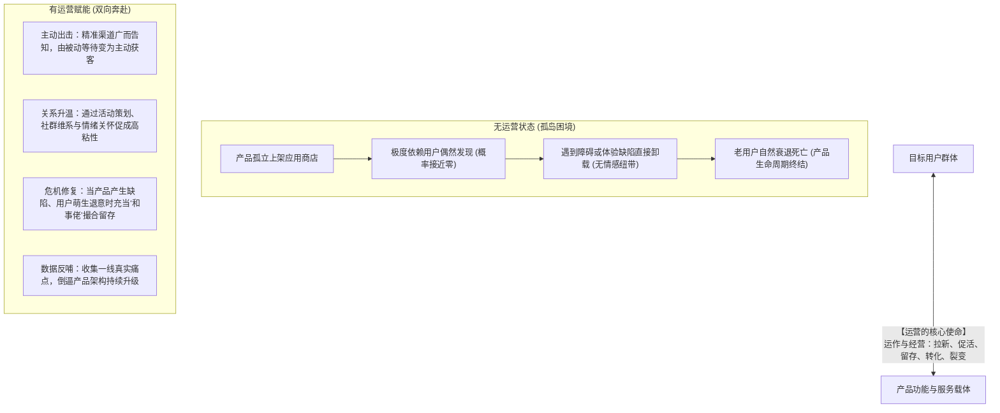
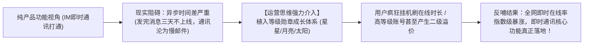
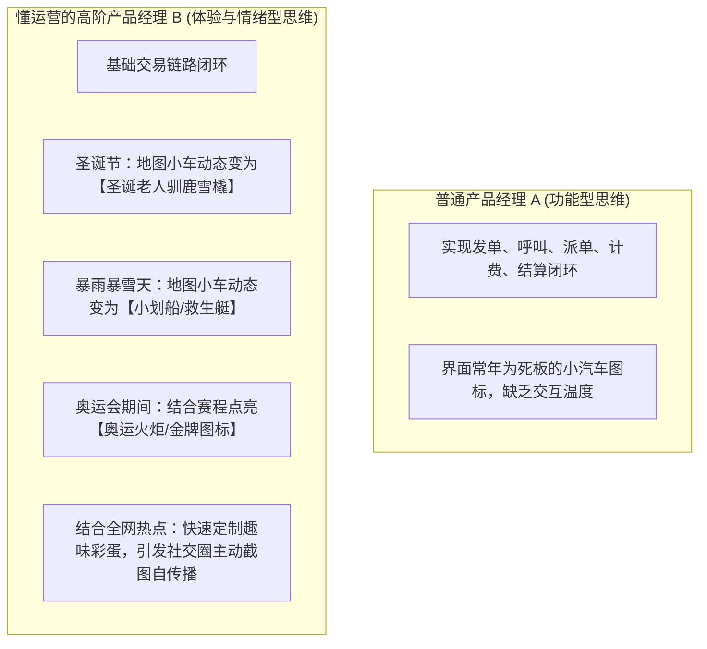
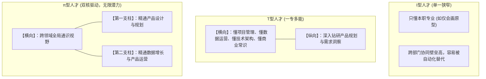

# 7.1-7.3 【实操】产品运营的价值、基本概念与T型产品人才发展

> [!IMPORTANT] 核心提要
> “酒香也怕巷子深”，任何卓越的产品若脱离了精细化运营，都难以在激烈的市场竞争中独自存活。**运营的本质是“运作与经营”——充当产品与用户之间的“媒婆”与“催化剂”，其终极使命是建立、维系并加速产品与用户之间的连接与连接效率**。优秀的产品经理绝不能画地为牢，必须吸收运营思维，从单一技能的“I型人才”进化为兼备商业敏感度与跨界协同能力的“T型”乃至“π型”复合型人才。

---

## 1. 行业宏观感知与用户深度洞察

在进入运营体系之前，产品人必须建立对互联网人才结构与用户心理底层的客观感知：

### 1.1 互联网人才分布与岗位结构
* **行业基数**：截至 2019~2020 年，中国互联网核心从业人员约为 **1700 万人**；
* **产品经理占比**：约占 **6%～8%**（约 100~130 万人），岗位综合素质要求极高，准入门槛相对陡峭；
* **运营人员占比**：约占 **17%**（约 280~300 万人），细分为内容运营、用户运营、活动运营、增长运营等专业方向；
* **人才启示**：运营岗位基数大、需求广且更贴近市场前沿，既是初学者切入互联网核心业务的绝佳跳板，也是产品经理建立市场同理心的必修课。

---

### 1.2 经典商业洞察三连问与反常识案例

#### （1）需求洞察案例：下沉市场特步为什么卖不过耐克？
> [!NOTE] 真实商业调研背后的“心理隐喻”
> * **反常识现象**：在三四线城市及县域市场，按常理特步更具下沉渠道和价格优势，但在学生群体中却常被高价的耐克反超。
> * **底层洞察**：
>   * 在下沉市场，父亲往往常年外出打工，孩子的日常照料与学业决策多由母亲主导；
>   * 母亲群体对孩子的升学考试寄予厚望，对吉祥暗示与考学心理极为敏感；
>   * **视觉符号心理隐喻**：耐克的品牌标识是**“对勾（√）”**，在考卷语境中象征“题目全对、考满分”；而特步的标识是**“交叉（×）”**，象征“打错扣分”；
>   * 特步高管在年度复盘会上曾反思：早期品牌符号设计未能深度契合核心购买决策者的潜意识心理，导致在教育焦虑极重的家长群体中产生了天然抗拒。

#### （2）产品人性化反思案例：苹果 iOS 与支付宝的认知成本
* **苹果 iOS 应用排列机制**：新下载或删除 App 时，全屏图标自动向前补位填空，彻底破坏了用户的空间视觉记忆（Muscle Memory），大幅增加寻找成本；
* **苹果取消 3.5mm 耳机孔**：早期将耳机孔与充电孔合二为一，打破了“边充边听”的原生习惯，唯有顶级行业巨头能承担“教育用户心智”的巨大代价，中小企业切勿盲目效仿；
* **支付宝入口反复流窜**：因缺乏底层架构定力，常用功能（花呗、借呗）频繁被新业务强行顶替，用户认知负担与反感情绪倍增。

---

## 2. 运营的本质定义与核心价值模型

### 2.1 破除误区：“产品生孩子，运营养孩子”？
* **传统观点的片面性**：有人常说“产品和研发负责生孩子，交付之后运营负责养孩子”；
* **深刻纠偏**：生孩子固然主要是产品与技术的工作，但“养孩子”绝不仅是运营的独角戏。产品上线后，**产品经理必须依据数据持续迭代演进，技术团队必须持续维护优化，全团队都在共同“抚养成才”**。

### 2.2 运营的本质：“媒婆”与“催化剂”
1. **概念拆解**：**运营 = 运作 + 经营**。
2. **核心定位**：运营是产品与用户谈恋爱过程中的**“超级媒婆”**：
   * 在用户未感知前，到处“奔走相告”，将产品的核心卖点精准送达目标客群；
   * 在使用磨合期，通过活动、积分、权益与情绪关怀让关系“迅速升温”；
   * 当产生误解或疲态时，充当“和事佬”化解矛盾，维系长期安稳关系。
3. **核心价值**：**解决并强化产品与用户之间的“连接问题”与“效率问题”**。

---

## 3. 运营思维反哺产品设计的经典实战

产品经理若缺乏运营思维，设计出来的往往只是“功能可用但毫无生气”的冰冷代码；而融入运营思维后，产品将具备自驱动的生命力：

### 3.1 经典案例一：QQ 等级成长体系（太阳、月亮、星星）

* **背景痛点**：早期 QQ 作为即时通讯软件，底层发文字、收消息功能完全走通，但在实际场景中，用户往往发一条消息后就下线，对方几天后才上线回复，**即时通讯沦为“异步电报”**；
* **运营反哺设计**：产品团队并未单纯优化网络收发速度，而是创新引入**“在线时长成长体系”**（累计活跃天数兑换星星、月亮、太阳勋章）；
* **惊人效果**：成长等级直接激发了用户的虚拟荣誉感，引发了全网通宵挂机狂潮（甚至衍生出付费代挂产业链与高等级账号溢价）。用户全天候在线，彻底激活了“即时互动”的商业生命力。

---

### 3.2 经典案例二：滴滴打车借势营销与情绪价值设计

* **体验升级**：产品经理 B 通过轻量级的视觉资源配置，将冷冰冰的地图工具转化为兼具娱乐性、场景感与情绪价值的交互场域；
* **商业价值**：初次使用者因惊喜彩蛋产生深刻记忆，自然促发朋友圈社交裂变，实现了极低成本的促活与自传播。

---

## 4. T型与π型人才成长路径：王兴与校内网创业启示

### 4.1 美团王兴早期创业的“三人复合模型”
* **历史背景**：王兴在创办美团之前，曾主导打造了风靡全国的校园社交平台**校内网（后更名为人人网）**。
* **成功根因解密**：同时期全国有 6~7 个顶尖技术团队在做同类校园社交产品，融资失败只是表象，王兴在一线访谈中披露的最核心胜负手是**创始团队的能力复合性**：
  * **竞品团队致命短板**：要么清一色是纯技术极客（不懂用户心理与运营推广），要么全是销售/运营（不懂产品架构与技术实现），短板极其明显；
  * **校内网铁三角结构**：三人核心团队中，**一人专精产品、一人精通技术、一人深谙运营**，能力高度互补闭环，产品设计从第一天起就兼顾了技术实现边界与后续运营推广效率。

### 4.2 人才进化三部曲：从 I型 到 T型 再到 π型
1. **淘汰 I型人才**：仅掌握单一纵向技能（如只会写 PRD），对上下游职能一无所知，在组织协同中充满壁垒与抵触，极易被工具化；
2. **立足 T型人才**：在产品专业立足深耕的同时，横向通晓项目管理、数据运营、交互设计与技术常识，能够听懂各方语言并顺畅对话；
3. **追求 π型人才**：$\pi$ 代表无限循环（3.1415926...），代表无限可能。打造**“产品架构 + 数据增长运营”**的双核心专业支柱，在职场中建立不可替代的差异化壁垒。

---

## 5. 全景对比与速查表（Cheat Sheet）

| 维度 | 传统产品视角（偏研发思维） | 运营赋能型产品视角（复合思维） | 核心工具 / 典型案例 | 关键收益与避坑指南 |
| :--- | :--- | :--- | :--- | :--- |
| **产品目标** | 交付功能、满足逻辑闭环、系统按期上线 | 驱动用户使用、提升留存活跃、达成商业闭环 | **QQ 等级勋章体系** | 严防“研发按时上线了但无一人使用”的资源浪费。 |
| **用户连接** | 被动等待：上架后等待用户搜索与自然下载 | 主动触达：渠道分发、裂变玩法、情绪共鸣 | **滴滴打车暴雨划船/圣诞彩蛋** | 好的设计自带自传播属性；善用借势营销放大产品声量。 |
| **需求输入** | 依靠阶段性问卷调研、高层拍脑袋、竞品抄袭 | 依靠一线用户社群动态反馈、转化漏斗埋点数据 | **神策/Sensors 数据漏斗埋点分析** | 运营是一线用户的传声筒；产品必须建立日常数据巡检机制。 |
| **人才模型** | **I型人才**：只会画 Axure 原型，缺乏全局观 | **T型 / π型人才**：懂技术、懂设计、精通运营与增长 | **校内网三人团队成功案例** | 走出舒适区，系统性学习运营与项目管理知识，破除职场瓶颈。 |
| **下沉市场洞察** | 依靠自身主观偏好与理性逻辑推演 | 深入现场，尊重目标客群的非理性与文化心理 | **特步 vs 耐克下沉市场符号隐喻** | 商业决策不可傲慢；用户深层心理暗示往往超越价格与品牌本身。 |
