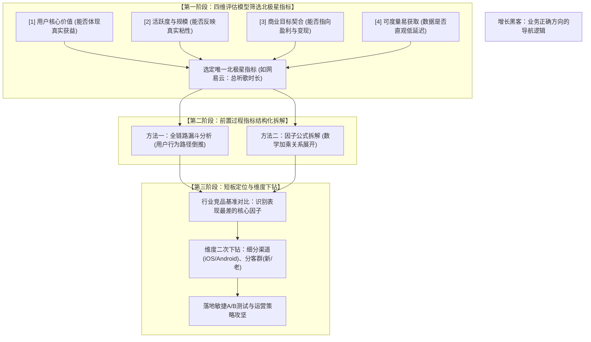
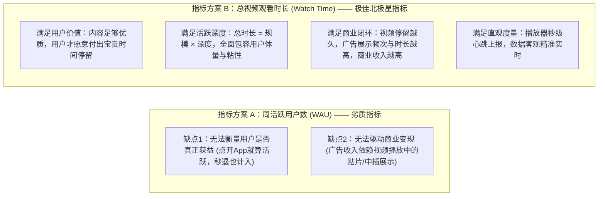
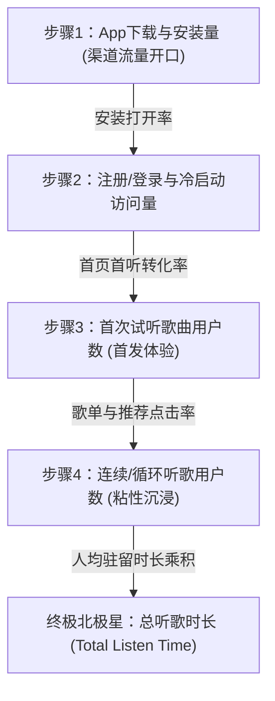
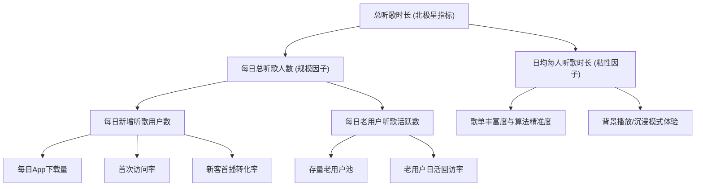

# 7.11-7.12 【实操】找到业务方向：如何制定北极星指标与指标分解优化

> [!IMPORTANT] 核心提要
> 增长黑客（Growth Hacker）的核心方法论依托于两大底层支柱：**其一是“学好巴菲特”——通过制定科学的北极星指标（North Star Metric）找到业务长远发展的正确方向，做时间的朋友；其二是“学好爱因斯坦”——基于数据假设展开科学实验与敏捷证伪**。北极星指标作为业务航向的唯一灯塔，若定位失偏，全团队的努力都将沦为“南辕北辙”。产品与运营必须依托“四维评估法”精准锚定北极星指标，并熟练运用“全链路漏斗法”与“因子公式分解法”，将其拆解为可归因、可落地的过程行动指南。

---

## 1. 业务方向破局：为何必须确立北极星指标

### 1.1 导入思考：谷歌搜索产品经理经典面试题
> [!NOTE] 真实面试考题：用户搜索“如何打领带”，该展示哪个结果？
> * **情境**：用户在谷歌搜索框输入“如何打领带”，搜索算法召回两个视频结果：
>   * **视频 A**：1分钟快速标准教学，步骤极简明了；
>   * **视频 B**：8分钟幽默搞笑脱口秀式教学，娱乐性极强、时长充分。
> * **决策剖析**：80% 以上的优秀产品经理均会坚定选择将**视频 A** 排在最顶部。
> * **本质逻辑**：必须穿透用户搜索行为背后的场景与本质诉求。用户在此场景下的迫切诉求是**“快速掌握打领带技能并出门赶赴正式场合”**，而非娱乐打发时间。视频 A 能在最短时间内向用户提供最纯粹的核心价值。
> * **方法论映射**：评判业务是否朝向正确方向演进，第一要务是衡量**“产品是否真正解决了用户的本质诉求并输出了核心价值”**。

---

## 2. 制定北极星指标的四大黄金评估维度

优秀的北极星指标必须能够全面覆盖以下四个核心维度，缺一不可：

| 评估维度 | 核心关注问题 | 正面示例 | 反面避坑示例 |
| :--- | :--- | :--- | :--- |
| **维度一：用户核心价值** (User Value) | 该指标能否直接反映用户切实从产品中获得了核心价值？ | **视频总观看时长**：内容优质用户才愿意持续驻留消费。 | **页面访问量（PV）**：用户可能误触或因标题党点击，秒关离开无价值。 |
| **维度二：用户活跃与规模** (User Activity) | 该指标能否综合反映产品活跃用户的真实广度与深度？ | **总消费时长 / 总完成订单量**：涵盖总盘规模，杜绝极值失真。 | **人均使用时长**：极少数极端重度用户能拉高均值，掩盖大盘流失。 |
| **维度三：商业价值闭环** (Business Success) | 该指标能否必然驱动企业的盈利增长与商业战略达成？ | **付费学习用户数 / GMV**：指标提升必然直接带来营收增长。 | **纯注册用户数**：注册后沉睡的僵尸用户无法带来任何现金流。 |
| **维度四：可度量与易获取** (Measurability) | 该指标的数据采集是否直观、简单、准确且具备高时效性？ | **日/周交易成交笔数**：业务数据库实时准确统计。 | **复杂加权折算比率**：如“近三月定房且好评用户占比”，链路过长难以实时监控。 |

---

### 2.3 标杆对决：YouTube 视频平台北极星指标选型复盘

以全球最大视频平台 YouTube 为例，探讨为何将**“总视频观看时长（Total Watch Time）”**设为最高北极星指标，而非“日/周活跃用户数（DAU/WAU）”：

---

## 3. 主流互联网产品北极星指标实战矩阵

| 产品类型 / 标杆产品 | 推荐北极星指标 | 劣质 / 虚荣指标 | 选型底层逻辑深度剖析 |
| :--- | :--- | :--- | :--- |
| **视频流媒体** YouTube / 抖音 / 哔哩哔哩 | **总视频播放时长** (Total Watch Time) | 活跃用户数 (DAU) 单条视频点击率 | 视频平台商业本质是“注意力经济与广告变现”。点击率高可能是封面党，唯有总播放时长能兼顾用户满意度与广告位库存。 |
| **内容资讯** 今日头条 / 腾讯新闻 | **总内容阅读时长** | 文章总点击量 (PV) | 标题党会造成点击量虚高，但用户受骗后迅速退出。有效阅读时长才能沉淀真实阅读心智。 |
| **知识付费** 得到 APP / 知识星球 | **活跃学习用户数** (付费且持续听课者) | 平台访问用户数 | 得到本质是严肃知识付费产品。仅打开 App 闲逛而不消费课程无意义，必须以“产生持续学习行为的人数”为导向。 |
| **社交公域号** 微信公众平台 / 订阅号 | **产生有效阅读的粉丝数** | 累计总关注粉丝数 | 绝大多数老账号充斥大量死粉、注销号与静默粉。唯有每篇推文产生完整阅读行为的活跃粉丝数代表真实商业号召力。 |
| **旅行民宿平台** Airbnb (爱彼迎) | **总预订客房晚数** (Nights Booked) | 房源浏览量 复杂加权占比指标 | 平台核心价值在于促成住客与房东的撮合交易。每一晚真实入住都同时为双端带来价值，并直接对应平台抽佣收入。 |
| **音乐流媒体** 网易云音乐 / QQ音乐 | **总听歌播放时长** | 评论/弹幕发送总数 | 音乐产品的核心第一性原理是“听歌”，社区评论与弹幕仅是辅助调味剂。大盘听歌总时长是衡量曲库丰富度与推荐精准度的终极标尺。 |
| **综合电商平台** 淘宝 / 京东 / 拼多多 | **GMV 交易总额** (或成功订单总数) | 注册用户数 商品加购件数 | 电商平台的平台抽成（Take Rate）与广告推广费（直通车）直接与交易总额绑定，GMV 完美兼顾了商户规模与消费活跃度。 |
| **协同办公平台** 钉钉 / 飞书 / 企业微信 | **每周有效会话/消息总数** | 累计注册企业数 | 企业可能因行政命令注册安装，但实际沟通仍流窜至个人微信。唯有高频的组织内消息与协同交互总数，才代表产品已真正生根。 |

---

## 4. 北极星指标结构化分解与落地优化

> [!WARNING] 实操陷阱：切忌对着“结果指标”抓耳挠腮
> 北极星指标（如“总听歌时长”）属于典型的**滞后结果指标（Lagging Indicator）**。产品经理与运营人员无法凭空向团队下达“明天把总时长提升 20%”的指令。**必须将其拆解为细分的、前置的过程行为指标（Leading Indicators），找到短板环节各个击破**。

### 4.1 方法一：全链路漏斗分解法（User Journey Funnel）
* **核心思维**：梳理用户达成最终结果行为之前的**端到端行为路径（上游链路）**，计算各环节转化率，定位断流节点。
* **以网易云音乐“总听歌时长”为例的用户全链路推演**：

* **实操诊断法**：当总听歌时长低迷时，按链路倒推排查：
  * 若是前端步骤 1 $\rightarrow$ 步骤 2 流失严重，说明获客渠道质量差或包体安装包报错；
  * 若是步骤 2 $\rightarrow$ 步骤 3 转化率骤降，说明首页推荐内容不符合新客偏好，冷启动策略需重构；
  * 针对最薄弱的漏斗节点展开针对性功能与运营攻坚。

---

### 4.2 方法二：因子公式拆解法（Factor Equation Decomposition）
* **核心思维**：将北极星指标抽象为严密的数学公式，自上而下逐层展开为子因子（类似于 WBS 工作分解结构与杜邦分析法）。

#### （1）网易云音乐因子公式层级推导
$$\text{总听歌时长} = \text{每日总听歌人数} \times \text{日均每人听歌时长}$$

继续向下拆解“每日总听歌人数”：
$$\text{每日总听歌人数} = \text{每日新增听歌用户数} + \text{每日老用户听歌活跃数}$$

继续深入底层微观因子：
$$\text{每日新增听歌用户数} = \text{日均 App 下载量} \times \text{首次打开转化率} \times \text{首曲播放率}$$
$$\text{每日老用户听歌数} = \text{存量老用户大盘基数} \times \text{老用户每日回访促活率}$$

---

### 4.3 寻找优化突破口的两步实操法则

#### 步骤一：提取现状最差因子，对标行业大盘基准
* 通过日常埋点监控所有末端细分因子，找出数值表现最低、转化率最差的指标；
* **横向对比行业与核心竞品数据**：
  * 若某项数据表现差，但行业竞品普遍更差，说明受行业物理属性限制，优化上限狭窄；
  * 若某项数据落后于行业平均值 30% 以上，说明存在巨大系统性缺陷，此短板即为**ROI 最高的战略突破口**。

#### 步骤二：若大盘数据拉平，果断进行“维度下钻（Drill-down）”
> [!TIP] 高阶分析技巧：整体看似平庸，细分必有玄机
> 当总体指标与竞品相差无几、找不到发力点时，必须打破单一汇总大盘，按不同维度下钻切割：
> * **按操作系统渠道切分**：iOS 端 vs Android 各品牌应用市场；
> * **按人群画像切分**：大学生客群 vs 都市白领 vs 中老年银发族；
> * **按城市等级切分**：一二线核心城市 vs 三四线下沉市场。
> * **实操案例**：某音乐 App 日均下载量看似与竞品持平，但通过下钻分析发现，其 iOS 端表现极佳（远超竞品），而 Android 某主流渠道转化率却暴跌 60%。团队迅速针对 Android 端适配优化与渠道包投放进行攻坚，以极低成本换来了整体大盘的爆发式逆袭。

---

## 5. 全景对比与速查表（Cheat Sheet）

| 业务分析模块 | 核心思维 / 方法 | 核心评估标准 / 计算公式 | 经典案例 | 核心避坑要点 |
| :--- | :--- | :--- | :--- | :--- |
| **北极星指标确立** | 四维评估法 (用户/活跃/商业/度量) | 兼顾用户核心价值、活跃规模、商业变现与低延迟度量 | **YouTube 确立总观看时长** vs 抛弃单纯周活 (WAU) | 严防“虚荣指标”（如累计注册数、文章总PV）；避免无法变现的自嗨指标。 |
| **链路过程拆解** | 全链路漏斗分析法 (User Journey) | $\text{转化率} = \frac{\text{下游节点用户数}}{\text{上游节点用户数}} \times 100\%$ | **网易云用户路径**：下载 $\rightarrow$ 登录 $\rightarrow$ 首听 $\rightarrow$ 连播 | 严禁跳过上游步骤死抠最终结果；定位第一道陡降漏斗是破局关键。 |
| **因子公式推导** | 数学公式逐层拆解 (Factor Equation) | $\text{总结果} = \text{规模因子} \times \text{深度因子} = (\text{新客} + \text{老客}) \times \dots$ | **听歌总时长拆解为下载、新客转化、老客留存** | 每一层公式必须保持严格数学恒等；避免拆解逻辑相互重叠（MECE 原则）。 |
| **增长瓶颈攻坚** | 行业标杆对标 + 维度下钻 | 识别与行业 Top 差距最大的短板因子；按渠道/设备/人群下钻 | **Android 渠道适配缺陷发现与专项优化** | 避免在已经是全行业第一名的指标上死磕；下钻细分维度往往隐藏巨大红利。 |
