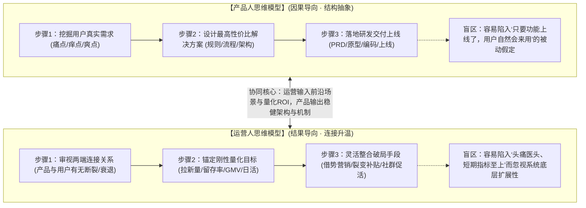
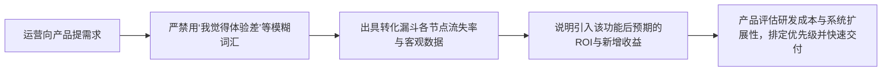
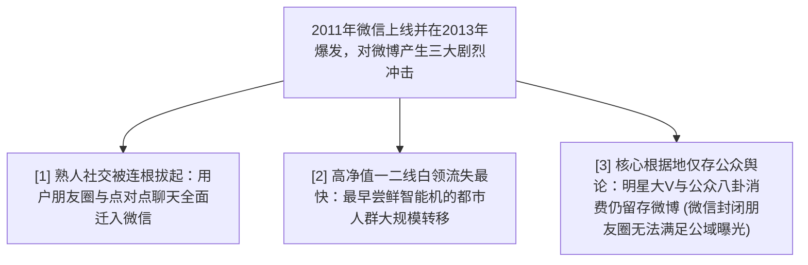
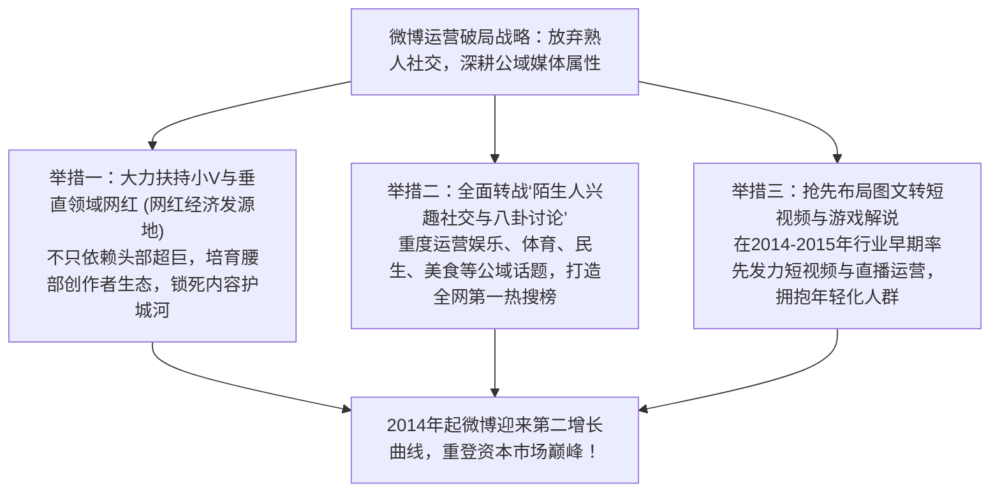
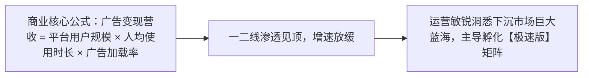

# 7.4 【实操】运营人思维与产品人思维的核心区别

> [!IMPORTANT] 核心提要
> 产品人与运营人是驱动商业飞轮的双翼，二者终极目标完全一致（让产品在市场活得更久、更好，实现用户价值与商业价值的平衡）。然而，**产品人侧重于“从需求到方案”的因果求解与系统搭建，运营人则侧重于“从关系到指标”的强结果导向与灵活破局**。若缺乏换位思考，团队极易陷入“产品嫌运营不懂架构只会提零碎需求，运营嫌产品不懂业务体验奇差”的互怼内耗。唯有理解两种思维模型的底层差异，才能实现“产品筑基，运营破局”的双轮协同。

---

## 1. 运营人思维 vs 产品人思维：底层逻辑解构

### 1.1 产品人思维：三步递进模型
1. **寻找需求**：探寻目标用户在特定场景下未被满足的痛点与渴望；
2. **构想方案**：发散多元化的解决路径，评估技术可行性与投入产出比，挑选兼顾各方利益的最佳产品方案；
3. **闭环交付**：将方案细化为页面流程、信息架构、Axure 原型与 PRD 文档，推动研发编码上线。
* **思维特征**：重逻辑严密性、重功能完整性、重系统架构沉淀。

### 1.2 运营人思维：三步破局模型
1. **审视关系**：心中时刻装着“产品端”与“用户端”，敏锐捕捉二者是否出现脱节、冷淡或流失裂痕；
2. **锁死目标**：**强目标与强结果导向**。不讲空话，直接将问题转化为刚性量化指标（例如：“下季度在下沉市场拉新 50 万高净值线索”、“将次月留存率由 18% 提升至 28%”）；
3. **整合手段**：围绕指标穷尽手段——发优惠券、搞地推小礼品、策划借势营销热点、设计成长积分任务，不择手段促成目标达成。
* **思维特征**：重商业敏感度、重即时反馈、重目标达成率。

---

## 2. 跨职能日常“互怼”根因剖析与破局之道

### 2.1 典型互怼场景复盘
* **运营向产品疯狂开炮**：
  * *“你做的这个新版本体验太差了，操作繁琐得要死，用户根本不买账！我作为‘媒婆’把人拉过来了，结果因为你的破功能全跑光了，这锅我不背！”*
* **产品绝地反击运营**：
  * *“业务数据差你凭什么全赖产品？活动策划得老套无趣、渠道投放不精准，你有完整漏斗数据证明是产品功能引起的吗？张口闭口‘体验差’，纯凭主观感觉瞎喷！”*

### 2.2 跨部门协同避坑心法

1. **运营方：用数据逻辑替代主观情绪**
   * 运营向产品反馈问题或提功能需求（如分享裂变、积分商城）时，必须出示详尽的转化漏斗数据，指明流失节点，并提供明确的量化 ROI 预测模型，切忌用感性抱怨掩盖分析缺陷。
2. **产品方：理解产品生命周期的阶段性运营诉求**
   * 在引入期与成长期，拉新与裂变是决定生死的核心。此时产品经理绝不可死守“架构纯洁性”而一味推脱，必须在底层架构中为运营配置灵活的运营位与活动模板，协同破局。

---

## 3. 商战级经典案例一：新浪微博抵御微信冲击的二次崛起

新浪微博在面对微信毁灭级冲击时所展现的运营战略转型，堪称中国互联网“运营思维重构产品命运”的教科书范本。

### 3.1 微信崛起对微博的降维打击（2011~2013年）

* **数据异动**：2011~2013 年，微博新增用户增速急剧放缓，活跃度出现断崖式下跌，甚至一度被资本市场判定为“将被微信彻底取代”。

### 3.2 微博运营团队的战略自救与三大破局举措
面对灭顶之灾，微博运营团队深刻审视用户与产品关系，做出了极具魄力的**战略定位重塑——从“重社交的社交媒体”彻底转型为“重媒体的公共信息平台”**：

1. **举措一：大力扶持“小V”，培育草根网红生态**
   * 明星虽能带来瞬时高流量，但无法形成日均内容高频互动；微博运营通过算法倾斜与流量扶持，孵化大量垂直领域的草根“小V”（早期网红），构建了多层次、高韧性的内容供给底座。
2. **举措二：战略性放弃熟人社交，主攻“陌生人兴趣圈层”**
   * 熟人社交既已不可逆地输给微信，微博便彻底转向陌生人公共话题广场。通过“热搜榜、超话、兴趣标签”，让用户因共同的八卦、体育赛事、影视剧讨论连接在一起，将“媒体讨论与围观属性”发挥到极致。
3. **举措三：率先启动“图文向短视频与富媒体转型”**
   * 针对流失后沉淀下来的年轻客群（偏三四线及学生），敏锐捕捉到游戏与生活类内容对视频形态的强需求，较早展开短视频运营扶持，拉长用户停留时长。

---

## 4. 商战级经典案例二：抖音/快手/头条推出“极速版”的下沉增长密码

### 4.1 核心主 App 见顶与下沉市场的增量红利
当今日头条、抖音、快手等国民级产品在一二线都市人群中渗透率饱和后，面临严峻的用户增长瓶颈。然而，中国广袤的**三四线城市、县域及乡镇长尾市场（数亿规模下沉人群）**，仍存在巨大的流量盲区。

### 4.2 极速版背后的精细化用户画像与需求洞察
下沉市场用户与一二线白领存在截然不同的生活形态与价值偏好：

| 洞察维度 | 一二线都市白领（主 App 核心受众） | 三四五线下沉市场人群（极速版目标受众） | 极速版定制化产品/运营解决方案 |
| :--- | :--- | :--- | :--- |
| **时间成本** | 生活工作节奏极快（996/007），休闲时间稀缺碎片化 | 生活节奏从容，闲暇时间充裕，具有充沛的娱乐时间 | 极速版主打**轻量化包体（极低内存占用）**与长内容沉浸刷屏。 |
| **金钱敏感度** | 对几毛钱的微小奖励毫无感知，厌恶过度营销打扰 | **对金钱与物质奖励高度敏感**，具有极强的“薅羊毛”动力 | 创新引入**“看视频/看文章赚金币兑现”**网赚机制，形成即时正向激励。 |
| **社交关系链** | 崇尚隐私边界，反感在亲友群转发裂变砍价 | 熟人熟络度极高，宗族与邻里网络紧密，热衷分享赚佣金 | 植入**“邀请好友提成现金”**的高额裂变链路，撬动熟人网络病毒式扩散。 |

### 4.3 商业逻辑与运营思维的完美闭环
* **极速版绝非单纯的 App 瘦身版，其本质是一套包装成产品的“获客与网赚运营机器”**；
* 平台通过补贴几分钱、几毛钱的极低获客成本，换取了下沉用户每日数小时的高粘性停留，进而向广告主售卖高额的信息流广告曝光，实现了健康的商业 ROI 循环。这就是典型的**以运营指标为牵引、反向定制产品形态的商业神作**。

---

## 5. 全景对比与速查表（Cheat Sheet）

| 对比维度 | 产品人思维 | 运营人思维 | 冲突引爆点 | 协同融合解法 |
| :--- | :--- | :--- | :--- | :--- |
| **思考原点** | 用户底层需求、痛点、使用场景 | 产品与用户的连接状态、关系强弱 | 产品骂运营需求碎片化，运营骂产品不贴近市场 | 运营提需求附带详细漏斗数据；产品设计配置化活动后台。 |
| **目标设定** | 功能闭环、逻辑严密、架构高扩展性 | 强指标导向：拉新、留存、活跃、GMV、ROI | 运营只顾拉升短期指标，产品担忧长期架构被毁 | 设立共同北极星指标，平衡短期获客与长期产品健康度。 |
| **迭代节奏** | 周期较长：发版排期、技术评审、测试验证 | 周期极短：快速试错、借势热点、按天调整策略 | 运营嫌产品开发太慢，产品嫌运营朝令夕改 | 产品封装模块化营销工具箱（如统一积分/优惠券组件），运营自主配置活动。 |
| **核心武器** | 业务流程图、交互原型、系统架构、PRD | 裂变裂变、社群维系、情绪价值、内容矩阵、借势彩蛋 | 运营认为界面应花哨促销，产品追求极简克制 | 区分功能主干与运营展位；重大节点开放换肤与趣味彩蛋（如滴滴节日车标）。 |
| **经典战役** | 搭建支撑数亿级并发的消息通讯架构 | **新浪微博转型陌生人媒体** / **抖音极速版网赚破局** | — | **产品筑基，运营破局**：没有坚实架构产品会崩，没有狼性运营商业必死。 |
