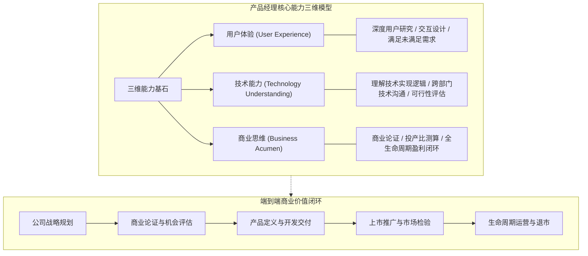
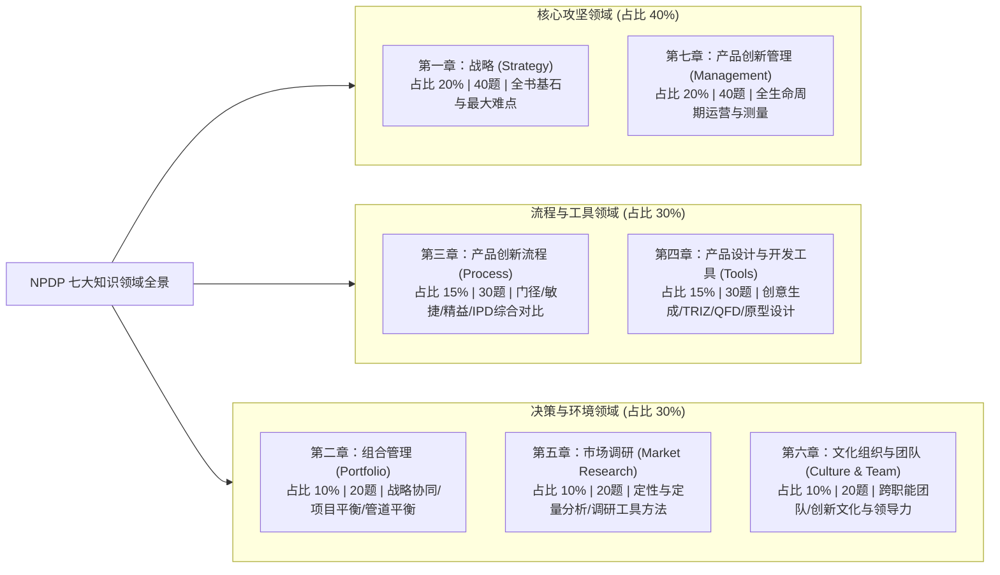

# NPDP精髓班备考导学课（上）：产品经理视野格局与NPDP七大领域全景

## 一、导学引言：产品经理的视野格局与思维蜕变

### 1. 从执行者到“小CEO”：大产品经理的格局定位
在现代企业组织架构中，新产品开发早已脱离了单纯的“研发设计”或“功能实现”范畴，而是演变为决定企业生死存亡的战略级活动：
- **小微企业的原生形态**：在初创或小微企业中，根本没有专职的产品经理岗位，老板本人就是唯一的产品经理。老板必须亲自考量有限资金与有限资源如何分配、挑选哪些项目立项投产、如何从研发推进至销售、如何向广大市场变现。
- **业务扩张下的角色演进**：当企业业务规模扩大、并行项目激增时，高层管理者无法全面兼顾细节，必须设立专职的“代理人”负责端到端价值闭环，这就是 NPDP（New Product Development Professional）所定义的大产品经理。
- **无授权的领导者（小CEO）**：NPDP 培养的是具备商业全局视野的中高层产品管理人才，要求从业者跳出单一职能部门的局限，站位公司高层，承担起“没有法定管理权限，却要调动跨部门资源驱动商业成功”的核心使命。

### 2. 为什么说“NPDP开拓视野，提升格局”？
许多技术出身或基层执行岗位的产品经理在工作多年后往往会遭遇职业瓶颈。NPDP 体系的核心价值在于帮助从业者建立系统的商业逻辑：
- **听懂高层战略语言**：掌握公司战略规划、投资组合权衡、资源管道分配的底层机理，深刻理解公司高层决策背后的商业意图。
- **建立全局端到端链路**：从最初的战略对齐、机会挖掘、创意生成、概念界定，到产品开发、上市推广、生命周期管理直至最终退市，打通从 0 到 1 再到 N 的全链路通路。
- **构建解决复杂问题的系统化框架**：摆脱依赖个人灵光一闪的粗放式管理，掌握业界经过数十年验证的标准化工具与流程模板。

---

## 二、产品经理核心能力三维模型与价值闭环

### 1. 产品经理三维能力模型
NPDP 体系明确指出，优秀的产品经理必须同时具备三大核心维度的综合素养，缺一不可：
1. **用户体验维度（User Experience）**：
   - 产品不仅要能用，更要好用、顺手、令人愉悦。
   - 必须将用户思维与同理心贯彻到底，深刻洞察用户痛点与未满足的需求。除垄断型产品外，忽视用户体验的产品必将被市场抛弃。
2. **技术能力维度（Technology Understanding）**：
   - 产品经理不需要亲自编写每一行代码或绘制电路图，但必须深刻理解技术实现的逻辑与架构边界。
   - 跨部门沟通中最大的障碍是“语言不通”——技术人员使用研发工程语言，商务人员使用商业与销售语言。产品经理必须充当“双向翻译官”，准确评估研发可行性。
3. **商业思维维度（Business Acumen）**：
   - 任何产品创新的终极目的都是为企业带来持续的商业价值。
   - 必须时刻考量：产品的目标客户群体是谁？定价与成本结构如何？投产比（ROI）与回收期是否达标？能否在市场上实现规模化盈利？

### 2. PMP vs NPDP：项目管理与产品管理的本质差异
很多学员在考取 PMP（项目管理专业人士认证）后转战 NPDP，两者的核心差异在于关注的视角与生命周期跨度不同：

| 比较维度 | PMP（项目管理专业人士） | NPDP（产品管理专业人士） |
| :--- | :--- | :--- |
| **核心关注点** | **如何正确地做事情（Do the thing right）** | **做正确的事情（Do the right thing）** |
| **生命周期范围** | 仅覆盖“项目开发与交付阶段”（商业论证后启动至项目验收移交） | 贯穿“产品全生命周期”（从前期的战略构想、创意发掘，直至上市运营与退市管理） |
| **价值实现时点** | 交付物移交即算项目完成，商业收益通常在项目结束后才显现 | 持续对产品从投入到商业变现的全流程盈利与市场表现终身负责 |
| **核心知识重合度** | 强调范围、进度、成本、质量、风险与采购等九/十大知识领域 | 侧重战略框架、组合权衡、创新流程、工具方法与市场调研，**与PMP重叠度仅约5%~7%** |
| **知识广度与深度** | 流程标准成熟，偏向工程与交付执行规范 | 知识面极宽，涵盖战略学、市场学、设计学、组织行为学等多学科交叉，**知识理解门槛更高** |

---

## 三、NPDP 认证体系、考情演进与备考基础

### 1. 认证背景与组织架构
- **发起机构**：由美国产品开发与管理协会（PDMA，Product Development and Management Association）发起设立，是全球公认的新产品开发与产品管理领域唯一的国际资格认证体系。
- **中国大陆运营机构**：由中国国际人才交流基金会统一组织考务与引进推广。
- **考试频率与时间**：每年举办两次（通常为上半年 5 月、下半年 11 月/12 月周六举行）。

### 2. 考试规则与合格标准
- **题量与题型**：正式考试共 **200 道单项选择题**，题干与选项采用**中英文双语对照**呈现。
- **考试时长**：**3.5 小时（210 分钟）**，时间分配较为充裕，但因题量较大，需保持专注。
- **及格分数线**：要求答对 **75% 及以上**，即 **满分 200 分中至少取得 150 分** 方可通过认证。
- **证书管理**：证书有效期为三年，期满需通过积累 PDH（专业发展学时）进行续证。

### 3. 考情发展趋势与教材升级
- **出题风格演化**：早期考试（2018年前后）题目多为概念直接考查，且题目按第一章至第七章顺序编排；当前考试已全面演变为**全卷乱序出题**，并引入了大量**复杂商业情境题、多知识点交叉综合应用题**。
- **试题语言特征**：虽然及格分数线（75%）高于 PMP（约60%），但 NPDP 题干表述相对更加务实、直截了当，考查的是对知识体系的本质理解，而非语言陷阱。
- **教材改版沿革**：教材已升级至第三版《产品开发与管理知识体系》，整体架构保持对经典体系的传承，并在敏捷流程、数字化转型及可持续发展等方面进行了补充与精进。

### 4. 报考资格与学时门槛
- **学历与工作经验要求**：
  - 本科学历及以上：需具备至少 **2 年** 的产品开发与管理相关工作经验；
  - 大专学历及以下：需具备至少 **5 年** 的产品开发与管理相关工作经验。
- **学时证明要求**：必须在官方授权的培训机构（R.E.P.，如希赛网）完成至少 **40 个学时** 的新产品开发专业培训，方可获得报名资格。

---

## 四、NPDP 知识体系七大领域全景剖析

NPDP 知识体系全书划分为七大知识领域，各领域的考核分值与重难点分布如下：

### 1. 第一章：战略（Strategy）—— 占比 20%（40 题）
- **核心定位**：全书的顶层设计与思想灵魂，同时也是**全书理论最深、考查最灵活、错题率最高的章节之一**。
- **核心考点群**：
  - **战略层次与愿景使命**：从公司经营战略到业务战略、职能战略的层层分解与协同；
  - **四大主流创新战略框架**：迈克尔·波特竞争战略框架（成本领先、差异化、细分市场）、迈尔斯-斯诺战略框架（探索者、分析者、防御者、回应者）、克里斯坦森破坏性创新框架（持续式创新 vs 颠覆式创新）、皮萨诺创新画布（常规、突破、颠覆、架构式创新）；
  - **支撑职能战略**：平台战略（共用架构）、技术战略（技术预测与技术S曲线）、知识产权战略（四种管理演进类型）、营销战略与营销4P、数字化战略、可持续性战略；
  - **业务与产品组合分析工具**：波士顿矩阵（BCG Growth-Share Matrix，明星、现金牛、问题/野猫、瘦狗产品的策略转化）。

### 2. 第二章：组合管理（Portfolio Management）—— 占比 10%（20 题）
- **核心定位**：解决“有限资源下做正确的事”，是高层管理者的核心决策工具。
- **核心考点群**：
  - **组合管理的定义与两大活动**：组合选择/开发（确定做什么新项目）与组合审查/维护（动态剔除落后项目与资源再分配）；
  - **组合管理的五大目标**：核心目标（价值最大化）+ 四大分目标（战略协同、项目平衡、管道平衡、财务稳健）；
  - **创新漏斗模型（Innovation Funnel）**：漏斗全周期的动态筛选机制；
  - **四大项目类型划分**：突破型（大相径庭）、平台型（共用架构）、衍生型（填补产品线）、支持型（渐进改进与维护）。

### 3. 第三章：产品创新流程（Product Innovation Process）—— 占比 15%（30 题）
- **核心定位**：新产品开发落地的作业指导书与阶段推进规范。
- **核心考点群**：
  - **模糊前端（Fuzzy Front End, FFE）**：定义、活动构成，以及“为何概念是模糊的”本质辨析；
  - **产品创新章程（PIC）**：战略指导文件，回答 Who/What/Where/When/Why，严禁包含 How（具体执行细节）；四大核心要素（背景、重点舞台/聚焦领域、目标与目的、特别准则）；
  - **门径管理流程（Stage-Gate）**：六阶段五关口规范演进，各阶段法定产出与上市规划法定节点；
  - **主流开发流程对比**：经典瀑布流程（顺序依赖与维护阶段本质）、敏捷开发 Scrum 框架（三大角色、四大仪式、时间盒迭代）、精益产品开发（核心思想为消除浪费与客户价值为先）、集成产品开发（IPD，跨部门集成与高效开发）；
  - **治理（Governance）与管理（Management）**：高层治理监督框架与日常经营管理的界限。

### 4. 第四章：产品设计与开发工具（Product Design & Development Tools）—— 占比 15%（30 题）
- **核心定位**：赋能创意挖掘、工程设计与制造落地的实战工具箱。
- **核心考点群**：
  - **创意生成套路与工具**：头脑风暴法、SCAMPER奔驰法、六顶思考帽、思维导图；
  - **设计与研发工具**：质量功能展开（QFD / 质量屋）、TRIZ（发明问题解决理论）、健壮设计（田口方法）、为X设计（DFX，如面向制造DFM、面向装配DFA、面向环保DFE）；
  - **工程与验证工具**：原型设计（低保真与高保真原型）、计算机辅助设计与工程（CAD/CAE/CAM）、快速成型与逆向工程。

### 5. 第五章：市场调研（Market Research）—— 占比 10%（20 题）
- **核心定位**：倾听市场与用户声音，降低市场不确定性的决策雷达。
- **核心考点群**：
  - **调研分类体系**：初级调研（一手数据） vs 次级调研（二手数据）；定性调研（挖掘深层动机与洞察） vs 定量调研（统计验证与规模推断）；
  - **经典调研方法**：焦点小组访谈（Focus Group）、用户深度访谈、人种学调研（现场情境观察法）；
  - **高级分析工具**：联合分析（Conjoint Analysis，模拟多属性权衡偏好）、感官检验、社交媒体倾听与大数据分析。

### 6. 第六章：文化、组织与团队（Culture, Organization & Teams）—— 占比 10%（20 题）
- **核心定位**：保障产品创新顺利落地的组织土壤与人才组织形式。
- **核心考点群**：
  - **创新文化营造**：容忍失败的试错机制、高管支持、跨部门协作氛围、创新奖励机制；
  - **团队组织架构**：职能型、轻量级矩阵、重量级矩阵、全职自主型团队的权衡；
  - **跨职能团队建设**：塔克曼团队发展阶段（形成期、震荡期、规范期、发挥期、解散期）及领导风格匹配。

### 7. 第七章：产品创新管理 / 产品生命周期管理（Product Innovation Management）—— 占比 20%（40 题）
- **核心定位**：产品上市后的运营监控、绩效评估与生命周期战略，与第一章并列为**分值最高、综合性最强的重难点**。
- **核心考点群**：
  - **产品全生命周期（PLC）四大阶段策略**：引入期（建立认知、开拓渠道）、成长期（规模扩张、差异化竞争）、成熟期（捍卫份额、延长生命、降本增效）、衰退期（收割、撤退或重构）；
  - **跨越鸿沟模型（Crossing the Chasm）**：早期尝鲜者与早期大众之间的鸿沟跨越策略；
  - **产品上市与商业化**：全面上市计划（Launch Plan）、渠道铺设与市场推广节奏；
  - **创新测量与指标体系**：投入指标、过程指标、产出指标（如新产品活力指数 New Product Vitality Index）。

---

## 五、全景备战核心速查表（Cheat Sheet）

| 章节与模块 | 考试占比与题量 | 考点复杂度 | 典型核心关键词与题眼 | 备战通关策略 |
| :--- | :--- | :--- | :--- | :--- |
| **第1章 战略 (Strategy)** | **20%（40题）** | 极高（全书核心基石） | 波特宽窄市场与创新成本、迈尔斯-斯诺风险偏好、克里斯坦森边缘切入颠覆、IP管理四演进、BCG矩阵 | 深刻理解战略哲学底层逻辑，重点击破多战略交叉情境题，不做死记硬背 |
| **第2章 组合管理 (Portfolio)** | **10%（20题）** | 中高（逻辑严密） | 漏斗全貌整体性、价值最大化与四大分目标、Cooper产品优越性首要因素、四大项目类型辨析 | 抓准“有限资源权衡取舍”本质，厘清突破/平台/衍生/支持四类项目题眼特征 |
| **第3章 产品创新流程 (Process)** | **15%（30题）** | 高（标准模型多） | 模糊前端概念模糊、PIC战略文件无How、门径开发阶段定成本/定价、瀑布维护找缺点、Scrum三角色、精益消除浪费 | 对比记忆门径、瀑布、敏捷、精益与IPD的核心差异，掌握各流程适用行业与场景 |
| **第4章 设计开发工具 (Tools)** | **15%（30题）** | 中等（偏重工具应用） | 奔驰法SCAMPER、TRIZ技术矛盾、质量屋QFD转化需求、DFX面向制造、低/高保真原型 | 掌握每个设计工具的典型应用场景与输入输出，不深究复杂计算，重在工具选型 |
| **第5章 市场调研 (Research)** | **10%（20题）** | 中等（概念清晰） | 初级/次级数据、定性探究动机、定量统计验证、人种学现场观察、联合分析属性权衡 | 区分不同调研方法的优缺点、成本及适用阶段，识别题目中定性与定量的适用情境 |
| **第6章 文化组织团队 (Team)** | **10%（20题）** | 较低（与PMP少部分重合） | 创新容错文化、重量级/轻量级跨职能团队、塔克曼团队五阶段、仆人式领导 | 结合项目团队管理常识，侧重理解组织结构对创新自主权与跨部门沟通的影响 |
| **第7章 创新管理 (Management)**| **20%（40题）** | 极高（综合实战性强） | PLC生命周期四阶段策略、跨越鸿沟保龄球道、上市营销组合落地、活力指数测量 | 串联全书知识点，站在产品总监高度理解上市后运营、退市决策与全生命周期效益 |
