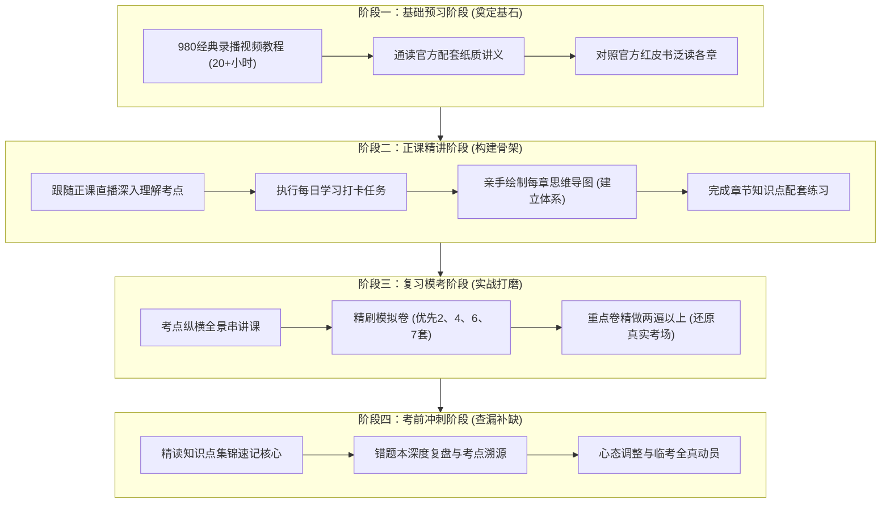
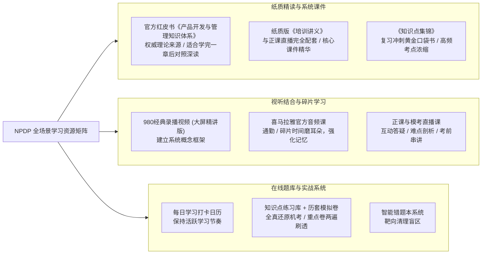

# NPDP精髓班备考导学课（下）：课程学习路径与应试通关方法

## 一、备战通关总纲：四阶段递进式学习路径规划

备战 NPDP 不应是一场仓促的考前突击，而是一个从宏观骨架构建到微观知识精雕的系统工程。整个备考周期科学划分为四个递进阶段：

### 1. 阶段一：基础预习阶段（建立初始概念）
- **核心资料**：980 经典录播视频教程（大屏精讲版）+ 纸质版《培训讲义》（直播课件）。
- **任务目标**：利用开学典礼至正课开启前的窗口期，完整通看录播视频。该阶段无需强行死记硬背细微概念，重在建立产品管理的基础语境与感性认知。
- **正向激励**：在正课正式开讲前完成前三章录播学习，即可找助教老师兑换首发学习激励礼品。

### 2. 阶段二：正课直播精讲阶段（深入理解与体系建立）
- **核心资料**：正课直播课 + 希赛网“任务日历”每日学习任务。
- **任务目标**：
  - 准时参与直播课堂，积极与主讲老师互动答疑；
  - 严格按照每日计划完成单天学习打卡，防止拖延积压；
  - **核心动作**：每学完一个章节，必须**亲手绘制该章节的知识体系思维导图**（手绘或脑图工具均可），交付助教老师批改换取专业学分奖励；
  - 同步完成学习中心题库的“章节知识点练习”。

### 3. 阶段三：复习串讲与模考实战阶段（横向拉通与实战检验）
- **核心资料**：全景串讲课 + 模考大赛试卷 + 精选模拟卷。
- **任务目标**：
  - 参加全景串讲课，将孤立的章节考点在横向（跨流程）与纵向（战略到执行）进行拉通；
  - 正式开启模拟考试：模拟卷出题顺序全卷打乱，真正还原正式考试的实战压力；
  - 严抓“重点卷”：重点卷必须**精做 2 遍以上**，严格按照 3.5 小时做完 200 题的标准控制做题节奏。

### 4. 阶段四：考前冲刺阶段（错题歼灭与精准拿分）
- **核心资料**：《知识点集锦》速查手册 + 个人题库“错题本”。
- **任务目标**：
  - 停止盲目无序刷题，集中精力清空错题本；
  - 针对反复做错的题目进行“结构化复盘”，精准定位其属于全书哪一章、哪一小节的哪一个知识点，彻底扫清认知盲区。

---

## 二、应试通关核心方法论与刷题高分秘籍

### 1. “自己做的是笔记，别人做的是书”
这是高分通关学员的核心学习心法：
- **拒绝拿来主义**：很多学员习惯于直接向别人索取现成的思维导图或精炼笔记。但别人的笔记逻辑基于他个人的认知体系，对你而言等同于另一本未消化的“书”。
- **亲自动手输出**：在阅读教材和听课过程中，唯有亲手提取知识脉络、梳理逻辑层级所绘制出的思维导图，才真正刻入了自己的大脑神经回路，能有效解决教材叙述分散、孤立知识点易混淆的痛点。

### 2. 知识框架优先：先有体系，再攻细节
- **树立框架意识**：NPDP 知识体系涵盖战略学、市场营销、组织行为学等多个学科。如果直接死磕单个知识点（例如各种战略框架细节），极易产生“这些内容到底有何关联”的迷茫。
- **先纲后目**：始终站在公司高层的全局视角看问题。遇到具体考题时，第一反应是调动大脑中的知识树定位：“这道题考的是组织层面的竞争战略？还是业务层面的组合平衡？亦或是操作层面的门径管理？”体系明确后，干扰选项自然无所遁形。

### 3. 刷题方法与复盘闭环规范
题库是检验掌握程度的试金石，但盲目题海战术不可取。必须建立“做题-定位-辨析-清错”的复盘闭环：
- **必做重点卷**：平台的“重点卷”凝聚了多年高频真题考点，必须作为全真模拟试卷，做完后深入分析每一题的解析，达到做两遍以上直至完全透彻的程度。
- **模拟卷推荐做题顺序**：推荐按照 **模拟卷 2、4、6、7** 优先攻坚，其次完成 **模拟卷 1、3、5**。
- **错题结构化三步分析法**：
  1. **定位考点**：本题考查的是第几章的哪个具体理论或工具？
  2. **提炼题眼**：题干中的核心关键词是什么？题干在解决什么业务问题？问句的主体是宏观公司还是微观产品？
  3. **干扰辨析**：我为何误选？是被题干冗余信息误导，还是对相似概念（如颠覆式创新 vs 持续式创新）存在认知模糊？

### 4. 树立“空杯心态”与主动探究精神
- **放下经验偏见**：部分拥有丰富工作经验的老产品人做题正确率反而不高，往往是因为将自己原公司的个性化操作习惯误当成了国际标准理论。做题必须以 PDMA 官方知识体系为准绳。
- **积极沟通提问**：若对试题解析存在疑问，不要陷入自我纠结，充分利用平台的题目讨论与助教答疑渠道。通过精准提问暴露理解障碍，由教研老师协助快速捋清底层逻辑。

### 5. 备考量化指标参考（海外机考高分范式）
- **做题总量基准**：建议在考前累计完成题库题目 **2000 道以上**；
- **及格线与目标设定**：“取乎其上，得乎其中”。虽然官方及格标准为 75%（150分/200题），但平时的模考练习正确率目标必须设定在 **85% 以上**；
- **实战榜样经验**：海外机考学员凭借本套体系考取了 179 分、183 分乃至 187 分（只错 13 题，正确率超过 93%）的卓越成绩，证明了“精讲打底 + 导图梳理 + 错题闭环”路径的高效性与可靠性。

---

## 三、教学资源矩阵与多场景学习法

为了满足在职学员多元化、碎片化的学习需求，备考体系提供了完整的资源矩阵：

### 1. 纸质权威图书的使用时机指南
- **官方教材（红皮书《产品开发与管理知识体系》）**：
  - 原书语言高度概括、翻译相对抽象。**严禁零基础初学者一上来直接通读红皮书**，否则极易产生枯燥劝退感；
  - **最佳食用方式**：先看对应的视频讲义或听完一章直播精讲，在大脑中搭好骨架后，再翻阅红皮书对应章节的原文字句。此时会发现字里行间豁然开朗，能有效命中正式考试的原版用词。
- **培训讲义（课件）**：直播与录播听课的核心伴读手册，用于记录课堂补充的生动案例与考查陷阱。
- **知识点集锦**：进入冲刺阶段后的核心速记工具，集中涵盖全书 80% 的高频考查点。

### 2. 视听结合的碎片化学习策略
- **在职人员的时间管理法则**：利用早晚通勤、运动或家务时间，打开喜马拉雅搜索收听 NPDP 官方配套音频，反复磨耳朵，保持大脑在非整块时间对产品知识术语的持续敏感。
- **周末整块时间**：用于高质量完成整套模拟卷的封闭式答题与错题纠偏。

### 3. 精髓班 vs 清髓班与后续产品实战进阶
- **认证通关只是起点**：NPDP 考试以考取国际认证为底线目标，而精髓班的核心价值更在于考后的**实战能力进阶**；
- **六大实战落地进阶模块（精髓班专属）**：
  1. 商业需求深度挖掘与敏捷需求管理；
  2. 产品端到端运营与增长黑客实操；
  3. 行业竞品分析与逆向工程拆解；
  4. AI 时代大模型驱动下的 AI 产品经理实操与工作流重塑；
  5. 商业商业模式设计与商业论证画布实战；
  6. 中高级产品经理求职晋升、简历包装与高薪面试技巧。

### 4. “三师”全天候协同教学服务体系
- **主讲老师（罗福星老师）**：把控全局教学方向，讲授导学、核心重难点及商业前沿实操；
- **正课与实战主讲（孟玉 / 佟山玉老师）**：系统拆解全书考点，以清晰严密的逻辑挑大梁讲授全章节知识；
- **教研与答疑助教（徐鸿泉 / 步惊云老师）**：全天候社群答疑、思维导图作业专业批改、模考大赛深入解析与精准服务支持。

---

## 四、常见学员备考痛点答疑（FAQ）

### Q1：平时工作极度繁忙，可以完全不看官方红皮书吗？
> **解答**：完全不看红皮书，仅通过认真听课、精刷讲义和完整做完题库，达到 75% 的及格线通过考试是完全可行的。但**精读红皮书绝对能够带来可观的加分效应**！尤其对于追求 85% 以上高分、希望深刻吃透专业底层逻辑的同学，建议在听完每章课程后花 1~2 小时阅读红皮书原文。时间如同海绵里的水，离考试越早起步，复习越从容。

### Q2：书本理论知识非常多，感觉逻辑分散、看完就忘怎么办？
> **解答**：这是缺乏知识结构树的典型症状。单纯“被动听课”在大脑中的留存率只有 20% 左右。必须通过“主动输出”打破遗忘曲线——**亲手绘制思维导图**！不要嫌麻烦，拿起笔或打开思维导图软件，把每章的一级目录、二级知识点、对应工具与战略逐级画出来。亲手画完一张图，整个章节的逻辑链条便彻底贯通。

### Q3：如果同时备战 PMP 和 NPDP（或者连考），时间会冲突吗？
> **解答**：两者同属管理类认证，但知识重合度仅 5%~7%。如果两个考试时间相隔较近（如 3 月考 PMP，5 月考 NPDP），必须实行**错峰突击策略**：
> - 在备战 PMP 的主周期（考前 1~1.5 个月），将 80% 精力投向 PMP，但 NPDP 绝不能完全停滞，需保持每天听半小时音频或刷一组知识点练习以维持“题感”；
> - PMP 考完后立即将重心全面切换至 NPDP，利用 NPDP 较为友好的题干风格，集中火力攻坚全书重点卷与模拟题。

### Q4：在做竞品分析时，拿到物料清单（BOM表）如何倒推外部成本？
> **解答**：竞品成本倒推属于实战中的逆向工程（Reverse Engineering）范畴。单靠公司内部的物料成本进行绝对对比往往存在偏差（因规模效应、采购溢价及自研元器件差异）。标准做法是：
> 1. 将竞品拆解为核心元器件、外围硬件、加工组装与测试包装四大模块；
> 2. 结合行业通用的供应链报价数据库及关键原材料市场公开价格进行基准测算；
> 3. 更重要的是通过竞品分析理解其**功能取舍背后的商业意图**（该功能究竟是创造核心价值，还是徒增成本的冗余功能），以此指导自研产品的正向开发。

---

## 五、通关备考执行清单与核心法则速查表（Cheat Sheet）

| 备考模块 | 推荐时间投入 | 核心交付成果 | 关键通过标准与避坑指南 |
| :--- | :--- | :--- | :--- |
| **基础预习** | 20~25 小时 | 完成 980 视频前三章录播 | 建立整体产品管理语境，不深究生僻细节，了解整体轮廓 |
| **正课精讲** | 30~35 小时 | 参与直播并完成每日打卡 | **必须亲手完成 7 份章节思维导图**；绝不积压每日任务 |
| **章节练习** | 15~20 小时 | 题库知识点练习刷完 1 遍以上 | 关注错误考点的本质，不在单一概念上钻牛角尖 |
| **模考实战** | 20~25 小时 | **重点卷刷 2 遍以上**；完成模拟卷 2、4、6、7 | 严格按照 3.5 小时限时 200 题；模考成绩稳定在 80% 以上 |
| **错题歼灭** | 10~15 小时 | 个人错题本全面清零 | 严格执行考点溯源三步法，精准归因至教材具体理论 |
| **碎片磨耳** | 每日 20~30 分钟 | 喜马拉雅官方音频反复循环 | 利用通勤洗漱碎片时间激活记忆，对抗遗忘曲线 |
| **考前心态** | 考前 3 天 | 打印准考证，回归《知识点集锦》 | 保持空杯与自信心，坚信系统训练成果，从容应考 |
